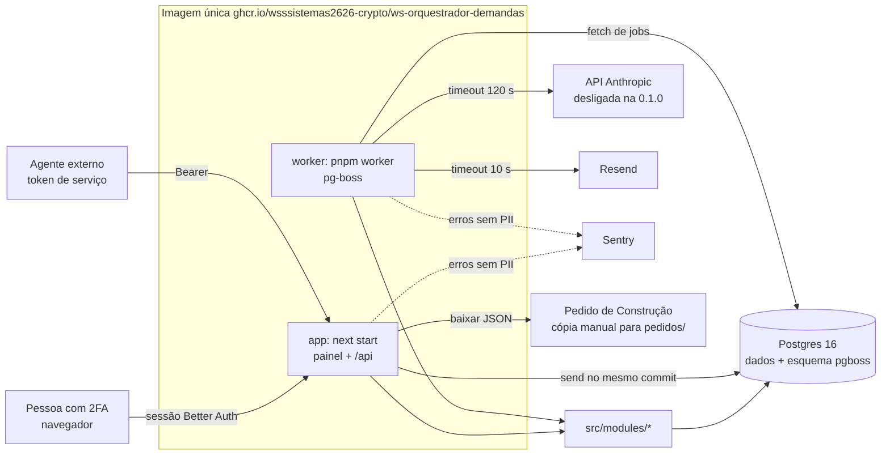

## Entrega

Arquitetura do WS Orquestrador de Demandas, versão 0.1.0. Base: requisitos de `01-analista-requisitos.md` (RF-01 a
RF-26, RNF-01 a RNF-18), `padrao-tecnico.md` e o pedido. O repositório hoje só tem `.gitignore` e `docs/construcao/`:
não há código anterior a respeitar.

### 1. Visão da solução

Um monólito modular em Next.js 16 com **dois processos da mesma imagem**: `app` (painel e API) e `worker` (jobs do
pg-boss: agentes de IA, aviso por e-mail, expurgo). Os dois usam o mesmo Postgres 16, que guarda também a fila do
pg-boss. Toda a regra de negócio fica em `src/modules/<domínio>`. Rota da API, Server Action do painel e job do worker
são adaptadores finos sobre as mesmas funções de módulo, com os mesmos schemas Zod e a mesma política de acesso.

Fluxo principal (todos os passos gravam evento no histórico):

1. Entrada: pessoa cola o texto (RF-05) ou chama `POST /api/demandas`. Com o agente orquestrador desligado, a pessoa
   preenche os campos. Ligado, a mesma transação grava a entrada bruta e enfileira o job do orquestrador.
2. Demanda criada → job `insumo_tecnico` (se ligado) → ESP rascunho de agente. Desligado: a pessoa grava a ESP.
3. ESP sem dúvida → job `risco` → RSK. ESP com dúvida → `aguardando_informacao`, sem job.
4. RSK gravado com ESP existente → job `consolidacao` → DEC `pendente` → demanda `pronta_para_decisao` → job de aviso
   por e-mail.
5. Pessoa decide no painel (`PATCH /api/pacotes-decisao/:decId/decisao`). DEC aprovado → pessoa baixa o Pedido de
   Construção e o copia à mão para `pedidos/` da estruturaAutonoma.

### 2. Componentes e responsabilidades

| Componente | Caminho | Responsabilidade | Dono na construção | Como se observa | Plano de falha |
|---|---|---|---|---|---|
| Painel | `src/app/(painel)/` | Telas pt-BR (Server Components que leem os módulos; Server Actions que chamam os módulos) | engenheiro-frontend | e2e + axe; log pino da ação | Erro de módulo vira mensagem pt-BR sem detalhe |
| API | `src/app/api/` | Route handlers: autenticação do ator, Zod, chamada ao módulo, mapeamento de erro para HTTP | engenheiro-backend | log pino por requisição (método, rota, status, ms, ator) | `ErroDominio` → 400/403/404/409/422; resto → 500 genérico + Sentry |
| Autenticação e acesso | `src/modules/acesso/` | Better Auth (senha + TOTP, papel `cto`/`administradora`), tokens de serviço, `resolverAtor`, matriz de acesso | engenheiro-backend | evento de login falho no log (sem senha); teste da matriz | Sem sessão/token → 401; fora da matriz → 403 |
| Demandas | `src/modules/demandas/` | Criar, ler, filtrar, alterar; gerador de id; máquina de status; entrada bruta | engenheiro-backend | histórico | Sequência esgotada → erro claro (RNF-09) |
| Especificações | `src/modules/especificacoes/` | ESP versionada, regras de construção (RF-08), gatilho de dúvida (RF-15) | engenheiro-backend | histórico | Conflito de versão impossível por trava (ver 3.3) |
| Pareceres de risco | `src/modules/pareceres-risco/` | RSK versionado | engenheiro-backend | histórico | idem |
| Pacotes de decisão | `src/modules/pacotes-decisao/` | DEC versionado, `desatualizado`, decisão, dupla aprovação | engenheiro-backend | histórico | Corrida aprovação × ESP nova resolvida por trava |
| Histórico | `src/modules/historico/` | Gravar e ler eventos (só inclusão) | engenheiro-backend | — | Falha ao gravar evento desfaz a transação inteira |
| Agentes de IA | `src/modules/agentes/` e `src/agents/` | Interruptores, teto, preço por modelo, execução idempotente, minimização, provedor de IA, prompts | engenheiro-backend | tabela `uso_ia`, `execucao_agente`, painel de configuração | Ver seção 5 |
| Pedido de Construção | `src/modules/pedido-construcao/` | Montar, serializar de forma determinística e validar com o `validarPedido` copiado | engenheiro-backend | evento de geração | Falha de validação → 422 com a lista |
| Avisos | `src/modules/avisos/` | E-mail de DEC pronto, uma vez por DEC | engenheiro-backend | tabela `aviso_email` | Ver seção 5 |
| Retenção | `src/modules/retencao/` | Expurgo do texto bruto | engenheiro-backend | evento de expurgo; `entrada_bruta.expurgada_em` | Job diário idempotente; falha repete no dia seguinte e vai ao Sentry |
| Worker | `src/worker/index.ts` e `src/jobs/` | Sobe o pg-boss sem criar esquema, registra filas e agendamentos, grava batimento | engenheiro-backend | `worker_batimento` exibido no painel de configuração | Processo cai → Easypanel reinicia; jobs ficam na fila |
| Banco | `src/db/`, `drizzle/`, `scripts/migrate.ts` | Esquema Drizzle, cliente do papel da aplicação, migrations e privilégios pelo migrator | engenheiro-dados-bd | teste de guarda de privilégios (ADR-03) | Migration só pelo migrator; nunca no boot |
| Utilidades | `src/lib/` | `relogio` injetável, fuso America/Sao_Paulo, `log` (pino com redação), `erros`, adaptador HTTP | engenheiro-backend | — | — |
| Scripts | `scripts/` | `migrate.ts`, `criar-usuario.ts`, `criar-token-servico.ts`, `revogar-token-servico.ts`, `definir-preco-modelo.ts` | engenheiro-backend | saída no terminal, sem segredo além do token exibido uma vez | — |

### 3. Rastreabilidade RF → componente

| RF | Componente responsável | Peça principal |
|---|---|---|
| RF-01 | Autenticação e acesso | `acesso/auth.ts` (Better Auth + `twoFactor`), `acesso/exigir-pessoa.ts`; páginas `/entrar` e `/configurar-2fa` |
| RF-02 | Autenticação e acesso | `acesso/tokens-servico.ts`, `acesso/matriz.ts` (tabela da seção 6) |
| RF-03 | Demandas + API + Painel | `demandas/schemas.ts` (`criarDemandaSchema`), `demandas/servico.ts` |
| RF-04 | Demandas | `demandas/gerar-id.ts` (sequência `demanda_seq`, relógio injetado); `versoes.ts` comum (3.3) |
| RF-05 | Demandas + Agentes + Painel | `demandas/entrada.ts`, tabela `entrada_bruta`, job `agente.orquestrador` |
| RF-06 | Demandas + API | `demandas/consultas.ts` |
| RF-07 | Demandas | `demandas/transicoes.ts` (função pura com a tabela do RF-07) |
| RF-08 | Especificações | `especificacoes/schemas.ts`, `especificacoes/servico.ts` |
| RF-09 | Pareceres de risco | `pareceres-risco/schemas.ts`, `pareceres-risco/servico.ts` |
| RF-10 | Pacotes de decisão | `pacotes-decisao/criar.ts` |
| RF-11 | Banco + módulos de versão | privilégios só `SELECT, INSERT` (ADR-03); rotas sem `PATCH/PUT/DELETE` (Next responde 405) |
| RF-12 | Pacotes de decisão | `pacotes-decisao/desatualizado.ts` (calculado na leitura e conferido sob trava na decisão) |
| RF-13 | Pacotes de decisão | `pacotes-decisao/decidir.ts`, tabelas `aprovacao` e `decisao` |
| RF-14 | Pacotes de decisão | `pacotes-decisao/decidir.ts` (regra de dupla aprovação) |
| RF-15 | Especificações + Agentes + Demandas | gatilho no `especificacoes/servico.ts` e no job do orquestrador; sem nenhum canal de saída |
| RF-16 | Agentes de IA + Worker | `agentes/executar.ts`, `src/jobs/agente-*.ts`, `src/agents/*.ts` |
| RF-17 | Agentes de IA | `agentes/uso.ts`, tabela `uso_ia`, `preco_modelo` |
| RF-18 | Agentes de IA | `agentes/teto.ts` |
| RF-19 | Agentes de IA + Painel | `agentes/configuracao.ts`, tela `/configuracao` |
| RF-20 | Agentes de IA | `agentes/minimizar.ts` e montadores de entrada por agente (lista de permissão de campos) |
| RF-21 | Histórico | `historico/registrar.ts`, tabela `evento` |
| RF-22 | Pedido de Construção | `pedido-construcao/montar.ts`, `serializar.ts`, `src/vendor/construir/pedido.mjs` (ADR-05) |
| RF-23 | Pacotes de decisão + API | `pacotes-decisao/consultas.ts` |
| RF-24 | Retenção + Worker | `retencao/expurgar.ts`, agendamento `retencao.expurgo` |
| RF-25 | Avisos + Worker | `avisos/aviso-dec.ts`, fila `aviso.dec-pronto` |
| RF-26 | Painel | `src/app/(painel)/**` (rotas na seção 7) |

### 4. Modelo de dados preliminar

Convenções: nomes em `snake_case` no banco e `camelCase` no TypeScript (Drizzle `casing: 'snake_case'`); datas em
`timestamptz` (UTC), convertidas para America/Sao_Paulo só na borda; enumerações como `text` com `CHECK` (gerado pelo
Drizzle) para evitar `ALTER TYPE` em migration futura; listas em `jsonb` validadas pelo mesmo schema Zod da API. O
modelo físico, índices e migrations ficam com `engenheiro-dados-bd`.

| Entidade (tabela) | Mutável? | Campos principais | Relações |
|---|---|---|---|
| Better Auth (`user`, `session`, `account`, `verification`, `two_factor`) | sim | esquema do Better Auth + `papel` (`cto` \| `administradora`) em `user` | — |
| `token_servico` | só `revogado_em` | `id`, `agente`, `hash` (SHA-256, único), `prefixo` (8 caracteres para identificar), `criado_em`, `revogado_em` | — |
| `demanda` | sim | campos da seção 3.1 da spec original + `status` (9 valores do RF-07), `autor_tipo`, `autor_id`, `rascunho_agente`, `atualizada_em` | 1:0..1 `entrada_bruta`; 1:N ESP, RSK, DEC, evento |
| `entrada_bruta` | só expurgo | `demanda_id` (PK/FK), `texto` (nulo após expurgo), `origem` jsonb (canal, referência; nulo após expurgo), `recebida_em`, `expurgada_em` | N:1 demanda |
| `especificacao_tecnica` | **não** | `id` (`ESP-<dem>-vN`), `demanda_id`, `versao` (único com `demanda_id`), campos da seção 3.2 com `escopo_inclui`, `escopo_exclui`, `duvidas_em_aberto` em jsonb, `sistema_alvo`, `repositorio_destino`, `criterios_aceite_preliminares` jsonb, `definicao_de_pronto` jsonb, `autor_tipo`, `autor_id`, `rascunho_agente`, `execucao_agente_id`, `criada_em` | N:1 demanda |
| `parecer_risco` | **não** | `id` (`RSK-<dem>-vN`), `demanda_id`, `versao`, campos da seção 3.3 com `pre_condicoes` e `recomendacoes_mitigacao` em jsonb, `envolver_juridico_ou_administradora_quando`, autor, `rascunho_agente`, `criada_em` | N:1 demanda |
| `pacote_decisao` | **não** | `id` (`DEC-<dem>-vN`), `demanda_id`, `versao`, `especificacao_id` + `especificacao_versao`, `parecer_risco_id` + `parecer_risco_versao`, cópia `demanda_tipo`, `demanda_titulo`, `demanda_descricao`, campos de opção A e B, `recomendacao_agente_consolidacao`, `nivel_aprovacao_requerido`, autor, `rascunho_agente`, `criada_em` | N:1 demanda, N:1 ESP, N:1 RSK |
| `aprovacao` | **não** | `id`, `pacote_decisao_id`, `usuario_id`, `nome` e `papel` (cópia no momento), `opcao` (A/B), `comentario`, `referencia_documento`, `data_documento`, `revisou_rascunhos`, `registrada_em`; único (`pacote_decisao_id`, `papel`) | N:1 DEC |
| `decisao` | **não** | `pacote_decisao_id` (único), `status_decisao` (`aprovada` \| `devolvida` \| `arquivada`), `opcao_escolhida`, `comentarios`, `decidida_por`, `decidida_em` (= `dataAprovacao` quando aprovada) | 1:1 DEC |
| `evento` | **não** | `id` bigserial, `ocorrido_em`, `ator_tipo` (`pessoa` \| `agente` \| `sistema`), `ator_id`, `demanda_id` (nulo para evento de configuração), `entidade`, `entidade_id`, `acao`, `antes` jsonb, `depois` jsonb | N:1 demanda (opcional) |
| `configuracao_agente` | sim | `agente` (PK, 4 linhas semeadas com `ligado = false`), `ligado`, `modelo`, `atualizado_em`, `atualizado_por` | — |
| `configuracao_ia` | sim (linha única) | `teto_mensal` numeric (inicial 0), `moeda`, `atualizado_em`, `atualizado_por` | — |
| `preco_modelo` | só inclusão de vigência nova | `modelo`, `preco_entrada_por_milhao`, `preco_saida_por_milhao`, `moeda`, `vigente_desde` | — |
| `execucao_agente` | sim (operacional) | `id`, `agente`, `chave_entrada` (único com `agente`), `demanda_id`, `status` (`pendente`, `em_andamento`, `concluida`, `falhou`, `ignorada`), `tentativas`, `bloqueada_ate`, `artefato_id`, `atualizada_em` | N:1 demanda |
| `uso_ia` | **não** | `id`, `execucao_agente_id`, `agente`, `demanda_id`, `modelo`, `tokens_entrada`, `tokens_saida`, `custo` numeric(12,6), `resultado` (`sucesso` \| `fora_do_schema` \| `erro`), `ocorrido_em`. Sem prompt nem resposta | N:1 execução |
| `aviso_email` | só resultado | `pacote_decisao_id` (único), `status`, `tentativas`, `id_provedor`, `enviado_em` | 1:1 DEC |
| `worker_batimento` | sim (linha única) | `visto_em` | — |

Decisões de modelo que sustentam os requisitos:

- **`statusDecisao` e `aprovadores` são derivados**, não colunas do DEC: `pendente` quando não há linha em `decisao`;
  `aprovadores` vem de `aprovacao`. Assim o DEC fica 100% só inclusão, e o "decide uma vez só" (CA-11.3) é a
  restrição única de `decisao.pacote_decisao_id`.
- **`desatualizado`** = `especificacao_versao < max(versão da ESP)` ou `parecer_risco_versao < max(versão do RSK)` da
  demanda, por número de versão (RF-12), calculado na leitura com subconsulta indexada por (`demanda_id`, `versao`).
- **Texto bruto em tabela própria**: nenhuma consulta de demanda o traz por acidente, o expurgo só precisa de
  `UPDATE` em três colunas dessa tabela, e o serializador de log nunca o vê.
- **IDs (RF-04)**: `demanda_seq` com `MAXVALUE 9999 NO CYCLE`; o 10.000º `nextval` falha e vira erro de domínio
  `capacidade_de_ids_esgotada` (HTTP 409, mensagem pt-BR). A data do id vem do relógio injetado no fuso de São Paulo.
  Acima de 9.000 o painel mostra aviso (RNF-09). Aumentar a capacidade exige mudar o formato aqui e no `validarPedido`.
- **Versão N (RF-04, CA-04.3)**: criar ESP, RSK ou DEC faz `SELECT … FROM demanda WHERE id = $1 FOR UPDATE`, calcula
  `max(versao) + 1` e insere, tudo numa transação; a restrição única (`demanda_id`, `versao`) é a segunda barreira. A
  mesma trava da linha da demanda serializa "criar ESP/RSK" contra "aprovar DEC", o que fecha a corrida em que uma ESP
  nova chega no meio de uma aprovação.

### 5. Integrações externas

| Integração | Uso | Tempo limite | Comportamento de falha | Idempotência | Nos testes e no CI |
|---|---|---|---|---|---|
| API Anthropic (`@anthropic-ai/sdk` 0.131.0) | Os quatro agentes, só no worker | 120 s por chamada (`timeout` do SDK), `maxRetries: 0` no SDK: a nova tentativa é nossa | Erro de rede, 429, 5xx, tempo esgotado ou saída fora do schema: grava `uso_ia` (com tokens quando houver), não grava artefato, agenda a próxima tentativa (30 s, depois 2 min). Esgotadas 3 tentativas: `execucao_agente.status = falhou`, evento `falha_agente` sem conteúdo, demanda fica para preenchimento manual. 401/403 do provedor: falha imediata sem nova tentativa, evento e Sentry | `execucao_agente` única por (`agente`, `chave_entrada`) + `singletonKey` do pg-boss | `ProvedorFalso` injetado; sem `ANTHROPIC_API_KEY` a fábrica nunca devolve o provedor real |
| Resend (6.30.0) | Aviso de DEC pronto | 10 s | 3 tentativas (1 min, 5 min); esgotou: `aviso_email.status = falhou`, evento e Sentry. A decisão não depende do e-mail: o DEC já aparece na fila do painel | `aviso_email` única por DEC + cabeçalho `Idempotency-Key: dec-<DEC-id>` | `EnviadorFalso` em memória |
| Sentry (`@sentry/node`) | Erros de app e worker | padrão do SDK, envio assíncrono | Falha de envio é ignorada; nunca bloqueia requisição nem job | — | DSN ausente = desligado |
| Pedido de Construção → /construir | Saída manual (RF-22) | — | Não há chamada: a pessoa baixa e copia. O /construir valida de novo na entrada | Mesmo DEC = mesmo arquivo byte a byte | Teste com o `validarPedido` copiado |

Interna, para registro: Postgres 16. Na app, `statement_timeout` de 10 s no papel da aplicação e falha de conexão →
503 genérico; no worker, o pg-boss reconecta sozinho e o job volta à fila.

### 6. API e matriz de acesso

Prefixo `/api`, sem versão no caminho (sistema interno, um consumidor; versionar quando houver consumidor externo).
`P` = pessoa com sessão e 2FA; `P(cto)` = só papel `cto`; `A` = token de serviço de agente.

| Rota | Métodos | Quem | RF |
|---|---|---|---|
| `/api/saude` | GET | público | RNF-17 |
| `/api/auth/[...all]` | Better Auth | público (login) | RF-01 |
| `/api/demandas` | POST, GET | P, A | RF-03, RF-06 |
| `/api/demandas/entrada` | POST (texto bruto) | P | RF-05 |
| `/api/demandas/:id` | GET | P, A | RF-06 |
| `/api/demandas/:id` | PATCH (campos e status) | P | RF-06, RF-07 |
| `/api/demandas/:id/historico` | GET | P | RF-21 |
| `/api/demandas/:id/especificacoes` | POST, GET | P, A | RF-08 |
| `/api/especificacoes/:espId` | GET (outros métodos: 405) | P, A | RF-08, RF-11 |
| `/api/demandas/:id/pareceres-risco` | POST, GET | P, A | RF-09 |
| `/api/pareceres-risco/:rskId` | GET (outros: 405) | P, A | RF-09, RF-11 |
| `/api/demandas/:id/pacotes-decisao` | POST, GET | P, A | RF-10 |
| `/api/pacotes-decisao` | GET `?statusDecisao=` | P, A | RF-23 |
| `/api/pacotes-decisao/:decId` | GET (outros: 405) | P, A | RF-10, RF-12 |
| `/api/pacotes-decisao/:decId/decisao` | PATCH | P | RF-13, RF-14 |
| `/api/pacotes-decisao/:decId/pedido-construcao` | GET (JSON com `Content-Disposition: attachment; filename="<DEC-id>.json"`) | P | RF-22 |
| `/api/agentes` e `/api/agentes/:agente` | GET; PATCH (`ligado`, `modelo`) | P; P(cto) | RF-19 |
| `/api/configuracao/teto` | GET; PUT | P; P(cto) | RF-18 |

A matriz é **dados**, em `src/modules/acesso/matriz.ts`: a rota declara a ação (`registrar_decisao`,
`criar_especificacao`…) e `autorizar(ator, acao)` consulta a tabela. O teste de acesso negado percorre a tabela e
chama cada rota com o ator proibido (CA-02.1, CA-02.2, CA-07.4, CA-18.4): rota nova sem linha na matriz quebra o
teste. O worker usa a mesma `autorizar` com o ator do agente, então "agente nunca decide" vale também fora da HTTP.

Formato de erro: `{ "erro": "<código>", "mensagem": "<pt-BR>", "campos"?: [...], "faltando"?: [...] }`, sem pilha,
SQL ou nome de tabela. Rotas com cookie que mudam estado conferem o cabeçalho `Origin` contra `BETTER_AUTH_URL`
(proteção de CSRF; detalhe com `seguranca-aplicacao`).

### 7. Painel (rotas do App Router)

`/entrar`, `/configurar-2fa`, `/demandas` (fila com filtros), `/demandas/nova` (entrada colando o texto),
`/demandas/[id]` (detalhe, texto bruto ou "expurgado em <data>", dúvidas, versões, histórico, status manual),
`/demandas/[id]/especificacoes/nova`, `/demandas/[id]/pareceres-risco/nova`, `/demandas/[id]/pacotes-decisao/nova`,
`/pacotes-decisao/[decId]` (decisão, baixar e copiar o pedido), `/configuracao` (agentes, teto, gasto do mês, batimento
do worker). O desenho de cada tela é da etapa 03 (`ux-ui-design`).

### 8. Worker, filas e agendamentos

| Fila (pg-boss) | Disparo | Opções | Handler |
|---|---|---|---|
| `agente.orquestrador` | entrada por texto com o agente ligado | `singletonKey = orquestrador:<demandaId>`, `retryLimit: 0` (tentativas nossas) | `src/jobs/agente-orquestrador.ts` |
| `agente.insumo_tecnico` | demanda criada | `singletonKey = insumo_tecnico:<demandaId>` | `src/jobs/agente-insumo-tecnico.ts` |
| `agente.risco` | ESP gravada sem dúvida | `singletonKey = risco:<espId>` | `src/jobs/agente-risco.ts` |
| `agente.consolidacao` | RSK gravado com ESP existente | `singletonKey = consolidacao:<rskId>` | `src/jobs/agente-consolidacao.ts` |
| `aviso.dec-pronto` | DEC criado | `singletonKey = <decId>`, `retryLimit: 2` | `src/jobs/aviso-dec-pronto.ts` |
| `retencao.expurgo` | `schedule` diário às 03:00 America/Sao_Paulo | — | `src/jobs/expurgo-texto-bruto.ts` |
| `worker.batimento` | `schedule` a cada minuto | — | grava `worker_batimento.visto_em` |

As quatro filas de agente rodam com `localConcurrency: 1` e uma réplica de worker: uma chamada ao provedor por vez.
Isso garante a tolerância da RNF-07 (o teto é ultrapassado em no máximo uma chamada) sem trava extra. Com 200
demandas por mês (RNF-05), a fila não acumula.

Execução de agente (`agentes/executar.ts`), em ordem:

1. Reivindica a execução: `UPDATE execucao_agente SET status = 'em_andamento', bloqueada_ate = agora + 150 s,
   tentativas = tentativas + 1 WHERE agente = $1 AND chave_entrada = $2 AND (status = 'pendente' OR (status =
   'em_andamento' AND bloqueada_ate < agora)) RETURNING *`. Nada voltou: outra execução já cuidou dela → termina sem
   chamar o provedor (CA-16.4).
2. Agente desligado ou sem modelo com preço → `ignorada`, evento, sem chamada (CA-19.4).
3. Gasto do mês (soma de `uso_ia.custo` no mês civil de São Paulo, pelo relógio injetado) ≥ teto → `ignorada`, evento
   `suspensao_por_teto`, sem chamada (CA-18.1, CA-18.3).
4. Monta a entrada pela lista de permissão de campos do agente e passa o texto por `minimizar` (RF-20).
5. Chama o provedor (120 s). Grava `uso_ia` em transação própria, haja o que houver depois (CA-17.2).
6. `JSON.parse` + `safeParse` com o schema da rota correspondente. Válido: numa transação, cria o artefato pelo mesmo
   serviço da API com ator `{ tipo: 'agente', agente }`, marca `concluida` com `artefato_id`, grava eventos e
   enfileira o próximo job. Inválido: `pendente` e novo job com `startAfter` 30 s (2ª) ou 2 min (3ª); na 3ª falha,
   `falhou` + evento sem conteúdo (CA-16.3).

### 9. Configuração e ambiente

- **Porta de desenvolvimento: 3101.** `ss -ltn` em 22/10/2026 mostrou em escuta 22, 53, 80, 443, 2377, 3000, 7946,
  24282 a 24284 e 65529; a 3101 estava livre. `dev` = `next dev -p 3101`; `start` usa `PORT` (padrão 3101).
- Banco de desenvolvimento: `docker-compose.dev.yml` com `postgres:16-alpine` publicado em `127.0.0.1:5434` (livre no
  mesmo `ss -ltn`; 5432 e 5433 ficam para outros projetos). Testes: Testcontainers, porta aleatória.
- Variáveis (só nomes; ficam em `.env.example` e em `docs/operacao/deploy.md`): `DATABASE_URL`,
  `DATABASE_URL_MIGRATOR`, `BETTER_AUTH_SECRET`, `BETTER_AUTH_URL`, `ANTHROPIC_API_KEY` (ausente na 0.1.0),
  `RESEND_API_KEY`, `EMAIL_REMETENTE`, `EMAIL_AVISO_DECISAO`, `SENTRY_DSN`, `RETENCAO_TEXTO_BRUTO_DIAS` (padrão 90,
  entre 1 e 3650), `LOG_LEVEL`, `PORT`.
- Easypanel (ação de Fabiano, fora do /construir): projeto com serviços `app` (`pnpm start`), `worker`
  (`pnpm worker`) e `db` (Postgres 16), mesma imagem nos dois primeiros, uma réplica cada. Migration por
  `pnpm db:migrate` com o papel migrator, rodada à mão por Fabiano antes de subir a versão, nunca no boot.

### 10. ADRs

#### ADR-01. Monólito modular com dois processos da mesma imagem

- Contexto: API, painel, quatro agentes, aviso e expurgo; 200 demandas por mês; padrão técnico com Next + worker
  pg-boss.
- Opções: (a) Next com API e painel + worker pg-boss, mesma imagem; (b) API separada do painel; (c) serviço por agente.
- Decisão: (a). É o padrão técnico e o caso do NutriDebby.
- Consequência: um build, um deploy, dois serviços no Easypanel. Custo: o worker carrega o código do app inteiro
  (imagem maior que o necessário para ele) e um bug em módulo comum afeta os dois processos. (b) e (c) foram
  descartadas por multiplicar deploy, contrato HTTP interno e observabilidade sem ganho no volume previsto.

#### ADR-02. Worker chama os módulos direto, não a própria API

- Contexto: pendência da etapa 01. Os agentes da spec original "chamam a mesma API que humanos usam".
- Opções: (a) worker faz HTTP para a app com token de serviço; (b) worker chama as funções de `src/modules` com o ator
  do agente e passa pela mesma `autorizar`.
- Decisão: (b). Mesmo schema Zod, mesmo serviço, mesma matriz de acesso, numa transação só com a marcação da execução e
  o próximo job.
- Consequência: sem token de agente guardado no worker, sem dependência de a app estar no ar para o worker trabalhar e
  sem dupla escrita (artefato gravado e execução não marcada). Custo: a regra "agente recebe 403" é provada na rota
  pelo teste da matriz e, no worker, pelo teste de `autorizar`; a garantia não vem do HTTP. O token de serviço continua
  existindo para agente **externo** (ex.: sessão do Claude Code) que use a API (RF-02).

#### ADR-03. Imutabilidade garantida por privilégio no banco, com tabelas só de inclusão

- Contexto: RF-11 e RF-21 pedem que o banco recuse alteração com o papel da aplicação; sistema de um cliente só, sem
  RLS por `tenant_id` (padrão técnico, seção 5).
- Opções: (a) gatilho que bloqueia `UPDATE`/`DELETE`; (b) `GRANT` só de `SELECT, INSERT` ao papel da aplicação nas
  tabelas imutáveis, com a decisão fora do DEC (tabelas `aprovacao` e `decisao`); (c) só regra na aplicação.
- Decisão: (b). Migration custom `privilegios_app` (criada por `drizzle-kit generate --custom`) com `REVOKE ALL` e
  `GRANT` explícito por tabela para o papel `orquestrador_app`; `UPDATE` só nas colunas `texto`, `origem` e
  `expurgada_em` de `entrada_bruta`, e nas tabelas mutáveis do modelo. Um teste de guarda (no molde do
  `rls-guard.ts` do NutriDebby) lê `information_schema.table_privileges` e quebra se uma tabela imutável ganhar
  `UPDATE`/`DELETE` ou se uma tabela nova ficar sem linha na lista de privilégios.
- Consequência: a recusa vem do Postgres, sem código a manter em gatilho; o DEC não precisa de coluna mutável. Custo:
  toda tabela nova pede uma linha de `GRANT` numa migration custom; o papel `orquestrador_app` precisa existir em cada
  ambiente (passo do `deploy.md` e do ajudante do Testcontainers). (a) foi descartada por esconder a regra em PL/pgSQL;
  (c) não atende CA-11.2 nem CA-21.2.

#### ADR-04. Esquema do pg-boss criado pelo migrator

- Contexto: o pg-boss cria o próprio esquema ao iniciar, e o papel da aplicação não tem DDL (padrão técnico, seção 5).
- Opções: (a) dar DDL ao papel da aplicação no esquema `pgboss`; (b) `scripts/migrate.ts` instala ou atualiza o
  esquema do pg-boss com o migrator, e app e worker iniciam o pg-boss com a criação de esquema desligada.
- Decisão: (b). O `tech-lead` confere na 12.34.0 a opção que desliga a migração no `start` (`migrate: false`); se ela
  não existir, o `migrate.ts` aplica o SQL de construção que o próprio pg-boss expõe.
- Consequência: nenhum DDL fora do migrator. Custo: atualizar o pg-boss exige rodar `pnpm db:migrate`; esquecer faz o
  worker falhar no boot com erro de versão de esquema (visível e reversível).

#### ADR-05. `validarPedido` copiado sem alteração para o repositório

- Contexto: pendência da etapa 01. O pedido gerado precisa passar nas mesmas regras de
  `ferramentas/construir/lib/pedido.mjs` da estruturaAutonoma, sem acoplar os repositórios.
- Opções: (a) reescrever as regras em TypeScript com os mesmos casos; (b) copiar o arquivo `pedido.mjs` sem mudança
  para `src/vendor/construir/pedido.mjs`, com `pedido.d.mts` de tipos e `src/vendor/construir/ORIGEM.md` (caminho,
  commit e SHA-256 da origem); (c) importar da estruturaAutonoma em tempo de execução.
- Decisão: (b). O gerador chama o `validarPedido` copiado antes de responder; falhou, 422 com `erros`.
- Consequência: é literalmente a mesma regra, inclusive a lista de donos de repositório. Custo: a cópia pode envelhecer
  quando o /construir mudar; o risco é contido porque o /construir valida de novo na entrada (o pedido errado é recusado
  lá, não construído). Atualizar a cópia = substituir o arquivo e o `ORIGEM.md`. (a) duplica a regra à mão; (c) acopla o
  deploy ao servidor da estruturaAutonoma.

#### ADR-06. Enfileirar job na mesma transação que grava o artefato

- Contexto: "sem execução duplicada" e "nada se perde" entre gravar ESP e disparar o agente de risco.
- Opções: (a) `send` do pg-boss depois do commit; (b) `send` dentro da transação, pelo executor de banco que o pg-boss
  aceita na opção `db`; (c) tabela de saída própria varrida pelo worker.
- Decisão: (b), com `execucao_agente` (pendente) inserida na mesma transação.
- Consequência: artefato, execução e job nascem juntos ou não nascem. Custo: adaptador fino entre a transação do Drizzle
  (node-postgres) e o executor do pg-boss, coberto por teste de integração. (a) perde o job se o processo cair entre os
  dois passos; (c) reimplementa o que o pg-boss já faz.

#### ADR-07. Nova tentativa controlada pela aplicação, não pelo pg-boss

- Contexto: RNF-06 fixa tentativas e esperas e exige teste com relógio injetado; a espera nativa do pg-boss tem
  variação.
- Opções: (a) `retryLimit`/`retryBackoff` do pg-boss; (b) `retryLimit: 0` e reagendamento explícito com `startAfter`
  calculado por função pura `esperaAntesDaTentativa(n)`.
- Decisão: (b) para as filas de agente; (a) para o aviso por e-mail, onde a espera exata não importa.
- Consequência: número de tentativas e esperas testáveis sem relógio real; contador em `execucao_agente.tentativas`.
  Custo: o handler precisa reagendar com `singletonKey` que inclui o número da tentativa, para o pg-boss não descartar
  o reagendamento como duplicado.

#### ADR-08. Provedor de IA e e-mail atrás de interface injetável

- Contexto: nenhuma chamada real na construção nem no CI (RNF-14); agentes desligados até a chave no CNPJ (CA-E-03).
- Decisão: `ProvedorIA` (`gerar({ modelo, sistema, conteudo, maxTokens, sinal })` → `{ texto, modelo, tokensEntrada,
  tokensSaida }`) com `ProvedorAnthropic` e `ProvedorFalso`; `EnviadorEmail` com `EnviadorResend` e `EnviadorFalso`. A
  fábrica só devolve o provedor real com a chave definida; testes injetam o falso. Saída estruturada pedida em JSON e
  sempre validada por Zod, nunca confiada.
- Consequência: trocar de provedor no futuro é uma implementação nova da interface. Custo: o `ProvedorAnthropic` não é
  exercido na construção; o primeiro uso real acontece quando Fabiano ligar um agente em produção, depois de definir
  chave, modelo, preço e teto.

#### ADR-09. Schema do agente derivado do schema da rota

- Contexto: "mesmo schema Zod da API" (ESP, item 4) e RF-20 (nome do solicitante não vem da IA).
- Decisão: insumo técnico, risco e consolidação usam exatamente `criarEspecificacaoSchema`, `criarParecerRiscoSchema` e
  `criarPacoteDecisaoSchema`. O orquestrador usa `criarDemandaSchema.omit({ solicitanteNome, solicitantePapel, anexos
  }).extend({ flags })`; os campos omitidos vêm do que a pessoa informou na entrada.
- Consequência: mudar o schema da rota muda o contrato do agente no mesmo commit. Custo: o prompt em `src/agents/`
  precisa acompanhar o schema; um teste confere que o exemplo de saída de cada prompt passa no schema.

#### ADR-10. Acréscimos ao layout do padrão técnico

- Contexto: a seção 2 do padrão não lista `src/agents/` nem `src/vendor/`.
- Decisão: `src/agents/<agente>.ts` (prompts como constantes TypeScript, exigidos pela ESP; `.ts` em vez de `.md` para
  não depender de leitura de arquivo no contêiner) e `src/vendor/construir/` (ADR-05), fora do ESLint.
- Consequência: desvio só de pastas; stack, versões, comandos e entrega seguem o padrão sem mudança.

#### ADR-11. Rede, limite de login e sessão

- Contexto: RNF-12 (10 tentativas de login por minuto por IP, sessão de 8 h) com a app atrás do proxy do Easypanel.
- Decisão: limite do próprio Better Auth em memória (uma réplica de app), com o IP lido de `X-Forwarded-For`
  configurado no Better Auth; `session.expiresIn = 8 h` sem renovação deslizante; 2FA obrigatório conferido em
  `exigirPessoa` (conta sem TOTP ativo → 403 na API e redirecionamento para `/configurar-2fa`).
- Consequência: simples e suficiente para uma réplica. Custo: o contador zera a cada reinício e não serve para mais de
  uma réplica; se a app escalar, muda para armazenamento no banco.

### 11. Observabilidade e dados sensíveis

- pino com `redact` de `req.headers.authorization`, `req.headers.cookie`, `*.senha`, `*.token`, `*.texto`,
  `*.origem`, `*.solicitanteNome`, `*.conteudo`; corpo de requisição e resposta de IA **nunca** passam ao logger. Log
  por requisição: método, rota (padrão, sem id na query), status, duração, tipo de ator.
- Sentry com `sendDefaultPii: false` e `beforeSend` que remove `request.data`, cookies e cabeçalhos.
- Teste da RNF-10 com valores-sentinela fictícios capturando a saída do pino num fluxo completo.
- `/api/saude`: `SELECT 1` com tempo limite de 150 ms; 200 `{ "status": "ok" }` ou 503 `{ "status": "indisponivel" }`,
  sem versão nem configuração.
- Batimento do worker visível em `/configuracao`; mais de 5 minutos sem batimento aparece como alerta.

## Decisões tomadas

- Monólito modular com app e worker da mesma imagem: é o padrão técnico e o menor custo de operação (ADR-01).
- Worker chama os módulos direto: transação única e mesma política de acesso, sem token no worker (ADR-02).
- Imutabilidade por `GRANT` e decisão em tabelas próprias: a recusa vem do banco e o DEC não tem coluna mutável (ADR-03).
- Esquema do pg-boss pelo migrator: o papel da aplicação continua sem DDL (ADR-04).
- `validarPedido` copiado sem mudança: mesma regra, sem acoplar repositórios, com segunda validação no /construir (ADR-05).
- Job enfileirado na mesma transação do artefato: nada se perde nem duplica (ADR-06).
- Nova tentativa dos agentes calculada pela aplicação: esperas determinísticas e testáveis (ADR-07).
- Provedor de IA e e-mail por interface injetável: zero chamada real na construção (ADR-08).
- Schema do agente derivado do schema da rota: um contrato só (ADR-09).
- Prompts em `.ts` e cópia do validador em `src/vendor/`: únicos desvios de layout, sem desvio de stack (ADR-10).
- Limite de login em memória e sessão de 8 h fixa: suficiente para uma réplica (ADR-11).
- Concorrência 1 nas filas de agente: cumpre a tolerância do teto (RNF-07) sem trava adicional.
- Ligar agente exige modelo com preço cadastrado: sem preço não há como calcular custo nem respeitar o teto.
- Prazo de retenção por variável de ambiente (padrão 90): mudá-lo passa por Fabiano no Easypanel, e não por um clique no painel.
- Preço por modelo só por script: ninguém altera custo pelo painel sem rastro no terminal de Fabiano.
- API sem versão no caminho: sistema interno com um consumidor; versionar só quando houver consumidor externo.
- Porta 3101 e banco de desenvolvimento em 127.0.0.1:5434: livres em `ss -ltn` e longe das portas de outros projetos.

## Pendências

- Nenhuma bloqueia a etapa.
- Disciplina de comandos desta etapa: rodei dois comandos fora da lista **Pode**, ambos só de leitura e sem efeito: o
  `echo ----` dentro da primeira linha composta (que juntou `cat` e `ls` com `;`) e um `git grep` na estruturaAutonoma
  para procurar portas reservadas. Estão declarados abaixo como rodaram. O maestro decide se isso exige refazer a etapa.
- `analista-requisitos` / Parada 1: a RNF-06 cita três esperas (30 s, 2 min, 10 min) para três tentativas, que só têm
  duas esperas. Adotei 30 s e 2 min; se a intenção era 3 **novas** tentativas (4 no total), basta acrescentar 10 min à
  tabela de `esperaAntesDaTentativa`, sem mudar a arquitetura.
- `tech-lead` (05): confirmar no pg-boss 12.34.0 a opção que desliga a criação de esquema no `start` (ADR-04) e a
  passagem do executor de transação na opção `db` do `send` (ADR-06).
- `seguranca-aplicacao` (04): validar a matriz de acesso (seção 6), a proteção de CSRF por `Origin`, a lista de
  `redact` do pino, a minimização (RF-20) e a pendência da etapa 01 sobre dado pessoal em ESP e RSK copiados para o
  pedido.
- `engenheiro-dados-bd` (06): modelo físico, índices (`demanda(status, criada_em)`, `demanda(tipo)`,
  (`demanda_id`, `versao`) nas três tabelas de versão, `uso_ia(ocorrido_em)`) e a migration `privilegios_app` com o
  papel `orquestrador_app`.
- `devops-sre` (09): `deploy.md` com os três serviços, a criação do papel `orquestrador_app` e do migrator no Postgres
  do Easypanel, a ordem migrate → deploy e o rollback (imagem anterior do GHCR; migration sempre aditiva na 0.1.x).
- Fabiano (Parada 1): quem registra a aprovação da administradora (pendência da etapa 01). A arquitetura aceita os dois
  jeitos: conta própria com papel `administradora`, ou o CTO registrando com a referência ao documento.
- `controladoria-orcamento` / `finops`: o custo recorrente da 0.1.0 é só o Postgres e dois contêineres na VPS atual;
  a IA começa em zero (teto inicial 0) e o Resend cabe no plano já usado. Reavaliar quando os agentes forem ligados.

## Comandos executados

- `cat /home/deploy/servidor/projetos/estruturaAutonoma/docs/construcao/contrato-passagem.md` — leu o contrato (na mesma linha composta dos dois seguintes, separados por `;`)
- `echo ----` — separador de saída; fora da lista **Pode** (ver Pendências)
- `ls -la /home/deploy/servidor/projetos/ws-orquestrador-demandas/docs/construcao/DEC-DEM-20261022-0001-v1` — pasta do pedido com `pedido.json`, `01-analista-requisitos.md` e `passagens.jsonl`
- `ls -la /home/deploy/servidor/projetos/ws-orquestrador-demandas` — repositório só com `.gitignore` e `docs/`
- `git -C /home/deploy/servidor/projetos/ws-orquestrador-demandas log --oneline -n 20` — 3 commits (início e etapas 00 e 01)
- `ss -ltn` — 3101 e 5434 livres; 3000 ocupada pelo Easypanel
- `git -C /home/deploy/servidor/projetos/estruturaAutonoma grep -n -E "310[1-9]|localhost:54|127.0.0.1:54" -- docs pedidos ferramentas` — nenhuma porta 310x ou 54xx reservada por outro pedido; fora da lista **Pode** (ver Pendências)

## Critério de pronto atendido

- [x] cada RF de 01 tem um componente responsável
- [x] a stack é a do padrão técnico, ou o desvio tem ADR
- [x] cada integração externa tem comportamento de falha e tempo limite
- [x] a porta de desenvolvimento é diferente de 3000 e estava livre em `ss -ltn`
- [x] o texto não tem segredo nem valor de `.env`
