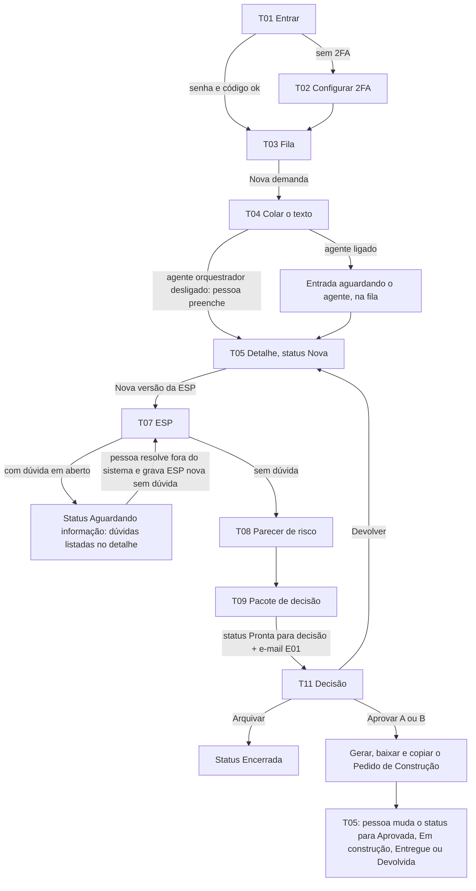
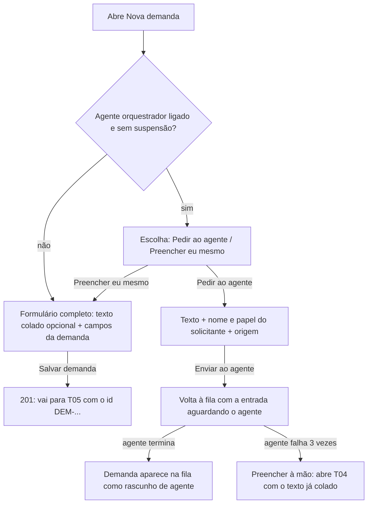
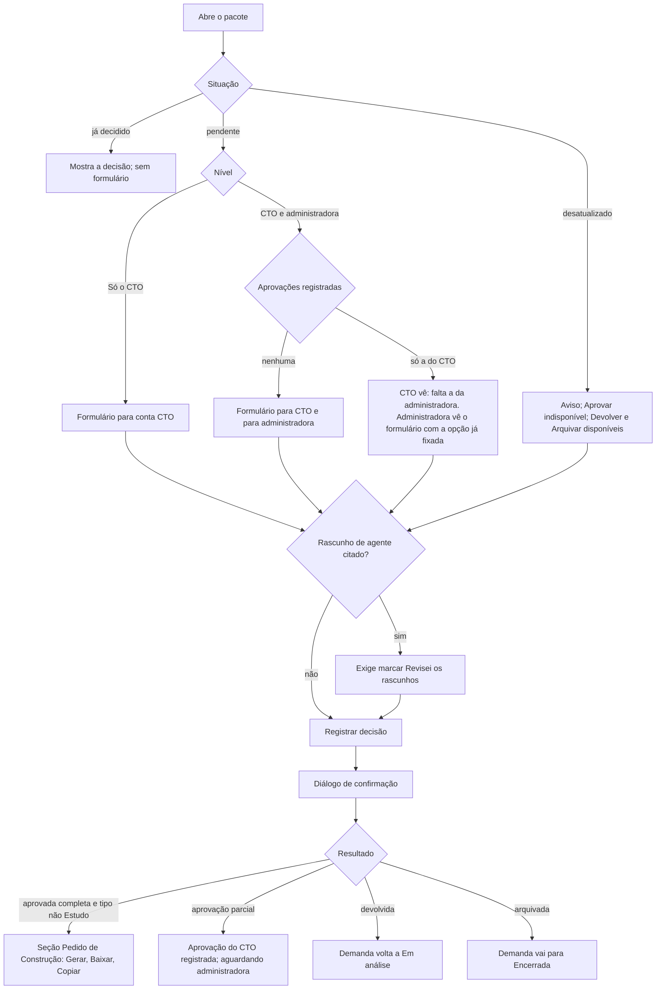

## Entrega

Interface do WS Orquestrador de Demandas, versão 0.1.0. Demanda `novo_projeto`: o repositório ainda não tem código de
interface, então não há design system anterior; esta entrega define o mínimo (seção 2) e todas as telas o reutilizam.
Os nomes de campo seguem o `01-analista-requisitos.md` e a seção 3 da spec original (lida só para os rótulos dos
campos de ESP, RSK e DEC, que o 01 cita sem listar). Usuários: Fabiano (papel `cto`) e a administradora (papel
`administradora`). Uso previsto: desktop, até 200 demandas por mês; o painel também precisa funcionar em 320 px de
largura e com zoom de 200 %.

### 1. Mapa de telas e cobertura dos RF

| Tela | Rota do painel (proposta) | RF atendidos |
|---|---|---|
| T01 Entrar (senha e código) | `/entrar` | RF-01 |
| T02 Configurar verificação em duas etapas | `/configurar-2fa` | RF-01 |
| T03 Fila de demandas | `/demandas` | RF-06, RF-26, RNF-09 |
| T04 Nova demanda (colar o texto) | `/demandas/nova` | RF-03, RF-04, RF-05, RF-20 |
| T05 Detalhe da demanda | `/demandas/[id]` | RF-06, RF-07, RF-12, RF-15, RF-16, RF-21, RF-24, RF-26 |
| T06 Editar dados da demanda | `/demandas/[id]/editar` | RF-06 |
| T07 Nova versão da especificação técnica (ESP) | `/demandas/[id]/especificacoes/nova` | RF-08, RF-15, RF-19 |
| T08 Novo parecer de risco (RSK) | `/demandas/[id]/pareceres-risco/novo` | RF-09, RF-19 |
| T09 Novo pacote de decisão (DEC) | `/demandas/[id]/pacotes-decisao/novo` | RF-10, RF-19 |
| T10 Ver versão de ESP ou RSK (somente leitura) | `/especificacoes/[espId]`, `/pareceres-risco/[rskId]` | RF-08, RF-09, RF-11 |
| T11 Decisão do pacote | `/pacotes-decisao/[decId]` | RF-12, RF-13, RF-14, RF-22, RF-25 (link do e-mail) |
| T12 Agentes e teto de gasto | `/configuracao/agentes` | RF-17, RF-18, RF-19 |
| E01 E-mail de pacote pronto para decisão | (Resend) | RF-25 |

RF sem tela própria: RF-02 (token de serviço; na interface aparece só como ator "Agente de …" no histórico), RF-04
(o id aparece em T03, T04 e T05), RF-11 (garantido por não existir botão de editar nem excluir versão), RF-20 (aviso em
T04), RF-23 (filtro só da API; no painel, a fila filtrada por "Pronta para decisão" cobre a tarefa de achar o que
decidir).

As rotas do painel são proposta; o `arquiteto-solucoes` e o `engenheiro-frontend` podem renomear, desde que não colidam
com `src/app/api/`.

### 2. Design system mínimo

#### 2.1 Tokens (Tailwind 4, em `@theme`)

| Token | Valor | Uso |
|---|---|---|
| `--color-texto` | `#1f2937` (gray-800) | texto principal sobre branco |
| `--color-texto-suave` | `#4b5563` (gray-600) | texto de apoio, dicas de campo |
| `--color-fundo` | `#ffffff` | fundo de página |
| `--color-fundo-suave` | `#f3f4f6` (gray-100) | faixas, cabeçalho de tabela |
| `--color-borda` | `#6b7280` (gray-500) | borda de campo (contraste ≥ 3:1 com o branco) |
| `--color-primaria` | `#1d4ed8` (blue-700) | botão primário, link, anel de foco |
| `--color-perigo` | `#b91c1c` (red-700) | erro, botão de ação destrutiva |
| `--color-sucesso` | `#166534` (green-800) | texto de sucesso |
| `--color-atencao-texto` / `-fundo` | `#78350f` / `#fef3c7` (amber-900 / amber-100) | alerta de atenção |
| Espaçamento | escala de 4 px (`1` = 4 px … `8` = 32 px) | margens e intervalos |
| Tipografia | pilha do sistema (`ui-sans-serif, system-ui`), base 16 px, altura de linha 1,5; títulos 24/20/18 px; ids em `ui-monospace` | |
| Raio | 6 px em campo e botão; 9999 px em selo | |
| Foco | `outline: 2px solid var(--color-primaria); outline-offset: 2px` em todo elemento focável, nunca removido | |
| Alvo | botão e controle com no mínimo 44 × 44 px; link em linha com área mínima de 24 × 24 px | |

Todo par de texto e fundo precisa de contraste ≥ 4,5:1 (texto grande ≥ 3:1) e todo contorno de controle ≥ 3:1; o axe
confere nas telas. Nenhuma informação depende só da cor: os selos sempre têm texto.

#### 2.2 Selos (texto escuro 800 sobre fundo claro 100 da mesma cor)

| Valor | Texto do selo | Cor |
|---|---|---|
| `nova` | Nova | slate |
| `em_analise` | Em análise | blue |
| `aguardando_informacao` | Aguardando informação | amber |
| `pronta_para_decisao` | Pronta para decisão | violet |
| `aprovada` | Aprovada | green |
| `em_construcao` | Em construção | cyan |
| `entregue` | Entregue | emerald |
| `devolvida` | Devolvida pela construção | orange |
| `encerrada` | Encerrada | gray |
| decisão `pendente` / `aprovada` / `devolvida` / `arquivada` | Decisão pendente / Aprovada / Devolvida para nova análise / Arquivada | amber / green / orange / gray |
| rascunho de agente | Rascunho de agente | violet, com borda tracejada |
| DEC desatualizado | Desatualizado | red |
| nível `baixo` / `medio` / `alto` | Baixo / Médio / Alto | green / amber / red |

#### 2.3 Componentes (todas as telas usam só estes)

Botão (primário, secundário, perigo, link); Campo de texto; Área de texto (com contador de caracteres quando houver
limite); Seleção; Grupo de opções (rádio, dentro de `fieldset` com `legend`); Caixa de seleção; Interruptor
(`button role="switch"` com `aria-checked`); Lista de textos (seção 2.4); Selo; Alerta (informação, atenção, erro,
sucesso; erro e sucesso de envio em `role="alert"`, o resto estático); Resumo de erros (seção 2.5); Tabela (com
`caption` e `th scope`); Paginação; Diálogo de confirmação (`<dialog>` nativo, foco no título ao abrir, Esc fecha,
foco volta ao botão de origem); Esqueleto de carregamento; Bloco de JSON (`<pre>` rolável com `tabindex="0"` e rótulo);
Cabeçalho do painel; Região de aviso (`role="status"`, uma por página, para mensagens assíncronas).

#### 2.4 Lista de textos (para os campos JSONB em lista)

- Cada item é um Campo de texto com rótulo visível "Item 1", "Item 2"… dentro de um `fieldset` cuja `legend` é o nome
  do campo.
- Botão "Adicionar item" ao fim; botão "Remover" ao lado de cada item, com nome acessível "Remover item 2 de Escopo
  inclui". Ao adicionar, o foco vai ao campo novo; ao remover, vai ao item anterior (ou ao "Adicionar item").
- Item vazio é descartado ao enviar. Com 50 itens, "Adicionar item" fica desabilitado e aparece a dica "Limite de 50
  itens atingido.".
- Sem arrastar para reordenar (nenhuma ação depende de arrastar).

#### 2.5 Padrão de formulário

- Rótulo visível acima do campo; obrigatório marcado no próprio rótulo com "(obrigatório)". Dica de campo abaixo do
  rótulo, ligada por `aria-describedby`.
- Validação ao enviar, não ao digitar. Com erro: Resumo de erros no topo ("Corrija os campos abaixo para continuar.",
  com um link por campo), foco no resumo, `aria-invalid="true"` no campo e a mensagem abaixo dele, ligada por
  `aria-describedby`. Os erros que a API devolve (400) entram no mesmo resumo, campo a campo.
- Botão de envio mostra "Salvando…" e fica desabilitado durante o envio; o formulário recebe `aria-busy="true"`.
- O que já foi digitado nunca se perde num erro de envio.
- Formulários com conteúdo não salvo pedem confirmação ao sair: "Sair sem salvar? O que você digitou nesta tela será
  perdido." Botões "Sair sem salvar" e "Continuar editando".

#### 2.6 Textos de enumeração

| Campo | Valores (rótulo na interface) |
|---|---|
| Tipo | Bug; Melhoria; Novo projeto; Estudo; Produto próprio |
| Papel do solicitante | Operações; Financeiro; Produto; Outro |
| Linha de serviço provável | Sistema sob medida; Automação e integração; IA com controle humano; Diagnóstico e sustentação; Indefinida |
| Urgência | Baixa; Média; Alta |
| Nível de aprovação requerido | Só o CTO; CTO e administradora |
| Agentes | Agente orquestrador (entrada); Agente de insumo técnico (ESP); Agente de risco (RSK); Agente de consolidação (DEC) |
| Papel da conta | CTO; Administradora |
| Ator no histórico | "<Nome> (CTO)", "<Nome> (Administradora)", "Agente orquestrador", "Agente de insumo técnico", "Agente de risco", "Agente de consolidação", "Sistema" |

Datas: "22/10/2026 às 14:05", no fuso America/Sao_Paulo, com `<time datetime>`. Dinheiro: "US$ 3,20" (moeda da
cobrança do provedor, ver Decisões).

#### 2.7 Moldura do painel (todas as telas depois do login)

- `<html lang="pt-BR">`. Título da aba: "<Nome da tela> — WS Orquestrador de Demandas".
- Primeiro elemento focável: link "Pular para o conteúdo" (visível ao receber foco), que leva ao `<main id="conteudo">`.
- Cabeçalho (`<header>`): nome "WS Orquestrador de Demandas" (link para a fila); navegação (`<nav aria-label="Principal">`)
  com "Demandas", "Nova demanda", "Agentes e teto"; à direita "<Nome> (CTO)" e botão "Sair". A página atual tem
  `aria-current="page"`. Em tela estreita, a navegação vira botão "Menu" com `aria-expanded`.
- Cabeçalho fixo não pode cobrir o elemento focado: `scroll-padding-top` igual à altura do cabeçalho.
- Um `h1` por tela. Ao trocar de tela, o foco vai ao `h1`.
- Aviso de agentes suspensos (RF-18), em todas as telas enquanto valer, abaixo do cabeçalho: "Agentes de IA suspensos:
  o gasto do mês atingiu o teto. Nenhum agente chama o provedor até o teto subir ou o mês virar. Preencha os campos à
  mão." Link "Ver agentes e teto".
- Aviso de capacidade (RNF-09), em todas as telas quando houver mais de 9.000 demandas: "Atenção: já existem 9.012
  demandas. O formato do id comporta até 9.999. Avise o time técnico para planejar a mudança."

#### 2.8 Mensagens comuns de erro (todas as telas)

| Situação | Texto |
|---|---|
| Sem sessão ou sessão expirada (401) | Leva a T01 com o alerta "Sua sessão terminou. Entre de novo para continuar." |
| Sem 2FA ativo | Leva a T02 com o alerta "Para usar o painel, configure a verificação em duas etapas." |
| Sem permissão (403) | Título "Sem permissão"; texto "Sua conta não pode fazer esta ação. Se precisar, fale com o CTO." Botão "Voltar para a fila" |
| Não encontrado (404) | Título "Página não encontrada"; texto "Confira o endereço ou o id. A demanda, a versão ou o pacote podem não existir." Botão "Voltar para a fila" |
| Conflito (409) | O motivo devolvido pela API, num alerta de erro, precedido de "Não foi possível concluir: " |
| Erro do servidor (5xx) ou rede | "Não foi possível concluir agora. Nada foi alterado. Tente de novo em instantes." Botão "Tentar de novo" |
| Falha ao carregar uma tela | "Não foi possível carregar esta página. Tente de novo em instantes." Botão "Tentar de novo" |

Nenhuma mensagem mostra pilha, SQL, nome de tabela ou detalhe interno (RNF-10).

### 3. Jornada principal



Com os agentes ligados, os passos F, H e I podem chegar prontos como rascunho de agente; a pessoa lê em T10 e confirma
a revisão em T11.

### 4. Telas

Cada tela traz: fluxo (quando houver mais de um passo), wireframe, textos, os quatro estados e a acessibilidade
específica. A acessibilidade da moldura (2.7) e dos componentes (2.3 a 2.5) vale em todas e não é repetida.

---

#### T01. Entrar

Fluxo: e-mail e senha → código de verificação (ou código de recuperação) → fila. Conta sem 2FA ativo vai a T02.

```
+------------------------------------------------+
| WS Orquestrador de Demandas                    |
|                                                |
| # Entrar                                       |
| [alerta, quando houver]                        |
| E-mail (obrigatório)      [________________]   |
| Senha (obrigatório)       [________________]   |
|                           [ ] Mostrar senha    |
| [ Continuar ]                                  |
+------------------------------------------------+
Passo 2:
| # Código de verificação                        |
| Digite o código de 6 dígitos do seu aplicativo |
| autenticador.                                  |
| Código (obrigatório)      [______]             |
| [ Entrar ]                                     |
| Usar um código de recuperação                  |
```

Textos:
- Título: "Entrar". Campos: "E-mail (obrigatório)", "Senha (obrigatório)", caixa "Mostrar senha". Botão "Continuar".
- Passo 2: título "Código de verificação"; texto "Digite o código de 6 dígitos do seu aplicativo autenticador.";
  campo "Código (obrigatório)"; botão "Entrar"; link-botão "Usar um código de recuperação".
- Modo recuperação: texto "Digite um dos códigos de recuperação que você guardou ao configurar a verificação. Cada código
  vale uma vez."; campo "Código de recuperação (obrigatório)"; botão "Entrar"; link-botão "Usar o código do aplicativo".
- Não existe link de cadastro nem de "esqueci minha senha" (fora do escopo).

Estados:
- Vazio: formulário em branco, foco no `h1`.
- Carregando: botão "Verificando…", desabilitado.
- Erro: "Preencha o e-mail e a senha." | "E-mail ou senha incorretos." (mesma mensagem para e-mail inexistente) |
  "O código precisa ter 6 dígitos." | "Código inválido ou expirado. Confira se o relógio do celular está certo e tente
  de novo." | "Código de recuperação inválido ou já usado." | "Muitas tentativas. Aguarde um minuto e tente de novo." |
  erro de servidor (2.8).
- Sucesso: vai para a fila (ou para a página que a pessoa tentava abrir antes do login, se for do painel).

Acessibilidade:
- Campos com `autocomplete="username"`, `current-password` e `one-time-code`; código com `inputmode="numeric"`, um
  campo só (não seis caixas). Colar é permitido em todos os campos e gerenciador de senha funciona (WCAG 2.2, 3.3.8).
- "Mostrar senha" é caixa de seleção com rótulo, não ícone.
- Mensagem de erro de envio em `role="alert"`; foco vai ao resumo de erros.
- Ao passar ao passo 2, o foco vai ao título "Código de verificação".
- Sem limite de tempo visível na tela; se o passo 2 expirar, a mensagem é "O tempo para digitar o código acabou.
  Entre de novo." e volta ao passo 1 com o e-mail preenchido.

---

#### T02. Configurar verificação em duas etapas

Fluxo: confirmar a senha → ler o QR code ou digitar a chave → digitar o código → guardar os códigos de recuperação →
fila. Obrigatório para toda conta sem 2FA ativo (RF-01); nenhuma outra tela abre antes.

```
# Configurar verificação em duas etapas
Passo 1 de 3 — Confirme sua senha
  Senha (obrigatório) [________]   [ Continuar ]
Passo 2 de 3 — Ligue o aplicativo autenticador
  [QR code]
  Não consegue ler o QR code? Digite esta chave no aplicativo:
  ABCD EFGH IJKL MNOP   [ Copiar chave ]
  Código de 6 dígitos (obrigatório) [______]   [ Verificar ]
Passo 3 de 3 — Guarde os códigos de recuperação
  [lista de códigos]
  [ Baixar códigos ] [ Copiar códigos ]
  [ ] Guardei os códigos em lugar seguro (obrigatório)
  [ Concluir ]
```

Textos:
- Título: "Configurar verificação em duas etapas". Introdução: "Para proteger as decisões registradas aqui, toda conta
  usa senha e um código do aplicativo autenticador (por exemplo, Google Authenticator ou Microsoft Authenticator)."
- Passo 1: "Passo 1 de 3 — Confirme sua senha"; campo "Senha (obrigatório)"; botão "Continuar".
- Passo 2: "Passo 2 de 3 — Ligue o aplicativo autenticador"; "No aplicativo, escolha adicionar conta e leia o QR code."
  Texto alternativo do QR: "QR code para adicionar o WS Orquestrador de Demandas ao aplicativo autenticador". "Não
  consegue ler o QR code? Digite esta chave no aplicativo:"; botão "Copiar chave"; campo "Código de 6 dígitos
  (obrigatório)"; botão "Verificar".
- Passo 3: "Passo 3 de 3 — Guarde os códigos de recuperação"; "Se perder o celular, cada um destes códigos permite
  entrar uma vez. Eles aparecem só agora."; botões "Baixar códigos" e "Copiar códigos"; caixa "Guardei os códigos em
  lugar seguro (obrigatório)"; botão "Concluir".

Estados:
- Vazio: passo 1, foco no `h1`.
- Carregando: "Gerando o QR code…" no lugar do QR (esqueleto 200 × 200 px, `aria-busy`); botões "Verificando…".
- Erro: "Senha incorreta." | "Código inválido. Confira se o relógio do celular está certo e digite o código atual." |
  "Marque que guardou os códigos para concluir." | "Não foi possível copiar. Selecione os códigos e copie com Ctrl+C." |
  erro de servidor (2.8).
- Sucesso: aviso em `role="status"` após copiar ("Chave copiada." / "Códigos copiados."); ao concluir, vai à fila com o
  alerta de sucesso "Verificação em duas etapas ativada.".

Acessibilidade:
- A chave em texto é a alternativa ao QR para quem não consegue ler a imagem; fonte monoespaçada, agrupada de 4 em 4
  caracteres, com o valor sem espaços no botão copiar.
- Passos com título `h2` e indicação "Passo N de 3" em texto; foco vai ao título do passo novo.
- Códigos de recuperação numa lista `<ul>`, lida item a item.

---

#### T03. Fila de demandas

```
# Demandas                                         [ Nova demanda ]
[Entradas aguardando o agente orquestrador (2)]  (só se houver)
Filtros
  Status [Todos ▾]  Tipo [Todos ▾]  Linha de serviço [Todas ▾]
  [ Filtrar ]  Limpar filtros
Tabela: Demandas (página 1)
| Id               | Título            | Tipo  | Status        | Urgência | Linha de serviço | Criada em  |
| DEM-20261022-0042| Pedidos duplicados| Bug   | [Em análise]  | Alta     | Automação e ...  | 22/10/2026 |
...
[ Anterior ]  Página 1  [ Próxima ]
```

Textos:
- Título: "Demandas". Botão "Nova demanda".
- Filtros: `fieldset` com `legend` "Filtros"; "Status", "Tipo", "Linha de serviço", cada um com a primeira opção
  "Todos" (ou "Todas"); botão "Filtrar"; link "Limpar filtros".
- Tabela: `caption` "Demandas, da mais nova para a mais antiga" (com os filtros ativos: "Demandas com status Aguardando
  informação, da mais nova para a mais antiga"). Colunas: "Id", "Título", "Tipo", "Status", "Urgência", "Linha de
  serviço", "Criada em". Valor ausente: "Não informada". Id é link para T05; marca "Rascunho de agente" ao lado do
  título quando a demanda foi criada por agente.
- Paginação (`nav aria-label="Paginação"`): "Anterior", "Página 2", "Próxima".
- Entradas aguardando o agente (só com o agente orquestrador ligado, ver Pendências): título "Entradas aguardando o agente
  orquestrador"; cada linha "Recebida em 22/10/2026 às 14:05 — <papel do solicitante>"; estado "O agente está
  preparando os campos." ou "O agente não conseguiu preparar os campos." com o botão "Preencher à mão".

Estados:
- Vazio (sem nenhuma demanda): "Nenhuma demanda ainda. Crie a primeira colando o texto do pedido." Botão "Nova demanda".
- Vazio (com filtro): "Nenhuma demanda com esses filtros." Link "Limpar filtros".
- Carregando: esqueleto de 5 linhas na tabela, tabela com `aria-busy="true"` e texto oculto "Carregando demandas…".
- Erro: "Não foi possível carregar as demandas. Tente de novo em instantes." Botão "Tentar de novo". Filtro inválido na
  URL: "Algum filtro do endereço não é válido. Mostrando todas as demandas." e a lista sem filtro.
- Sucesso: tabela preenchida; após filtrar, a Região de aviso diz "12 demandas encontradas." (ou "Página com 20
  demandas." quando não houver total).

Acessibilidade:
- Filtros não se aplicam ao mudar a seleção (WCAG 3.2.2); só ao clicar "Filtrar". Os filtros ficam na URL, então
  "Voltar" do navegador funciona.
- Foco depois de filtrar ou trocar de página: no `caption` da tabela (`tabindex="-1"`).
- Tabela com rolagem horizontal própria em tela estreita (`tabindex="0"`, `role="region"`, `aria-label="Tabela de
  demandas"`), sem rolagem da página inteira em 320 px.
- Status com texto do selo; "Anterior" desabilitado na página 1 e "Próxima" quando a página vier incompleta.

---

#### T04. Nova demanda (colar o texto)

Fluxo:



```
# Nova demanda
[Alerta de modo: "Agente orquestrador desligado. Preencha os campos abaixo."]
Texto recebido
  Texto do pedido (opcional) [área de texto grande]   0 de 100.000 caracteres
  Canal de origem (opcional) [E-mail ▾]  Referência da origem (opcional) [____]
Solicitante
  Nome do solicitante (obrigatório) [____]  Papel do solicitante [Operações ▾]
Classificação
  Título (obrigatório) [____]
  Tipo (obrigatório) ( ) Bug ( ) Melhoria ( ) Novo projeto ( ) Estudo ( ) Produto próprio
  Linha de serviço provável [Indefinida ▾]
  Urgência ( ) Baixa ( ) Média ( ) Alta    Justificativa da urgência [____]
Descrição
  Contexto [____]  Descrição do problema [____]  Impacto percebido [____]
Anexos (referências)
  Tipo [Link ▾] Referência [____] Descrição [____] [Remover anexo 1]
  [ Adicionar anexo ]
[ Salvar demanda ]  Cancelar
```

Textos:
- Título: "Nova demanda".
- Alerta de modo (informação), um dos três: "Agente orquestrador desligado. Preencha os campos abaixo." | "Agentes
  suspensos pelo teto de gasto. Preencha os campos abaixo." | (agente ligado) grupo de opções "Como criar a demanda?"
  com "Pedir ao agente orquestrador que proponha os campos" e "Preencher eu mesmo".
- Seção "Texto recebido": "Texto do pedido" (obrigatório só no modo agente; opcional no manual), dica "Cole o e-mail,
  a mensagem ou o formulário como chegou. Este texto é dado pessoal de terceiro: fica guardado por 90 dias e depois é
  apagado."; contador "0 de 100.000 caracteres"; "Canal de origem (opcional)" com opções "E-mail", "Mensagem",
  "Formulário", "Outro"; "Referência da origem (opcional)", dica "Um identificador da mensagem, sem endereço de
  e-mail.".
- Seção "Solicitante": "Nome do solicitante (obrigatório)", dica "Digite o nome. Ele não é enviado ao agente de IA.";
  "Papel do solicitante" (opções 2.6, primeira "Não informado").
- Seção "Classificação": "Título (obrigatório)"; grupo "Tipo (obrigatório)"; "Linha de serviço provável"; grupo
  "Urgência" (com opção "Não informada"); "Justificativa da urgência".
- Seção "Descrição": "Contexto", "Descrição do problema", "Impacto percebido".
- Seção "Anexos (referências)": dica "Só a referência: o arquivo não é enviado ao sistema."; por anexo "Tipo" ("Link" ou
  "Arquivo"), "Referência", "Descrição"; botões "Adicionar anexo" e "Remover anexo 1".
- Modo agente: o painel esconde Classificação, Descrição e Anexos e mostra o aviso "O agente recebe só o texto, sem o
  nome do solicitante, sem a origem e com e-mails, telefones, CPF e CNPJ trocados por marcadores. Você revisa a
  proposta antes de qualquer decisão." Botão "Enviar ao agente".
- Botões do modo manual: "Salvar demanda" e link "Cancelar".

Estados:
- Vazio: formulário em branco, modo definido pela configuração; foco no `h1`.
- Carregando: "Salvando…" / "Enviando…", formulário com `aria-busy`.
- Erro: "Informe o título." | "Informe o nome do solicitante." | "Escolha o tipo." | "Cole o texto do pedido para enviar
  ao agente." | "O texto tem 100.512 caracteres. O limite é 100.000." | "Este campo aceita até 10.000 caracteres." |
  "Limite de 50 anexos atingido." | "Não é possível criar a demanda: o limite de 9.999 ids foi atingido. Avise o time
  técnico." | erro de servidor (2.8).
- Sucesso: modo manual vai a T05 com o alerta "Demanda DEM-20261022-0042 criada com status Nova."; modo agente volta a
  T03 com o alerta "Texto enviado ao agente orquestrador. A demanda aparece na fila quando ele terminar; se ele falhar,
  você poderá preencher à mão."

Acessibilidade:
- Seções com `fieldset`/`legend` (ou `h2` com `section aria-labelledby`); grupos de opção com `legend`.
- Contador de caracteres ligado à área por `aria-describedby`, anunciado só ao passar de 90 % e ao exceder o limite
  (`aria-live="polite"` com atraso), para não falar a cada tecla.
- Trocar o modo esconde campos sem mover o foco; o texto já digitado continua.
- Ao "Preencher à mão" depois de falha, o texto vem preenchido (WCAG 2.2, 3.3.7: sem digitar de novo).

---

#### T05. Detalhe da demanda

```
DEM-20261022-0042  [Aguardando informação]  [Rascunho de agente]
# Pedidos do marketplace duplicados no ERP
[ Editar dados ]
Nesta página: Dados · Dúvidas em aberto · Versões · Mudar status · Texto recebido · Histórico

[Alerta: falha de agente / agentes suspensos / aguardando informação]

## Dados
  Tipo, Linha de serviço, Urgência, Justificativa, Solicitante, Papel,
  Contexto, Descrição do problema, Impacto percebido, Anexos, Criada em, Responsável
## Dúvidas em aberto (da ESP-...-v2)
  1. ...
## Versões
  ### Especificações técnicas        [ Nova versão da ESP ]
  | ESP-...-v2 | 22/10 14:10 | Agente de insumo técnico [Rascunho de agente] | Ver |
  ### Pareceres de risco             [ Novo parecer de risco ]
  ### Pacotes de decisão             [ Novo pacote de decisão ]
  | DEC-...-v1 | ... | [Decisão pendente] [Desatualizado] | Abrir decisão |
## Mudar status
  Status atual: Aguardando informação
  Novo status: ( ) Em análise  ( ) Encerrada
  [ Mudar status ]
## Texto recebido
  ▸ Mostrar texto recebido
## Histórico
  | Data e hora | Quem | O que aconteceu | Antes | Depois |
```

Textos:
- Cabeçalho: id, selo de status, selo "Rascunho de agente" quando a demanda foi criada pelo agente; `h1` com o título;
  botão "Editar dados"; navegação interna `nav aria-label="Nesta página"` com "Dados", "Dúvidas em aberto", "Versões",
  "Mudar status", "Texto recebido", "Histórico".
- Dados (lista de descrição `dl`): "Tipo", "Linha de serviço provável", "Urgência", "Justificativa da urgência",
  "Solicitante", "Papel do solicitante", "Contexto", "Descrição do problema", "Impacto percebido", "Anexos", "Criada em",
  "Criada por". Valor ausente: "Não informado".
- Dúvidas em aberto (só quando houver): `h2` "Dúvidas em aberto", subtítulo "Da ESP-DEM-20261022-0042-v2." (ou "Do
  agente orquestrador, na entrada."); lista numerada; nota "O sistema não envia estas perguntas ao solicitante. Trate-as
  fora do sistema e, com a resposta, grave uma ESP nova sem dúvida."
- Versões, três `h3`: "Especificações técnicas", "Pareceres de risco", "Pacotes de decisão". Colunas: "Versão", "Criada
  em", "Criada por", "Situação" e a ação. Ações: "Ver" (ESP e RSK), "Abrir decisão" (DEC). Botões "Nova versão da ESP",
  "Novo parecer de risco", "Novo pacote de decisão". Selos "Rascunho de agente", "Desatualizado", e os de decisão.
- Sem ESP ou RSK, no lugar do botão de pacote: "Para criar um pacote de decisão, a demanda precisa de especificação
  técnica e de parecer de risco. Falta: parecer de risco." (lista só o que falta).
- Mudar status: "Status atual: <status>"; grupo de opções "Novo status" com as transições permitidas pela tabela do
  RF-07; botão "Mudar status". Dicas por opção, quando a regra impede: "Aprovada: precisa de um pacote de decisão
  aprovado e atualizado." (opção desabilitada) | "Em construção: demanda do tipo Estudo não vai para construção."
  (opção desabilitada). Em status final: "Entregue é um status final. Não há próxima mudança." / "Encerrada é um
  status final. Não há próxima mudança." Dica fixa para `aprovada`: "Mudar para Em construção, Entregue ou Devolvida é
  manual nesta versão: faça quando o /construir avançar."
- Texto recebido: `details` com resumo "Mostrar texto recebido"; dentro, aviso "Contém dado pessoal de terceiro. Não
  copie para fora do sistema sem necessidade. Será apagado em 20/01/2027." e os campos "Recebido em", "Canal de
  origem", "Referência da origem", "Texto". Expurgado: "O texto recebido foi apagado em 20/01/2027, pela regra de
  retenção de 90 dias. Os dados da demanda continuam." Sem texto: "Esta demanda foi criada sem texto colado."
- Histórico: tabela com `caption` "Histórico da demanda, do mais novo para o mais antigo"; colunas "Data e hora",
  "Quem", "O que aconteceu", "Antes", "Depois". Textos dos eventos:

| Evento (RF-21) | Texto em "O que aconteceu" |
|---|---|
| criação da demanda | Criou a demanda |
| mudança de status | Mudou o status (Antes/Depois com os rótulos de 2.2) |
| mudança de campo | Alterou "<rótulo do campo>" |
| nova ESP / RSK / DEC | Criou ESP-…-v2 / Criou RSK-…-v1 / Criou DEC-…-v1 |
| decisão | Registrou a decisão: Aprovada, opção A / Devolvida para nova análise / Arquivada |
| aprovação parcial | Registrou a aprovação como CTO (opção A) / Registrou a aprovação como administradora (opção A), documento <identificador> de <data> |
| falha de agente | O agente de risco não conseguiu gerar o parecer depois de 3 tentativas |
| suspensão por teto | Agente de risco não rodou: agentes suspensos pelo teto de gasto |
| pedido gerado | Gerou o Pedido de Construção de DEC-…-v1 |
| expurgo | Apagou o texto recebido (retenção de 90 dias) |

Alertas de topo (no máximo um de cada, nesta ordem):
- Falha de agente (erro): "O agente de risco não conseguiu gerar o parecer de risco depois de 3 tentativas. Preencha o
  parecer à mão." Botão "Novo parecer de risco". (Equivalente para os outros agentes, trocando o nome e o artefato.)
- Aguardando informação (atenção): "Esta demanda está aguardando informação. Veja as dúvidas em aberto." Link para a
  seção.
- Pacote desatualizado (atenção): "O pacote DEC-…-v1 está desatualizado: a demanda já tem uma versão mais nova de ESP
  ou de parecer de risco. Crie um pacote novo para decidir."
- Agente trabalhando (informação, se a etapa 02 expuser o estado do job): "O agente de risco está preparando o parecer
  de risco. Esta página não se atualiza sozinha: recarregue em alguns minutos."

Estados:
- Vazio: cada lista de versões vazia diz "Nenhuma especificação técnica ainda." / "Nenhum parecer de risco ainda." /
  "Nenhum pacote de decisão ainda."; histórico nunca é vazio (tem ao menos a criação); demanda sem anexos: "Nenhum
  anexo.".
- Carregando: esqueleto do cabeçalho e das seções, `main` com `aria-busy="true"` e texto oculto "Carregando a demanda…".
- Erro: 404 (2.8); falha de carga (2.8); ao mudar status, 409 com o motivo da API ("Não foi possível concluir: a
  demanda não tem pacote de decisão aprovado."); sem opção marcada: "Escolha o novo status.".
- Sucesso: ao mudar status, alerta "Status alterado para Em construção." em `role="status"`, selo e histórico
  atualizados; ao chegar de T04, T07, T08 ou T09, o alerta de sucesso da tela de origem.

Acessibilidade:
- Estrutura de títulos: `h1` título; `h2` por seção; `h3` em cada lista de versões.
- Navegação interna por âncoras; ao seguir uma, o foco vai ao `h2` (com `tabindex="-1"`).
- `details`/`summary` nativos para o texto recebido; o texto em `<pre>` com quebra de linha (`white-space: pre-wrap`),
  sem rolagem horizontal.
- Opção de status desabilitada fica no grupo com `aria-disabled` e a dica ligada por `aria-describedby`, para ser
  encontrada pelo leitor de tela e explicar por que não está disponível.
- Selos "Rascunho de agente" e "Desatualizado" são texto, não só ícone.

---

#### T06. Editar dados da demanda

Mesmos campos das seções "Solicitante", "Classificação", "Descrição" e "Anexos" de T04, preenchidos com os valores
atuais. Não edita status (fica em T05) nem texto recebido.

```
DEM-20261022-0042
# Editar dados da demanda
[Aviso: "Os pacotes de decisão já criados guardam uma cópia..."]
(campos de T04, preenchidos)
[ Salvar alterações ]  Cancelar
```

Textos:
- Título: "Editar dados da demanda". Aviso (informação): "As alterações ficam no histórico, com o valor de antes e o de
  depois. Os pacotes de decisão já criados guardam uma cópia dos dados e não mudam."
- Rótulos iguais aos de T04. Botões "Salvar alterações" e link "Cancelar".

Estados:
- Vazio: não se aplica (sempre há dados); campos opcionais vazios aparecem em branco.
- Carregando: esqueleto dos campos ao abrir; "Salvando…" ao enviar.
- Erro: mensagens de validação de T04; "Nada foi alterado." quando nenhum campo mudou; 404 e erro de servidor (2.8).
- Sucesso: volta a T05 com "Alterações salvas. O histórico registra o antes e o depois."

Acessibilidade: as de T04; o foco inicial vai ao `h1`.

---

#### T07. Nova versão da especificação técnica (ESP)

Fluxo: a partir de T05 ("Nova versão da ESP") ou de T10 ("Criar nova versão a partir desta"). A versão nova começa
preenchida com a ESP mais nova da demanda (ou em branco, se não houver).

```
DEM-20261022-0042 — Pedidos duplicados
# Nova versão da especificação técnica
[Informação: "Esta será a ESP-...-v3. A v2 continua guardada e não muda."]
## Problema        Descrição objetiva / Situação atual / Situação desejada
## Escopo          Escopo inclui (lista) / Escopo exclui (lista)
## Sistemas        ERP / E-commerce e marketplace / APIs de terceiros / Serviços internos da WS
## Dados           Entidades / Campos críticos
## Restrições técnicas
## Dúvidas em aberto (lista)
## Construção (obrigatório, exceto Estudo)
   Sistema alvo [ws-exemplo]
   Conta do repositório (wsssistemas2626-crypto ▾)   Repositório destino: wsssistemas2626-crypto/ws-exemplo
   Critérios de aceite preliminares (lista)
   Definição de pronto (lista)
[ Gravar ESP-...-v3 ]  Cancelar
```

Textos:
- Título: "Nova versão da especificação técnica". Informação: "Esta será a ESP-DEM-20261022-0042-v3. A v2 continua
  guardada e não muda." (Sem versão anterior: "Esta será a primeira especificação técnica desta demanda, a v1.")
  Partindo de rascunho de agente: "Os campos vieram da v2, um rascunho do agente de insumo técnico. Revise antes de
  gravar."
- Seção "Problema": "Descrição objetiva", "Situação atual", "Situação desejada".
- Seção "Escopo": listas "Escopo inclui" e "Escopo exclui", dica "Um item por linha de escopo.".
- Seção "Sistemas envolvidos": "ERP", "E-commerce e marketplace", "APIs de terceiros", "Serviços internos da WS".
- Seção "Dados": "Entidades", "Campos críticos".
- "Restrições técnicas".
- Lista "Dúvidas em aberto", dica "Com qualquer dúvida aqui, a demanda vai para Aguardando informação e o agente de
  risco não roda. Nenhuma mensagem é enviada ao solicitante."
- Seção "Construção": `legend` "Construção (obrigatório, exceto para Estudo)"; para Estudo: "Construção (opcional: demanda
  do tipo Estudo não gera Pedido de Construção)". Campos "Sistema alvo (obrigatório)", dica "Só letras minúsculas,
  números e hífen. Exemplo: ws-orquestrador-demandas."; "Conta do repositório (obrigatório)" com as opções
  "wsssistemas2626-crypto" e "fabianojp06"; texto calculado "Repositório destino: wsssistemas2626-crypto/<sistema
  alvo>" (atualizado ao digitar, sem anúncio a cada tecla); listas "Critérios de aceite preliminares (obrigatório)" e
  "Definição de pronto (obrigatório)", dica "Ao menos um item.".
- Botões "Gravar ESP-…-v3" e link "Cancelar".
- Confirmação ao gravar com dúvida (Diálogo): título "Gravar com dúvidas em aberto?"; texto "A demanda vai para
  Aguardando informação. Nenhuma mensagem é enviada ao solicitante."; botões "Gravar mesmo assim" e "Voltar".

Estados:
- Vazio: sem ESP anterior, campos em branco, com um item vazio em cada lista.
- Carregando: esqueleto ao abrir (busca da versão anterior); "Gravando…" ao enviar.
- Erro: "Informe o sistema alvo." | "Sistema alvo aceita só letras minúsculas, números e hífen." | "Informe ao menos um
  critério de aceite preliminar." | "Informe ao menos um item da definição de pronto." | "O repositório destino precisa
  terminar com o sistema alvo." (vindo da API, se a conta for alterada fora da tela) | limites de RNF-04 (T04) |
  conflito de versão: "Outra versão foi gravada enquanto você editava. Sua versão foi gravada como v4; confira as
  duas no detalhe." | erro de servidor (2.8).
- Sucesso: volta a T05 com "ESP-DEM-20261022-0042-v3 gravada." e, se houver dúvida, "A demanda foi para Aguardando
  informação."; se houver DEC pendente que ficou desatualizado: "O pacote DEC-…-v1 ficou desatualizado. Crie um pacote
  novo para decidir."

Acessibilidade:
- Seções com `fieldset`/`legend`; "Repositório destino" é texto com `id` ligado ao campo de sistema alvo por
  `aria-describedby`.
- O Diálogo de confirmação prende o foco e o devolve ao botão "Gravar" ao fechar.
- Formulário longo: o Resumo de erros lista todos os campos com problema e cada link leva ao campo (no caso de lista,
  ao primeiro item).

---

#### T08. Novo parecer de risco (RSK)

Mesmo padrão de T07 (começa preenchido com o RSK mais novo, se houver).

```
# Novo parecer de risco
[Informação: "Este será o RSK-...-v2. Baseado na ESP-...-v3."]
Resumo [____]
## Risco técnico       Nível (obrigatório) ( ) Baixo ( ) Médio ( ) Alto   Comentário [____]
## Risco operacional   Nível (obrigatório) ( ) Baixo ( ) Médio ( ) Alto   Comentário [____]
## Risco jurídico      Nível (obrigatório) ( ) Baixo ( ) Médio ( ) Alto   Comentário [____]
Recomendações de mitigação (lista)
Pré-condições (lista)
Quando envolver o jurídico ou a administradora [____]
[ Gravar RSK-...-v2 ]  Cancelar
```

Textos:
- Título: "Novo parecer de risco". Informação: "Este será o RSK-DEM-20261022-0042-v2. A especificação mais nova desta
  demanda é a ESP-DEM-20261022-0042-v3." Sem ESP: "Esta demanda ainda não tem especificação técnica. Você pode gravar o
  parecer, mas o pacote de decisão vai exigir as duas."
- "Resumo"; três grupos "Risco técnico", "Risco operacional", "Risco jurídico", cada um com "Nível (obrigatório)"
  (Baixo, Médio, Alto) e "Comentário"; listas "Recomendações de mitigação" e "Pré-condições", dica "Um item por
  pré-condição. O que precisa estar resolvido antes de construir."; "Quando envolver o jurídico ou a administradora",
  dica "Situações em que a decisão precisa passar pelo jurídico ou pela administradora.".
- Botões "Gravar RSK-…-v2" e link "Cancelar".

Estados:
- Vazio: sem RSK anterior, campos em branco, nenhum nível marcado.
- Carregando: esqueleto ao abrir; "Gravando…" ao enviar.
- Erro: "Escolha o nível do risco técnico." (idem operacional e jurídico) | limites de RNF-04 | conflito de versão
  (como T07, trocando "ESP" por "RSK") | erro de servidor (2.8).
- Sucesso: volta a T05 com "RSK-DEM-20261022-0042-v2 gravado."; se um DEC pendente ficou desatualizado, o mesmo aviso
  de T07.

Acessibilidade: cada nível é um grupo de opções com `legend` "Nível do risco técnico (obrigatório)" (o nome do risco
entra na `legend`, para não haver três grupos chamados só "Nível").

---

#### T09. Novo pacote de decisão (DEC)

```
# Novo pacote de decisão
[Informação: "Este será o DEC-...-v2. Ele vai citar ESP-...-v3 e RSK-...-v2, as versões mais novas."]
Resumo executivo (obrigatório) [____]
## Opção A   Descrição (obrigatório) / Vantagens / Desvantagens / Quando escolher
## Opção B   Descrição (obrigatório) / Vantagens / Desvantagens / Quando escolher
Recomendação [____]
Nível de aprovação requerido (obrigatório) ( ) Só o CTO ( ) CTO e administradora
[ Gravar DEC-...-v2 ]  Cancelar
```

Textos:
- Título: "Novo pacote de decisão". Informação: "Este será o DEC-DEM-20261022-0042-v2. Ele vai citar a
  ESP-DEM-20261022-0042-v3 e o RSK-DEM-20261022-0042-v2, as versões mais novas desta demanda. Os dados da demanda são
  copiados para o pacote e não mudam depois."
- Se faltar ESP ou RSK (a tela abre, mas sem formulário): "Ainda não dá para criar o pacote. Falta: especificação
  técnica e parecer de risco." (lista só o que falta) e botões "Nova versão da ESP" / "Novo parecer de risco".
- "Resumo executivo (obrigatório)"; grupos "Opção A" e "Opção B" com "Descrição da opção A (obrigatório)", "Vantagens
  da opção A", "Desvantagens da opção A", "Quando escolher a opção A" (idem B); "Recomendação", dica "Qual opção você
  recomenda e por quê."; grupo "Nível de aprovação requerido (obrigatório)" com "Só o CTO" e "CTO e administradora",
  dica "Use CTO e administradora quando a decisão gerar compromisso que exija a assinatura da administradora.".
- Botões "Gravar DEC-…-v2" e link "Cancelar".

Estados:
- Vazio: campos em branco (pacote não parte do anterior: cada pacote é uma proposta nova sobre as versões citadas).
- Carregando: esqueleto ao abrir; "Gravando…" ao enviar.
- Erro: "Faltam itens para o pacote: parecer de risco." (400 com `faltando`) | "Informe o resumo executivo." | "Descreva
  a opção A." | "Descreva a opção B." | "Escolha o nível de aprovação requerido." | erro de servidor (2.8).
- Sucesso: vai a T11 do pacote novo com "DEC-DEM-20261022-0042-v2 criado. A demanda está pronta para decisão e o aviso
  por e-mail entrou na fila de envio."

Acessibilidade: as do padrão de formulário; rótulos de cada campo repetem a opção ("Vantagens da opção B"), para que
o campo seja entendido fora do contexto visual.

---

#### T10. Ver versão de ESP ou RSK (somente leitura)

```
ESP-DEM-20261022-0042-v2   [Rascunho de agente]
# Especificação técnica v2 — Pedidos duplicados
Criada em 22/10/2026 às 14:10 por Agente de insumo técnico
[Informação: "Esta versão não muda. Para corrigir, crie uma nova versão a partir dela."]
(todos os campos, com os rótulos de T07 ou T08; listas como listas)
[ Criar nova versão a partir desta ]   Voltar para a demanda
```

Textos:
- ESP: título "Especificação técnica v2 — <título da demanda>"; RSK: "Parecer de risco v1 — <título da demanda>".
- "Criada em <data> por <ator>". Informação: "Esta versão não muda. Para corrigir, crie uma nova versão a partir
  dela." Rascunho: "Rascunho do agente de insumo técnico. Leia com atenção: o conteúdo foi gerado por IA a partir do
  texto do pedido." Se houver versão mais nova: "Existe uma versão mais nova: ESP-…-v3." com link.
- Campo vazio: "Não informado." Lista vazia: "Nenhum item."
- Botão "Criar nova versão a partir desta" (leva a T07 ou T08 preenchido com esta versão) e link "Voltar para a
  demanda".
- Não há botão de editar nem de excluir (RF-11).

Estados:
- Vazio: não se aplica (a versão existe ou é 404); campos vazios mostram "Não informado.".
- Carregando: esqueleto, `aria-busy`, texto oculto "Carregando a versão…".
- Erro: 404 "Versão não encontrada."; falha de carga (2.8).
- Sucesso: conteúdo exibido.

Acessibilidade: conteúdo em `dl` por seção, com `h2` por grupo (Problema, Escopo…); níveis de risco com texto
("Risco técnico: Alto"), nunca só a cor do selo.

---

#### T11. Decisão do pacote

Fluxo:



```
DEC-DEM-20261022-0042-v1  [Decisão pendente]  [Rascunho de agente]
# Decisão: Pedidos duplicados no ERP
Demanda DEM-20261022-0042 · Nível: CTO e administradora
Cita: ESP-...-v2 (Ver) · RSK-...-v1 (Ver)
[Alerta desatualizado, quando houver]
## Resumo executivo
## Opções            (lado a lado em tela larga; empilhadas em tela estreita)
  ### Opção A: Descrição / Vantagens / Desvantagens / Quando escolher
  ### Opção B: ...
## Recomendação
## Aprovações
  CTO: Fabiano — opção A — 22/10/2026 às 15:00
  Administradora: pendente
## Registrar decisão
  Decisão (obrigatório) ( ) Aprovar  ( ) Devolver para nova análise  ( ) Arquivar
  Opção escolhida (obrigatório) ( ) Opção A  ( ) Opção B
  Identificador do documento assinado / Data da assinatura   (só para a administradora)
  Comentários (opcional) [____]
  [ ] Revisei os rascunhos de agente citados neste pacote (obrigatório)
  [ Registrar decisão ]
## Pedido de Construção     (só depois de aprovado)
  [ Gerar Pedido de Construção ]
  [ Baixar DEC-...-v1.json ] [ Copiar JSON ]
  [Bloco de JSON]
```

Textos:
- Cabeçalho: id do pacote, selos; `h1` "Decisão: <título copiado no pacote>"; linha "Demanda <id> · Nível de
  aprovação: <Só o CTO | CTO e administradora> · Criado em <data> por <ator>"; "Cita: <ESP-id> (Ver) · <RSK-id>
  (Ver)".
- Alerta desatualizado (erro): "Este pacote está desatualizado. A demanda já tem ESP-…-v3, mais nova que a citada
  aqui. Ele não pode ser aprovado; você pode devolvê-lo ou arquivá-lo. Para aprovar, crie um pacote novo." Link "Criar
  pacote novo".
- Alerta de rascunho (atenção): "Este pacote cita conteúdo gerado por agente de IA: <DEC-id, ESP-id e/ou RSK-id>. Leia
  cada um antes de decidir."
- Seções: "Resumo executivo"; "Opções" com "Opção A" e "Opção B" (subtítulos "Descrição", "Vantagens", "Desvantagens",
  "Quando escolher"); "Recomendação" (quando escrita por agente: "Recomendação do agente de consolidação").
- Seção "Aprovações" (só para nível CTO e administradora): "CTO: <nome> aprovou a opção A em <data>." ou "CTO:
  pendente."; "Administradora: <nome> aprovou a opção A em <data>, com o documento <identificador> assinado em
  <data>." ou "Administradora: pendente."; nota "O sistema guarda a referência ao documento assinado; ela não substitui a
  assinatura."
- Formulário "Registrar decisão":
  - Grupo "Decisão (obrigatório)": "Aprovar", "Devolver para nova análise", "Arquivar". Dicas: Aprovar
    desatualizado: "Indisponível: pacote desatualizado."; "Devolver para nova análise: a demanda volta para Em
    análise."; "Arquivar: a demanda vai para Encerrada."
  - Grupo "Opção escolhida (obrigatório)", visível só com "Aprovar": "Opção A — <primeiras 80 letras da descrição>",
    "Opção B — …".
  - Na segunda aprovação (administradora depois do CTO), no lugar do grupo de opção: "O CTO aprovou a opção A. A sua
    aprovação vale para a mesma opção. Para discordar, escolha devolver ou arquivar."
  - Só para a conta da administradora, com "Aprovar": "Identificador do documento assinado (obrigatório)", dica
    "Exemplo: número do documento no sistema de assinatura."; "Data da assinatura (obrigatório)".
  - "Comentários (opcional)".
  - Caixa, quando houver rascunho citado: "Revisei os rascunhos de agente citados neste pacote (obrigatório)".
  - Botão "Registrar decisão".
- Diálogo de confirmação: título "Confirmar a decisão?"; texto "Você vai registrar: Aprovar a opção A. Depois de
  registrada, a decisão deste pacote não muda. Para decidir de outro jeito, será preciso um pacote novo." (variação
  "Devolver para nova análise." / "Arquivar."); botões "Confirmar e registrar" e "Voltar".
- Sem formulário para a conta atual:
  - Nível "Só o CTO", conta administradora: "Este pacote exige só a aprovação do CTO."
  - CTO depois da própria aprovação: "Sua aprovação está registrada. Falta a aprovação da administradora, com a
    referência ao documento assinado. O pacote só vale depois dela."
  - Pacote já decidido: "Decisão registrada: Aprovada, opção A, por <nome> em <data>." (ou Devolvida/Arquivada), com
    os comentários, se houver.
- Lembrete pós-aprovação (informação): "A demanda continua em Pronta para decisão até alguém mudar o status para
  Aprovada no detalhe da demanda." Link "Ir para a demanda".
- Seção "Pedido de Construção" (só com decisão aprovada completa):
  - Texto: "Gere o pedido, baixe ou copie o JSON e grave-o na pasta pedidos/ da estruturaAutonoma. O envio ao
    /construir é manual nesta versão."
  - Botão "Gerar Pedido de Construção"; depois de gerado: "Baixar DEC-DEM-20261022-0042-v1.json", "Copiar JSON" e o
    Bloco de JSON com rótulo "Conteúdo do Pedido de Construção". Nota: "O mesmo pacote gera sempre o mesmo pedido."
  - Estudo: "Demanda do tipo Estudo não gera Pedido de Construção." (sem botão).

Estados:
- Vazio: não se aplica ao pacote (sempre tem conteúdo); campos opcionais vazios: "Não informado."; aprovações sem
  registro: "pendente".
- Carregando: esqueleto ao abrir, texto oculto "Carregando o pacote…"; "Registrando…" ao enviar; "Gerando o pedido…"
  ao gerar.
- Erro: "Escolha a decisão." | "Escolha a opção A ou a opção B." | "Marque que revisou os rascunhos de agente para
  registrar a decisão." | "Informe o identificador do documento assinado." | "Informe a data da assinatura." | 409:
  "Não foi possível concluir: este pacote já tem decisão registrada." / "… o pacote está desatualizado e não pode ser
  aprovado." / "… a opção precisa ser a mesma aprovada pelo CTO." | 403 (2.8) | pedido 422: "O pedido não passou na
  validação do /construir. Nada foi entregue. Erros:" com a lista devolvida pela API e a orientação "Corrija criando
  uma versão nova da ESP e um pacote novo." | 422 Estudo: "Demanda do tipo Estudo não gera Pedido de Construção." |
  cópia falhou: "Não foi possível copiar. Selecione o conteúdo abaixo e copie com Ctrl+C." | erro de servidor (2.8).
- Sucesso: "Decisão registrada: Aprovada, opção A." | "Aprovação do CTO registrada. Falta a aprovação da
  administradora." | "Aprovação da administradora registrada. O pacote está aprovado." | "Pacote devolvido para nova
  análise. A demanda voltou para Em análise." | "Pacote arquivado. A demanda foi para Encerrada." | "Pedido de
  Construção gerado." | "JSON copiado para a área de transferência." (em `role="status"`).

Acessibilidade:
- A opção "Aprovar" indisponível fica no grupo com `aria-disabled="true"` e a razão ligada por `aria-describedby`
  (CA-12.4: indisponível, mas encontrável e explicada).
- Mostrar o grupo "Opção escolhida" ao marcar "Aprovar" não move o foco; o grupo aparece logo depois, na ordem do
  teclado.
- Opções A e B em colunas só a partir de 1024 px; abaixo, empilhadas na ordem A, B; ordem do DOM igual à visual.
- O Bloco de JSON tem `tabindex="0"`, `role="region"` e `aria-label="Conteúdo do Pedido de Construção"`, para rolar
  pelo teclado; o botão "Baixar" é um link com `download` e nome de arquivo no texto.
- O Diálogo resume a decisão em texto antes de confirmar (prevenção de erro em ação que não se desfaz, WCAG 3.3.4).

---

#### T12. Agentes e teto de gasto

```
# Agentes e teto de gasto
[Alerta: teto não definido / agentes suspensos]
## Gasto do mês
  Outubro de 2026: US$ 3,20 de US$ 10,00 (32 %)
  Teto mensal de gasto (US$) [10,00]   [ Salvar teto ]
## Agentes
  | Agente                          | Situação  | Última mudança                 |       |
  | Agente orquestrador (entrada)   | Desligado | Nunca alterado                 | [Interruptor] |
  | Agente de insumo técnico (ESP)  | Ligado    | Fabiano, 22/10/2026 às 10:00   | [Interruptor] |
  ...
```

Textos:
- Título: "Agentes e teto de gasto". Introdução: "Agente ligado prepara rascunhos por IA, dentro do teto mensal.
  Desligado, você preenche os mesmos campos à mão. Nenhum agente decide nem envia nada para fora."
- Alertas (um por vez): teto zero (atenção): "Teto não definido: com US$ 0,00, nenhum agente chama o provedor, mesmo
  ligado. Defina o teto para usar os agentes." | suspensão (erro): "Agentes suspensos: o gasto do mês (US$ 10,00)
  atingiu o teto (US$ 10,00). Nada é chamado até o teto subir ou o mês virar em 01/11/2026."
- Seção "Gasto do mês": "<Mês de ano>: US$ 3,20 de US$ 10,00 (32 %)"; campo "Teto mensal de gasto (US$)", dica "Valor
  na moeda da cobrança do provedor de IA. O gasto conta do dia 1 ao último dia do mês."; botão "Salvar teto".
- Seção "Agentes": tabela com `caption` "Agentes de IA"; colunas "Agente", "Situação", "Última mudança"; interruptor
  com nome acessível "Agente de risco (RSK)" e estado "Ligado"/"Desligado". "Última mudança": "<nome>, <data>" ou
  "Nunca alterado".
- Diálogo ao ligar: título "Ligar o agente de risco?"; texto "Ele passa a chamar o provedor de IA a cada especificação
  técnica sem dúvida gravada, dentro do teto mensal. O resultado é sempre um rascunho que uma pessoa revisa."; botões
  "Ligar agente" e "Cancelar". (Os outros agentes trocam o gatilho: orquestrador "a cada texto enviado na Nova demanda";
  insumo técnico "a cada demanda criada"; consolidação "a cada parecer de risco gravado com especificação".) Desligar
  não pede confirmação.
- Conta administradora: os controles aparecem desabilitados com a nota "Só o CTO altera esta configuração." (os valores
  continuam legíveis).

Estados:
- Vazio: sem gasto no mês: "<Mês de ano>: US$ 0,00 de US$ <teto>. Nenhuma chamada este mês."; agentes nunca alterados:
  "Nunca alterado".
- Carregando: esqueleto da tabela e do gasto; interruptor mostra "Alterando…" e fica desabilitado até a resposta.
- Erro: "Informe o teto com até duas casas decimais, por exemplo 10,00." | "O teto não pode ser negativo." | 403 (2.8) |
  falha ao alternar: "Não foi possível ligar o agente de risco. Ele continua desligado." (o interruptor volta ao
  estado anterior) | erro de servidor (2.8).
- Sucesso: "Teto salvo: US$ 10,00." | "Agente de risco ligado." | "Agente de risco desligado." (em `role="status"`).

Acessibilidade:
- Interruptor é `button role="switch"` com `aria-checked`, texto visível do estado ao lado; não depende de cor.
- Campo de teto `inputmode="decimal"`, aceita vírgula ou ponto; rótulo com a moeda.
- A porcentagem do gasto é texto; se houver barra, é `<meter>` com rótulo e o texto continua visível.

---

#### E01. E-mail de pacote pronto para decisão (RF-25)

- Assunto: "Pacote DEC-DEM-20261022-0042-v1 pronto para decisão"
- Corpo (texto puro, com versão HTML de mesmo conteúdo):

```
Há um pacote de decisão pronto no WS Orquestrador de Demandas.

Pacote: DEC-DEM-20261022-0042-v1
Demanda: DEM-20261022-0042

Abrir a tela de decisão: <link para /pacotes-decisao/DEC-DEM-20261022-0042-v1>

Este aviso não traz o conteúdo da demanda. Para ler e decidir, entre no painel com sua senha e o código de verificação.
```

- Sem título da demanda, texto recebido nem nome do solicitante. HTML: `lang="pt-BR"`, link com o texto "Abrir a tela
  de decisão" (não "clique aqui"), sem imagem.

### 5. Acessibilidade por tela (resumo verificável, WCAG 2.2 AA)

Vale em todas as telas: `lang="pt-BR"`; título da aba único; link "Pular para o conteúdo"; marcos `header`, `nav`,
`main`; um `h1`; ordem de foco igual à visual; foco sempre visível (2.4.7) e não coberto pelo cabeçalho fixo (2.4.11);
contraste de texto ≥ 4,5:1 e de componente ≥ 3:1 (1.4.3, 1.4.11); nada só por cor (1.4.1); funciona a 320 px e com
zoom de 200 % sem perder conteúdo (1.4.10, 1.4.4); espaçamento de texto ajustável (1.4.12); alvo ≥ 24 × 24 px (2.5.8);
nenhuma ação por arrastar (2.5.7); sem animação além de transição curta, desligada com `prefers-reduced-motion`; todo
campo com rótulo visível e nome acessível igual ao rótulo (2.5.3, 3.3.2); erros em texto, ligados ao campo (3.3.1,
3.3.3); avisos assíncronos por `role="status"` ou `role="alert"` (4.1.3).

| Tela | Foco | Teclado | Rótulos e leitor de tela | Contraste e outros |
|---|---|---|---|---|
| T01 | `h1` ao abrir; título do passo 2 ao avançar; resumo de erros no erro | Enter envia; Tab percorre e-mail, senha, mostrar senha, botão | `autocomplete` username/current-password/one-time-code; erro em `role="alert"` | colar permitido; sem teste cognitivo (3.3.8) |
| T02 | título do passo novo | botões de copiar e baixar por teclado | alt do QR; chave em texto; códigos em `ul` | chave alternativa ao QR (1.1.1) |
| T03 | `caption` após filtrar ou paginar | filtros só aplicam no botão (3.2.2) | `caption` descreve filtros; `th scope="col"`; `nav aria-label="Paginação"`; `aria-current` na página | rolagem da tabela por teclado (`tabindex="0"`) |
| T04 | resumo de erros; `h1` ao abrir | troca de modo sem perder foco; adicionar/remover anexo com foco previsível | `fieldset`/`legend` por seção; contador por `aria-describedby`, anunciado só perto do limite | texto preservado após falha (3.3.7) |
| T05 | `h2` ao seguir âncora; alerta de status após mudar status | `details` abre com Enter/Espaço | estrutura `h1`/`h2`/`h3`; opção de status indisponível com `aria-disabled` e motivo | selos com texto; histórico em tabela com `caption` |
| T06 | `h1` ao abrir; resumo de erros | como T04 | rótulos de T04 | aviso sobre cópia no DEC em texto |
| T07 | resumo de erros; diálogo prende e devolve o foco | Lista de textos com foco no item novo/anterior | `legend` em cada lista; repositório destino por `aria-describedby` | prevenção de erro por confirmação com dúvida |
| T08 | resumo de erros | grupos de nível com setas | `legend` com o nome do risco | nível em texto, não só cor |
| T09 | resumo de erros | — | rótulos repetem a opção ("Vantagens da opção B") | — |
| T10 | `h1` ao abrir | — | `dl` por seção, `h2` por grupo | sem ação de editar ou excluir |
| T11 | alerta de resultado; diálogo prende e devolve o foco | Aprovar indisponível alcançável e explicado; bloco de JSON rolável por teclado | grupo de opção com `legend`; Bloco de JSON com `role="region"` e rótulo; `role="status"` ao copiar | confirmação com resumo antes de ação irreversível (3.3.4) |
| T12 | alerta de resultado; diálogo ao ligar | interruptor com Espaço/Enter | `role="switch"`, `aria-checked`, estado em texto | controles desabilitados para quem não é CTO ainda legíveis |
| E01 | — | — | link com texto descritivo | texto puro disponível |

Teste automatizado: cada tela no Playwright com `@axe-core/playwright` e as regras `wcag2a`, `wcag2aa`, `wcag21a`,
`wcag21aa` e `wcag22aa`, em três estados no mínimo (vazio, com erro de formulário e com dados), sem violação
(RNF-11). Os itens que o axe não pega (ordem de foco, foco após ação, anúncio de status, diálogo) entram nos casos do
`qa-funcional`, pela coluna "Foco" e "Teclado" acima.

## Decisões tomadas

- Nova versão de ESP e RSK começa preenchida com a versão mais nova: evita redigitar (WCAG 3.3.7) e deixa explícito que a anterior não muda; o DEC começa em branco porque cada pacote é uma proposta nova.
- Repositório destino montado por seleção de conta + sistema alvo: impede por desenho o erro do CA-08.3, sem mudar a regra da API.
- Decisão com diálogo de confirmação: decisão registrada é final para aquela versão do DEC (01, Decisões).
- "Aprovar" desatualizado fica visível e indisponível, com o motivo, em vez de sumir: a pessoa entende por que não pode e o CA-12.4 é atendido.
- Para nível "Só o CTO", a interface mostra o formulário só à conta CTO; a API continua sendo a regra (ver Pendências).
- Na segunda aprovação, a opção fica fixada na do CTO: evita o 409 do CA-14.4 em vez de só mostrá-lo.
- O Pedido de Construção é gerado por botão, não ao abrir a tela, porque cada geração vai ao histórico (RF-22).
- Lembrete na tela de decisão de que o status da demanda muda à mão: a ESP manda mudar à mão e o lembrete evita a demanda esquecida em "Pronta para decisão".
- Texto recebido fechado por padrão em `details`, com aviso de dado pessoal: minimiza exposição sem esconder.
- Filtros aplicados por botão e guardados na URL: atende WCAG 3.2.2 e permite voltar e compartilhar a fila internamente.
- Moeda do teto exibida como US$, porque o 01 manda usar a moeda da cobrança do provedor; muda só o rótulo se for outra.
- Códigos de recuperação do 2FA incluídos (recurso padrão do plugin de 2FA do Better Auth): sem eles, a perda do celular trava a única conta de decisão.
- Sem tela própria para RF-23 nem para tabela de preço por modelo: a fila filtrada cobre a tarefa, e a tabela de preço é configuração no banco segundo o 01.
- Design system mínimo próprio, sem herdar a identidade da marca: ferramenta interna, sem peça externa; `marketing-comunicacao` não precisa ser acionado.
- Spec original lida só para os rótulos dos campos de ESP, RSK e DEC, que o 01 cita pela seção sem listar; valem os nomes do 01 onde divergem.

## Pendências

- Nenhuma bloqueia a etapa. Itens para a etapa 02, para o 01 ou para a Parada 1:
- `arquiteto-solucoes` (02): com o agente orquestrador ligado, a demanda só nasce quando o job termina (RF-05). A tela T03 prevê a lista "Entradas aguardando o agente orquestrador" e o "Preencher à mão" após falha; isso exige guardar a entrada (texto bruto, nome e papel) antes da demanda e expor o estado dela. Se a 02 preferir outra forma, a T03 e a T04 se ajustam; sem nenhuma, o texto enviado some da vista da pessoa até o job terminar.
- `arquiteto-solucoes` (02): o aviso "agente trabalhando" em T05 depende de a API expor o estado do job; sem isso, a T05 mostra só falha e suspensão (pelo histórico).
- `arquiteto-solucoes` (02): a fila mostra "N demandas encontradas" só se `GET /demandas` devolver o total; sem total, o texto é "Página com N demandas".
- `analista-requisitos` / Fabiano: em DEC de nível `cto`, a administradora pode aprovar? O RF-13 não restringe o papel; a interface restringe ao CTO. Se a resposta for "pode", basta mostrar o formulário às duas contas.
- Fabiano (Parada 1): quem registra a aprovação da administradora. A T11 foi desenhada para ela entrar com a própria conta (o aprovador vem da sessão, RF-13). Se for o CTO informando a referência, a T11 precisa de um bloco "Registrar aprovação da administradora em nome dela", e o RF-14 precisa dizer como o aprovador é gravado.
- `analista-requisitos`: o RF-09 cita a lista `riscos` sem dizer quais campos; a T08 tratou "Recomendações de mitigação" e "Pré-condições" como listas e os comentários de nível como texto. Se `riscos` for outra estrutura, só a T08 muda.
- `analista-requisitos` / `seguranca-aplicacao` (04): a tela de 2FA inclui códigos de recuperação; se a 04 vetar, a T01 perde o modo recuperação e a T02 perde o passo 3.
- Fabiano: confirmar a moeda do teto (US$).

## Comandos executados

Nenhum.

## Critério de pronto atendido

- [x] cada RF com interface tem fluxo e tela
- [x] cada tela tem os quatro estados
- [x] os textos de interface estão escritos por inteiro, em pt-BR
- [x] os critérios de acessibilidade estão listados por tela
