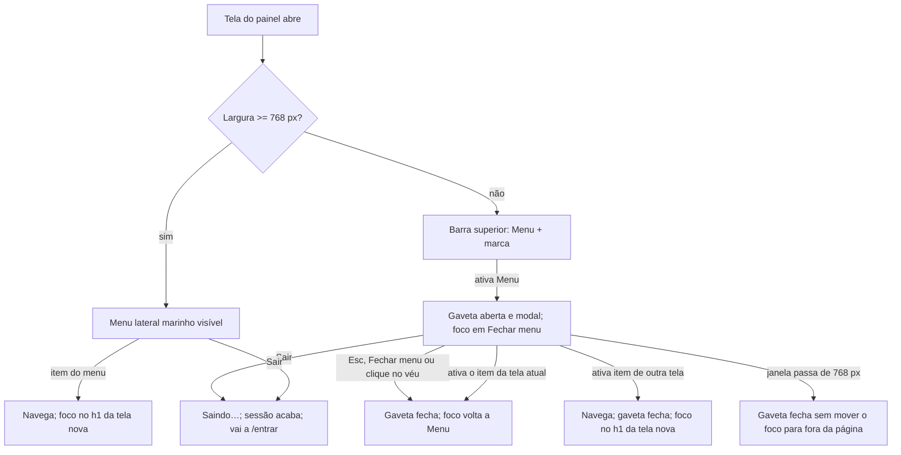
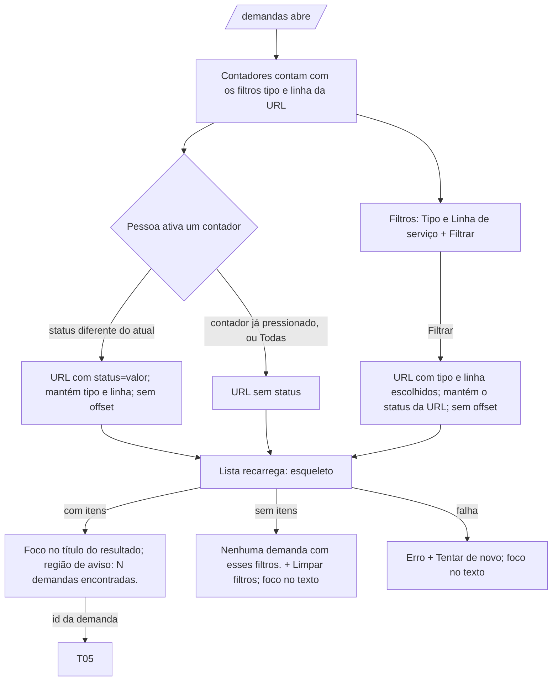
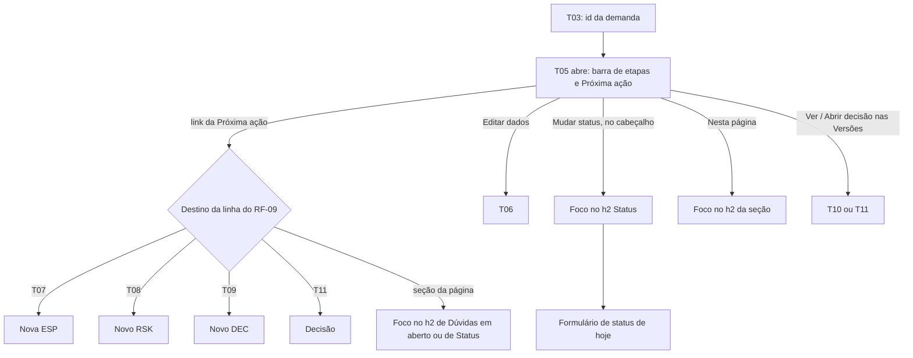
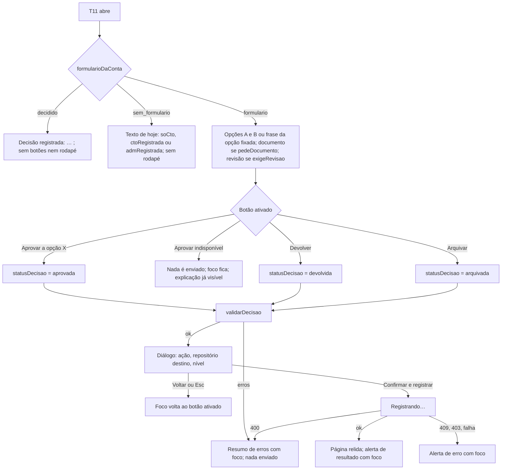
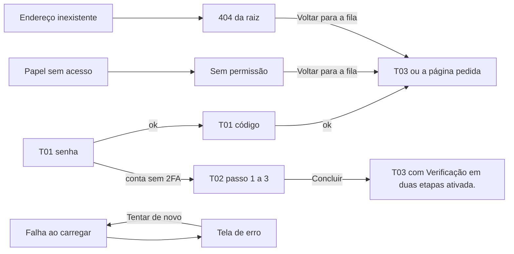

## Entrega

### 0. Escopo e regra de leitura

Interface da 0.2.0 do WS Orquestrador de Demandas: só a camada visual muda (ESP-DEM-20261110-0015-v1). Base de
layout: proposta A (A1 fila, A2 demanda); decisão abaixo de 768 px: C2. Identidade: manual de marca MKT-2026-005.
Os mockups são referência de arranjo; cor, tipografia, contraste e texto saem desta entrega e do manual, nunca do
mockup (o A1 tem borda de campo `#c3ccd6` com 1,6:1 e marca de etapa tracejada `#a7b3bf` com 2,1:1, que reprovam
WCAG 1.4.11; ver 2.2).

Regras que valem em todo o documento:

- RF-NN e CA-NN.N são os do `01-analista-requisitos.md` deste pedido.
- Texto que **não muda** é citado pela constante do código (ex.: `TEXTOS_FILA.vazio`), para não haver duas fontes. Todo
  texto **novo ou alterado** está escrito por inteiro na seção 9 e no lugar onde aparece.
- Pontos de quebra: **celular** abaixo de 768 px; **tablete** de 768 a 1199 px; **computador** a partir de 1200 px.
  Larguras de teste: 1280 × 720 e 390 × 844 (e 320 px para reflow).
- Nada nesta entrega cria regra: condições de exibição vêm do RF-08, RF-09 e RF-11, e o que é obrigatório continua no
  servidor.

### 1. Mapa: RF com interface → fluxo → tela

| RF | Fluxo | Tela / seção |
|---|---|---|
| RF-01 Tokens | sem fluxo (transversal) | 2.1 a 2.5 |
| RF-02 Fontes | sem fluxo (transversal) | 2.3 |
| RF-03 Casca a partir de 768 px | 3.1 | 3.2, 3.4 |
| RF-04 Gaveta abaixo de 768 px | 3.1 | 3.3, 3.4 |
| RF-05 Contadores | 4.1 | 4.2, 4.3, 4.5 |
| RF-06 Tabela densa | 4.1 | 4.2, 4.4 |
| RF-07 Cartões abaixo de 768 px | 4.1 | 4.3, 4.4 |
| RF-08 Barra de etapas | 5.1 | 5.2, 5.4 |
| RF-09 Próxima ação | 5.1 | 5.2, 5.5 |
| RF-10 Detalhe A2 | 5.1 | 5.2, 5.3, 5.6 |
| RF-11 Decisão por botões | 6.1 | 6.2, 6.4 |
| RF-12 Decisão C2 | 6.1 | 6.3, 6.4 |
| RF-13 Entrar, 2FA, sem permissão, erro, 404 | 7.1 | 7.2 |
| RF-14 Demais telas | 8.1 | 8.2 |
| RF-15, RF-16, RF-17 | sem interface própria | seção 11 (o que o `qa-funcional` confere) |

### 2. Design system 0.2.0

Substitui a seção 2 do `03-ux-ui-design.md` do pedido 0001 só em cor, tipografia, raio e nos componentes listados em
2.6. Padrão de formulário (2.5 de lá), textos de enumeração (2.6 de lá) e mensagens comuns (2.8 de lá) **não mudam**.

#### 2.1 Tokens de cor (Tailwind 4, `@theme` em `src/app/globals.css`, único lugar com hexadecimal)

| Token (`--color-…`) | Valor | Papel | Fonte |
|---|---|---|---|
| `marinho` | `#12385f` | fundo da casca e do cartão Próxima ação; `h1`; marca de etapa feita | manual 3.1 |
| `marinho-luz` | `#1f4f86` | item ativo e passagem do mouse no menu (só fundo) | manual 3.1 |
| `acao` | `#1a6ae0` | preenchimento do botão primário; borda do contador pressionado; marca da etapa atual. **Nunca texto sobre marinho** | manual 3.1 |
| `acao-escura` | `#1354b4` | link e texto de destaque sobre claro; passagem do mouse no primário; anel de foco sobre claro | manual 3.1 |
| `azul-claro` | `#7db0f5` | sobre marinho: etiqueta do cartão Próxima ação, barra do item ativo, borda do "Sair" | manual 3.1 |
| `nevoa` | `#eaf1fd` | fundo do contador pressionado, da opção marcada e do alerta de informação | manual 3.1 |
| `tinta` | `#0f1620` | texto principal sobre claro | manual 3.1 |
| `tinta-media` | `#4a5763` | texto secundário, rótulo, cabeçalho de tabela | manual 3.1 |
| `tinta-suave` | `#6b7885` | **só** borda de campo e de controle, e marca tracejada; como texto, só sobre `#ffffff` (no painel não é usado como texto) | manual 3.1 |
| `linha` | `#dfe4ea` | borda de cartão e divisor (decorativo) | manual 3.1 |
| `superficie` | `#f6f8fa` | fundo das telas | manual 3.1 |
| `branco` | `#ffffff` | fundo de cartão, campo e tabela | manual 3.1 |
| `texto-claro` | `#dfe6ee` | texto sobre marinho | manual 3.1 |
| `texto-claro-apoio` | `#b9c5d2` | texto de apoio sobre marinho ("de Demandas") | manual 3.1 |
| `positivo` / `positivo-fundo` | `#0f7a52` / `#e7f4ee` | alerta de sucesso | manual 3.1 |
| `atencao` / `atencao-fundo` | `#8a5a00` / `#fdf3e0` | alerta de atenção; selo âmbar | manual 3.1 |
| `erro` / `erro-fundo` | `#b42318` / `#fdecea` | erro de campo, alerta de erro, botão perigo; selo vermelho | manual 3.1 (fundo novo) |
| `selo-violeta` / `-fundo` | `#5b3fa0` / `#efe9fb` | Em análise; Rascunho de agente (com borda tracejada) | A1 |
| `selo-petroleo` / `-fundo` | `#0b5d6b` / `#ddf2f5` | Pronta para decisão; Decisão pendente | A1, A2, C2 |
| `selo-verde` / `-fundo` | `#1d6b3a` / `#e3f3e8` | Aprovada; decisão Aprovada; nível Baixo; texto "Feita"/"Feito" da barra | A1 |
| `selo-marinho-fundo` | `#e6edf5` | Em construção (texto `marinho`) | A1 |
| `selo-laranja` / `-fundo` | `#9a3412` / `#fdebdd` | Devolvida pela construção; decisão Devolvida | novo |
| `selo-cinza-fundo` | `#eceff3` | Encerrada; Arquivada; Substituído; botão principal indisponível (texto `tinta-media`) | A2 |

Mapa dos tokens de hoje para os novos (para o `engenheiro-frontend` trocar sem sobrar classe antiga): `texto` →
`tinta`; `texto-suave` → `tinta-media`; `fundo` → `branco`; `fundo-suave` → `superficie`; `borda` → `tinta-suave`;
`primaria` → `acao` (preenchimento) ou `acao-escura` (link, foco); `perigo` → `erro`; `sucesso` → `positivo`;
`atencao-texto`/`atencao-fundo` → `atencao`/`atencao-fundo`. As classes `bg-blue-50`, `bg-red-50`, `bg-green-50`,
`hover:bg-blue-800`, `hover:bg-red-800` e as cores do `Selo.tsx` (`slate`, `blue`…) saem.

Foco tem token próprio, trocado pela superfície: `--cor-foco: var(--color-acao-escura)` no claro e `#ffffff` (por
`var(--color-branco)`) dentro de toda superfície marinho (casca, gaveta, cartão Próxima ação).

#### 2.2 Contraste verificado (fórmula de luminância do WCAG 2.x; o teste de unidade do RNF-01/RNF-02 recalcula)

Texto (regra da casa: ≥ 4,5:1 em qualquer tamanho):

| Texto sobre fundo | Razão | Texto sobre fundo | Razão |
|---|---|---|---|
| `tinta` / `branco`, `superficie`, `nevoa` | 18,2 / 17,1 / 16,0 | `tinta-media` / `branco`, `superficie`, `nevoa`, `#eceff3` | 7,4 / 7,0 / 6,5 / 6,4 |
| `marinho` / `branco`, `superficie`, `nevoa`, `#e6edf5` | 11,9 / 11,2 / 10,5 / 10,1 | `acao-escura` / `branco`, `superficie`, `nevoa` | 7,1 / 6,7 / 6,3 |
| `branco` / `acao` (botão primário) | 5,0 | `branco` / `acao-escura` (primário com mouse) | 7,1 |
| `branco` / `marinho` | 11,9 | `texto-claro` / `marinho`, `marinho-luz` | 9,5 / 6,6 |
| `texto-claro-apoio` / `marinho` | 6,8 | `azul-claro` / `marinho` | 5,3 |
| `branco` / `marinho-luz` | 8,3 | `marinho` / `branco` (botão do cartão Próxima ação) | 11,9 |
| `erro` / `branco`, `erro-fundo` | 6,6 / 5,7 | `atencao` / `atencao-fundo`, `branco` | 5,4 / 5,9 |
| `positivo` / `positivo-fundo`, `branco` | 4,7 / 5,4 | `selo-violeta` / fundo | 6,7 |
| `selo-petroleo` / fundo | 6,5 | `selo-verde` / fundo, `branco` | 5,7 / 6,5 |
| `selo-laranja` / fundo | 6,3 | `branco` / `selo-verde` (selo Entregue) | 6,5 |

Elemento não textual (≥ 3:1 contra o fundo vizinho):

| Elemento | Cor / fundo | Razão |
|---|---|---|
| Borda de campo, de botão secundário, de contador, de cartão de opção; marca tracejada de etapa | `tinta-suave` / `branco`, `superficie` | 4,5 / 4,2 |
| Borda do contador pressionado, anel da etapa atual | `acao` / `branco` | 5,0 |
| Borda da opção marcada | `marinho` / `branco` | 11,9 |
| Anel de foco no claro | `acao-escura` / `branco`, `superficie`, `nevoa` | 7,1 / 6,7 / 6,3 |
| Anel de foco no marinho | `branco` / `marinho`, `marinho-luz` | 11,9 / 8,3 |
| Barra do item ativo do menu | `azul-claro` / `marinho-luz`, `marinho` | 3,7 / 5,3 |
| Borda do "Sair" | `azul-claro` / `marinho` | 5,3 |

Pares **vetados** (não aparecem): `acao` como texto sobre `marinho` (2,4) ou `tinta` (3,6); `azul-claro` como texto
sobre `marinho-luz` (3,7); `tinta-suave` como texto sobre `superficie` (4,2); `#c3ccd6` e `#a7b3bf` do mockup como
borda que informa. `linha` (`#dfe4ea`, 1,3:1) é só decorativa: nunca é a única fronteira de um controle.

#### 2.3 Tipografia (RF-02)

- Famílias: `--font-sans: <Noto Sans do app>, system-ui, sans-serif`; `--font-mono: <Noto Sans Mono do app>,
  ui-monospace, monospace`. Arquivos `woff2` do próprio app, `font-display: swap` (origem e carga com o
  `arquiteto-solucoes`, P-03 do 01).
- Mono (600) em: id (`DEM-…`, `ESP-…`, `RSK-…`, `DEC-…`), número do contador, marcas ESP/RSK/DEC, etiqueta.
- Escala (px / peso / entrelinha): etiqueta 12 / Mono 600 / 1,3, caixa alta por CSS (`text-transform`, o texto no DOM
  fica normal), espaçamento +0,08 em; apoio 13 / 400; tabela, selo e item de menu 14 / 400–700; corpo e campo 16 / 400
  / 1,5 (campo nunca abaixo de 16 px no celular); `h3` 16 / 600; `h2` 18 / 700 / 1,3; `h1` 28 / 800 / 1,2 / −0,02 em
  em `marinho` (22 px abaixo de 768 px); número do contador 28 / Mono 600 (20 px na pílula do celular).
- Nenhum texto abaixo de 12 px. Nenhum texto em imagem.

#### 2.4 Espaço, raio, foco, alvo, movimento

- Espaço: escala de 4 px do Tailwind. Página: 32 px de margem no computador, 24 no tablete, 16 no celular; 20 px entre
  blocos.
- Raio (manual 5.1): `--radius-campo: 10px` (botão, campo, item de menu, contador); `--radius-cartao: 16px` (cartão);
  selo e pílula: 9999 px.
- Cartão: fundo `branco`, borda 1 px `linha`, raio 16, preenchimento 24 (16 no celular), sem sombra.
- Foco: `outline: 2px solid var(--cor-foco); outline-offset: 2px` em todo elemento focável, nunca removido.
- Alvo: todo controle com 44 × 44 px no mínimo, em qualquer largura (já é o padrão do `Botao`); abaixo de 768 px vale
  também para link solto (fora de frase): "Nesta página", "Ver", "Limpar filtros", "Ver agentes e teto", trilha.
- Movimento: só a gaveta anima (deslizar, 200 ms); com `prefers-reduced-motion: reduce`, nenhuma animação (regra de
  hoje em `globals.css` continua).
- Rolagem: `scroll-padding-top` = 16 px a partir de 768 px (a casca não cobre o topo) e 64 px abaixo (barra de 56 px +
  8); na T11 abaixo de 768 px, `scroll-padding-bottom` = altura do rodapé fixo + 16 px.

#### 2.5 Selos (`Selo.tsx`; texto sempre presente, nada só por cor)

`CorSelo` passa a ter nomes de token: `azul`, `violeta`, `ambar`, `petroleo`, `verde`, `marinho`, `verde-cheio`,
`laranja`, `cinza`, `vermelho`. Estilo: 13 px, peso 700, raio 9999, preenchimento 2 × 10 px.

| Valor | Texto (sem mudança, `rotulos.ts`) | Cor (texto / fundo) |
|---|---|---|
| `nova` | Nova | `azul`: `acao-escura` / `nevoa` |
| `em_analise` | Em análise | `violeta` |
| `aguardando_informacao` | Aguardando informação | `ambar`: `atencao` / `atencao-fundo` |
| `pronta_para_decisao` | Pronta para decisão | `petroleo` |
| `aprovada` | Aprovada | `verde` |
| `em_construcao` | Em construção | `marinho`: `marinho` / `selo-marinho-fundo` |
| `entregue` | Entregue | `verde-cheio`: `branco` / `selo-verde` |
| `devolvida` | Devolvida pela construção | `laranja` |
| `encerrada` | Encerrada | `cinza`: `tinta-media` / `selo-cinza-fundo` |
| decisão `pendente` / `aprovada` / `devolvida` / `arquivada` | (sem mudança) | `petroleo` / `verde` / `laranja` / `cinza` |
| Rascunho de agente | Rascunho de agente | `violeta` + borda 1 px tracejada `selo-violeta` |
| Desatualizado | Desatualizado | `vermelho`: `erro` / `erro-fundo` |
| Substituído | Substituído | `cinza` |
| nível `baixo` / `medio` / `alto` | Baixo / Médio / Alto | `verde` / `ambar` / `vermelho` |

#### 2.6 Componentes

Reaproveitados, só com tokens novos (nenhuma tela inventa substituto): `Botao` (primário, secundário, perigo, link),
`CampoTexto`, `AreaTexto`, `Selecao`, `GrupoOpcoes`, `CaixaSelecao`, `Interruptor`, `ListaTextos`, `Selo`, `Alerta`,
`ResumoErros`, `Tabela`, `Paginacao`, `DialogoConfirmacao`, `Esqueleto`, `BlocoJson`, `RegiaoAviso`.

Variações novas de componentes existentes:

| Componente | Variação | Uso |
|---|---|---|
| `Botao` | `sobre-escuro`: fundo transparente, borda 1 px `azul-claro`, texto `branco` | "Sair" na casca e na gaveta |
| `Botao` / `classeDoBotao` | `claro-sobre-escuro`: fundo `branco`, texto `marinho`, peso 700 | link do cartão Próxima ação |
| `Botao` | estado `aria-disabled` (sem `disabled`): fundo `selo-cinza-fundo`, texto `tinta-media`, borda tracejada `tinta-suave`, continua focável e com `aria-describedby` | "Aprovar" indisponível na T11 |
| `GrupoOpcoes` | `cartao`: cada opção num cartão clicável inteiro, mínimo 44 px de altura, borda 1 px `tinta-suave`; marcada: borda 2 px `marinho` e fundo `nevoa` | opções A e B na T11 |
| `Tabela` | legenda fora da tabela: o título do resultado vira um `h2` com o id de foco, e a tabela recebe `caption` só para leitor de tela, com o mesmo texto e sem id | T03 (4.4) |
| `Alerta` | `informacao`: fundo `nevoa`, texto `tinta`, borda esquerda 4 px `acao-escura` | todas as telas |

Componentes novos (não existiam; cada um tem um uso só, descrito nas seções indicadas):

| Componente | Seção | Resumo |
|---|---|---|
| `Casca` (substitui `CabecalhoPainel`) | 3 | `header` lateral marinho no computador e no tablete; barra superior no celular |
| `Marca` | 3.2 | bloco "WS" + "Orquestrador / de Demandas", em HTML e CSS, versão clara e escura |
| `Gaveta` | 3.3 | `<dialog>` modal com o menu, abaixo de 768 px |
| `Cartao` | 2.4 | `section` com o estilo de cartão |
| `ContadoresDeStatus` | 4.5 | grupo de botões com `aria-pressed` |
| `MarcasDeEtapa` | 4.4 | ESP, RSK e DEC numa célula ou num cartão da fila |
| `CartaoDeDemanda` | 4.4 | item da lista da fila abaixo de 768 px |
| `BarraDeEtapas` | 5.4 | lista ordenada das cinco etapas |
| `ProximaAcao` | 5.5 | cartão marinho com o que falta e quem age |
| `LinhaDoTempo` | 5.6 | histórico em lista |
| `Recolhivel` | 4.3, 6.3 | botão com `aria-expanded` que recolhe um bloco só abaixo de 768 px |
| `AcoesDaDecisao` | 6.3 | grupo dos três botões da T11, fixo no rodapé abaixo de 768 px |

`Recolhivel`: a partir de 768 px o bloco fica sempre visível e o botão não existe (`display: none`); abaixo de 768 px
começa recolhido. Um elemento só no DOM nas duas larguras (sem duplicar id).

### 3. Casca e gaveta (RF-03, RF-04)

#### 3.1 Fluxo



#### 3.2 Computador e tablete (a partir de 768 px)

```
+---------------------------+-------------------------------------------------------------+
| [Pular para o conteúdo]   (só com foco, sobre tudo, canto superior esquerdo)            |
| <header> marinho, 248 px  | [avisos da moldura, quando houver: Alerta atenção]          |
| fixo na altura da janela  | <main id="conteudo"> fundo superficie                        |
|                           |                                                             |
|  [WS] Orquestrador        |   conteúdo da tela                                          |
|       de Demandas         |                                                             |
|                           |                                                             |
|  nav "Principal"          |                                                             |
|  |▌ (ícone) Demandas      |   <- aria-current="page": fundo marinho-luz, barra 4 px      |
|  |  (ícone) Nova demanda  |      azul-claro à esquerda, texto branco peso 700            |
|  |  (ícone) Agentes e teto|                                                             |
|                           |                                                             |
|  ------------------------ |                                                             |
|  <Nome> (CTO)             |                                                             |
|  [ Sair ]                 |                                                             |
+---------------------------+-------------------------------------------------------------+
```

- `header` (banner) com `position: sticky; top: 0; height: 100vh; overflow-y: auto`; largura 248 px (216 px de 768 a
  1199 px). Conteúdo à direita com largura máxima de 1200 px.
- Marca (link para `/demandas`): quadrado 36 × 36, raio 10, fundo `superficie`, "WS" em `marinho` 15 px peso 800;
  ao lado "Orquestrador" (`branco`, 15 px, 700) e, abaixo, "de Demandas" (`texto-claro-apoio`, 13 px). O nome
  acessível sai do próprio texto: "WS Orquestrador de Demandas". Na versão clara (seção 7): quadrado `marinho` com "WS"
  `branco`, "Orquestrador" `marinho`, "de Demandas" `tinta-media`.
- Itens do menu: os de hoje (`LINKS` e `ehPaginaAtual` sem mudança), 44 px de altura, raio 10, texto `texto-claro` 15
  px; com mouse, fundo `marinho-luz` e texto `branco`. Ícones de traço simples em SVG no próprio código, com
  `aria-hidden="true"` (linhas para Demandas, mais para Nova demanda, engrenagem para Agentes e teto).
- Conta: `<Nome> (<Papel>)` como hoje, `texto-claro` 14 px; botão "Sair" (`sobre-escuro`). Durante a saída, "Saindo…"
  e desabilitado.
- Avisos da moldura (`AvisosDaMoldura`, textos sem mudança) ficam no topo da coluna de conteúdo, acima do `main`.
- Foco no `h1` ao trocar de tela pelo painel e não na primeira carga: a regra de `CabecalhoPainel` vai para a `Casca`
  sem mudança.

#### 3.3 Celular (abaixo de 768 px)

```
+--------------------------------------+     Gaveta aberta (<dialog> modal):
| [≡ Menu]  [WS] Orquestrador de Dem.  |     +---------------------------+░░░░░░░░░
+--------------------------------------+     | [WS] Orquestrador         |░ véu    ░
  barra superior 56 px, sticky,             |      de Demandas          |░ tinta  ░
  fundo marinho, mesma <header>              |           [✕ Fechar menu] |░ a 50 % ░
                                             | nav "Principal"           |░        ░
                                             | |▌ Demandas               |░        ░
                                             | |  Nova demanda           |░        ░
                                             | |  Agentes e teto         |░        ░
                                             | ------------------------- |░        ░
                                             | <Nome> (CTO)              |░        ░
                                             | [ Sair ]                  |░        ░
                                             +---------------------------+░░░░░░░░░
                                               largura min(320 px, 85 %), altura total
```

- O mesmo `header` vira a barra superior: botão "Menu" (ícone de três linhas `aria-hidden` + texto visível "Menu",
  `aria-expanded`, `aria-controls="gaveta-menu"`, 44 × 44 no mínimo) e a marca compacta (quadrado de 32 px + "Orquestrador
  de Demandas" numa linha, `branco` 15 px). O `nav` e a conta do `header` ficam `display: none` nessa largura.
- Gaveta: `<dialog id="gaveta-menu" aria-label="Menu">` aberto com `showModal()` (o resto da página fica inerte), fundo
  `marinho`, entra pela esquerda. Ordem dentro dela: marca (sem link, só texto), botão "Fechar menu" (ícone X
  `aria-hidden` + texto visível), `nav aria-label="Principal"` com os três itens e `aria-current`, conta e "Sair".
- Ao abrir: foco em "Fechar menu". Tab depois do último elemento volta ao primeiro; Shift+Tab no primeiro vai ao último
  (o código faz a volta; não confiar só no `showModal`, que no Chromium deixa o foco sair para a janela do navegador).
- Fecham a gaveta: Esc, "Fechar menu", clique no véu, ativar o item da tela atual. Em todos, o foco volta a "Menu".
  Ativar item de outra tela: navega, fecha e o foco vai ao `h1` da tela nova (regra da casca). Janela que passa a 768
  px ou mais com a gaveta aberta: fecha.
- Com a gaveta aberta, a página atrás não rola (`overflow: hidden` no `html` enquanto aberta).

#### 3.4 Estados da casca e da gaveta

| Estado | Casca | Gaveta |
|---|---|---|
| Vazio | sem sessão válida, a moldura não aparece (como hoje) e a página redireciona | fechada (padrão) |
| Carregando | troca de tela: a tela anterior fica até a nova chegar (como hoje); "Sair" com "Saindo…" | — |
| Erro | falha ao sair: vai a `/entrar` do mesmo jeito (como hoje); avisos de agentes suspensos e de capacidade (textos de `AvisosDaMoldura`, sem mudança) | — |
| Sucesso | item da tela atual com `aria-current="page"`; foco no `h1` depois da navegação | aberta, com foco dentro; fechada, com o foco de volta em "Menu" |

### 4. T03 Fila de demandas (RF-05, RF-06, RF-07)

#### 4.1 Fluxo



#### 4.2 Wireframe no computador (1280 px; de 768 a 1199 px a grade dos contadores tem 3 colunas e a tabela rola dentro da região)

```
| casca | FILA                                                             [+ Nova demanda] |
|       | # Demandas                                                                        |
|       | [Alerta sucesso: aviso=2fa-ativado | aviso=entrada-enviada] [Alerta atenção: filtro inválido] |
|       | Filtrar por status (grupo; rótulo só para leitor de tela)                          |
|       | +--------+ +--------+ +------------+ +--------------+ +--------------+            |
|       | |✓ Todas | | Nova   | | Em análise | | Aguardando   | | Pronta para  |            |
|       | |  18    | |   3    | |     5      | | informação 2 | | decisão  2   |            |
|       | +--------+ +--------+ +------------+ +--------------+ +--------------+            |
|       | +--------+ +--------+ +------------+ +--------------+ +--------------+            |
|       | |Aprovada| |Em cons-| | Entregue   | | Devolvida p/ | | Encerrada    |            |
|       | |   1    | |trução 4| |     0      | | construção 0 | |     1        |            |
|       | +--------+ +--------+ +------------+ +--------------+ +--------------+            |
|       | [Entradas aguardando o agente orquestrador (2)]  (cartão, só se houver)            |
|       | +------------------------------------------------------------------------------+  |
|       | | Filtros: Tipo [Todos ▾]  Linha de serviço [Todas ▾]  [Filtrar]  Limpar filtros|  |
|       | |------------------------------------------------------------------------------|  |
|       | | ## Demandas, da mais nova para a mais antiga        18 demandas encontradas. |  |
|       | | ID | TÍTULO | TIPO | STATUS | ETAPAS | URGÊNCIA | LINHA DE SERVIÇO | IDADE  |  |
|       | | DEM-20261110-0018 | Conciliação de… [Rascunho de agente] | Bug | [Nova] |    |  |
|       | |   [ESP][RSK][DEC] | ● Média | Automação e integração | Hoje / 10/11/2026     |  |
|       | | …                                                                            |  |
|       | |                                  [Anterior]  Página 1  [Próxima]              |  |
|       | +------------------------------------------------------------------------------+  |
```

- Cabeçalho: etiqueta "Fila" (Mono 12, caixa alta por CSS, `tinta-media`), `h1` "Demandas" e, à direita, o link-botão
  primário "Nova demanda" (ícone mais `aria-hidden`).
- Contadores (4.5) logo abaixo dos alertas, em grade de 5 colunas no computador.
- Cartão do resultado, nesta ordem no DOM: formulário de filtros; título do resultado; tabela (ou lista); paginação.
  Assim, depois de filtrar, o foco cai no título e o próximo Tab já entra nas linhas.
- Formulário "Filtros": só Tipo e Linha de serviço (o seletor de Status sai; o contador o substitui), um campo oculto
  `status` com o valor da URL (para "Filtrar" manter o status), "Filtrar" (primário) e "Limpar filtros" (link). Sem
  aplicar ao mudar o seletor (WCAG 3.2.2).
- Título do resultado: `h2 id="resultado-da-fila" tabindex="-1"` com `legendaDaFila(filtro)` (texto sem mudança); ao
  lado, em `tinta-media` 14 px, `textoDemandasEncontradas(total)`. A tabela leva `caption` só para leitor de tela com o
  mesmo texto da legenda, sem id (um id só no DOM nas duas larguras).
- Tabela: cabeçalho em `superficie`, `tinta-media` 12 px peso 600 caixa alta por CSS; linhas 14 px com divisor
  `linha`. Colunas e células em 4.4.

#### 4.3 Wireframe no celular (390 px)

```
+--------------------------------------+
| [≡ Menu]  [WS] Orquestrador de Dem.  |
+--------------------------------------+
| FILA                                 |
| # Demandas          [+ Nova demanda] |
| (Todas 18)(Nova 3)(Em análise 5)     |  <- pílulas, quebram linha, 44 px de altura
| (Aguardando informação 2)            |
| (Pronta para decisão 2)(Aprovada 1)  |
| (Em construção 4)(Entregue 0)        |
| (Devolvida pela construção 0)        |
| (Encerrada 1)                        |
| [Entradas aguardando… (2)]           |
| +----------------------------------+ |
| | [Mais filtros (1 ativo) ▾]       | |  <- Recolhivel; aberto mostra Tipo, Linha,
| | ## Demandas com tipo Bug, da mais| |     Filtrar e Limpar filtros, empilhados
| |    nova para a mais antiga       | |
| | 18 demandas encontradas.         | |
| | +------------------------------+ | |
| | | DEM-20261022-0042  [Pronta…] | | |  <- id é o link para a T05
| | | ### Pedidos do marketplace   | | |
| | |     duplicados no ERP        | | |
| | | [Rascunho de agente]         | | |
| | | TIPO        URGÊNCIA         | | |
| | | Bug         ● Alta           | | |
| | | LINHA DE SERVIÇO             | | |
| | | Automação e integração       | | |
| | | ETAPAS            IDADE      | | |
| | | [ESP][RSK][DEC]   19 dias    | | |
| | |                   22/10/2026 | | |
| | +------------------------------+ | |
| | …                                | |
| | [Anterior]  Página 1  [Próxima]  | |
| +----------------------------------+ |
```

- Pílulas: rótulo + número (Mono 600 20 px) na mesma linha, 44 px de altura, `flex-wrap`, sem rolagem lateral.
- "Mais filtros": botão `Recolhivel` com `aria-expanded` e `aria-controls`; com Tipo ou Linha ativos na URL, o texto
  diz quantos ("Mais filtros (1 ativo)", "Mais filtros (2 ativos)"). Começa recolhido.
- Lista: `ul aria-labelledby="resultado-da-fila"`, um `li` por demanda, com o cartão de 4.4. A tabela fica `display:
  none` abaixo de 768 px; a lista fica `display: none` a partir de 768 px (só uma forma na árvore de acessibilidade).
- 320 px: mesmo arranjo; título longo quebra (`overflow-wrap: anywhere` no título e no id), sem rolagem lateral.

#### 4.4 Linha da tabela e cartão da lista (mesmos dados e textos acessíveis)

| Dado | Tabela (a partir de 768 px) | Cartão (abaixo de 768 px) |
|---|---|---|
| Id | link Mono 600 13 px `acao-escura`, para `/demandas/<id>` | idem, no topo do cartão, 44 px de altura de toque |
| Título | texto 14 px peso 600 + selo "Rascunho de agente" quando `rascunhoAgente` | `h3` 16 px peso 600 + selo |
| Tipo | `ROTULO_TIPO` | `dt` "Tipo" (etiqueta) + `dd` |
| Status | `Selo` com `COR_STATUS` | `Selo` ao lado do id |
| Etapas | `MarcasDeEtapa` | `dt` "Etapas" + `MarcasDeEtapa` |
| Urgência | ponto 8 px `aria-hidden` (Alta `erro`, Média `atencao`, Baixa `tinta-suave`) + `ROTULO_URGENCIA`, ou "Não informada" (`TEXTOS_FILA.naoInformada`) sem ponto | `dt` "Urgência" + `dd` |
| Linha de serviço | `ROTULO_LINHA` ou "Não informada" | `dt` "Linha de serviço" + `dd` |
| Idade | `<time dateTime="<criadaEm ISO>">Hoje</time>` (ou "1 dia", "N dias") e, na linha de baixo, 13 px `tinta-media`: `<span class="sr-only">criada em </span>dd/mm/aaaa` | `dt` "Idade" + o mesmo conteúdo |

`MarcasDeEtapa`: três etiquetas Mono 600 11 px, raio 4, lado a lado. Feita: fundo `marinho`, texto `branco`. Por
fazer: fundo `branco`, borda 1 px **tracejada** `tinta-suave`, texto `tinta-media` (diferença de forma, além da cor).
As três ficam com `aria-hidden="true"` e, antes delas, um texto só para leitor de tela no formato fixo do RF-06:
"Etapas: ESP feita, RSK feita, DEC por fazer". Na tabela a célula inteira tem esse nome; no cartão, o `dd`.

Cartão: fundo `branco`, borda 1 px `linha`, raio 16, preenchimento 16; `dl` em grade de 2 colunas (Tipo | Urgência;
Linha de serviço na linha toda; Etapas | Idade); `dt` como etiqueta (Mono 12, caixa alta por CSS, `tinta-media`). O
cartão não é link; só o id é.

#### 4.5 Contadores (`ContadoresDeStatus`)

- `div role="group" aria-label="Filtrar por status"` com 10 botões, nesta ordem: "Todas" e os nove status na ordem de
  `ROTULO_STATUS` (Nova, Em análise, Aguardando informação, Pronta para decisão, Aprovada, Em construção, Entregue,
  Devolvida pela construção, Encerrada).
- Conteúdo de cada botão: ponto 10 px da cor do selo do status (`aria-hidden`; "Todas" sem ponto), o rótulo, o número em
  Mono e um texto só para leitor de tela " demandas" (ou " demanda" quando 1). Nome acessível: "Nova 3 demandas",
  "Todas 18 demandas", "Entregue 1 demanda" (contém o texto visível, WCAG 2.5.3).
- `aria-pressed="true"` só no do status da URL; "Todas" quando não há status ou quando o status da URL é inválido.
- Aparência: cartão `branco`, borda 1 px `tinta-suave`, raio 10, 14 × 16 px de preenchimento, rótulo 13 px
  `tinta-media`, número 28 px `marinho`. Pressionado: borda 2 px `acao`, fundo `nevoa` e um ícone de visto
  `aria-hidden` antes do rótulo (forma além da cor).
- Ativar (clique, Enter ou Espaço): segue RF-05 (URL, página 1, foco no título do resultado, anúncio). Recomendação de
  construção, sem obrigar: um `form` GET para `/demandas` com `tipo` e `linhaServicoProvavel` ocultos e cada contador
  como `<button name="status" value="…">`, com o mesmo `pedirFocoNoResultado` de hoje; sem script, continua filtrando.

#### 4.6 Estados da T03

| Estado | O que aparece | Texto | Foco e anúncio |
|---|---|---|---|
| Vazio (nenhuma demanda, sem filtro) | contadores com 0 e "Todas" pressionado; no cartão, o texto e o botão primário "Nova demanda" | `TEXTOS_FILA.vazio` ("Nenhuma demanda ainda. Crie a primeira colando o texto do pedido.") | como hoje |
| Vazio com filtro | contadores; no cartão, o texto, "Limpar filtros" e a paginação quando `offset > 0` | `TEXTOS_FILA.vazioComFiltro` ("Nenhuma demanda com esses filtros.") | foco no texto (`resultado-da-fila`) |
| Carregando (lista) | no computador, tabela com `aria-busy` e 5 linhas de `Esqueleto`; no celular, lista com `aria-busy` e 3 cartões de esqueleto; texto oculto uma vez | `TEXTOS_FILA.carregando` ("Carregando demandas…") | — |
| Carregando (contadores) | grupo com `aria-busy="true"`, os 10 rótulos sem número (barra de esqueleto `aria-hidden` no lugar) e sem botão ativo | — | — |
| Erro (lista) | `Alerta` de erro com o texto e "Tentar de novo" | `TEXTOS_FILA.erro` ("Não foi possível carregar as demandas. Tente de novo em instantes.") | foco no texto |
| Erro (contadores) | os 10 botões continuam e filtram, sem número; abaixo do grupo, texto `tinta-media` 13 px | "Não foi possível contar as demandas por status. Os filtros por status continuam funcionando." | — |
| Erro (filtro da URL) | `Alerta` de atenção; "Todas" pressionado | `TEXTOS_FILA.filtroInvalido` ("Algum filtro do endereço não é válido. Mostrando todas as demandas.") | — |
| Sucesso | lista com itens; alertas `aviso=2fa-ativado` (`MENSAGENS_2FA.ativada`) e `aviso=entrada-enviada` (`TEXTOS_DEMANDA.sucessoEnviada`) como hoje | `textoDemandasEncontradas(total)` | depois de filtrar ou paginar: foco no título do resultado; região de aviso com "N demandas encontradas." |

### 5. T05 Detalhe da demanda (RF-08, RF-09, RF-10)

#### 5.1 Fluxo



#### 5.2 Wireframe no computador (a partir de 1200 px: duas colunas)

```
| casca | Trilha: Demandas / DEM-20261022-0042                                              |
|       | DEM-20261022-0042  [Pronta para decisão] [Rascunho de agente]  ● Urgência: Alta    |
|       | # Pedidos do marketplace duplicados no ERP              [Editar dados] [Mudar status]|
|       | Nesta página: Dados · Dúvidas em aberto · Versões · Status · Texto recebido · Histórico|
|       | [Alerta de chegada (sucesso/erro)] [alertas do topo: falha de agente, agente trabalhando…]|
|       | +- ol "Etapas da demanda" (cartão) --------------------------------------------------+|
|       | | (✓) Demanda      (✓) Especificação  (✓) Parecer de risco ((4)) Decisão  (5) Pedido de |
|       | |  DEM-…-0042       ESP-…-0042-v2      RSK-…-0042-v1          DEC-…-v1      Construção|
|       | |  Registrada       Feita              Feito                  1 de 2 apro-  Nenhuma   |
|       | |                                                             vações        Depois da |
|       | |                                                                           aprovação |
|       | +-----------------------------------------------------------------------------------+|
|       | +------------------------------------------+ +-------------------------------------+ |
|       | | ## Dados (cartão)                        | | PRÓXIMA AÇÃO  (h2, cartão marinho)  | |
|       | |  TIPO            LINHA DE SERVIÇO        | | Decidir entre as opções A e B.      | |
|       | |  Bug             Automação e integração  | | O CTO já aprovou a opção A. Falta   | |
|       | |  URGÊNCIA        SOLICITANTE             | | a aprovação da administradora, com  | |
|       | |  …  (campos longos na linha toda)        | | o identificador do documento        | |
|       | +------------------------------------------+ | assinado.                           | |
|       | | ## Dúvidas em aberto (cartão, só se há)  | | Quem age: Administradora            | |
|       | +------------------------------------------+ | [ Abrir a decisão ]                 | |
|       | | ## Versões (cartão)                      | +-------------------------------------+ |
|       | |  ### Especificações técnicas  [Nova ESP] | +-------------------------------------+ |
|       | |  tabela  ### Pareceres  [Novo RSK]       | | ## Histórico (cartão)               | |
|       | |  tabela  ### Pacotes   [Novo DEC]        | | Do mais novo para o mais antigo.    | |
|       | |  tabela  (texto do que falta, se houver) | | • Registrou a aprovação como CTO    | |
|       | +------------------------------------------+ |   (opção A)                         | |
|       | | ## Status (cartão: formulário de hoje)   | |   <Nome> (CTO) · 23/10/2026 às 10:05| |
|       | +------------------------------------------+ | • Mudou o status                    | |
|       | | ## Texto recebido (cartão)               | |   Antes: Em análise.                | |
|       | +------------------------------------------+ |   Depois: Pronta para decisão.      | |
|       |                                              |   … (todos os eventos)              | |
|       |                                              +-------------------------------------+ |
```

- Grade com áreas: `cabecalho` (linha toda), `etapas` (linha toda), `principal` (2/3) e `lateral` (1/3). Ordem no DOM:
  trilha, cabeçalho, "Nesta página", alertas, barra de etapas, **Próxima ação**, Dados, Dúvidas, Versões, Status,
  Texto recebido, **Histórico**. Próxima ação e Histórico vão para a coluna lateral pela grade; a ordem de leitura e de
  Tab segue o DOM (Próxima ação primeiro, depois o conteúdo, e o histórico por último, como em "Nesta página").
- Trilha: `nav aria-label="Trilha"` com `ol`: link "Demandas" e o id em Mono com `aria-current="page"` (sem link).
- Cabeçalho: id em Mono, selos de status e de rascunho (como hoje) e, quando a urgência está informada, ponto `aria-hidden`
  + "Urgência: Alta"; `h1` com o título (`marinho`, 28 px, quebra de palavra longa); à direita "Editar dados"
  (secundário, como hoje) e "Mudar status" (secundário, `LinkNestaPagina` para o `h2` Status).
- "Nesta página": a navegação de hoje, em linha, links `acao-escura` (44 px de altura abaixo de 768 px).
- Dados: `dl` em grade de 2 colunas; Contexto, Descrição do problema, Impacto percebido, Justificativa da urgência e
  Anexos ocupam a linha toda. Mesmos 12 itens e textos de hoje (`TEXTOS_DETALHE.dados`).
- Versões: as três subseções de hoje (`h3`, botões "Nova ESP", "Novo RSK", "Novo DEC" nas mesmas condições, tabelas com
  rolagem própria, texto do que falta para o pacote).
- Dúvidas em aberto: cartão com borda esquerda 4 px `atencao`; conteúdo de hoje.

#### 5.3 Celular e tablete (abaixo de 1200 px: uma coluna, na ordem do DOM)

```
+--------------------------------------+
| [≡ Menu]  [WS] Orquestrador de Dem.  |
+--------------------------------------+
| Demandas / DEM-20261022-0042         |
| DEM-20261022-0042 [Pronta para dec.] |
| [Rascunho de agente] ● Urgência: Alta|
| # Pedidos do marketplace duplicados  |
|   no ERP                             |
| [Editar dados] [Mudar status]        |
| Nesta página:                        |
| Dados  Dúvidas em aberto  Versões    |
| Status  Texto recebido  Histórico    |
| [alertas]                            |
| +- Etapas da demanda --------------+ |
| | (✓) Demanda          Registrada  | |
| |     DEM-20261022-0042            | |
| | (✓) Especificação    Feita       | |
| |     ESP-DEM-20261022-0042-v2     | |
| | (✓) Parecer de risco Feito       | |
| | ((4)) Decisão  1 de 2 aprovações | |  <- etapa atual
| | (5) Pedido de Construção         | |
| |     Nenhuma  Depois da aprovação | |
| +----------------------------------+ |
| [PRÓXIMA AÇÃO …  [Abrir a decisão]]  |
| [## Dados] [## Versões] [## Status]  |
| [## Texto recebido] [## Histórico]   |
+--------------------------------------+
```

#### 5.4 Barra de etapas (`BarraDeEtapas`)

- `ol aria-label="Etapas da demanda"` com 5 `li`. Computador: grade de 5 colunas dentro de um cartão. Abaixo de 1200
  px: lista vertical, uma etapa por linha, com fio vertical `linha` entre as marcas (`aria-hidden`).
- Cada `li`: marca 28 px (`aria-hidden`), nome (`strong` 14 px), id da versão mais nova em Mono 12 `tinta-media` (ou
  "Nenhuma"), e o estado em texto 12 px peso 600. Id longo quebra em qualquer ponto (`overflow-wrap: anywhere`), sem
  reticências (o id inteiro fica legível e copiável).
- Marcas por forma (além da cor): **feita** = círculo cheio `marinho` com ícone de visto `branco`; **atual** = círculo
  cheio `acao` com o número em `branco` e anel externo de 2 px `acao` a 2 px de distância; **por fazer** = círculo
  `branco` com borda 1,5 px tracejada `tinta-suave` e o número em `tinta-media`.
- Cor do texto do estado: feita `selo-verde`; atual `acao-escura`; por fazer `tinta-media`.
- Etapa atual: `aria-current="step"` no `li` (regra do RF-08). Demanda `entregue` ou `encerrada`: nenhuma.
- Textos dos estados: os do RF-08, com uma troca: "Desatualizado" passa a **"Pacote desatualizado"** (o nome da etapa é
  "Decisão", feminino; a palavra sozinha ficava ambígua). Lista fechada completa na seção 9.
- Etapa 5: id = id do aprovado vigente quando "Gerado"; senão "Nenhuma".

#### 5.5 Cartão Próxima ação (`ProximaAcao`)

- `section aria-labelledby` com `h2` "Próxima ação" estilizado como etiqueta (Mono 600 12 px, caixa alta por CSS,
  `azul-claro` sobre `marinho`, 5,3:1); fundo `marinho`, raio 16, preenchimento 20; foco `branco`.
- Conteúdo: "O que falta" em `p` `branco` 18 px peso 700; "Detalhe" (só onde a tabela abaixo define) em `p`
  `texto-claro` 14 px; "Quem age: <texto>" em `p` `texto-claro` 14 px ("Quem age:" em peso 600); link-botão
  `claro-sobre-escuro` quando há destino. Destino na mesma página: `LinkNestaPagina` (foco no `h2`).
- O cartão só informa: não habilita, desabilita nem esconde nada (RF-09).

Textos finais (condições e ordem do RF-09, sem mudança; vale a primeira linha que casar):

| # | O que falta | Detalhe | Quem age | Link (texto → destino) |
|---|---|---|---|---|
| 1 | "Nada. A demanda está em Entregue." / "Nada. A demanda está em Encerrada." | — | "Ninguém" | — |
| 2 | "Esperar o <agente na frase> terminar <artefato>." Ex.: "Esperar o agente de risco terminar o parecer." (artefatos de `ARTEFATO_DO_AGENTE`) | — | `NOME_AGENTE` do agente (ex.: "Agente de risco") | — |
| 3 | "Responder às dúvidas em aberto e voltar a demanda para Em análise." | — | "Uma pessoa (CTO ou administradora)" | "Ver as dúvidas em aberto" → `h2` Dúvidas; sem essa seção na página, "Mudar o status" → `h2` Status |
| 4 | "Escrever a especificação técnica." | — | "Agente de insumo técnico ou uma pessoa" | "Escrever a especificação" → T07 |
| 5 | "Escrever o parecer de risco." | — | "Agente de risco ou uma pessoa" | "Escrever o parecer de risco" → T08 |
| 6 | "Montar o pacote de decisão." | — | "Agente de consolidação ou uma pessoa" | "Montar o pacote de decisão" → T09 |
| 7 | "Montar um pacote novo. O pacote atual está desatualizado." | — | "Uma pessoa (CTO ou administradora)" | "Montar um pacote novo" → T09 |
| 8 | "Decidir entre as opções A e B." | dupla com a aprovação do CTO: "O CTO já aprovou a opção <X>. Falta a aprovação da administradora, com o identificador do documento assinado."; dupla com a da administradora: "A administradora já aprovou a opção <X>. Falta a aprovação do CTO."; nos demais casos, sem detalhe | nível `cto`: "CTO"; dupla sem aprovação: "CTO e administradora"; dupla com uma: "Administradora" ou "CTO" (o papel que falta) | "Abrir a decisão" → T11 do DEC mais novo |
| 9 | "Mudar o status para Aprovada e gerar o Pedido de Construção." | — | "Uma pessoa (CTO ou administradora)" | "Abrir a decisão aprovada" → T11 do vigente |
| 10 | "Gerar o Pedido de Construção e, quando a construção começar, mudar o status para Em construção." | — | "Uma pessoa (CTO ou administradora)" | "Abrir a decisão aprovada" → T11 do vigente |
| 11 | "Acompanhar a construção. Quando terminar, mudar o status para Entregue ou Devolvida pela construção." | — | "Uma pessoa (CTO ou administradora)" | "Mudar o status" → `h2` Status |
| 12 | "Ler o motivo da devolução no histórico e voltar a demanda para Em construção ou Em análise." | — | "Uma pessoa (CTO ou administradora)" | "Mudar o status" → `h2` Status |
| 13 | "Acompanhar a demanda." | — | "Sem responsável definido" | — |

O detalhe da linha 8 só usa dado que a página já lê (aprovações do DEC mais novo, como o RF-08); não muda condição.

#### 5.6 Histórico (`LinhaDoTempo`)

- `section` com `h2` "Histórico" (focável, como hoje); abaixo, `p` `tinta-media` 13 px "Do mais novo para o mais
  antigo."; `ol` com **todos** os eventos (sem corte, sem "Ver histórico completo").
- Cada `li`: marcador 10 px `acao` (`aria-hidden`); linha 1: `textoDoEvento` (14 px, peso 600); linha 2, só quando o
  evento tem antes ou depois (`valoresDoEvento`): "Antes: <antes>. Depois: <depois>." (parte vazia omitida: "Depois:
  <depois>." sozinho); linha 3 (13 px `tinta-media`): `rotuloAtor`, separador " · " `aria-hidden`, `<time
  dateTime>` com `formatarDataHora`.
- Na coluna lateral do computador e na coluna única abaixo de 1200 px. Os textos de evento e de ator não mudam.

#### 5.7 Estados da T05

| Estado | O que aparece | Texto |
|---|---|---|
| Vazio (demanda sem versões) | barra com Especificação "Por fazer" atual e o resto por fazer; Próxima ação linha 4; Versões com os textos de nenhuma versão | `TEXTOS_DETALHE.versoes.nenhumaEsp`, `nenhumRsk`, `nenhumDec` (sem mudança) |
| Carregando | troca de tela: a anterior fica até esta chegar (como hoje); formulário de status com o texto de envio de hoje | sem mudança |
| Erro | id inválido ou inexistente: 404 do painel (seção 7); falha de leitura: tela de erro (seção 7); falha de agente: alerta do topo de hoje (`alertasDoTopo`) | sem mudança |
| Sucesso | alerta de chegada (`aviso=` de T04, T06, T07, T08), com foco como hoje | sem mudança |

### 6. T11 Decisão (RF-11, RF-12)

#### 6.1 Fluxo



#### 6.2 Computador (a partir de 1200 px: conteúdo à esquerda, decisão à direita)

```
| casca | DEC-DEM-20261022-0042-v1 [Decisão pendente] [Rascunho de agente]                   |
|       | # Decisão: Pedidos do marketplace duplicados no ERP                                |
|       | Demanda DEM-20261022-0042 · Nível de aprovação: CTO e administradora · Criado em … por …|
|       | Repositório destino: <dono>/<repositório>                                         |
|       | Cita: ESP-…-v2 (Ver) · RSK-…-v1 (Ver)                                              |
|       | [alerta de resultado] [lembrete P1-d] [substituído] [desatualizado] [rascunho citado]|
|       | +-------------------------------------------+ +----------------------------------+ |
|       | | ## Aprovações (cartão, se houver)         | | ## Registrar decisão (cartão)    | |
|       | |  CTO: <Nome> aprovou a opção A em …       | | [Resumo de erros]                | |
|       | |  Administradora: pendente.                | | Opção escolhida (obrigatório)    | |
|       | |  nota                                     | | +------------------------------+ | |
|       | +-------------------------------------------+ | |( ) Opção A                   | | |
|       | | ## Resumo executivo                       | | |    Chave única do pedido…    | | |
|       | +-------------------------------------------+ | +------------------------------+ | |
|       | | ## Recomendação                           | | |( ) Opção B                   | | |
|       | +-------------------------------------------+ | |    Integração por fila…      | | |
|       | | ## Opções   [### Opção A] [### Opção B]   | | +------------------------------+ | |
|       | |  descrição, vantagens, desvantagens,      | | Identificador do documento       | |
|       | |  quando escolher (lado a lado)            | | assinado (obrigatório para       | |
|       | +-------------------------------------------+ | aprovar) [______________]        | |
|       | | ## Revisão antes de decidir (de hoje)     | | Data da assinatura (obrigatório  | |
|       | +-------------------------------------------+ | para aprovar) [__/__/____]       | |
|       |                                               | [ ] Revisei os rascunhos de      | |
|       |                                               |     agente citados… (obrigatório)| |
|       |                                               | Comentários (opcional) [_______] | |
|       |                                               | Devolver: a demanda volta para   | |
|       |                                               | Em análise.                      | |
|       |                                               | Arquivar: a demanda vai para     | |
|       |                                               | Encerrada.                       | |
|       |                                               | [    Aprovar a opção A    ]      | |
|       |                                               | [ Devolver ]  [ Arquivar ]       | |
|       |                                               | O sistema guarda a referência…   | |
|       |                                               +----------------------------------+ |
|       | ## Pedido de Construção (linha toda, só depois de aprovado; conteúdo de hoje)       |
```

- Grade: `cabecalho` e `alertas` na linha toda; `conteudo` (3/5) e `decisao` (2/5, cartão não fixo, no topo da coluna);
  `pedido` na linha toda. Ordem no DOM (a mesma em toda largura): cabeçalho; alertas; Aprovações; Resumo executivo;
  Recomendação; bloco recolhível com Opções e Revisão antes de decidir; Registrar decisão; Pedido de Construção. A
  revisão (C-14) continua antes do formulário no DOM e na leitura.
- De 768 a 1199 px: uma coluna, nessa ordem; botões no fim do formulário, sem rodapé fixo.
- Linha nova "Repositório destino: <valor>" (ou "Repositório destino: Não informado") no cabeçalho, visível em toda
  largura (o RF-12 pede sem abrir nada).
- Selos e alertas do topo: os de hoje, nas mesmas condições.

#### 6.3 Celular (abaixo de 768 px: C2)

```
+--------------------------------------+
| [≡ Menu]  [WS] Orquestrador de Dem.  |  barra 56 px, sticky
+--------------------------------------+
| ‹ Voltar para a demanda              |  só abaixo de 768 px, 44 px
| DEC-DEM-20261022-0042-v1             |  Mono 12
| [Decisão pendente] [Rascunho de ag.] |
| # Decisão: Pedidos do marketplace    |  22 px
|   duplicados no ERP                  |
| Demanda DEM-… · Nível de aprovação:  |
| CTO e administradora · Criado em …   |
| Repositório destino: <dono>/<repo>   |
| Cita: ESP-…-v2 (Ver) · RSK-…-v1 (Ver)|
| [alertas, se houver]                 |
| ## Aprovações                        |
| CTO: <Nome> aprovou a opção A em …   |
| Administradora: pendente.            |
| ## Resumo executivo                  |
| texto…                               |
| ## Recomendação                      |
| texto…                               |
| [Ver vantagens, desvantagens e a     |  Recolhivel, aria-expanded="false"
|  revisão do pacote ▾]                |
| ## Registrar decisão                 |
| A administradora… / O CTO aprovou a  |  frase da opção fixada, ou:
| opção A. A sua aprovação vale para a |
| mesma opção. Para discordar, …       |
| Identificador do documento assinado  |
| (obrigatório para aprovar) [_______] |
| Data da assinatura (obrigatório para |
| aprovar) [__/__/____]                |
| [ ] Revisei os rascunhos de agente   |
|     citados neste pacote (obrigatório)|
| Comentários (opcional) [__________]  |
| Devolver: a demanda volta para Em    |
| análise. Arquivar: a demanda vai…    |
| (folga = altura do rodapé)           |
+--------------------------------------+
| [       Aprovar a opção A        ]   |  rodapé fixo, branco, borda superior linha
| [  Devolver  ]    [  Arquivar   ]    |  até 160 px; respeita safe-area
+--------------------------------------+
```

- Sem opção fixada, no lugar da frase: `GrupoOpcoes` variação `cartao`, legenda "Opção escolhida (obrigatório)", cartões
  "Opção A" / "Opção B" (peso 700) com o trecho de 80 letras abaixo (`opcoesDaEscolha`, sem mudança). **Nenhuma vem
  marcada** e não há selo "Recomendada" (RF-12; P-01 do 01). A recomendação fica visível logo antes, na seção
  "Recomendação" (rótulo de hoje: "Recomendação" ou "Recomendação do agente de consolidação").
- Recolhível: botão "Ver vantagens, desvantagens e a revisão do pacote" (texto fixo; o estado vai em `aria-expanded`;
  chevron `aria-hidden` gira). Dentro: Opções completas e Revisão antes de decidir. Ficam **fora** dele, sempre
  visíveis: nível de aprovação, repositório destino, todos os alertas, aprovações, resumo, recomendação, documento,
  revisão, comentários.
- Rodapé (`AcoesDaDecisao`, `div role="group" aria-label="Ações da decisão"`, dentro do `form`): `position: fixed`
  embaixo, fundo `branco`, borda superior 1 px `linha`, preenchimento 12 × 16 px + `env(safe-area-inset-bottom)`. Linha
  opcional de explicação (13 px, só com "Aprovar" indisponível); botão principal com 48 px de altura e largura toda;
  "Devolver" e "Arquivar" lado a lado, 44 px, metade da largura cada. Altura: 124 px sem a explicação, 150 px com ela
  (≤ 160). O `main` ganha folga embaixo igual à altura do rodapé + 16 px e `scroll-padding-bottom` igual, para nada
  focado ficar sob o rodapé; se o navegador não respeitar o `scroll-padding` no foco, o código rola a página no
  `focusin` (CA-12.3 confere).
- O rodapé só existe com `formulario.tipo === 'formulario'`. A partir de 768 px o mesmo grupo fica no fluxo
  (`position: static`), no fim do cartão "Registrar decisão".

#### 6.4 Regras de comportamento dos três botões (as duas larguras)

- Um formulário só. Botões `type="submit"` com ids `decisao-aprovar`, `decisao-devolver` e `decisao-arquivar`; o botão
  ativado define `statusDecisao` (sugestão: `event.nativeEvent.submitter`) e segue `validarDecisao` → diálogo →
  `registrarDecisaoNoPainel`, com as funções de hoje.
- Texto do principal: "Aprovar a opção <X>" com X = opção fixada ou marcada; sem opção marcada, "Aprovar". Muda ao
  marcar o rádio, sem anúncio.
- "Devolver" tem `aria-describedby` → `p` visível "Devolver: a demanda volta para Em análise."; "Arquivar" →
  "Arquivar: a demanda vai para Encerrada.". Os dois textos ficam acima do grupo de botões, no fluxo do formulário.
- Pacote desatualizado (`aprovarIndisponivel`): o principal diz "Aprovar", fica com `aria-disabled="true"` (sem
  `disabled`, continua focável), estilo indisponível (2.6) e `aria-describedby` → "Indisponível: pacote
  desatualizado." visível logo acima dele (no rodapé, no celular). Ativá-lo, inclusive por Enter num campo, não valida,
  não abre diálogo e não envia. Nesse caso o grupo de opções e o documento não aparecem (só servem para aprovar, como
  hoje, quando "Aprovar" não podia ser marcado); revisão e comentários continuam.
- Enter num campo de texto envia pelo principal (primeiro botão de envio): passa por validação e pelo diálogo, como
  qualquer clique.
- Antes de abrir o diálogo, o código põe o foco no botão ativado (o Safari não foca botão no clique); ao fechar, o foco
  volta a ele.
- Enviando: os três ficam desabilitados e o ativado mostra "Registrando…" (`TEXTOS_DECISAO.registrando`);
  `aria-busy` no formulário; o diálogo mostra o mesmo texto no confirmar.
- Documento (`pedeDocumento`): visível desde o início, rótulos "Identificador do documento assinado (obrigatório para
  aprovar)" e "Data da assinatura (obrigatório para aprovar)", dica de hoje; **sem** `aria-required` (não é obrigatório
  para devolver nem arquivar; o rótulo diz quando é). Validação e envio só na aprovação, como `validarDecisao` e
  `entradaDaDecisao` fazem hoje.
- Revisão (`exigeRevisao`): "Revisei os rascunhos de agente citados neste pacote (obrigatório)", com `aria-required`,
  obrigatória nas três ações.

#### 6.5 Diálogo de confirmação (sem mudança de texto)

`DialogoConfirmacao` de hoje, com tokens novos. No celular: largura total menos 16 px de cada lado, botões empilhados
na largura toda, "Confirmar e registrar" (primário) e "Voltar". Conteúdo: as três linhas de `textoDoDialogo` (ex.:
"Você vai registrar: Aprovar a opção B. Depois de registrada, a decisão deste pacote não muda. Para decidir de outro
jeito, será preciso um pacote novo.", "Repositório destino: <valor>.", "Nível de aprovação: Só o CTO.").

#### 6.6 Estados da T11

| Estado | O que aparece | Texto |
|---|---|---|
| Vazio (sem formulário) | sem botões nem rodapé; no cartão "Registrar decisão", o texto da conta | `TEXTOS_DECISAO.soCto`, `ctoRegistrada`, `admRegistrada` (sem mudança) |
| Vazio (já decidido) | sem botões nem rodapé; texto e comentários da decisão; seção do Pedido quando aprovada | `textoDaDecisaoRegistrada` ("Decisão registrada: Aprovada, opção A, por <Nome> em <data>.") |
| Carregando | botões desabilitados, o ativado com "Registrando…", `aria-busy`; diálogo com "Registrando…" | `TEXTOS_DECISAO.registrando` |
| Erro (validação e 400) | `ResumoErros` no topo do formulário, com foco; mensagem abaixo de cada campo | `TEXTOS_DECISAO.erros` (ex.: "Escolha a opção A ou a opção B.", "Marque que revisou os rascunhos de agente para registrar a decisão.", "Informe o identificador do documento assinado.", "Informe a data da assinatura.") |
| Erro (409, 403, rede) | `Alerta` de erro com foco, acima do formulário | "Não foi possível concluir: <motivo>" (2.8 do 0001) e `MENSAGEM_ERRO_INTERNO` (sem mudança) |
| Erro (desatualizado) | alerta de erro do topo, sem abrir nada; principal indisponível e explicado | `TEXTOS_DECISAO.desatualizadoEsp`/`desatualizadoRsk`, "Indisponível: pacote desatualizado." |
| Sucesso | página relida, `AlertaDeResultado` com foco | `TEXTOS_DECISAO.sucesso` (ex.: "Decisão registrada: Aprovada, opção B.", "Aprovação da administradora registrada. O pacote está aprovado.", "Pacote devolvido para nova análise. A demanda voltou para Em análise.", "Pacote arquivado. A demanda foi para Encerrada.") |

### 7. T01 Entrar, T02 2FA, Sem permissão, erro e 404 (RF-13)

#### 7.1 Fluxo (sem mudança)



#### 7.2 Tela (molde comum, sem casca)

```
fundo superficie, conteúdo centralizado (largura máxima 440 px; 16 px de margem no celular)

        [WS] Orquestrador            <- Marca, versão clara, sem link em T01 e T02;
             de Demandas                link para /demandas em Sem permissão, erro e 404
   +--------------------------------+
   | # Entrar                       |  <- cartão branco, raio 16, borda linha, 24 px
   | [alerta, quando houver]        |
   | E-mail (obrigatório) [_______] |
   | Senha (obrigatório)  [_______] |
   | [ ] Mostrar senha              |
   | [        Continuar        ]    |
   +--------------------------------+
```

- T01, T02, Sem permissão, `error.tsx` e `not-found.tsx` da raiz: `main id="conteudo"` com a marca acima do cartão; tudo
  dentro do cartão é o que existe hoje (campos, passos, textos, mensagens, bloqueios). Botões primários na largura toda
  do cartão. T02: o QR continua `#000000` sobre `#ffffff` (`src/lib/qr.ts` e `AssistenteDoisFatores.tsx` sem mudança de
  cor), com 16 px de área branca em volta.
- O 404 do painel (`(painel)/not-found.tsx`) fica dentro da casca, num cartão.
- Estados: T01 e T02 seguem a tabela de estados do 0001 (vazio, "Verificando…", mensagens de erro, sucesso), textos sem
  mudança. Sem permissão, erro e 404 têm estado único (título, texto e botão de hoje): "Sem permissão" +
  `MENSAGENS_ACESSO.sem_permissao` + "Voltar para a fila"; "Não foi possível carregar esta página." + "Tente de novo
  em instantes." + "Tentar de novo"; "Página não encontrada" + `MENSAGEM_NAO_ENCONTRADO` + "Voltar para a fila".

### 8. T04, T06, T07, T08, T09, T10, T12 (RF-14)

#### 8.1 Fluxo

Sem mudança: os fluxos destas telas são os do `03-ux-ui-design.md` do 0001 e do cap. 08 do manual. Entram pela casca
(menu ou links da T05 e da Próxima ação) e voltam à T05 ou à T03 como hoje.

#### 8.2 Molde de página

```
| casca | [trilha, só onde a tela já tem link de volta]                  |
|       | # <Título da tela de hoje>                                     |
|       | [Resumo de erros / alertas de hoje]                            |
|       | +-----------------------------------------------------------+  |
|       | | <fieldset ou seção de hoje>  (cartão)                     |  |
|       | +-----------------------------------------------------------+  |
|       | | <fieldset ou seção de hoje>  (cartão)                     |  |
|       | +-----------------------------------------------------------+  |
|       | [Botão primário de hoje] [Cancelar/Voltar de hoje]            |
```

- Cada `fieldset` ou `section` de hoje vira um `Cartao`; campos, ordem, textos, validações, diálogos e condições de
  exibição não mudam. Largura máxima de formulário: 760 px. T10 e T12: cada seção num cartão; tabelas da T12 com a
  rolagem própria de hoje. Interruptor da T12: trilho ligado `acao`, desligado `tinta-suave`, texto do estado como
  hoje.
- Estados (vazio, carregando, erro, sucesso): os de hoje, com os textos de hoje e os tokens novos. Nenhum texto muda.

### 9. Textos novos e alterados (pt-BR, por inteiro)

| Onde | Texto |
|---|---|
| Casca, marca | "WS" · "Orquestrador" · "de Demandas" (nome acessível do link: "WS Orquestrador de Demandas") |
| Casca, "Sair" enviando | "Saindo…" |
| Casca, celular | botão "Menu"; gaveta com nome acessível "Menu"; botão "Fechar menu" |
| T03, etiqueta | "Fila" (caixa alta por CSS) |
| T03, grupo | "Filtrar por status" |
| T03, contadores | "Todas", e os rótulos de `ROTULO_STATUS`; texto oculto " demandas" ou " demanda" depois do número |
| T03, erro dos contadores | "Não foi possível contar as demandas por status. Os filtros por status continuam funcionando." |
| T03, celular | "Mais filtros" · "Mais filtros (1 ativo)" · "Mais filtros (2 ativos)" |
| T03, colunas | "Id" · "Título" · "Tipo" · "Status" · "Etapas" · "Urgência" · "Linha de serviço" · "Idade" (sai "Criada em") |
| T03, etapas | marcas "ESP", "RSK", "DEC"; texto oculto "Etapas: ESP <feita\|por fazer>, RSK <feita\|por fazer>, DEC <feita\|por fazer>" |
| T03, idade | "Hoje" · "1 dia" · "<N> dias"; texto oculto "criada em " antes de "dd/mm/aaaa" |
| T03, cartão | rótulos "Tipo" · "Urgência" · "Linha de serviço" · "Etapas" · "Idade" |
| T05, trilha | nome "Trilha"; "Demandas" |
| T05, cabeçalho | "Urgência: <Baixa\|Média\|Alta>"; botão "Mudar status" |
| T05, barra | nome "Etapas da demanda"; etapas "Demanda" · "Especificação" · "Parecer de risco" · "Decisão" · "Pedido de Construção"; sem versão "Nenhuma" |
| T05, estados da barra | "Registrada" · "Por fazer" · "Com dúvidas em aberto" · "Feita" · "Feito" · "Pacote desatualizado" · "1 de 2 aprovações" · "Decisão pendente" · "Aprovada, opção <X>" · "Devolvida" · "Arquivada" · "Gerado" · "Ainda não gerado" · "Depois da aprovação" |
| T05, Próxima ação | título "Próxima ação"; "Quem age:"; os textos da tabela de 5.5 |
| T05, histórico | "Do mais novo para o mais antigo." · "Antes: <valor>." · "Depois: <valor>." |
| T11, celular | link "Voltar para a demanda"; botão "Ver vantagens, desvantagens e a revisão do pacote" |
| T11, cabeçalho | "Repositório destino: <valor>" · "Repositório destino: Não informado" |
| T11, botões | "Aprovar a opção A" · "Aprovar a opção B" · "Aprovar" · "Devolver" · "Arquivar"; grupo "Ações da decisão" |
| T11, consequências (alterado) | "Devolver: a demanda volta para Em análise." (era "Devolver para nova análise: …") · "Arquivar: a demanda vai para Encerrada." (sem mudança) |
| T11, documento (alterado) | "Identificador do documento assinado (obrigatório para aprovar)" · "Data da assinatura (obrigatório para aprovar)" |

Ficam sem uso na T11 (não apagar sem conferir outros usos): `legendaDecisao`, `aprovar`, `devolver`, `arquivar` como
rótulos de rádio e o texto do botão "Registrar decisão" (o `h2` "Registrar decisão" continua). Os textos do diálogo,
das mensagens de erro e de sucesso não mudam.

### 10. Acessibilidade por tela (WCAG 2.2 AA; vale também a regra da casa de 4,5:1 para todo texto)

Comum a todas as telas (não repetido abaixo): `lang="pt-BR"`; um `h1`; foco visível de 2 px com a cor da superfície
(2.1); contraste da 2.2; alvo de 44 × 44 px (2.4); reflow em 320 px sem rolagem lateral da página (1.4.10), com zoom de
200 % e 400 %; espaçamento de texto ajustável sem corte (1.4.12, sem altura fixa em caixa de texto); nada só por cor
(1.4.1); Noto servida do próprio app; axe sem violação em 1280 × 720 e 390 × 844.

| Tela | Foco e teclado | Rótulos e nomes | Contraste e forma | Outros |
|---|---|---|---|---|
| Casca | "Pular para o conteúdo" é o primeiro Tab e leva ao `main`; foco no `h1` ao trocar de tela, não na primeira carga; foco `branco` no marinho | `header` (banner), `nav "Principal"`, `aria-current="page"`, marca com nome do texto, ícones `aria-hidden` | item ativo: fundo + barra `azul-claro` + peso 700 (forma além da cor) | um só banner e um só `nav "Principal"` na árvore em cada largura |
| Gaveta | abre com foco em "Fechar menu"; Tab e Shift+Tab presos e circulares; Esc fecha; foco volta a "Menu"; página atrás inerte | `dialog aria-label="Menu"`; "Menu" com `aria-expanded` e `aria-controls`; "Fechar menu" com texto visível | véu `tinta` a 50 % | sem animação com movimento reduzido; fecha ao passar de 768 px |
| T01, T02 | os de hoje (foco no `h1`, no título do passo, no resumo de erros) | os de hoje (`autocomplete`, `inputmode`, rótulo visível) | campo com borda `tinta-suave`; QR preto sobre branco | colar e gerenciador de senha funcionam (3.3.8) |
| T03 | contadores na ordem de leitura, Enter e Espaço filtram; foco no título do resultado depois de filtrar ou paginar; "Filtrar" só por botão (3.2.2) | grupo "Filtrar por status"; `aria-pressed`; nome "Nova 3 demandas"; título do resultado como `h2`; tabela com `caption` oculta e `th scope="col"`; lista com `aria-labelledby`; células de etapas com o texto fixo; "Mais filtros" com `aria-expanded` | pressionado: borda + fundo + ícone; etapa por fazer tracejada; urgência com texto | região de aviso única ("N demandas encontradas."); só tabela ou só lista na árvore; região rolável da tabela com `tabindex="0"` e nome |
| T04, T06–T10, T12 | os de hoje | os de hoje | cartões com borda `linha` decorativa; campos `tinta-suave` | sem mudança de comportamento |
| T05 | "Nesta página" e "Mudar status" focam o `h2`; ordem de Tab: Próxima ação antes do conteúdo; link da Próxima ação com destino explícito no texto | `nav "Trilha"` com `aria-current="page"`; `ol "Etapas da demanda"` com `aria-current="step"`; Próxima ação como `section` com `h2`; histórico em `ol` com `<time dateTime>` | marcas de etapa por forma (visto, anel, tracejado) e estado em texto | histórico completo; id longo quebra sem reticência |
| T11 | Tab passa por todo campo e chega aos três botões no fim; nada focado sob a barra nem sob o rodapé (2.4.11); foco no botão ativado antes do diálogo e de volta depois; resumo de erros e alertas recebem foco | `fieldset`/`legend` nas opções; rótulos com "(obrigatório)" e "(obrigatório para aprovar)"; `aria-required` só na revisão; "Devolver" e "Arquivar" com `aria-describedby` da consequência; "Aprovar" indisponível com `aria-disabled` e `aria-describedby`; grupo "Ações da decisão"; recolhível com `aria-expanded` e `aria-controls` | opção marcada: borda 2 px `marinho` + fundo `nevoa` + rádio marcado; indisponível: tracejado + texto | rodapé ≤ 160 px e só com formulário; alertas, nível e repositório sempre visíveis; diálogo nativo modal (foco no título, Esc, retorno) |
| Sem permissão, erro, 404 | foco no `h1` | marca com nome do texto | — | — |

### 11. Comportamento esperado para o `qa-funcional` e o `qa-automacao`

- Casca: CA-03.1 a CA-03.5; marca, conta e "Sair" visíveis em 1280 px; "Saindo…" ao sair.
- Gaveta: CA-04.1 a CA-04.5, mais: clique no véu fecha; item da tela atual fecha e devolve o foco a "Menu"; janela de
  390 para 1280 px com a gaveta aberta fecha; `reducedMotion: 'reduce'` sem transição.
- T03: CA-05.1 a CA-05.7; CA-06.1 a CA-06.4; CA-07.1 a CA-07.4; "Filtrar" mantém o `status` da URL; contador
  pressionado com ícone; erro dos contadores com o texto da seção 9 e botões funcionando.
- T05: CA-08.1 a CA-08.4 com "Pacote desatualizado" no lugar de "Desatualizado"; CA-09.1 a CA-09.4 com os textos de 5.5
  (CA-09.1 espera "Decidir entre as opções A e B.", quem age "Administradora" e o link "Abrir a decisão"); CA-10.1 a
  CA-10.3; histórico em lista com todos os eventos.
- T11: CA-11.1 a CA-11.7; CA-12.1 a CA-12.6; Enter num campo de texto abre o diálogo de aprovação (ou nada, com
  "Aprovar" indisponível); foco volta ao botão ativado ao fechar o diálogo.
- Axe: todos os estados de RF-16 nas duas larguras, mais a T03 com "Mais filtros" aberto e a T11 com o recolhível aberto
  em 390 px.

## Decisões tomadas

- Cores de selo seguem o A1 (teal para Pronta para decisão e Decisão pendente, violeta para Em análise) e completam os
  três status e as decisões que o A1 não mostra: a proposta A foi a escolhida e todas as razões passam de 5,5:1.
- Em análise e Rascunho de agente ficam no mesmo violeta, como no A1: o rascunho tem borda tracejada e texto próprio, e
  os dois nunca dividem a mesma coluna.
- Borda de campo, de controle e marca tracejada em `#6b7885` (4,5:1), não nos tons do mockup (1,6:1 e 2,1:1): os do
  mockup reprovam WCAG 1.4.11.
- Raio de 10 px em botão e campo e de 16 px em cartão: o manual (5.1) é a fonte da identidade e o mockup é referência
  de arranjo.
- Foco com cor por superfície (`#1354b4` no claro, branco no marinho): o azul de ação sobre marinho tem 2,4:1 e sumiria.
- Item ativo do menu marcado por fundo, barra lateral e peso: o fundo `#1f4f86` contra o marinho tem só 1,4:1.
- Título do resultado da fila vira `h2` com o id de foco, com `caption` oculta na tabela: um id só no DOM serve à tabela
  e à lista, sem id duplicado entre as duas larguras.
- Seletor de status sai do formulário e entra um campo oculto com o status da URL: dois controles para o mesmo filtro
  confundem, e "Filtrar" continua sem perder o status, como hoje.
- Contadores aparecem também quando tudo é zero e funcionam sem número quando a contagem falha: comportamento previsível
  e o filtro por status nunca fica sem controle.
- Tipo e Linha de serviço recolhidos em "Mais filtros" só no celular: sem isso a lista começaria abaixo da primeira tela
  em 390 × 844.
- Idade com a data visível em segunda linha: a data some do campo "Criada em" e quem enxerga também precisa dela.
- Próxima ação primeiro no DOM e histórico por último, posicionados pela grade: a ação é o que a pessoa procura, e a
  ordem de leitura continua igual à de "Nesta página".
- Histórico em lista na coluna lateral: a tabela de cinco colunas não cabe em 1/3 da largura; antes e depois continuam,
  em texto.
- "Desatualizado" da barra vira "Pacote desatualizado": a etapa é "Decisão" e a palavra sozinha ficava sem referência.
- Detalhe extra na linha 8 da Próxima ação (quem já aprovou e o que falta): usa só o dado que a regra do RF-08 já lê e
  responde ao "falta você" da C2 sem regra nova.
- T11 no computador com o formulário numa coluna à direita, sem fixar: a decisão fica visível desde o topo e a revisão
  continua antes do formulário no DOM; painel fixo com rolagem própria criaria rolagem aninhada.
- Uma ordem de DOM só para a T11 nas três larguras: a reordenação por CSS quebraria a ordem de leitura (1.3.2).
- Rótulos curtos "Devolver" e "Arquivar" com a consequência em texto visível e `aria-describedby` (P-04 do 01): o rodapé
  da C2 não comporta o rótulo longo, e a consequência continua lida.
- "Aprovar" indisponível com `aria-disabled` e explicação visível: continua encontrável pelo teclado, como o rádio de
  hoje.
- Sem desatualização, grupo de opções e documento aparecem desde o início; com desatualização, não aparecem: é o mesmo
  efeito de hoje, quando só "Aprovar" os revelava.
- Documento sem `aria-required`: ele é obrigatório só para aprovar, e o rótulo diz isso; `aria-required` diria que é
  sempre.
- Repositório destino numa linha própria do cabeçalho da T11: o RF-12 o exige visível sem abrir nada no celular.
- Sem "Voltar para a demanda" no computador: o link da demanda já está na linha do cabeçalho; trilha só na T05, onde o
  A2 a mostra.
- Texto que não muda é citado pela constante: duas cópias do mesmo texto divergiriam na primeira correção.

## Pendências

- P-01 (Fabiano, não bloqueia; vem do 01): opção recomendada marcada ou com selo "Recomendada" na T11, como na C2. A ESP
  pede "a recomendada marcada", mas exige campo estruturado no DEC; esta entrega segue o RF-12 (nenhuma marcada) e deixa
  a recomendação em texto visível antes das opções.
- P-02 (`marketing-comunicacao`, não bloqueia; vem do 01): o bloco "WS" da marca do A1 contra o manual 1.1 e 2.8. Se for
  vetado, a troca para o nome tipográfico (V4) é só de marcação e estilo na `Marca`.
- P-03 (`engenheiro-frontend` e `qa-automacao`): as razões de contraste da 2.2 foram calculadas à mão; o teste de
  unidade do RNF-01 e do RNF-02 é a fonte final. Par que der abaixo do mínimo volta para esta etapa, sem troca de cor
  por conta própria.
- P-04 (Fabiano, UAT; vem do 01): T11 em 390 px num iPhone com Safari, com o teclado virtual aberto sobre o rodapé fixo
  e a área segura.
- P-05 (`ux-ui-design`, próxima demanda de textos): continuam fora deste pedido a revisão de QF-01 a QF-04, D-01 a D-06,
  textos de 409 e os três avisos da T11 do cap. 08.

## Comandos executados

Nenhum.

## Critério de pronto atendido

- [x] cada RF com interface tem fluxo e tela
- [x] cada tela tem os quatro estados
- [x] os textos de interface estão escritos por inteiro, em pt-BR
- [x] os critérios de acessibilidade estão listados por tela
