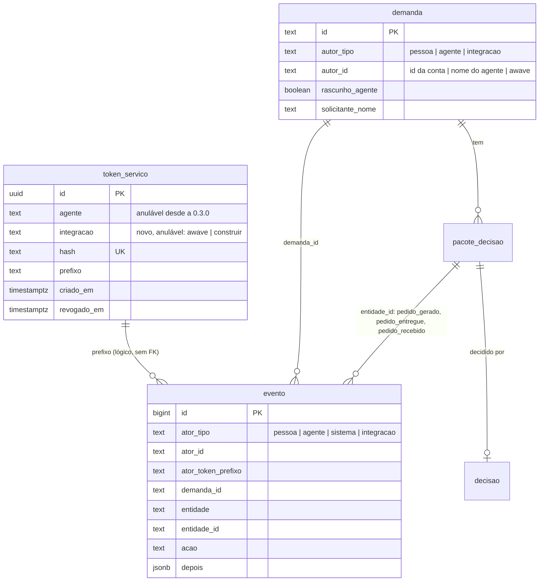

## Entrega

### 0. Escopo desta arquitetura

Evolução de um sistema no ar (0.2.0, `main` a9fd9b8) para a 0.3.0. O desenho parte do monólito modular de hoje
(ADR-01 a ADR-19, cap. 01 do manual) e acrescenta **um tipo de ator**, **três ações para a integração `construir`**,
**uma ação de pessoa** (confirmar demanda do Awave), **três rotas de API**, **uma Server Action**, **uma migration
gerada e aditiva** e mudanças de leitura no painel. Não há processo, serviço, fila, job, dependência, variável de ambiente
nem chamada de saída novos: as duas integrações **chamam** o Orquestrador; o Orquestrador não chama ninguém de novo.

Os ADRs continuam a numeração do sistema: **ADR-20 a ADR-29** (seção 9). Os requisitos citados (RF-NN, RNF-NN, CA-NN.n)
são os de `01-analista-requisitos.md` deste pedido.

### 1. Visão da solução

```mermaid
flowchart LR
  subgraph Fora do app
    AW[Awave, empresa-ia<br/>tool criar_demanda_orquestrador]
    CO[/construir no host<br/>buscar-pedidos.mjs, cron 5 min/]
    P[Pessoa com 2FA<br/>navegador]
  end
  AW -->|http://orquestrador_app<br/>Bearer wsod_ integracao awave<br/>10 s| RT
  CO -->|https domínio público<br/>Bearer wsod_ integracao construir<br/>15 s| RT
  P -->|cookie de sessão| PN[Painel: fila com origem, detalhe com confirmação,<br/>DEC com Recebido pelo /construir]
  subgraph app Next, 1 réplica
    RT[rota: regex, CSRF, resolverAtor, autorizar, Zod] --> MOD
    PN --> SA[Server Action confirmarDemandaNoPainel] --> MOD
    PN --> MOD
    MOD[src/modules: acesso, demandas, limites, historico, pedido-construcao]
  end
  MOD --> DB[(Postgres 16)]
  MOD -.->|só na confirmação por pessoa, se o insumo_tecnico estiver ligado| FILA[pg-boss: job do insumo_tecnico, como hoje]
```

Princípios:

1. **Lista de permissão fechada por integração.** Uma integração só faz o que a linha da matriz dela lista; ação nova
   nasce negada para toda integração. Nenhuma regra que percorre `AGENTES` a alcança.
2. **Todo ramo por tipo de ator é exaustivo.** Onde o código decide por `ator.tipo` (vista, autoria, limite, histórico,
   colunas do evento), a decisão é um `switch` com verificação `never`: o tipo novo quebra o `typecheck` em vez de cair
   no ramo "não é pessoa, então é agente".
3. **Estado derivado do histórico.** "Confirmada", "pendente", "entregue" e "recebido" saem dos eventos, que já são só de
   inclusão (ADR-03). Nenhuma coluna de estado nova, nenhum `UPDATE` novo, nenhum privilégio novo.
4. **O mesmo código gera e entrega.** A entrega ao `/construir` chama a mesma função de conferência e montagem da
   geração por pessoa: os bytes são iguais por construção, não por cópia.

### 2. Componentes e responsabilidades

| Id | Componente | Caminho | Responsabilidade | RF |
|---|---|---|---|---|
| C01 | Ator e token de serviço | `src/db/schema/acesso.ts` (`INTEGRACOES`, coluna `integracao`), `src/modules/acesso/ator.ts` (`AtorIntegracao`, `NOME_DA_INTEGRACAO`), `tokens-servico.ts`, `resolver-ator.ts` (sem mudança de regra) | `INTEGRACOES = ['awave', 'construir'] as const` com fonte única no esquema, reexportada como `AGENTES` é. `AtorIntegracao = { tipo: 'integracao'; integracao: Integracao; prefixoToken: string }`. `criarTokenServico(t, dono, relogio)` com `dono` = `{ agente }` ou `{ integracao }`. `validarTokenServico` lê `agente`, `integracao` e `prefixo` e devolve `AtorAgente`, `AtorIntegracao` ou `null` (linha que não casa com nenhuma das listas = token inválido, 401). Formato, geração, hash, mensagem 401 e 400 de cookie + Bearer: sem mudança | RF-01, RF-11 |
| C02 | Scripts de token | `scripts/criar-token-servico.ts`, `scripts/revogar-token-servico.ts` | Criação: `--agente <agente>` **ou** `--integracao awave\|construir`, exatamente um, `strictObject` (C-37; `--token` continua recusado). Evento `token_criado` (ator `sistema`) com `{ agente, prefixo }` ou `{ integracao, prefixo }`. Revogação pelo prefixo: sem mudança de código, só de comentário e teste | RF-02 |
| C03 | Matriz de acesso | `src/modules/acesso/matriz.ts` | `Linha` ganha `integracoes: readonly Integracao[]` (padrão vazio). Ações novas: `confirmar_demanda` (pessoa qualquer), `listar_pedidos_pendentes`, `entregar_pedido`, `confirmar_recebimento_pedido` (só `construir`). `criar_demanda` e `ler_demanda` ganham `['awave']`; `LEITURA` continua sem integração (a linha de `ler_demanda` deixa de usar `LEITURA`). `permitido` ganha o ramo `integracao` (lista fechada e linha). `atoresProibidos` devolve também as integrações | RF-03, RF-06, RF-11 |
| C04 | Criação de demanda | `src/modules/demandas/servico.ts`, `src/app/api/demandas/route.ts` | `autoriaDaDemanda(ator)` (pessoa, agente ou `{ autorTipo: 'integracao', autorId: 'awave' }`), separada de `autoriaDo(ator)` das versões, que continua recusando integração. Para integração: `solicitanteNome = NOME_DA_INTEGRACAO[integracao]`, `rascunhoAgente = true`, evento com o ator de integração e, **sem chamar `dispararSeLigado`** (lista de permissão: só `pessoa` e `agente` disparam). Tempo limite do servidor para integração (ADR-28). A rota não muda de forma: `vistaDaDemandaPara` já decide a vista do 201 | RF-04, RF-05 |
| C05 | Confirmação da demanda do Awave | `src/modules/demandas/confirmar.ts` (novo), `src/app/(painel)/demandas/[id]/acoes.ts` (`confirmarDemandaNoPainel`), detalhe da demanda | `confirmarDemanda(deps, ator, id)`: `autorizar(ator, 'confirmar_demanda')`; na transação, `travarDemanda`; origem diferente de Awave → 409; status final → 409; já confirmada → devolve `{ jaConfirmada: true }` sem gravar; senão grava `demanda_confirmada` (pessoa, `depois: { confirmada: true }`) e chama `dispararSeLigado(tr, deps, 'insumo_tecnico', 'demanda:<id>', id)`. `confirmacaoDaDemanda(db, id)` lê o evento (quem e quando) para a página. Sem rota de API (ADR-25) | RF-06 |
| C06 | Leituras de demanda | `src/modules/demandas/consultas.ts`, `src/app/api/demandas/[id]/route.ts` | `Responsavel` e `ResponsavelMinimo` ganham `{ tipo: 'integracao'; integracao }`. `obterDemandaDaIntegracao(db, ator, id)`: uma consulta com `id`, `autor_tipo = 'integracao'` e `autor_id = ator.integracao` no `WHERE`; sem linha → o mesmo `nao_encontrado` de hoje; monta a vista de 6 chaves (`id`, `titulo` minimizado pelo M-1, `tipo`, `status`, `criadaEm`, `atualizadaEm`) sem carregar ESP, RSK, DEC nem execuções. `vistaDaDemandaPara` vira `switch` exaustivo (pessoa → inteira; agente → mínima de hoje; integração → 6 chaves; sistema → erro). O GET por id chama `obterDemandaDaIntegracao` quando o ator é integração, antes de qualquer outra leitura. `OrigemDaDemanda = 'pessoa' \| 'agente' \| 'awave'` e `origemDaAutoria(autorTipo, autorId)`; `DemandaResumo.origem`; filtro `origem` em `filtroDemandasSchema`, `paginaDeDemandas` e `contarDemandasPorStatus` | RF-07, RF-10 |
| C07 | Limite por ator | `src/modules/limites.ts` | `autoriaDo` interno ganha o ramo integração; `limiteDe(ator, tipo)`: `awave` = 10 demandas; os outros, os 30 e 60 de hoje. Mensagem própria do limite de 10. A chave da trava consultiva já separa por `autorTipo:autorId` (`limite:demanda:integracao:awave`), então o Awave não espera pessoa nem agente | RF-08 |
| C08 | Adaptador de rota | `src/lib/rota.ts` (sem mudança de regra) | Bearer sem cookie continua sem exigir `Origin` (C-15 só com cookie); corpo ausente não exige `content-type`. A linha de log por requisição já leva só `atorTipo` (`integracao`), sem nome nem prefixo. Mudança só em `EXEMPLO_DO_PARAMETRO`, se o teste T13 precisar | RF-09 |
| C09 | Entrega ao `/construir` | `src/modules/pedido-construcao/conferir.ts` (novo, extraído de `gerar.ts`), `entregar.ts`, `pendentes.ts`, `receber.ts` (novos); rotas `src/app/api/pedidos-construcao/pendentes/route.ts` (GET), `[decId]/entrega/route.ts` (POST, sem corpo), `[decId]/recebimento/route.ts` (POST `{ sha256 }`) | `conferirEMontarPedido(tx, decId)`: passos 3 a 7 de hoje (DEC e trava, status final, aprovado, substituído, desatualizado, estudo, montagem, dados pessoais e nome, `validarPedido`), devolvendo `{ dec, json }`. `gerarPedido` = autorizar + confirmação + `conferirEMontarPedido` + `pedido_gerado` (comportamento e bytes iguais aos de hoje). `entregarPedido` = autorizar + `pedido_gerado` por pessoa existe (senão 404 de inexistente) + `conferirEMontarPedido` + `pedido_entregue` com `{ sha256 }` só na primeira entrega de cada hash. `listarPendentes` = uma consulta SQL (seção 5.3). `receberPedido` = autorizar + trava consultiva por DEC + 404/409/204 (seção 5.3) + `pedido_recebido` com `{ sha256 }` só uma vez | RF-12, RF-13, RF-14 |
| C10 | Painel: fila e detalhe da demanda | `src/app/(painel)/demandas/page.tsx`, `fila.tsx`, `CartoesDaFila.tsx`, `FiltrosFila.tsx`, `leituras-da-fila.ts`, `src/components/dados-da-fila.ts`, `[id]/page.tsx`, `[id]/demanda-da-pagina.ts`, `CartaoProximaAcao.tsx`, `src/components/dados-das-etapas.ts`, `src/components/rotulos.ts` | Coluna e rótulo de origem (tabela e cartões), filtro por origem combinado com os de hoje e a paginação (`hrefDaFila` leva `origem`). No detalhe: origem; estado "aguardando confirmação" ou "confirmada" (quem, quando) e o controle de confirmar só no primeiro caso; o cartão "Próxima ação" recebe a confirmação como entrada da função pura (ADR-17 continua: a página lê, a função decide). Textos da 03 | RF-06, RF-10 |
| C11 | Painel: DEC e histórico | `src/app/(painel)/pacotes-decisao/[decId]/page.tsx`, `pacote-da-pagina.ts`, `SecaoPedido.tsx`; `src/modules/historico/consultas.ts`, `src/app/(painel)/demandas/[id]/Historico.tsx`, `src/components/rotulos.ts` | `recebimentoDoPedido(db, decId)` → data do primeiro `pedido_recebido` ou `null`; a seção do pedido mostra "Recebido pelo /construir em <data e hora>" (fuso de `src/lib/fuso`). `AtorVisivel` ganha `{ tipo: 'integracao'; integracao; prefixo }` (o prefixo vem de `ator_token_prefixo`); rótulos dos eventos novos; nenhum cai no rótulo genérico | RF-15 |
| C12 | Histórico (gravação) | `src/modules/historico/registrar.ts` | `AcaoEvento` ganha `demanda_confirmada`, `pedido_entregue`, `pedido_recebido`. `colunasDoAtor` ganha o caso `integracao` (`ator_id` = nome da integração, `ator_token_prefixo` = prefixo). `depois` dos eventos novos: só booleano fixo ou `sha256` em hexadecimal (C-30, RNF-05) | RF-04, RF-06, RF-13, RF-14, RF-15 |
| C13 | Esquema e migration | `src/db/schema/acesso.ts`, `historico.ts`, `demandas.ts`; `drizzle/0007_<gerado>.sql` por `pnpm db:generate` | Seção 4. Uma migration gerada, sem migration custom: os `GRANT` de `token_servico`, `evento` e `demanda` são por tabela para `SELECT` e `INSERT`, e a coluna nova não entra no `UPDATE` | RNF-06 |
| C14 | Homologação e testes | `scripts/seed-ficticio.ts`, testes de contrato por integração, teste transversal da matriz, T13 das rotas, e2e | Seed com uma demanda do Awave (criada por `criarDemanda` com ator de integração) e um DEC aprovado vigente com pedido gerado por `gerarPedido` (não por evento escrito à mão). Token `construir` da V-01 emitido dentro da homologação pelo script, nunca escrito em arquivo do repositório | RF-09, RNF-08, V-01 |
| C15 | Versão e documentação | `package.json` (0.3.0), `CHANGELOG.md`, `docs/manual-tecnico/01`, `02`, `03`, `05`, `08`, `09`, `10`, `docs/operacao/` | Ator de integração e matriz; origem, limite do Awave, confirmação; as três rotas do cap. 05; emissão, troca e revogação dos dois tokens (sem valor) | RF-16 |

Dono de cada componente: o `tech-lead` do pedido até o merge; depois, o sistema (Fabiano). Como se observa e plano
de falha: seções 6 e 7.

**Rastreabilidade RF → componente:** RF-01 C01; RF-02 C02; RF-03 C03; RF-04 C04, C12; RF-05 C04; RF-06 C05, C10, C12;
RF-07 C06; RF-08 C07; RF-09 C08, C14; RF-10 C06, C10; RF-11 C01, C03; RF-12 C09; RF-13 C09, C12; RF-14 C09, C12;
RF-15 C11, C12; RF-16 C15. RNF-06 C13; RNF-08 C14.

### 3. Fluxos

**3.1 Awave cria demanda**

```mermaid
sequenceDiagram
  participant A as Awave (tool)
  participant R as rota() POST /api/demandas
  participant S as criarDemanda
  participant D as Postgres
  A->>R: Bearer wsod_..., JSON do contrato, sem Origin (10 s)
  R->>R: sem cookie: C-15 não pede Origin; content-type JSON
  R->>D: validarTokenServico (hash) → integracao awave
  R->>R: autorizar(awave, criar_demanda) → permitido
  R->>R: Zod criarDemandaSchema (400 se fora)
  R->>S: criarDemanda
  S->>D: BEGIN; SET LOCAL statement_timeout, lock_timeout (ADR-28)
  S->>D: trava consultiva limite:demanda:integracao:awave; conta 60 min (429 se ≥ 10)
  S->>D: nextval; INSERT demanda (autoria integracao/awave, rascunho, solicitante Awave)
  S->>D: INSERT evento demanda_criada (integracao, awave, prefixo; status e tipo)
  Note over S: sem dispararSeLigado para integração (D1)
  S->>D: COMMIT
  R-->>A: 201 vista de 6 chaves (id DEM-AAAAMMDD-NNNN, status nova)
```

**3.2 Pessoa confirma:** detalhe da demanda → `confirmarDemandaNoPainel({ id })` (`acaoDoPainel`, sessão, 2FA,
`confirmar_demanda`) → `confirmarDemanda`: trava, conferências, evento, `dispararSeLigado` na mesma transação (ADR-06
continua valendo: execução e job entram ou saem com o evento).

**3.3 `/construir` busca**

```mermaid
sequenceDiagram
  participant C as buscar-pedidos.mjs (15 s por chamada)
  participant O as Orquestrador
  C->>O: GET /api/pedidos-construcao/pendentes
  O-->>C: 200 { itens: [{ decId }] } (só ids, sem evento)
  loop até 20 por busca
    C->>O: POST /pedidos-construcao/DEC/entrega (sem corpo)
    O->>O: pedido_gerado por pessoa? senão 404; conferirEMontarPedido (409/422 sem evento)
    O->>O: pedido_entregue { sha256 } se ainda não houver com esse hash
    O-->>C: 200 bytes do pedido
    C->>C: validarPedido, grava pedidos/DEC.json (ou ja_existia / conflito)
    C->>O: POST /pedidos-construcao/DEC/recebimento { sha256 }
    O->>O: trava pedido:DEC; 404 / 409 sem entrega / 409 hash diferente
    O->>O: pedido_recebido { sha256 } só a primeira vez
    O-->>C: 204
  end
```

### 4. Modelo de dados (preliminar)



Mudanças de esquema (todas na mesma migration gerada, `0007`):

| Tabela | Mudança | Natureza |
|---|---|---|
| `token_servico` | `agente` passa a anulável; coluna `integracao text` anulável; CHECK `token_servico_integracao_check` (`"integracao" in ('awave', 'construir')`); CHECK `token_servico_dono_check` (`num_nonnulls("agente", "integracao") = 1`). O CHECK `token_servico_agente_check` fica como está (nulo passa) | Afrouxa um `NOT NULL`, acrescenta coluna e regra; nenhuma linha muda |
| `evento` | CHECK `evento_ator_tipo_check` passa a aceitar `'integracao'`; CHECK novo `evento_ator_integracao_check`: `"ator_tipo" <> 'integracao' or ("ator_id" in ('awave', 'construir') and "ator_token_prefixo" is not null)`; índice novo `evento_acao_entidade_idx (acao, entidade_id)` (ADR-27) | Amplia; acrescenta regra e índice |
| `demanda` | CHECK `demanda_autor_tipo_check` passa a aceitar `'integracao'`; CHECK novo `demanda_autor_integracao_check`: `"autor_tipo" <> 'integracao' or ("autor_id" = 'awave' and "rascunho_agente")` | Amplia; acrescenta regra |

- As tabelas de versões (ESP, RSK, DEC) **não** aceitam autoria de integração: o `AUTORES_ARTEFATO` delas não muda.
  A demanda passa a ter lista própria (`AUTORES_DEMANDA = ['pessoa', 'agente', 'integracao']`).
- `privilegios.ts` não muda: `token_servico.integracao` não entra em `colunasUpdate`; o `UPDATE` de `demanda` continua
  sem `autor_*` e `rascunho_agente` (C-11, C-34).
- Nenhum valor existente fere os CHECK novos (não há linha de integração antes da 0.3.0): `alteram_dado = false`.
- Os novos `ADD CONSTRAINT ... CHECK` leem as tabelas inteiras uma vez, e o `CREATE INDEX` segura a escrita em `evento`
  enquanto roda. Com o volume de hoje, isso leva milissegundos; a migration roda no passo separado do ADR-12, antes
  do deploy.
- **Nome que não pode colidir:** `Origem` já é o tipo do canal da entrada bruta (`demandas.ts`). A origem da demanda
  na fila se chama `OrigemDaDemanda` / `ORIGENS_DA_DEMANDA`.

Eventos novos e o que levam (C-30, RNF-05):

| `acao` | Ator | `entidade` / `entidade_id` | `demanda_id` | `depois` |
|---|---|---|---|---|
| `demanda_criada` (pelo Awave) | integração `awave` + prefixo | `demanda` / DEM | DEM | `{ status: 'nova', tipo }` (como hoje) |
| `demanda_confirmada` | pessoa | `demanda` / DEM | DEM | `{ confirmada: true }` |
| `pedido_entregue` | integração `construir` + prefixo | `pacote_decisao` / DEC | DEM do DEC | `{ sha256 }` (64 hexadecimais) |
| `pedido_recebido` | integração `construir` + prefixo | `pacote_decisao` / DEC | DEM do DEC | `{ sha256 }` |
| `token_criado` (integração) | sistema | `token_servico` / prefixo | nulo | `{ integracao, prefixo }` |
| `token_revogado` | sistema | `token_servico` / prefixo | nulo | `{ prefixo }` (como hoje) |

### 5. Contratos

**5.1 Awave (não muda, RNF-08):** o da seção 4 do `01`. Respostas desta arquitetura: 201 com a vista de 6 chaves;
400 `entrada_invalida` (Zod); 401 `nao_autenticado`; 403 `sem_permissao`; 429 `limite_excedido` com a mensagem do
limite de 10; 503 `indisponivel` quando o tempo limite do servidor estoura (ADR-28; o Awave trata como "confira a
fila antes de repetir", e nada foi gravado). Nenhum 3xx.

**5.2 Leitura pelo Awave:** `GET /api/demandas/:id` → 200 com exatamente `id`, `titulo`, `tipo`, `status`, `criadaEm`,
`atualizadaEm`; demanda de outro autor ou inexistente → 404 com o mesmo corpo (`nao_encontrado`). Toda outra rota → 403.

**5.3 `/construir` (não muda, RNF-08):**

| Rota | Ação | Entrada | Respostas |
|---|---|---|---|
| `GET /api/pedidos-construcao/pendentes` | `listar_pedidos_pendentes` | — | 200 `{ itens: [{ decId }] }`, do primeiro `pedido_gerado` mais antigo para o mais novo; nenhuma outra chave; não grava evento |
| `POST /api/pedidos-construcao/[decId]/entrega` | `entregar_pedido` | sem corpo, sem `content-type` | 200 `application/json; charset=utf-8`, corpo = bytes da geração; 404 (DEC inexistente ou sem `pedido_gerado` por pessoa, o mesmo corpo); 409 e 422 com as mensagens do RF-22; recusa não grava evento |
| `POST /api/pedidos-construcao/[decId]/recebimento` | `confirmar_recebimento_pedido` | `{ sha256: /^[0-9a-f]{64}$/ }` | 400 (corpo fora, antes de olhar o DEC, pela ordem do `rota()`); 404 (como na entrega); 409 (nunca entregue); 409 (hash diferente de todo `pedido_entregue` do DEC, sem evento); 204 (bate; `pedido_recebido` só na primeira vez) |

Consulta de pendentes (uma só, sem laço por DEC), reaproveitando as expressões que já existem:

```
DEC p  JOIN decisao (status_decisao = 'aprovada')  JOIN demanda (status fora de STATUS_FINAIS)
JOIN (primeiro pedido_gerado com ator_tipo = 'pessoa' e entidade = 'pacote_decisao', por entidade_id) g
WHERE expressaoSubstituidoPor() IS NULL AND NOT expressaoDesatualizado()
  AND NOT EXISTS (evento pedido_recebido com entidade_id = p.id)
ORDER BY g.primeiro, p.id
```

### 6. Integrações externas: falha e tempo limite

O Orquestrador **não faz chamada de saída nova**. As integrações deste pedido entram; a tabela diz o tempo limite de
cada lado e o que acontece na falha.

| Integração | Direção e transporte | Tempo limite | Comportamento na falha |
|---|---|---|---|
| Awave → `POST /api/demandas` | entrada; rede interna do Easypanel (`http://orquestrador_app`), sem TLS, sem sair da VPS | cliente: 10 s, sem seguir redirecionamento. Servidor (ADR-28): `lock_timeout` 2 s e `statement_timeout` 5 s na transação de ator de integração; RNF-01 p95 ≤ 1 s | 4xx com `{ erro, mensagem }`, mostrada ao dono. Tempo estourado no servidor → `ROLLBACK` e 503 (nada gravado). Orquestrador fora do ar → erro de rede no Awave. **Sem chave de idempotência no contrato:** se o 201 se perder no caminho depois do `COMMIT`, o Awave pede para conferir a fila; uma repetição cria outra demanda, contida pelo limite de 10/h, pelo rascunho e pela confirmação por pessoa |
| Awave → `GET /api/demandas/:id` | entrada; mesma rede | cliente: o mesmo do Awave; servidor: o mesmo orçamento | Só leitura; repetir é seguro |
| `/construir` → `pendentes` | entrada; HTTPS pelo domínio público, do host | cliente: 15 s; servidor: `statement_timeout` 5 s (ADR-28); RNF-02 p95 ≤ 1 s | Só leitura. Falha → a busca acaba com erro e o cron tenta de novo em 5 min; aviso por e-mail do lado do `/construir` |
| `/construir` → `entrega` | entrada; HTTPS | cliente: 15 s; servidor: `lock_timeout` 2 s, `statement_timeout` 10 s; RNF-02 p95 ≤ 3 s com 512 KB | Recusa (404, 409, 422) sem evento; o cliente marca o pedido como erro e tenta na próxima busca. Entrega repetida devolve os mesmos bytes e não grava outro `pedido_entregue` com o mesmo hash |
| `/construir` → `recebimento` | entrada; HTTPS | cliente: 15 s; servidor: `lock_timeout` 2 s, `statement_timeout` 5 s | Idempotente. Falha depois de gravar o arquivo → na próxima busca o DEC continua pendente, a entrega se repete, o cliente acha o arquivo igual (`ja_existia`) e confirma de novo |
| Orquestrador → Anthropic (existente) | saída, só pelo worker | 120 s (ADR-08, sem mudança) | Sem mudança. A confirmação por pessoa só enfileira o job do `insumo_tecnico` como a criação faz hoje; o worker segue com a regra de tentativas e teto de hoje |

### 7. Observabilidade e plano de falha

- **Log:** a linha por requisição (C-21) já existe para as três rotas novas (rota padrão, status, ms, `atorTipo`). O
  tipo `integracao` basta para separar: a rota diz qual integração (as de `pedidos-construcao` são só do `construir`;
  `POST /api/demandas` por integração é só do `awave`). Nenhum token, prefixo, hash, título ou corpo no log.
- **Histórico:** todo ato das integrações tem evento com o prefixo do token, menos a listagem de pendentes (só leitura,
  RF-12).
- **Sentry:** só 5xx, reduzido, como hoje. O 503 do tempo limite (ADR-28) vai ao Sentry com o código, sem a consulta.
- **Painel:** origem na fila; "aguardando confirmação"; "Recebido pelo /construir em" no DEC. Um DEC que o `/construir`
  não consegue receber (409 ou 422 recorrente) aparece no e-mail da busca do lado de lá.
- **Plano de falha por componente:** token vazado → `revogar-token-servico.ts --prefixo` (efeito imediato, os outros
  tokens seguem); entrega quebrada → o `/construir` desliga no `orquestrador.json` e volta à cópia manual (o RF-22 de
  pessoa não muda); limite do Awave estourando → 429 até a janela andar; migration com problema → backup e volta
  (ADR-12: imagem antiga não fica saudável em banco migrado, a volta é por restauração).
- **Versão anterior lendo dado da 0.3.0:** a 0.2.0 lança "autoria desconhecida" (500) no detalhe de uma demanda do
  Awave e trata um token de integração como agente nulo (403). Como a volta é sempre com restauração do backup
  (ADR-12), essas linhas não existem na volta. O procedimento de volta no `docs/operacao/deploy.md` ganha uma linha:
  revogar os dois tokens antes de restaurar não é preciso, porque o backup é anterior à emissão.

### 8. Porta de desenvolvimento

**3101**, a de hoje (`"dev": "next dev -p 3101"`), diferente de 3000 e livre em `ss -ltn` nesta etapa (em escuta só
53, 80, 443, 22, 2377, 3000, 7946 e portas altas de loopback). Postgres de desenvolvimento em `127.0.0.1:5434`.
Homologação em `127.0.0.1:${HML_PORTA}`, de 3200 a 3299 (escolhida pelo maestro).

### 9. ADRs

**ADR-20. Integração é um quarto tipo de ator, com lista fechada no esquema**
- Contexto: o Awave e o `/construir` precisam de acesso mínimo. Agente de IA traz interruptor, teto, uso de IA e a
  linha `LEITURA` (fila inteira). Opção A aprovada no DEC.
- Decisão: `Ator` = pessoa | agente | sistema | **integracao**. `INTEGRACOES = ['awave', 'construir']` em
  `src/db/schema/acesso.ts`, espelhada nos CHECK do banco. Integração nunca entra em `AGENTES`.
- Alternativas descartadas: quinto agente (cada exceção vira um `if` que alguém esquece; entra na tela de agentes e no
  teto); tabela de integrações cadastráveis (abre emissão de acesso sem pedido nem revisão; para duas integrações
  internas, é estrutura sem uso).
- Consequência: integração nova = pedido + migration que amplia os CHECK. Custo aceito: é raro e passa por revisão
  de segurança.

**ADR-21. Token de integração na mesma tabela, com `agente` anulável e `integracao` nova**
- Contexto: emissão, hash, prefixo e revogação são os mesmos dos agentes (RF-01, RF-02).
- Decisão: `token_servico.agente` anulável, `token_servico.integracao` nova e anulável, CHECK de exatamente um dos dois
  (`num_nonnulls = 1`). Uma busca por hash, uma revogação por prefixo para qualquer token.
- Alternativas descartadas: colunas genéricas `dono_tipo` + `dono` (exige migrar as linhas existentes,
  `alteram_dado = true`); tabela `token_integracao` separada (duas buscas por requisição, dois caminhos de revogação,
  scripts duplicados).
- Consequência: a migration afrouxa um `NOT NULL` (sem tocar linha) e a 0.2.0 leria token de integração como agente
  nulo (403, seção 7). O tipo TypeScript de `agente` passa a `Agente | null` e quem o lê trata o nulo.

**ADR-22. Matriz com coluna de integrações e ramos exaustivos por tipo de ator**
- Contexto: hoje vários pontos decidem "pessoa, senão agente" (`vistaDaDemandaPara`, `listarDemandasPara`, as vistas de
  ESP, RSK e DEC, `autoriaDo`, `responsavelDe`, `atorVisivel`, `entrada-agente.ts`). Um tipo novo cairia no ramo do
  agente e ganharia a vista mínima de agente sem ninguém decidir.
- Decisão: `Linha.integracoes` com padrão vazio (ação nova nasce negada); `permitido` com ramo próprio; e todo ponto
  que decide por `ator.tipo` vira `switch` com `never` no fim. O `tech-lead` inventaria esses pontos na etapa 05.
- Alternativas descartadas: manter `if/else` e acrescentar um `if` por lugar (o esquecimento só aparece em produção);
  um `if (ator.tipo === 'integracao') throw` no começo de cada rota (repete a matriz e não protege Server Action nem job).
- Consequência: mudança mecânica em vários arquivos, com o `typecheck` apontando cada um; o teste transversal da matriz
  e o T13 cobrem integração em toda ação e toda rota.

**ADR-23. Leitura do Awave por consulta própria, filtrada pela autoria, com vista de seis chaves**
- Contexto: RF-07 pede 404 igual ao de inexistente para demanda de outro autor e só seis campos.
- Decisão: `obterDemandaDaIntegracao` põe a autoria no `WHERE` e monta a vista chave a chave, sem carregar versões,
  execuções nem conta do autor. A rota decide pelo tipo de ator antes de qualquer outra leitura.
- Alternativa descartada: `obterDemanda` e depois conferir o autor (carrega ESP, RSK e DEC à toa, e o 404 passa a
  depender de um `if` depois da leitura, mais fácil de inverter).
- Consequência: duas formas de ler uma demanda; a guarda é o teste de chaves exatas (CA-07.1) e o de 404 idêntico.

**ADR-24. Autoria de demanda por integração, travada no banco, e limite por integração**
- Contexto: C-11 (autoria só do ator), RF-04 (`solicitanteNome` "Awave", rascunho), RF-08 (10 por hora).
- Decisão: `autoriaDaDemanda(ator)` separada de `autoriaDo(ator)` (que segue só para as versões); CHECK
  `demanda_autor_integracao_check` garante no banco que só o `awave` cria e sempre como rascunho. `limiteDe(ator, tipo)`
  com o valor por integração, na mesma trava consultiva por ator do C-36.
- Alternativa descartada: guardar o limite em configuração no banco (mais uma tabela e tela para um número decidido
  por Fabiano; mudar o número é decisão, e decisão passa por pedido).
- Consequência: o `solicitanteNome` enviado pelo Awave é descartado em silêncio (o contrato manda "Awave" de qualquer
  forma). Os demais campos do schema comum (`anexos`, `urgencia` etc.) seguem aceitos como no RF-04; ver Pendências
  para a etapa 04.

**ADR-25. Sem disparo para integração; confirmação por pessoa como ação própria, só no painel, com estado no evento**
- Contexto: D1 (texto de fora não vai sozinho a um modelo de IA) e RF-06.
- Decisão: `criarDemanda` dispara o `insumo_tecnico` só para pessoa e agente (lista de permissão). A ação
  `confirmar_demanda` (qualquer papel de pessoa) existe só como Server Action; "confirmada" é a existência do evento
  `demanda_confirmada`, lida sob a trava da demanda, o que torna a repetição idempotente sem coluna nova.
- Alternativas descartadas: confirmar ao mover para `em_analise` (muda a transição para todas as demandas e mistura
  dois atos); coluna `confirmada_em` (mais um `UPDATE` permitido ao papel do app, contra o C-34); rota de API (nenhum
  cliente precisa dela, e cada rota é superfície a mais).
- Consequência: a leitura de "confirmada" é uma consulta ao histórico por demanda (índice da ADR-27). Se um dia uma
  integração precisar confirmar, é ação nova na matriz.

**ADR-26. Entrega ao `/construir` reaproveita a geração; pendência e recebimento vêm dos eventos; o hash fica no evento**
- Contexto: RF-12 a RF-14, CA-22.2 (mesmos bytes) e o `/construir` que busca (o Orquestrador nunca chama para fora).
- Decisão: extrair `conferirEMontarPedido` de `gerarPedido` e chamá-lo das duas pontas; "pendente" é uma consulta
  sobre `pedido_gerado`, decisão, substituído, desatualizado, status final e `pedido_recebido`; `pedido_entregue`
  guarda o `sha256` dos bytes entregues e o recebimento compara com ele. `pedido_entregue` e `pedido_recebido` só são
  gravados uma vez por hash (repetir não polui o histórico).
- Alternativas descartadas: tabela `entrega_pedido` com estado (estado duplicado do histórico, mais migration,
  `UPDATE` novo); refazer a montagem no recebimento para comparar (custa até ~1 s e falha quando o DEC foi substituído
  depois da entrega, contra o RF-14); o Orquestrador empurrar o pedido por webhook (precisaria de rede e credencial de
  saída até o host; o contrato do `/construir` já é de busca).
- Consequência: o refatoramento da geração tem de deixar o `gerarPedido` com os mesmos bytes e os mesmos códigos; o
  teste de hoje da CA-22.2 e um teste novo (SHA-256 da geração igual ao da entrega para o mesmo DEC) são a guarda. Um
  DEC cuja entrega passe a ser recusada por 422 continua em `pendentes` até uma pessoa resolver (ver Decisões).

**ADR-27. Índice `evento (acao, entidade_id)`**
- Contexto: pendentes, recebido, entregue e confirmada procuram evento por ação e entidade; o único índice de `evento`
  é `(demanda_id, ocorrido_em)`, e a tabela só cresce.
- Decisão: `evento_acao_entidade_idx (acao, entidade_id)`, na migration gerada.
- Alternativa descartada: sem índice (com 20 mil eventos a varredura cabe no RNF-02, mas o custo cresce com o
  histórico inteiro, que é permanente).
- Consequência: um índice a mais em toda inserção de evento (custo pequeno); o `CREATE INDEX` segura a escrita em
  `evento` durante a migration, que roda antes do deploy (ADR-12).

**ADR-28. Tempo limite do servidor abaixo do tempo do cliente nas transações de integração**
- Contexto: o Awave corta em 10 s e o `/construir` em 15 s. Se o servidor gravar depois de o cliente desistir, o
  Awave pode repetir e duplicar a demanda.
- Decisão: as transações abertas para ator de integração começam com `SET LOCAL lock_timeout = '2s'` e
  `SET LOCAL statement_timeout` (5 s; 10 s na entrega, que faz a varredura de nome). Cancelamento (`57014`) ou trava
  não obtida (`55P03`) viram `503 indisponivel` com mensagem curta, sem detalhe, e `ROLLBACK`. Pessoa e agente não mudam.
- Alternativa descartada: `statement_timeout` no papel do banco (vale para tudo, inclusive o worker e as migrations
  do pg-boss); não limitar (o RNF-01 cobre o caso comum, não a trava presa).
- Consequência: um código de erro novo no `mapearErro` (`indisponivel`, 503). O PostgreSQL 16 não tem tempo limite por
  transação; o orçamento por comando, com poucos comandos por transação, fica bem abaixo dos 10 s.

**ADR-29. Stack sem mudança; as versões em uso substituem as do padrão técnico neste sistema**
- Contexto: o `padrao-tecnico.md` pede ADR para mudar de linha do Next (16.3 → 16.4). O sistema já está na 16.4.1, com
  `better-auth` 1.7.7 e `zod` 4.6.6, por correção de segurança (S-01, cap. 01), e essa troca ficou sem ADR.
- Decisão: este pedido não acrescenta pacote nem muda versão. Registra-se aqui o desvio já existente: valem as versões
  do `package.json` (Next e `eslint-config-next` 16.4.1, `better-auth` 1.7.7, `zod` 4.6.6, com o `override` do
  `pnpm-workspace.yaml`), por serem as que fecharam vulnerabilidade alta.
- Alternativa descartada: voltar à 16.3.8 (reabriria a vulnerabilidade da S-01).
- Consequência: o `padrao-tecnico.md` fica atrás deste sistema até alguém atualizá-lo (fora deste repositório; ver
  Pendências).

## Decisões tomadas

- Ator de integração como tipo próprio, com lista fechada no esquema e nos CHECK: é a opção A do DEC e fecha a
  permissão por construção (ADR-20).
- Token na mesma tabela, com `agente` anulável e CHECK de exatamente um: não toca linha existente e mantém um caminho
  só de validação e revogação (ADR-21).
- Argumento do script `--integracao awave|construir`, exclusivo com `--agente`: é o que o insumo e o `/construir` já
  documentam.
- Nomes das ações: `confirmar_demanda`, `listar_pedidos_pendentes`, `entregar_pedido`, `confirmar_recebimento_pedido`:
  os três últimos vêm da ESP; o primeiro segue a sugestão do RF-06.
- Ramos por tipo de ator viram `switch` exaustivo: `vistaDaDemandaPara` hoje daria a vista de agente a qualquer ator
  que não seja pessoa (ADR-22).
- Leitura do Awave com a autoria no `WHERE`: o 404 sai da mesma consulta de inexistente (ADR-23).
- CHECK no banco para autoria de integração na demanda e no evento: defesa em profundidade do C-11, sem custo de
  migration de dado (ADR-24).
- Confirmação só como Server Action, com estado no evento: sem rota, sem coluna, sem `UPDATE` novo (ADR-25).
- Comparação do SHA-256 pelo hash gravado em `pedido_entregue`, e não refazendo a montagem: atende o RF-14 quando o DEC
  é substituído depois da entrega e custa uma consulta (ADR-26).
- `pedido_entregue` gravado uma vez por hash: um DEC que o `/construir` não consegue receber seria entregue a cada 5 min,
  e o histórico da demanda ficaria cheio de linhas iguais. CA-13.5 continua atendido pela primeira entrega.
- DEC pendente com entrega recusada por 422 continua na lista: tirá-lo exigiria montar e varrer cada pedido na
  listagem (custo do RNF-02) e esconderia o problema; o aviso por e-mail do `/construir` é o sinal, e o caso é raro
  (renomear o solicitante depois de gerar).
- `origem` entra em `DemandaResumo` para todo ator que lista (pessoa e agentes): é enumeração sem dado pessoal, e o
  painel e a API usam uma consulta só.
- Índice `(acao, entidade_id)` em `evento`: a tabela é permanente e as quatro leituras novas procuram por ação e
  entidade (ADR-27).
- Tempo limite do servidor abaixo do tempo do cliente só para integração: reduz a duplicata por repetição do Awave
  sem mudar o comportamento de pessoa e agente (ADR-28).
- Porta 3101 mantida: já é a do sistema e estava livre.

## Pendências

- Nenhuma bloqueia a etapa. Itens para as etapas seguintes e para Fabiano ver na Parada:
- (seguranca-aplicacao, etapa 04) Campos do schema comum que o contrato do Awave não usa (`anexos` com URL, `urgencia`,
  `justificativaUrgencia`, `impactoPercebido`, `linhaServicoProvavel`): ficaram aceitos como no RF-04. Recomendação
  do arquiteto: descartar no serviço para autoria `awave` (lista de permissão de campos: `titulo`, `tipo`,
  `solicitantePapel`, `descricaoProblema`, `contexto`), sem 400, como já se faz com o `solicitanteNome`. Decidir na 04.
- (seguranca-aplicacao, etapa 04) Validar `origem` nos itens de `GET /api/demandas` para agentes, o prefixo do token
  mostrado à pessoa no histórico (RF-15) e o `sha256` no `depois` dos eventos `pedido_*`.
- (seguranca-aplicacao, etapa 04) Duplicata de demanda quando o 201 se perde depois do `COMMIT` (o contrato do Awave
  não tem chave de idempotência e não pode mudar): risco residual aceito com o limite de 10/h, o rascunho e a
  confirmação por pessoa; registrar se concordar.
- (Fabiano, na Parada 1) `pedido_entregue` uma vez por hash e DEC com entrega recusada por 422 mantido em `pendentes`
  (Decisões). Se preferir outra regra, muda antes da etapa 05.
- (Fabiano / analista) Pedidos gerados antes da 0.3.0 entram em `pendentes` na primeira busca (pendência do `01`).
  Como a entrega devolve os bytes de hoje, o arquivo antigo em `pedidos/` que tiver sido gerado antes da 0.1.12 vira
  `conflito` no `/construir`; nenhum dado se perde, e Fabiano resolve um a um.
- (tech-lead, etapa 05) Inventário de todo ponto que decide por `ator.tipo` (ADR-22), incluindo
  `src/modules/agentes/entrada-agente.ts` e as vistas de ESP, RSK e DEC; teste que fixa o SHA-256 da geração antes e
  depois do refatoramento de `gerar.ts`; seed da homologação com uma demanda do Awave e um DEC com pedido gerado por
  `gerarPedido`, e emissão do token `construir` da V-01 por script dentro da homologação.
- (devops-sre, etapa 09) Migration `0007` com `ADD CONSTRAINT` e `CREATE INDEX` em `evento`, `demanda` e
  `token_servico`: roda no passo separado do ADR-12, com backup antes; a volta é por restauração. Lembrar o snapshot e
  o risco atual dele (congela a VPS).
- (ux-ui-design, etapa 03) Textos listados no `01`, mais a mensagem do 503 `indisponivel` e a da recusa da
  confirmação (origem que não é Awave; status final).
- (estruturaAutonoma, fora deste repositório) O `padrao-tecnico.md` ainda cita Next 16.3.8, Zod 4.6.5 e Better Auth
  1.7.6 (ADR-29); atualizar é tarefa de quem cuida do padrão.

## Comandos executados

- `git -C /home/deploy/servidor/projetos/ws-orquestrador-demandas status` — ramo `construcao/DEC-DEM-20261111-0016-v1`, limpo
- `git -C /home/deploy/servidor/projetos/ws-orquestrador-demandas log --oneline -15` — base a9fd9b8 (0.2.0) e as passagens 00 e 01
- `git -C /home/deploy/servidor/projetos/ws-orquestrador-demandas log -i -G vigil --name-only --oneline` — onde está a vigia de origem da 0.2.0 (só nos e2e)
- `git -C /home/deploy/servidor/projetos/ws-orquestrador-demandas diff --name-only 4b825dc642cb6eb9a060e54bf8d69288fbee4904 HEAD -- src scripts drizzle docs/manual-tecnico docs/operacao docker-compose.hml.yml package.json` — lista dos arquivos rastreados lidos
- `ss -ltn` — 3101 livre; em escuta 22, 53, 80, 443, 2377, 3000, 7946 e portas altas de loopback

## Critério de pronto atendido

- [x] cada RF de 01 tem um componente responsável
- [x] a stack é a do padrão técnico, ou o desvio tem ADR
- [x] cada integração externa tem comportamento de falha e tempo limite
- [x] a porta de desenvolvimento é diferente de 3000 e estava livre em `ss -ltn`
- [x] o texto não tem segredo nem valor de `.env`
