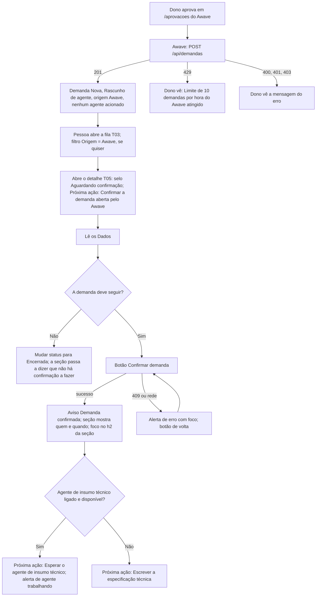
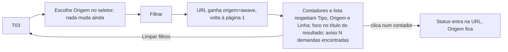
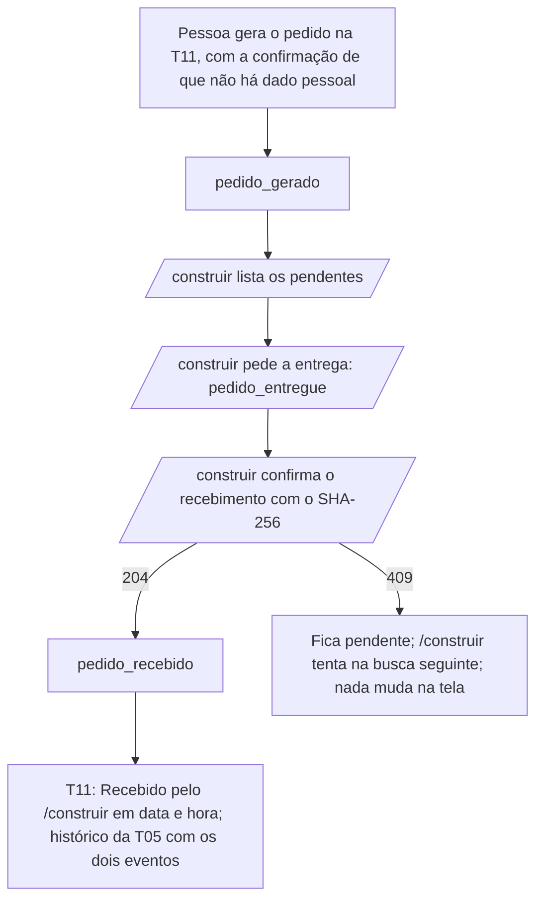

## Entrega

### 0. Escopo e regra de leitura

Interface da 0.3.0 do WS Orquestrador de Demandas. A maior parte do pedido é API, matriz, scripts e banco, sem tela.
O que chega ao painel é pouco, e esta entrega cobre só isso:

- **T03 Fila:** a origem de cada demanda (Pessoa, Agente de IA, Awave) e o filtro por origem (RF-10; CA-04.7).
- **T05 Demanda:** a origem nos dados, o selo e a seção de **confirmação** da demanda do Awave (RF-06), uma linha nova
  no cartão "Próxima ação" e os textos dos eventos novos no histórico (RF-15).
- **T11 Decisão:** a linha "Recebido pelo /construir em …" e o texto da seção "Pedido de Construção", que deixa de dizer
  que o envio é só manual (RF-15; CA-16.3).
- **T12 Agentes e teto:** nada muda; a integração não aparece (RF-11).
- **Mensagens da API** que alguém lê (o dono no Awave, Fabiano no e-mail do `/construir`): o texto do limite de 10
  (RF-08) e as recusas novas (RF-06, RF-14).

Regras que valem em todo o documento:

- RF-NN e CA-NN.n são os do `01-analista-requisitos.md` deste pedido. Seção "0015, n.n" é a do
  `03-ux-ui-design.md` do pedido 0015 (0.2.0).
- Base visual: a 0.2.0 na `main`. Casca A, tokens do `@theme` em `globals.css`, componentes e pontos de quebra são os da
  0.2.0, **sem nenhuma mudança**: celular abaixo de 768 px, tablete de 768 a 1199 px, computador a partir de 1200 px;
  larguras de teste 1280 × 720 e 390 × 844, reflow em 320 px.
- Texto que **não muda** é citado pela constante do código (ex.: `TEXTOS_FILA.vazioComFiltro`). Texto **novo ou
  alterado** está por inteiro no lugar onde aparece e, de novo, na seção 9.
- Nada aqui cria regra de negócio: quando a seção aparece, quem pode confirmar e o que a confirmação faz são do RF-06 e
  do servidor. A tela só mostra o estado que o servidor já gravou.
- Nenhum token, hash ou prefixo inventado aparece em tela; os exemplos usam `a1b2c3d4` e nomes fictícios.

### 1. Mapa: RF com interface → fluxo → tela

| RF | Interface | Fluxo | Tela / seção |
|---|---|---|---|
| RF-04 (CA-04.7) | demanda do Awave na fila, com selo de rascunho e origem | F1 | 4 |
| RF-06 | confirmação por pessoa, no detalhe | F1 | 5.3, 5.4, 5.5 |
| RF-08 | sem tela no painel; mensagem do 429 mostrada ao dono no Awave | — | 8 |
| RF-10 | origem na fila e no detalhe; filtro por origem | F2 | 4, 5.2 |
| RF-11 | nenhuma mudança na T12 (a integração não aparece) | — | 7 |
| RF-14 | sem tela no painel; mensagens das recusas lidas no e-mail do `/construir` | — | 8 |
| RF-15 | "Recebido pelo /construir em …" na T11; rótulos dos eventos novos no histórico da T05 | F3 | 5.6, 6 |
| RF-16 (CA-16.3) | texto da seção "Pedido de Construção" da T11 | F3 | 6.2 |
| RF-01, RF-02, RF-03, RF-05, RF-07, RF-09, RF-12, RF-13 | sem interface (API, matriz, scripts) | — | — |

### 2. Design system: o que esta versão usa

Nenhum componente novo, nenhuma variação nova e nenhum token novo. Tudo sai do design system da 0.2.0 (0015, seção 2):

| Uso nesta versão | Componente da 0.2.0 |
|---|---|
| Filtro "Origem" | `Selecao` (o mesmo de Tipo e Linha de serviço), dentro do `Recolhivel` "Mais filtros" no celular |
| Origem na linha da tabela | texto de apoio (13 px, `tinta-media`) dentro da célula Título, como a data sob a Idade |
| Origem no cartão da fila e nos Dados da T05 | item de `dl` com `dt` na classe de etiqueta (`CLASSE_DA_ETIQUETA`) |
| Selo "Aguardando confirmação" | `Selo` cor `ambar` (`atencao` / `atencao-fundo`, 5,4:1), sem borda tracejada |
| Seção "Confirmação do Awave" | `Cartao` com `h2` focável (a função `Secao` da T05), `Botao` primário, `Alerta` de erro, `RegiaoAviso` |
| Linha nova da "Próxima ação" | `CartaoProximaAcao` e `LinkNestaPagina`, sem mudança de componente |
| "Recebido pelo /construir em …" | parágrafo do cabeçalho da T11 com ícone SVG `aria-hidden` (o visto já usado nos contadores) e `<time>` |
| Histórico | `LinhaDoTempo`, sem mudança; só textos novos em `rotulos.ts` |

Constantes novas em `src/components/rotulos.ts` (texto na seção 9):

- `ROTULO_ORIGEM`: `pessoa` → "Pessoa", `agente` → "Agente de IA", `awave` → "Awave".
- `NOME_INTEGRACAO`: `awave` → "Awave", `construir` → "/construir".
- `SELO_AGUARDANDO_CONFIRMACAO`: `{ texto: 'Aguardando confirmação', cor: 'ambar', tracejado: false }`.

Componente de tela novo só da T05 (não entra no design system, uso único): `ConfirmarDemanda.tsx` (`'use client'`), no
molde de `MudarStatus.tsx`: botão, alerta de erro com foco, região de aviso e `router.refresh()`.

### 3. Fluxos

#### F1. Demanda do Awave: chega, é revisada e confirmada (RF-04, RF-06, RF-10)



#### F2. Filtrar a fila por origem (RF-10)



#### F3. Pedido de Construção buscado pelo /construir (RF-12 a RF-15)



### 4. T03 Fila de demandas (RF-10; CA-04.7, CA-10.1 a CA-10.3, CA-10.7)

#### 4.1 O que muda

1. **Filtro "Origem"** no formulário de filtros, entre Tipo e Linha de serviço: `Selecao` `id="filtro-origem"`,
   `name="origem"`, rótulo "Origem", opções "Todas", "Pessoa", "Agente de IA", "Awave" (valores `''`, `pessoa`,
   `agente`, `awave`). Aplica só por "Filtrar" (WCAG 3.2.2, como os outros). "Limpar filtros" tira também a origem.
2. **Endereço:** `hrefDaFila` escreve `origem` depois de `linhaServicoProvavel` (ordem: status, tipo, linha, origem,
   limit, offset). Valor fora da lista → `TEXTOS_FILA.filtroInvalido` (estado de hoje).
3. **Contadores:** o formulário dos contadores leva `origem` oculto, como já leva tipo e linha; o total de cada contador
   respeita tipo, linha **e origem**, e ignora o status (regra da 0.2.0 estendida; ver Pendências).
4. **"Mais filtros"** (celular) conta a origem: `rotuloMaisFiltros` passa a somar tipo, linha e origem ("Mais filtros
   (1 ativo)", "Mais filtros (2 ativos)").
5. **Título do resultado** (`legendaDaFila`): a parte nova "origem <rótulo>" entra por último, na mesma regra de
   vírgula e "e". Exemplos:
   - "Demandas com origem Awave, da mais nova para a mais antiga"
   - "Demandas com status Nova e origem Awave, da mais nova para a mais antiga"
   - "Demandas com status Nova, tipo Melhoria e origem Pessoa, da mais nova para a mais antiga"
6. **Tabela (a partir de 768 px):** sem coluna nova. A célula **Título** ganha uma segunda linha, em texto de apoio (13
   px, `tinta-media`): "Origem: Pessoa", "Origem: Agente de IA" ou "Origem: Awave", em toda linha. Motivo: a tabela já
   tem 8 colunas e rolagem própria em 1280 px; uma nona coluna empurraria Idade para fora da vista.
7. **Cartão (abaixo de 768 px):** item novo no `dl`, "Origem", na linha toda (`col-span-2`), depois de Urgência e antes
   de Linha de serviço. Ordem: Tipo | Urgência; Origem; Linha de serviço; Etapas | Idade.
8. A demanda do Awave mostra o selo `SELO_RASCUNHO` ("Rascunho de agente") como qualquer rascunho (CA-04.7). A fila
   **não** mostra "Aguardando confirmação" (ver Decisões).

#### 4.2 Wireframe, computador (1280 × 720)

```
┌──────────┬──────────────────────────────────────────────────────────────────────────────────┐
│ WS       │ FILA                                                                             │
│ Orquestr.│ Demandas                                                     [ + Nova demanda ]  │
│          │ [✓ Todas 4] [● Nova 2] [● Em análise 1] [● Aguardando informação 0] [● Pronta…]  │
│ Demandas │ [● Aprovada 1] [● Em construção 0] [● Entregue 0] [● Devolvida… 0] [● Encerrada 0]│
│ Nova dem.│ ┌──────────────────────────────────────────────────────────────────────────────┐ │
│ Agentes  │ │ Filtros                                                                      │ │
│          │ │ Tipo [Todos ▾]   Origem [Awave ▾]   Linha de serviço [Todas ▾]               │ │
│          │ │ [ Filtrar ]  Limpar filtros                                                  │ │
│          │ │                                                                              │ │
│          │ │ Demandas com origem Awave, da mais nova para a mais antiga                   │ │
│          │ │ 1 demanda encontrada.                                                        │ │
│          │ │ Id               │ Título                     │ Tipo    │ Status │ Etapas … │ │
│          │ │ DEM-20261111-0021│ Relatório semanal fictício │ Melhoria│ (Nova) │ ESP RSK… │ │
│          │ │                  │ (Rascunho de agente)       │         │        │          │ │
│          │ │                  │ Origem: Awave              │         │        │          │ │
│ Conta    │ └──────────────────────────────────────────────────────────────────────────────┘ │
│ [Sair]   │                                                                                  │
└──────────┴──────────────────────────────────────────────────────────────────────────────────┘
```

#### 4.3 Wireframe, celular (390 × 844)

```
┌──────────────────────────────────┐
│ [Menu]   WS Orquestrador         │
├──────────────────────────────────┤
│ FILA                             │
│ Demandas                         │
│ [+ Nova demanda]                 │
│ (✓ Todas 4)(● Nova 2)(● Em an…1) │
│ [ Mais filtros (1 ativo)  ▾ ]    │
│   Tipo        [Todos ▾]          │
│   Origem      [Awave ▾]          │
│   Linha de serviço [Todas ▾]     │
│   [ Filtrar ]  Limpar filtros    │
│ Demandas com origem Awave, da    │
│ mais nova para a mais antiga     │
│ ┌──────────────────────────────┐ │
│ │ DEM-20261111-0021     (Nova) │ │
│ │ Relatório semanal fictício   │ │
│ │ (Rascunho de agente)         │ │
│ │ TIPO          URGÊNCIA       │ │
│ │ Melhoria      Não informada  │ │
│ │ ORIGEM                       │ │
│ │ Awave                        │ │
│ │ LINHA DE SERVIÇO             │ │
│ │ Não informada                │ │
│ │ ETAPAS        IDADE          │ │
│ │ ESP RSK DEC   Hoje           │ │
│ └──────────────────────────────┘ │
└──────────────────────────────────┘
```

#### 4.4 Estados da T03 (os de hoje, com o que a origem muda)

| Estado | O que aparece | Texto | Foco |
|---|---|---|---|
| Vazio (nenhuma demanda, sem filtro) | sem mudança | `TEXTOS_FILA.vazio` | o de hoje |
| Vazio com filtro (ex.: Origem Awave sem demanda) | texto e "Limpar filtros" | `TEXTOS_FILA.vazioComFiltro` ("Nenhuma demanda com esses filtros.") | no texto |
| Carregando | esqueleto de hoje (5 linhas ou 3 cartões); contadores sem número; o título já com "origem Awave" | `TEXTOS_FILA.carregando` | — |
| Erro da lista | sem mudança | `TEXTOS_FILA.erro` + "Tentar de novo" | no texto |
| Erro dos contadores | sem mudança | `TEXTOS_CONTADORES.erro` | — |
| Erro do filtro da URL (ex.: `?origem=outra`) | alerta de atenção, lista sem filtro, "Todas" pressionado, Origem em "Todas" | `TEXTOS_FILA.filtroInvalido` | — |
| Sucesso | cada linha e cartão com "Origem: …"; aviso "N demandas encontradas." | `textoDemandasEncontradas` | no título do resultado |

### 5. T05 Detalhe da demanda (RF-06, RF-10, RF-15; CA-06.7, CA-10.1, CA-10.4, CA-15.3)

#### 5.1 O que muda

1. **Dados:** item novo "Origem", antes de "Criada por" (os dois por último). Valor: `ROTULO_ORIGEM` da autoria. "Criada
   por" passa a aceitar a integração: "Awave" (`rotuloResponsavel`). Exemplo de demanda do Awave: "Origem: Awave" e
   "Criada por: Awave"; de pessoa: "Origem: Pessoa" e "Criada por: <nome da conta>"; de agente: "Origem: Agente de IA"
   e "Criada por: Agente orquestrador". A origem vem da autoria, nunca do `solicitanteNome` (CA-10.4).
2. **Cabeçalho:** com demanda do Awave **não confirmada e fora de status final**, o selo `SELO_AGUARDANDO_CONFIRMACAO`
   ("Aguardando confirmação") depois do selo de rascunho. Confirmada, ou em status final, sem esse selo.
3. **Seção nova "Confirmação do Awave"** (só em demanda do Awave, em qualquer estado): cartão com `h2`
   `id="confirmacao"` `tabIndex={-1}`, logo **depois de Dados** e antes de Dúvidas em aberto. Entra em "Nesta página"
   na mesma posição. Conteúdo por estado em 5.4.
4. **Próxima ação:** linha nova (5.5).
5. **Histórico:** textos dos eventos novos e o ator de integração (5.6).
6. **Grade a partir de 1200 px:** a coluna principal pode ter até 6 seções (Dados, Confirmação, Dúvidas, Versões,
   Status, Texto recebido); `GRADE` passa de `repeat(5,auto)` para `repeat(6,auto)` antes do `1fr`, para o Histórico
   continuar na lateral até o fim.
7. Texto recebido de demanda do Awave: o estado de hoje sem texto, `TEXTOS_DETALHE.texto.semTexto` ("Esta demanda foi
   criada sem texto colado."). O Awave não cria `entrada_bruta` (RNF-07).

#### 5.2 Wireframe, computador (1280 × 720), demanda do Awave aguardando confirmação

```
┌──────────┬───────────────────────────────────────────────────────────────────────────────────┐
│ WS       │ Demandas / DEM-20261111-0021                                                      │
│          │ DEM-20261111-0021 (Nova) (Rascunho de agente) (Aguardando confirmação)            │
│          │ Relatório semanal fictício                    [Editar dados] [Mudar status]       │
│          │ Nesta página: Dados · Confirmação do Awave · Versões · Mudar status · Texto… · Hist│
│          │ ┌ Etapas da demanda ───────────────────────────────────────────────────────────┐  │
│          │ │ (✓)Demanda  (2)Especificação  ( )Parecer de risco  ( )Decisão  ( )Pedido…   │  │
│          │ └──────────────────────────────────────────────────────────────────────────────┘  │
│          │ ┌ Dados ───────────────────────────────────────┐ ┌ PRÓXIMA AÇÃO (marinho) ──────┐ │
│          │ │ TIPO Melhoria      LINHA DE SERVIÇO Não inf. │ │ Confirmar a demanda aberta   │ │
│          │ │ …                                            │ │ pelo Awave.                  │ │
│          │ │ ORIGEM Awave       CRIADA POR Awave          │ │ Até a confirmação, nenhum    │ │
│          │ └──────────────────────────────────────────────┘ │ agente de IA trabalha nela.  │ │
│          │ ┌ Confirmação do Awave ────────────────────────┐ │ Quem age: Uma pessoa (CTO ou │ │
│          │ │ Esta demanda foi aberta pelo Awave e ainda   │ │ administradora)              │ │
│          │ │ não foi confirmada. Até uma pessoa confirmar,│ │ [Ir para a confirmação]      │ │
│          │ │ nenhum agente de IA trabalha nela.           │ └──────────────────────────────┘ │
│          │ │ Ao confirmar, a demanda segue o fluxo de …   │ ┌ Histórico ───────────────────┐ │
│          │ │ Se a demanda não deve seguir, não confirme…  │ │ Do mais novo para o mais …   │ │
│          │ │ [ Confirmar demanda ]                        │ │ ● Criou a demanda            │ │
│          │ └──────────────────────────────────────────────┘ │   Awave (prefixo a1b2c3d4) · │ │
│          │ ┌ Versões ─ … ┐ ┌ Mudar status ─ … ┐ ┌ Texto recebido ─ … ┐                    │ │
└──────────┴───────────────────────────────────────────────────────────────────────────────────┘
```

Celular (390 × 844): uma coluna na ordem do DOM: trilha, cabeçalho (selos quebram linha), "Nesta página", alertas,
barra de etapas (vertical), Próxima ação, Dados, **Confirmação do Awave**, Dúvidas, Versões, Mudar status, Texto
recebido, Histórico. O botão "Confirmar demanda" ocupa a largura toda do cartão (`max-md:w-full`), 44 px de altura.

#### 5.3 Fluxo da confirmação na tela

1. A pessoa chega pela fila, pelo link "Ir para a confirmação" da Próxima ação (foco no `h2` "Confirmação do Awave") ou
   por "Nesta página".
2. Ativa "Confirmar demanda" (clique, Enter ou Espaço). **Sem diálogo de confirmação**: o rótulo do botão já é a ação,
   e a consequência está escrita acima dele e ligada por `aria-describedby` (ver Decisões).
3. Enviando: o botão diz "Confirmando…", fica desabilitado, e a seção fica com `aria-busy="true"`.
4. Sucesso: "Demanda confirmada." na `RegiaoAviso`, `router.refresh()`; a seção passa ao estado "Confirmada" e o foco
   vai ao `h2` da seção (o botão some; o foco não cai no fim da página, como em `MudarStatus`). O selo some do
   cabeçalho e a Próxima ação muda sozinha pelas regras de hoje (linha 2 com o agente acionado, ou linha 4).
5. Erro: `Alerta` de erro acima do botão, que recebe o foco; o botão volta a funcionar.

#### 5.4 Estados da seção "Confirmação do Awave"

| Estado | Quando (vem do servidor) | O que aparece | Texto | Foco |
|---|---|---|---|---|
| Vazio | demanda de Pessoa ou de Agente de IA | a seção não existe, nem o item em "Nesta página" | — | — |
| Aguardando | origem Awave, sem `demanda_confirmada`, fora de status final | três parágrafos e o botão | P1: "Esta demanda foi aberta pelo Awave e ainda não foi confirmada. Até uma pessoa confirmar, nenhum agente de IA trabalha nela." P2 (`id="confirmacao-consequencia"`): "Ao confirmar, a demanda segue o fluxo de qualquer outra: se o agente de insumo técnico estiver ligado, ele recebe o título, a descrição e o contexto e começa a especificação técnica." P3: "Leia os dados antes. Se a demanda não deve seguir, não confirme: use Mudar status e escolha Encerrada." Botão: "Confirmar demanda" | — |
| Carregando (envio) | depois de ativar o botão | botão desabilitado, seção com `aria-busy` | "Confirmando…" | fica no botão |
| Carregando (página) | troca de tela | a tela anterior fica até esta chegar (regra da 0.2.0, 0015, 5.7) | — | — |
| Sucesso | resposta ok, inclusive a repetição idempotente | aviso e, depois da nova leitura, o estado Confirmada | `RegiaoAviso`: "Demanda confirmada." | `h2` da seção |
| Confirmada | há `demanda_confirmada` | dois parágrafos, sem botão | "Confirmada por <ator> em <data e hora>." (ex.: "Confirmada por Ana Ficticia (CTO) em 11/11/2026 às 14:32.", data em `<time>`, ator por `rotuloAtor`) e "Desde a confirmação, a demanda segue o fluxo de qualquer outra." | — |
| Final sem confirmação | origem Awave, sem `demanda_confirmada`, status `entregue` ou `encerrada` | um parágrafo, sem botão | "Esta demanda foi aberta pelo Awave e não foi confirmada. Ela está em <status>, um status final: não há confirmação a fazer." (ex.: "… Ela está em Encerrada, um status final: …") | — |
| Erro 409 | servidor recusou (status final, outra origem) | `Alerta` de erro acima do botão | "Não foi possível concluir: " + mensagem do servidor (seção 8), pela `errosDoResultado` de hoje | no alerta |
| Erro 403, rede, interno | — | `Alerta` de erro | texto de hoje de `errosDoResultado`; sem resposta, `MENSAGEM_ERRO_INTERNO` | no alerta |
| Erro de leitura | falha ao ler demanda ou histórico | tela de erro de hoje (0015, 5.7) | sem mudança | — |

O nome da pessoa no "Confirmada por" é texto da conta: só expressão JSX, nunca HTML (C-18).

#### 5.5 Próxima ação: linha nova

Entra **depois da linha 2** (agente pendente ou em andamento) e **antes da linha 3** (aguardando informação). Número de
identificação **14**, para não renumerar as linhas 1 a 13 da 0.2.0 nem os testes que as conferem; a ordem de
avaliação é a desta tabela (vale a primeira que casar).

| # | Condição | O que falta | Detalhe | Quem age | Link |
|---|---|---|---|---|---|
| 14 | origem Awave, sem `demanda_confirmada` (status final já caiu na linha 1) | "Confirmar a demanda aberta pelo Awave." | "Até a confirmação, nenhum agente de IA trabalha nela." | "Uma pessoa (CTO ou administradora)" | "Ir para a confirmação" → seção `confirmacao` (`DestinoDaAcao` `secao` ganha o valor `confirmacao`; `ID_SECAO.confirmacao = 'confirmacao'`) |

O cartão continua só informando: não habilita nem esconde nada (CA-09.4 da 0.2.0). A barra de etapas não muda (ver
Decisões).

#### 5.6 Histórico: eventos novos e ator de integração (RF-15; CA-15.3)

Ator (`rotuloAtor`), novo caso `integracao`: "<nome> (prefixo <prefixo>)", com `NOME_INTEGRACAO`. Ex.: "Awave (prefixo
a1b2c3d4)", "/construir (prefixo a1b2c3d4)". O prefixo só aparece se casar `^[A-Za-z0-9_-]{8}$`; senão, só o nome
("Awave"). Integração fora da lista: "Integração" (a linha continua legível, como a conta que não existe mais).

| Evento (`acao`) | Ator típico | Texto (`textoDoEvento`) |
|---|---|---|
| `demanda_criada` pela integração `awave` | Awave (prefixo a1b2c3d4) | "Criou a demanda" (sem mudança; o ator diz que foi o Awave) |
| `demanda_confirmada` | Ana Ficticia (CTO) | "Confirmou a demanda aberta pelo Awave" |
| `pedido_entregue` | /construir (prefixo a1b2c3d4) | "Buscou o Pedido de Construção de <DEC-id>"; sem id válido (`RE_ID_DEC`): "Buscou o Pedido de Construção de um pacote de decisão" |
| `pedido_recebido` | /construir (prefixo a1b2c3d4) | "Confirmou o recebimento do Pedido de Construção de <DEC-id>"; sem id válido: "Confirmou o recebimento do Pedido de Construção de um pacote de decisão" |
| `token_criado` com integração | Sistema | "Criou um token de serviço para o Awave (prefixo a1b2c3d4)" ou "… para o /construir (prefixo a1b2c3d4)"; sem prefixo válido, sem o parêntese. Com agente ou sem nada: "Criou um token de serviço" (sem mudança) |
| `token_revogado` com integração | Sistema | "Revogou o token de serviço do Awave (prefixo a1b2c3d4)" ou "… do /construir (prefixo a1b2c3d4)"; só com o prefixo: "Revogou o token de serviço de prefixo a1b2c3d4"; sem nada: "Revogou um token de serviço" (sem mudança) |

Nenhum texto mostra o token, o hash ou o SHA-256 do recebimento. Os eventos de token não têm demanda e não aparecem no
histórico da T05 (comentário de hoje em `rotulos.ts`); os textos ficam para a leitura não quebrar.

#### 5.7 Estados da T05 (tela inteira)

| Estado | O que aparece | Texto |
|---|---|---|
| Vazio | demanda sem versões: "Especificação: Por fazer" atual na barra; Próxima ação linha 14 (Awave não confirmada) ou linha 4 | textos de hoje e da 5.5 |
| Carregando | troca de tela, como hoje; envio da confirmação, 5.4 | "Confirmando…" |
| Erro | 404 e tela de erro de hoje; erros da confirmação, 5.4 | sem mudança e 5.4 |
| Sucesso | alertas de chegada de hoje; confirmação, 5.4 | "Demanda confirmada." |

### 6. T11 Decisão (RF-15, RF-16; CA-15.1, CA-15.2, CA-15.4, CA-16.3)

#### 6.1 "Recebido pelo /construir em …"

- Com `pedido_recebido` para este DEC, o cabeçalho ganha uma linha **depois de "Repositório destino: …"**, antes das
  citações: ícone de visto (SVG `aria-hidden`, cor `positivo`) e o texto "Recebido pelo /construir em <data e
  hora>." com a data em `<time dateTime>` por `formatarDataHora` (fuso do sistema). Ex.: "Recebido pelo /construir em
  11/11/2026 às 14:32."
- Aparece em **toda** situação do DEC (substituído, desatualizado, demanda em status final): é um fato que já
  aconteceu. Sem `pedido_recebido`, a linha não existe (CA-15.2); não há texto "aguardando o /construir", porque o
  painel não sabe se a busca automática está ligada.
- O texto é preto (`tinta`) sobre o fundo da página; a cor do ícone não carrega informação sozinha.

```
‹ Voltar para a demanda                                   (só no celular)
DEC-DEM-20261111-0021-v1 (Aprovada)
Decisão: Relatório semanal fictício
Demanda DEM-20261111-0021 · Nível: Só o CTO · criado em 11/11/2026 às 10:05 por Ana Ficticia
Repositório destino: exemplo/repositorio-ficticio
✓ Recebido pelo /construir em 11/11/2026 às 14:32.
Cita ESP-DEM-20261111-0021-v1 (Ver) · RSK-DEM-20261111-0021-v1 (Ver)
```

#### 6.2 Seção "Pedido de Construção": texto que muda

`TEXTOS_PEDIDO.texto` passa de "Gere o pedido, baixe ou copie o JSON e grave-o na pasta pedidos/ da estruturaAutonoma.
O envio ao /construir é manual nesta versão." para:

> "Gere o pedido. Com a busca automática do /construir ligada, ele pega o pedido gerado na busca seguinte (a cada 5
> minutos), e o recebimento aparece no topo desta página. Com a busca desligada, baixe ou copie o JSON e grave-o na pasta
> pedidos/ da estruturaAutonoma."

O resto da seção (aviso de dado pessoal, caixa de confirmação, botão, baixar, copiar, nota) não muda.

#### 6.3 Estados da parte nova da T11

| Estado | O que aparece |
|---|---|
| Vazio | sem `pedido_recebido`: nenhuma linha nova; texto da seção 6.2 |
| Carregando | troca de tela, como hoje (0015, 6.6) |
| Erro | falha ao ler o recebimento: tela de erro de hoje (número errado não; a linha nunca aparece sem a leitura) |
| Sucesso | a linha "Recebido pelo /construir em …" |

### 7. T12 Agentes e teto (RF-11; CA-11.1)

Nada muda: a tabela continua com os quatro agentes de IA, o interruptor, o teto e o uso de IA de hoje. Nenhum rótulo,
filtro ou contagem cita Awave ou /construir. Estados (vazio, carregando, erro, sucesso) os de hoje, sem mudança de
texto. O axe da T12 continua na suíte (RNF-10).

### 8. Mensagens da API que alguém lê (pt-BR, por inteiro)

Mensagens no corpo `{ erro, mensagem }`. Onde já existe constante, ela continua.

| Situação | Código | `mensagem` | Quem lê |
|---|---|---|---|
| Awave passou de 10 demandas na janela (RF-08) | 429 `limite_excedido` | "Limite de 10 demandas por hora do Awave atingido. Tente de novo mais tarde." | dono, no Awave |
| Pessoa e agente passaram de 30 | 429 | `MENSAGEM_LIMITE.demanda` (sem mudança) | — |
| Token revogado, inexistente ou fora do formato | 401 | `token_invalido` de `mensagens.ts` (sem mudança) | dono e Fabiano |
| Integração em ação fora da lista | 403 | mensagem de sem permissão de hoje (sem mudança) | — |
| Confirmar demanda que não é do Awave (RF-06) | 409 | "Só demanda aberta pelo Awave precisa de confirmação." | pessoa, na T05 (com "Não foi possível concluir: ") |
| Confirmar demanda em status final (RF-06) | 409 | "A demanda está em um status final e não pode mais ser confirmada." | pessoa, na T05 |
| Recebimento sem entrega anterior (RF-14) | 409 | "Este pedido ainda não foi entregue ao /construir. Peça a entrega antes de confirmar o recebimento." | Fabiano, no e-mail do `/construir` |
| Recebimento com SHA-256 diferente (RF-14) | 409 | "O SHA-256 enviado não confere com o pedido entregue. Busque o pedido de novo." | Fabiano |
| `sha256` fora do formato ou ausente (RF-14) | 400 | "Informe o sha256 com 64 caracteres hexadecimais minúsculos." | Fabiano |
| Entrega recusada (RF-13) | 404, 409, 422 | as mesmas da geração (RF-22 do sistema), sem mudança | Fabiano |

### 9. Textos novos e alterados (pt-BR, por inteiro)

| Onde | Constante sugerida | Texto |
|---|---|---|
| Rótulos de origem | `ROTULO_ORIGEM` | "Pessoa", "Agente de IA", "Awave" |
| Nome da integração | `NOME_INTEGRACAO` | "Awave", "/construir" |
| Ator de integração | `rotuloAtor` | "<nome> (prefixo <prefixo>)"; sem prefixo válido, "<nome>"; integração desconhecida, "Integração" |
| Filtro | `FiltrosFila` | rótulo "Origem"; opções "Todas", "Pessoa", "Agente de IA", "Awave" |
| Título do resultado | `legendaDaFila` | parte "origem <rótulo>", por último (ex.: "Demandas com status Nova e origem Awave, da mais nova para a mais antiga") |
| Célula Título (tabela) | — | "Origem: <rótulo>" |
| Cartão da fila | `ROTULOS_DO_CARTAO.origem` | "Origem" |
| Dados da T05 | `TEXTOS_DETALHE.dados.origem` | "Origem" |
| "Criada por" de integração | `rotuloResponsavel` | "Awave" |
| Selo | `SELO_AGUARDANDO_CONFIRMACAO` | "Aguardando confirmação" |
| Seção e "Nesta página" | `TEXTOS_DETALHE.secoes.confirmacao` | "Confirmação do Awave" |
| Seção, aguardando | `TEXTOS_CONFIRMACAO.aguardando` | "Esta demanda foi aberta pelo Awave e ainda não foi confirmada. Até uma pessoa confirmar, nenhum agente de IA trabalha nela." |
| Seção, consequência | `TEXTOS_CONFIRMACAO.consequencia` | "Ao confirmar, a demanda segue o fluxo de qualquer outra: se o agente de insumo técnico estiver ligado, ele recebe o título, a descrição e o contexto e começa a especificação técnica." |
| Seção, orientação | `TEXTOS_CONFIRMACAO.orientacao` | "Leia os dados antes. Se a demanda não deve seguir, não confirme: use Mudar status e escolha Encerrada." |
| Botão | `TEXTOS_CONFIRMACAO.botao` | "Confirmar demanda" |
| Botão enviando | `TEXTOS_CONFIRMACAO.enviando` | "Confirmando…" |
| Aviso de sucesso | `TEXTOS_CONFIRMACAO.sucesso` | "Demanda confirmada." |
| Confirmada | `TEXTOS_CONFIRMACAO.confirmada(ator, data)` | "Confirmada por <ator> em <data e hora>." |
| Confirmada, apoio | `TEXTOS_CONFIRMACAO.depois` | "Desde a confirmação, a demanda segue o fluxo de qualquer outra." |
| Final sem confirmação | `TEXTOS_CONFIRMACAO.finalSem(status)` | "Esta demanda foi aberta pelo Awave e não foi confirmada. Ela está em <status>, um status final: não há confirmação a fazer." |
| Próxima ação, linha 14 | `proximaAcao` | o que falta "Confirmar a demanda aberta pelo Awave."; detalhe "Até a confirmação, nenhum agente de IA trabalha nela."; quem age "Uma pessoa (CTO ou administradora)"; link "Ir para a confirmação" |
| Histórico | `textoDoEvento` | "Confirmou a demanda aberta pelo Awave"; "Buscou o Pedido de Construção de <DEC-id>"; "Confirmou o recebimento do Pedido de Construção de <DEC-id>"; "Criou um token de serviço para o <nome> (prefixo <prefixo>)"; "Revogou o token de serviço do <nome> (prefixo <prefixo>)"; "Revogou o token de serviço de prefixo <prefixo>"; variantes sem id ou sem prefixo em 5.6 |
| T11 | `TEXTOS_DECISAO.recebido(data)` | "Recebido pelo /construir em <data e hora>." |
| T11, seção do pedido (**alterado**) | `TEXTOS_PEDIDO.texto` | "Gere o pedido. Com a busca automática do /construir ligada, ele pega o pedido gerado na busca seguinte (a cada 5 minutos), e o recebimento aparece no topo desta página. Com a busca desligada, baixe ou copie o JSON e grave-o na pasta pedidos/ da estruturaAutonoma." |
| API | seção 8 | as seis mensagens novas da seção 8 |

### 10. Acessibilidade por tela (WCAG 2.2 AA; vale também a regra da casa de 4,5:1 para todo texto)

Comum: tudo o que a 0.2.0 garante continua (0015, seção 10): `lang="pt-BR"`, um `h1`, foco de 2 px com afastamento,
alvo de 44 px, reflow sem rolagem lateral em 320 e 390 px, zoom de 200 % e 400 %, nada só por cor, axe sem violação
(`wcag2a`, `wcag2aa`, `wcag21a`, `wcag21aa`, `wcag22aa`) em 1280 × 720 e 390 × 844.

| Tela | Foco e teclado | Contraste | Rótulos e leitor de tela |
|---|---|---|---|
| T03 Fila | "Origem" alcançável por Tab entre Tipo e Linha; não aplica ao mudar (3.2.2), só por "Filtrar" ou Enter no formulário; depois de filtrar, foco no título do resultado (regra de hoje) | "Origem: …" em `tinta-media` 13 px sobre `branco` (7,5:1); borda do seletor `tinta-suave` (4,5:1) | `<label for="filtro-origem">Origem</label>`; o texto "Origem:" é visível, então a célula se lê "Relatório semanal fictício, Rascunho de agente, Origem: Awave"; no cartão, `dt` "Origem"; só tabela ou só lista na árvore (regra de hoje); "N demandas encontradas." na região de aviso |
| T05 Demanda | "Ir para a confirmação" e "Nesta página" levam o foco ao `h2` da seção (`tabIndex={-1}`); "Confirmar demanda" com 44 px, ativa por Enter e Espaço; durante o envio continua com foco, desabilitado; sucesso: foco no `h2` da seção; erro: foco no alerta; o selo não é focável | selo âmbar `atencao` / `atencao-fundo` 5,4:1; botão `branco` / `acao` 5,0:1; foco `acao-escura` no cartão branco, `branco` no cartão marinho da Próxima ação (regra de hoje) | botão com `aria-describedby="confirmacao-consequencia"`; seção `section` com `aria-labelledby` do `h2`; `aria-busy` na seção durante o envio; "Demanda confirmada." pela `RegiaoAviso` (`role="status"`), montada desde o início; data em `<time dateTime>`; nome da pessoa e título como texto (C-18) |
| T05 Histórico | sem mudança | ator de integração em `tinta-media` 13 px (7,5:1) | eventos novos com texto próprio (CA-15.3); o prefixo é texto lido normalmente; nenhum token |
| T11 Decisão | a linha nova não é focável | texto `tinta`; ícone `positivo` decorativo (`aria-hidden`), a informação está no texto | "Recebido pelo /construir em" + `<time dateTime>` com o ISO do evento; sem `role` próprio (é conteúdo estático, não anúncio) |
| T12 Agentes | sem mudança | sem mudança | sem mudança; só os quatro agentes |

### 11. Comportamento esperado para o `qa-funcional` e o `qa-automacao`

- **T03:** CA-10.1 (texto "Origem: Pessoa", "Origem: Agente de IA", "Origem: Awave" na tabela em 1280 px e no cartão em
  390 px); CA-10.2 e CA-10.3 pelo seletor "Origem" + "Filtrar" e pela URL `?origem=awave&status=nova`; o contador
  pressionado mantém a origem; "Mais filtros (1 ativo)" com só a origem escolhida; `?origem=outra` mostra
  `TEXTOS_FILA.filtroInvalido`; CA-10.4 com `solicitanteNome` editado; CA-10.7 axe nas duas larguras, com o filtro
  aplicado.
- **T05, demanda do Awave não confirmada:** selo "Aguardando confirmação"; Próxima ação "Confirmar a demanda aberta pelo
  Awave." com "Ir para a confirmação" levando o foco ao `h2` "Confirmação do Awave"; "Nesta página" com o item novo
  depois de "Dados"; "Confirmar demanda" → "Confirmando…" → "Demanda confirmada." → seção com "Confirmada por <ator> em
  <data e hora>." e foco no `h2`; o selo some; com o agente ligado, a Próxima ação passa à linha 2 (CA-06.1, CA-06.2,
  CA-06.7).
- **T05, demanda de pessoa ou de agente:** sem seção, sem item em "Nesta página", sem selo, Próxima ação sem a linha 14.
- **T05, Awave encerrada sem confirmação:** sem botão, texto "… Ela está em Encerrada, um status final: não há
  confirmação a fazer."; sem selo; Próxima ação linha 1.
- **T05, erro:** com a demanda encerrada por outra aba entre a carga e o clique, o 409 mostra "Não foi possível
  concluir: A demanda está em um status final e não pode mais ser confirmada." com foco no alerta.
- **Histórico:** os seis textos da 5.6, o ator "Awave (prefixo …)" e "/construir (prefixo …)", nenhum token (CA-15.3).
- **T11:** a linha "Recebido pelo /construir em …" só com `pedido_recebido` (CA-15.1, CA-15.2), também em DEC
  substituído; o texto novo da seção "Pedido de Construção"; axe sem violação com a linha (CA-15.4).
- **T12:** só os quatro agentes (CA-11.1).
- **API:** a mensagem do 429 do Awave contém "10" (CA-08.1) e é a da seção 8.

## Decisões tomadas

- Nenhum componente, variação ou token novo: tudo o que esta versão mostra cabe em `Selecao`, `Selo`, `Cartao`,
  `Botao`, `Alerta`, `RegiaoAviso` e `LinhaDoTempo` da 0.2.0 (padrão: nenhuma tela inventa componente que já existe).
- Origem na tabela como segunda linha da célula Título, e não como coluna: a tabela já tem 8 colunas com rolagem em
  1280 px; uma coluna a mais tiraria Idade da vista, e "Origem: …" escrito por inteiro se lê sem cabeçalho.
- A fila não mostra "Aguardando confirmação": exigiria uma leitura nova de eventos por página (custo da fila, RNF-09 da
  0.2.0) e o RF-10 não pede; o filtro Origem Awave + Nova chega às mesmas demandas.
- Rótulos de origem "Pessoa", "Agente de IA" e "Awave", os do RF-10 e dos CA-10.2: mudar quebraria os critérios; o nome
  do agente fica em "Criada por".
- Selo "Rascunho de agente" sem mudança para o Awave (CA-04.7): o sinal de "precisa de revisão humana" é o mesmo, e o
  Awave é de fato uma plataforma de agentes; a origem diz qual.
- Confirmação numa seção própria logo depois de Dados: a tarefa é ler o que veio de fora antes de liberar o texto para
  um modelo de IA, então o botão fica depois do conteúdo a revisar, não no topo.
- Sem diálogo de confirmação no botão: um botão "Confirmar demanda" que abre "Confirmar?" é atrito repetido; a
  consequência está escrita e ligada por `aria-describedby`, o custo do agente tem teto, e a mesma tela oferece a saída
  (Encerrada) para o que não deve seguir.
- Linha 14 da Próxima ação depois da linha 2 e antes da 3: agente rodando vale mais (é o que acontece agora); entre os
  estados que pedem pessoa, a confirmação vem primeiro porque destrava o resto. O número 14 é só identificador, para não
  renumerar a 0.2.0.
- Barra de etapas sem estado novo: o RF-08 da 0.2.0 tem "Demanda: Registrada" sempre feita, e a especificação pode ser
  escrita à mão antes da confirmação; o selo, a Próxima ação e a seção já dizem o que falta.
- Ator de integração com "(prefixo …)": o prefixo é o que se usa para revogar (RF-02), não é segredo, e ajuda Fabiano
  a saber qual token agiu; a palavra "prefixo" evita ler aquilo como o token.
- `pedido_entregue` como "Buscou o Pedido de Construção…": no histórico, o sujeito da frase é o ator, e quem age é o
  `/construir`.
- "Recebido pelo /construir em …" no cabeçalho da T11, não dentro da seção do pedido: a seção some com DEC substituído
  ou desatualizado, e o recebimento é um fato que tem de continuar visível (CA-15.1).
- Sem estado "aguardando o /construir" na T11: o painel não sabe se a busca automática está ligada e diria algo que pode
  ser falso.
- Mensagem do 429 com "do Awave": o dono lê no Awave, e precisa saber que o limite é do canal e não da conta dele.

## Pendências

- Nenhuma bloqueia a etapa. Itens para as etapas seguintes:
- (arquiteto-solucoes, etapa 02 em paralelo) Os contadores da T03 respeitam tipo, linha **e origem** (4.1, item 3);
  a contagem por status precisa aceitar o filtro de origem. Se a 02 decidir que não, o `tech-lead` reconcilia: contador
  com total que ignora a origem ao lado de uma lista filtrada por ela é número errado.
- (arquiteto-solucoes) A T05 precisa da origem (autoria) na vista da demanda e da fila (`DemandaResumo` ganha a
  origem), e de "confirmada, por quem e quando" derivado do histórico que a página já lê; a T11 precisa ler o
  `pedido_recebido` do DEC (nova leitura ou o histórico da demanda). A forma é da 02.
- (arquiteto-solucoes / engenheiro-backend) As mensagens da seção 8 são a proposta de texto; se a 02 fixar outra forma
  de erro (ex.: `erros` por campo no 400), vale a forma da 02 com estes textos.
- (seguranca-aplicacao, etapa 04) Conferir se mostrar o prefixo do token no histórico do painel (só pessoa com 2FA)
  está de acordo com o C-30 e o RNF-04; o desenho supõe que sim, porque o prefixo já é gravado no evento para isso.
- (desenvolvimento-produto, sugestão fora deste pedido) Marcar "Aguardando confirmação" também na fila e avisar a pessoa
  quando chega demanda do Awave; hoje ela só descobre abrindo a fila.

## Comandos executados

Nenhum.

## Critério de pronto atendido

- [x] cada RF com interface tem fluxo e tela
- [x] cada tela tem os quatro estados
- [x] os textos de interface estão escritos por inteiro, em pt-BR
- [x] os critérios de acessibilidade estão listados por tela
