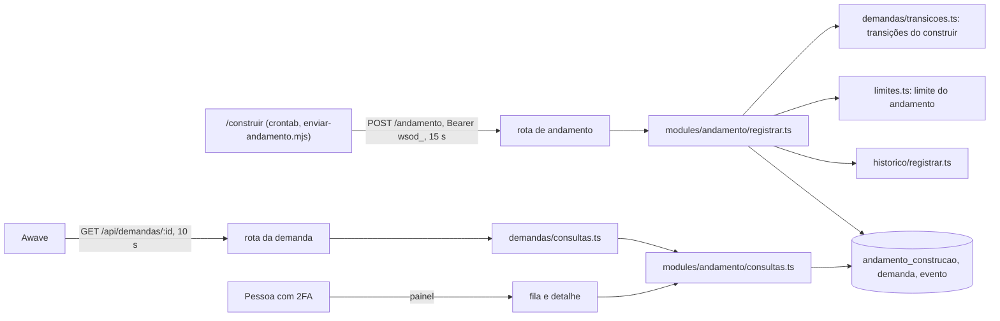

## Entrega

### 1. Visão da solução

A 0.4.0 acrescenta ao Orquestrador uma única escrita vinda de fora: o `/construir` informa o andamento de um Pedido de
Construção pela rota nova `POST /api/pedidos-construcao/<DEC-id>/andamento`, com o token `construir` da 0.3.0 e a ação
nova `registrar_andamento`. O Orquestrador **não chama ninguém de novo**: não há processo, fila, job, pacote nem
variável de ambiente novos. O desenho reaproveita, sem mudar, o que a 0.3.x já tem:

| Peça da 0.3.x | Uso na 0.4.0 |
|---|---|
| Ator de integração `construir` (ADR-20, ADR-21) e emissão do token | Mesmo token; ganha a ação pela matriz, sem mudar a emissão |
| Matriz fechada com a coluna `integracoes` (ADR-22) | Linha nova `registrar_andamento: SO_CONSTRUIR`; nenhuma outra linha muda |
| `rota()` (C-15, C-17, C-09, C-10) | Adaptador da rota nova; uma opção nova e opcional para o 422 (ADR-33) |
| `executarComOrcamento(..., 'padrao')` com prazo total de 8 s, piso de 5 s por instrução e 2 s de trava (ADR-28, M-3 da 0019) | Transação inteira do registro; estouro vira 503 sem gravar |
| `travarPedido` (`pedido:<decId>`, M-4 da 0019) e `pedidoGeradoPorPessoa` (IN-10) | Primeira instrução e primeira conferência do registro; 404 sem oráculo |
| `travarDemanda` (`SELECT … FOR UPDATE`) e `aprovadoVigente` | Fila com a mudança manual de status e conferência do DEC vigente |
| Limite por integração com janela móvel de 60 min e trava consultiva (ADR-24, C-36, IN-09) | Mesmo mecanismo, contado na tabela nova (ADR-31) |
| Regra de visibilidade por lista de permissão (IN-08, D-05, M-1 da 0019) | `andamento` entra na vista de pessoa e, com quatro chaves, na do Awave; a vista mínima de agente e a listagem não mudam |
| `registrarEvento` com ator integração e prefixo (IN-12) | `status_alterado` e `andamento_registrado` pelo ator `construir` |

### 2. Componentes e responsabilidades

| Componente (caminho) | Novo ou alterado | Responsabilidade |
|---|---|---|
| `src/db/schema/andamento.ts` (+ reexport em `src/db/schema/index.ts`) | novo | Tabela `andamento_construcao` (seção 4); as listas `FASES_ANDAMENTO` e `STATUS_CONSTRUCAO` como fonte única para o CHECK e para o Zod |
| `drizzle/0008_*.sql` (gerada) e `drizzle/0009_rls_privilegios_andamento.sql` (custom) | novos | Tabela, CHECKs, FKs e índices; `GRANT SELECT, INSERT` ao `orquestrador_app` (seção 7) |
| `src/db/privilegios.ts` | alterado | Linha `{ tabela: 'andamento_construcao', privilegios: ['SELECT', 'INSERT'] }`; nenhuma `colunasUpdate` nova em lugar nenhum |
| `src/modules/acesso/matriz.ts` | alterado | Ação `registrar_andamento` em `ACOES` e linha `SO_CONSTRUIR` |
| `src/modules/andamento/schemas.ts` | novo | `corpoAndamentoSchema` (`z.strictObject`, enumerações, inteiros 0 a 999, `prontas <= total`), `andamentoLidoSchema` (linha lida do banco) e as duas vistas: `AndamentoVista` (seis campos, pessoa) e `AndamentoDaIntegracao` (quatro campos, Awave) |
| `src/modules/andamento/regras.ts` | novo | Funções puras: `mesmoEstado`, `mudancaDeMarco`, `decidirPorStatus` (a tabela da seção 5 de 01: grava, grava e muda o status, ou 409) e `lerAndamento` (linha → `AndamentoVista` ou `null` pelo Zod, nunca lança) |
| `src/modules/andamento/registrar.ts` | novo | `registrarAndamento(deps, ator, decId, corpo)`: o fluxo da seção 3, numa transação com orçamento `padrao` |
| `src/modules/andamento/consultas.ts` | novo | `ultimoAndamento(db, demandaId)` e `andamentosDasDemandas(db, ids)` (uma consulta por página, ADR-16); só `SELECT` |
| `src/modules/demandas/transicoes.ts` | alterado | `AUTOMATICAS_DO_CONSTRUIR` (as duas transições, com origem fixa e a exceção de `estudo`), `CONTRADIZ_STATUS_FINAL` e `mudarStatusPeloConstruir(t, deps, ator, demandaId, statusConstrucao)`. `MANUAIS` e `AUTOMATICAS` do sistema não mudam |
| `src/modules/limites.ts` | alterado | `LIMITE_ANDAMENTO` (60 por DEC, 600 no total, mensagem) e `conferirLimiteDeAndamento(tx, ator, decId, relogio)`; `TipoLimite`, `LIMITE_POR_HORA` e o limite do Awave não mudam |
| `src/modules/historico/registrar.ts` | alterado | `AcaoEvento` ganha `andamento_registrado` |
| `src/lib/rota.ts` | alterado | Opção `corpoInvalido?: { codigo: 'nao_processavel'; mensagem: string }` em `OpRota` (ADR-33); sem a opção, nada muda |
| `src/app/api/pedidos-construcao/[decId]/andamento/route.ts` | novo | Adaptador fino: `rota({ acao: 'registrar_andamento', params: paramId.versao('decId', 'DEC'), corpo: corpoAndamentoSchema, corpoInvalido })` → 204 |
| `src/modules/demandas/consultas.ts` | alterado | `DemandaVista.andamento` (seis campos ou `null`) em `obterDemanda`; `DemandaVistaDaIntegracao.andamento` (quatro campos ou `null`) em `obterDemandaDaIntegracao` (mesma consulta, autoria no `WHERE`) e em `vistaDaIntegracao`; `vistaMinimaDaDemanda` e `paginaDeDemandas` **não** mudam |
| `src/components/dados-das-etapas.ts` | alterado | `DadosDasEtapas.andamento?` (opcional, como `aguardaConfirmacaoDoAwave`); linha nova da Próxima ação dentro de `linhaDoStatus('em_construcao')`, antes da 11, quando o andamento é do DEC vigente e está `construido` |
| `src/components/dados-da-fila.ts` e `src/components/rotulos.ts` | alterados | `ROTULO_FASE`, `ROTULO_STATUS_CONSTRUCAO`, texto do selo (`seloDeFase`, puro) e `textoDoEvento('andamento_registrado')` |
| `src/app/(painel)/demandas/leituras-da-fila.ts`, `page.tsx`, `fila.tsx`, `CartoesDaFila.tsx` | alterados | Leitura `andamentosDaPagina` (= `andamentosDasDemandas`) e o selo na linha e no cartão, só com status `em_construcao` |
| `src/app/(painel)/demandas/[id]/SecaoAndamento.tsx` e `page.tsx` | novo e alterado | Seção do detalhe (DEC, fase, situação, "x de y tarefas", barra acessível, `<time>`) |
| `docs/manual-tecnico/` (caps. 01, 02, 05, 08, 09), `docs/operacao/deploy.md`, `docs/operacao/tokens-de-integracao.md`, `CHANGELOG.md`, `package.json` | alterados | RF-13 |

### 3. Fluxo do registro (`registrarAndamento`)

Fora da transação (sem banco), em `rota()`: id pela regex (404), CSRF e tipo de conteúdo (403/415), `resolverAtor`
(401), `autorizar(ator, 'registrar_andamento')` (403), corpo JSON (400/413) e `corpoAndamentoSchema` (422 com mensagem
fixa, sem `campos` e sem eco do valor). O serviço chama `autorizar` de novo (defesa em profundidade, como `receber.ts`).

Dentro de `executarComOrcamento(deps.pool, ator, 'padrao', t, …)`, nesta ordem (é a ordem de conferência do RF-05):

1. `travarPedido(tx, decId)`: chave `pedido:<decId>`, a mesma da entrega e do recebimento.
2. `pedidoGeradoPorPessoa(tx, decId)`; nulo → 404 `nao_encontrado` com `MENSAGEM_NAO_ENCONTRADO` (inexistente, sem
   `pedido_gerado` e gerado por não pessoa saem da mesma consulta, sem leitura a mais num caso que no outro).
3. `travarDemanda(tx, demandaId)`: fila com a mudança manual de status e com outro DEC da mesma demanda. Ordem de travas
   fixa: pedido → demanda → limite (a mesma "pedido → demanda" de `entregar.ts`; ninguém trava na ordem inversa).
4. `ultimoAndamento(tx, demandaId)`; `mesmoEstado` (decId, fase, prontas, total, statusConstrucao iguais) → retorna sem
   gravar nada (204). Vem antes dos 409 (CA-05.9).
5. `aprovadoVigente(tx, demandaId)?.id !== decId` → 409 `conflito` (DEC substituído).
6. `decidirPorStatus(demanda.status, statusConstrucao)` = recusa → 409 `conflito` (contradição com status final).
7. `conferirLimiteDeAndamento(tx, ator, decId, relogio)` → 429 `limite_excedido`.
8. `INSERT` em `andamento_construcao` com `gravado_em = relogio.agora()` e o prefixo do token.
9. Se a regra casar, `mudarStatusPeloConstruir`: `UPDATE demanda SET status, atualizada_em` e `status_alterado` com o
   ator `construir` (`mudancaDeCampo('status', …)`). Sem regra, `demanda` não é tocada (CA-04.5).
10. Se `mudancaDeMarco` (sem andamento anterior, ou fase, statusConstrucao ou decId diferentes), `andamento_registrado`
    com `entidade = 'pacote_decisao'`, `entidadeId = decId`, `antes` (quatro chaves ou `null`) e `depois` (quatro chaves).

Nada aqui enfileira job, dispara agente (`dispararSeLigado` não é chamado), manda aviso ou grava log próprio: a linha de
log é a de `rota()`, só com `atorTipo` e `codigoErro`.

### 4. Modelo de dados

**Tabela nova `andamento_construcao`** (só de inclusão para o papel do app; ADR-30):

| Coluna | Tipo | Regra |
|---|---|---|
| `id` | `bigint` identity (`generatedAlwaysAsIdentity`, como `evento`) | PK; ordem de gravação, usada para "o último" (não a data, que vem do relógio injetado e pode empatar) |
| `demanda_id` | `text not null` | FK `demanda(id)`; a demanda do evento `pedido_gerado` |
| `dec_id` | `text not null` | FK `pacote_decisao(id)`; CHECK `^DEC-DEM-[0-9]{8}-[0-9]{4}-v[0-9]{1,4}$` |
| `fase` | `text not null` | CHECK nas seis fases |
| `tarefas_prontas`, `tarefas_total` | `integer not null` | CHECK `0 <= tarefas_prontas <= tarefas_total <= 999` |
| `status_construcao` | `text not null` | CHECK em `em_construcao`, `construido`, `cancelado` |
| `ator_token_prefixo` | `text not null` | CHECK `^[A-Za-z0-9_-]{8}$`; quem gravou cada número, também sem evento (auditoria e revogação pelo prefixo) |
| `gravado_em` | `momento() not null`, sem padrão no banco | do `Relogio` (G3.4); é o `atualizadoEm` da vista |

Índices: `(demanda_id, id)` para o último por demanda e para a página da fila; `(dec_id, gravado_em)` para o limite por
DEC; `(gravado_em)` para o limite total.

**Relações:** `demanda 1—N andamento_construcao` (o andamento da demanda é a linha de maior `id`); `pacote_decisao 1—N
andamento_construcao`; `evento` (`andamento_registrado` e `status_alterado` do `construir`) aponta para a demanda por
`demanda_id` e para o DEC por `entidade_id`, como os eventos do pedido da 0.3.0. Nenhuma coluna nova em `demanda` nem em
`evento`; `evento.acao` é texto sem CHECK, então a ação nova não pede DDL.

**Vistas lidas** (montadas chave a chave a partir da linha, depois do `andamentoLidoSchema`; linha fora do esquema vira
`null`, sem 500):

- pessoa (`DemandaVista.andamento`): `{ decId, fase, tarefasProntas, tarefasTotal, statusConstrucao, atualizadoEm }`;
- Awave (`DemandaVistaDaIntegracao.andamento`): `{ fase, tarefasProntas, tarefasTotal, atualizadoEm }`;
- agente e sistema: sem a chave (vista mínima inalterada); listagem `GET /api/demandas`: inalterada.

Volume esperado: o `/construir` grava só quando o estado muda, no máximo 1 a cada 2 min por pedido; um pedido de cadeia
completa fica na casa de dezenas a poucas centenas de linhas (cerca de 60 bytes de dado cada). Com o teto de 9.999
demandas da `demanda_seq`, a tabela não passa de alguns milhões de linhas no pior caso teórico, e na prática de
milhares. Sem expurgo nesta versão (RNF-10); se um dia for preciso, o expurgo guarda a última linha de cada demanda e
pede `DELETE`, que hoje o papel do app não tem.

### 5. Rastreabilidade RF → componente

| RF de 01 | Componente responsável |
|---|---|
| RF-01 Ação só do `construir` | `acesso/matriz.ts` (linha `SO_CONSTRUIR`); `autorizar` em `rota()` e no serviço |
| RF-02 Rota e corpo | `app/api/pedidos-construcao/[decId]/andamento/route.ts`, `lib/rota.ts` (opção `corpoInvalido`), `andamento/schemas.ts` |
| RF-03 404 sem oráculo | `andamento/registrar.ts` com `pedido-construcao/pendentes.ts` (`pedidoGeradoPorPessoa`) |
| RF-04 Último andamento e idempotência | `db/schema/andamento.ts`, migrations `0008`/`0009`, `andamento/regras.ts` (`mesmoEstado`, `lerAndamento`), `andamento/consultas.ts` |
| RF-05 Transições e recusas | `demandas/transicoes.ts` (`AUTOMATICAS_DO_CONSTRUIR`, `CONTRADIZ_STATUS_FINAL`, `mudarStatusPeloConstruir`), `andamento/regras.ts` (`decidirPorStatus`), `pacotes-decisao/substituido.ts` (`aprovadoVigente`), `versoes.ts` (`travarDemanda`) |
| RF-06 `andamento_registrado` | `historico/registrar.ts` (`AcaoEvento`), `andamento/regras.ts` (`mudancaDeMarco`), `components/rotulos.ts` (texto) |
| RF-07 Próxima ação | `components/dados-das-etapas.ts` |
| RF-08 Selo na fila | `andamento/consultas.ts` (`andamentosDasDemandas`), `(painel)/demandas/leituras-da-fila.ts`, `fila.tsx`, `CartoesDaFila.tsx`, `components/dados-da-fila.ts`, `components/rotulos.ts` |
| RF-09 Detalhe | `demandas/consultas.ts` (`obterDemanda`), `(painel)/demandas/[id]/SecaoAndamento.tsx` |
| RF-10 Vista do Awave | `demandas/consultas.ts` (`obterDemandaDaIntegracao`, `vistaDaIntegracao`) |
| RF-11 Vistas de pessoa e agente | `demandas/consultas.ts` (`DemandaVista`; `vistaMinimaDaDemanda` e `paginaDeDemandas` sem mudança) |
| RF-12 Limite | `limites.ts` (`LIMITE_ANDAMENTO`, `conferirLimiteDeAndamento`), sobre `andamento_construcao` |
| RF-13 Versão e documentação | `package.json`, `CHANGELOG.md`, `docs/manual-tecnico/`, `docs/operacao/` |

### 6. Integrações externas: tempo limite e falha

O Orquestrador não chama nenhum serviço externo novo. As integrações tocadas são de entrada:

| Integração | Tempo limite | Falha e comportamento |
|---|---|---|
| `/construir` → `POST /api/pedidos-construcao/<DEC-id>/andamento` | Cliente: 15 s (`chamar` de `buscar-pedidos.mjs`). Servidor: orçamento `padrao` (prazo total 8 s desde a espera pela conexão, `statement_timeout` 5 s, `lock_timeout` 2 s) | Estouro, trava ocupada ou pool cheio → 503 `indisponivel`, `ROLLBACK`, nada gravado; o `/construir` marca `erro` e repete na volta seguinte do crontab. 429 → `erro`, repete. 404 → `fora_do_orquestrador`, não repete até o estado mudar. 409/422/400 → `recusado`. 401/403 → a volta inteira para (problema do token). Orquestrador fora do ar → falha de rede no cliente, `erro`, e o `/construir` segue construindo (o envio não bloqueia a cadeia) |
| Awave → `GET /api/demandas/:id` (agora com `andamento`) e `POST /api/demandas` (201 com `andamento: null`) | Cliente: 10 s. Servidor: orçamento `padrao` | Como na 0.3.1: 503 sem gravar; a chave nova é aditiva. A leitura do andamento é uma subconsulta indexada na mesma consulta que já tem a autoria no `WHERE` |
| Resend, Anthropic | Sem mudança | Sem mudança; a 0.4.0 não manda aviso nem dispara agente |

Plano de falha do componente novo: andamento errado é corrigido pela mudança manual de status (tabela `MANUAIS`
intacta); token vazado é revogado pelo prefixo (`tokens-de-integracao.md`), e o prefixo gravado em cada linha mostra o
que ele escreveu; envio com defeito do lado do `/construir` é desligado em `"andamento_ligado": false`, sem deploy aqui.

### 7. Não funcionais no desenho

- **Desempenho (RNF-01):** cerca de 12 idas ao banco por envio, todas por índice (`evento_acao_entidade_idx`, PK de
  `demanda`, `(demanda_id, id)`, `(dec_id, gravado_em)`, `(gravado_em)`). A fila ganha uma consulta por página
  (`distinct on (demanda_id) … where demanda_id in (…) order by demanda_id, id desc`), com custo pelo tamanho da página.
  O detalhe e a leitura do Awave ganham uma busca indexada.
- **Concorrência (RNF-06):** envios do mesmo DEC entram em fila pela `pedido:<decId>`; envio e mudança manual, pela linha
  da demanda; o limite, pela trava consultiva `limite:andamento:integracao:construir` (global para o andamento, que
  serializa só os envios que vão gravar; com 20 pedidos e no máximo 1 envio a cada 2 min por pedido, a espera é
  desprezível e cabe no `lock_timeout` de 2 s). Tudo é lido depois das travas.
- **Segurança:** só a integração `construir` alcança a escrita; o corpo é fechado em enumerações e inteiros, então não
  há texto livre para entrar em evento, log, Sentry ou `pgboss` (C-30, RNF-03); a linha guarda o prefixo, nunca o token
  (RNF-04); o papel do app ganha só `SELECT, INSERT` numa tabela nova e nenhum `UPDATE` novo (RNF-05, C-34).
- **Observabilidade:** a linha de log de `rota()` (rota padrão, status, ms, `atorTipo`, `codigoErro`) já distingue 204,
  404, 409, 422, 429 e 503; 5xx vai ao Sentry reduzido. No painel, o "Atualizado em" mostra quando o andamento parou de
  chegar. Sem métrica ou alerta novos.
- **Custo:** zero recorrente. Mesmo banco, mesmos serviços; crescimento de dados na ordem de KB por pedido.
- **Dono:** o módulo `src/modules/andamento/` é do `engenheiro-backend` na construção e de Fabiano no sistema, como os
  demais módulos.

### 8. Migration, ensaio e volta (resposta à P-05)

- Duas migrations, ambas aditivas: `0008_*` gerada por `pnpm db:generate` (tabela, CHECKs, FKs, índices) e `0009_rls_privilegios_andamento`
  custom, criada vazia por `pnpm drizzle-kit generate --custom --name rls_privilegios_andamento`, só com
  `GRANT SELECT, INSERT ON "andamento_construcao" TO orquestrador_app`. O padrão técnico manda SQL escrito à mão para a
  migration custom; por isso não é "uma migration só". Nenhuma linha existente muda (`alteram_dado: false` esperado),
  nenhuma coluna sai e nenhuma migration da `main` é editada. O `CREATE TABLE` é sobre tabela vazia: sem trava longa.
- **Volta 0.4.0 → 0.3.1: só pelo caminho B (backup restaurado).** A regra da saúde (cap. 01, ADR-12) responde 503
  quando a última migration do banco não é a do journal da imagem; a 0.3.1 sobre o banco com `0008` e `0009` fica em
  503. O `ensaiar-rollback` deve, portanto, sair com `volta_sem_restaurar: false`, e isso é o esperado, não falha. Para
  registro: se a 0.3.1 lesse esse banco, ela ignoraria a tabela nova, mostraria `andamento_registrado` com o texto
  vazio no histórico (o `textoDoEvento` dela não conhece a ação, como já documentado para a 0.1.12) e o
  `status_alterado` do `construir` como "Mudou o status" por "/construir (prefixo …)"; nada disso quebra, mas a saúde
  impede essa volta.
- **Em `docs/operacao`:** antes da volta, `"andamento_ligado": false` no `/construir`; depois da restauração, o
  andamento gravado desde o backup se perde, e o `/construir` reenvia o estado inteiro quando for religado contra a
  0.4.0 (o envio é do estado, não incremental). Trocar `"andamento_ligado"` para `true` só depois do deploy da 0.4.0 e
  da saúde em 200.

### 9. ADRs

Numeração contínua com o cap. 01 (ADR-01 a ADR-29).

**ADR-30. Andamento em tabela própria só de inclusão (`andamento_construcao`), e não em coluna `jsonb` da demanda**

- Contexto: a ESP deixa ao arquiteto coluna `jsonb` validada pelo Zod ou tabela própria. O RF-04 pede o último
  andamento, idempotência e `demanda.atualizadaEm` intocado; o RF-12 pede contar gravações sem gravar no envio
  idempotente; o C-34 pede o menor privilégio.
- Opções: (a) coluna `demanda.andamento jsonb` atualizada a cada gravação; (b) tabela com uma linha por demanda,
  atualizada por `UPSERT`; (c) tabela só de inclusão, uma linha por gravação aceita.
- Decisão: (c). O último andamento é a linha de maior `id` da demanda.
- Consequências: o papel do app ganha só `SELECT, INSERT` numa tabela nova; `demanda` não ganha coluna nem
  `colunasUpdate`, então gravar andamento não toca `demanda.atualizadaEm` por construção; as mesmas linhas servem de
  contagem para o limite (ADR-31), sem segunda estrutura; o formato fica garantido por CHECK no banco e pelo Zod na
  leitura; fica o rastro de quem gravou cada número sem inflar o histórico (A2). Custos: a leitura do "último" pede
  `distinct on`/`order by id desc` com índice; a tabela cresce sem expurgo (pequena, seção 4); o CA-04.6 (valor fora do
  esquema inserido à mão) passa a ser verificado pelo teste unitário de `lerAndamento` e pelo teste de que o CHECK
  recusa a linha, porque o banco não aceita a linha fora do formato. Descartadas: (a) exige `UPDATE` em coluna nova de
  `demanda`, `jsonb` sem CHECK de forma e uma segunda estrutura para contar; (b) exige `UPDATE` e também uma segunda
  estrutura para contar.

**ADR-31. Limite do andamento contado nas linhas de `andamento_construcao`, por DEC e total, na janela móvel**

- Contexto: RF-12 (60 por DEC e 600 no total por hora, só gravações), ADR-24 (limite por integração, decisão por
  pedido), C-36 (janela móvel de 60 min e trava consultiva).
- Decisão: `conferirLimiteDeAndamento` em `limites.ts`, só para o ator integração `construir` (outro ator lança
  "sem limite definido", como hoje); trava `limite:andamento:integracao:construir`; conta `gravado_em > agora - 60 min`
  por `dec_id` e no total; `>= 60` ou `>= 600` → 429. Chamado depois do "mesmo estado" e dos 409, antes do `INSERT`.
- Consequências: o envio idempotente não grava e não conta (CA-12.2); duas gravações simultâneas no limite ficam em
  fila e só uma passa (CA-12.5); `TipoLimite`, `LIMITE_POR_HORA` e o limite do Awave ficam intactos (CA-12.6). Custo:
  uma trava global para gravações de andamento. Descartada: acrescentar `andamento` a `TipoLimite`, que obrigaria a dar
  número a pessoa e agente em `LIMITE_POR_HORA` para uma ação que eles não têm.

**ADR-32. Registro numa transação `padrao`, com travas na ordem pedido → demanda → limite**

- Contexto: RNF-06 (concorrência com o mesmo DEC e com a mudança manual), RNF-01 e ADR-28 (servidor desiste antes do
  cliente), M-4 da 0019 (entrega e recebimento na mesma trava).
- Decisão: `executarComOrcamento(…, 'padrao')`; primeira instrução `travarPedido`, depois `travarDemanda`, depois a
  trava do limite; todas as leituras de estado depois das travas.
- Consequências: no máximo uma gravação e um evento por estado; a mudança manual e o envio se veem em ordem; sem
  inversão de travas (a entrega já usa pedido → demanda; o recebimento e a mudança manual usam uma só). Custo: um envio
  pode esperar uma mudança manual em curso, dentro dos 2 s de `lock_timeout`; acima disso, 503 e o `/construir` repete.

**ADR-33. 422 pelo próprio `rota()`, com opção `corpoInvalido` por rota**

- Contexto: hoje o Zod do corpo em `rota()` dá 400 `entrada_invalida` com `campos`; a ESP e o CP-6 pedem 422, sem eco
  do valor e antes de qualquer consulta ao DEC. `nao_processavel: 422` já existe em `STATUS_DO_CODIGO`.
- Decisão: `OpRota` ganha `corpoInvalido?: { codigo: 'nao_processavel'; mensagem: string }`. Com ela, a falha do Zod do
  corpo vira `ErroDominio(codigo, mensagem)` sem `campos`; sem ela, nada muda. Só a rota do andamento usa.
- Consequências: a invariante "nada toca o banco antes de a entrada estar no formato" continua num lugar só, e o teste
  que percorre as rotas (T13) segue lendo o mesmo `meta`; o 422 é igual para DEC existente ou não (CA-02.3). Custo: um
  ramo novo no adaptador central, coberto por teste próprio e pelos testes de `rota()` existentes, que não mudam.
  Descartada: declarar `corpo: z.unknown()` na rota e validar no serviço, que tira a validação do adaptador e enfraquece
  a leitura de C-11 (sem chave desconhecida) pela rota.

**ADR-34. Transições do `construir` em tabela própria em `transicoes.ts`, pelo ator integração**

- Contexto: RF-05 e A1. As automáticas de hoje são do ator `sistema` e não passam por `autorizar`; as manuais são só de
  pessoa.
- Decisão: `AUTOMATICAS_DO_CONSTRUIR` (`em_construcao`: de `aprovada` para `em_construcao`, salvo tipo `estudo`;
  `cancelado`: de `em_construcao` para `devolvida`) e `CONTRADIZ_STATUS_FINAL` (`entregue` recusa `em_construcao` e
  `cancelado`; `encerrada` recusa `em_construcao` e `construido`), lidas por `decidirPorStatus` e por
  `mudarStatusPeloConstruir`, que grava `status_alterado` com o ator integração e o prefixo.
- Consequências: `entregue` e `encerrada` não são destino em nenhuma linha da tabela, o que o teste 9 × 3 (CA-05.10)
  confere; `MANUAIS` e as automáticas do sistema não mudam (CA-05.11); a origem da mudança fica no histórico como
  `/construir (prefixo …)`, e não como "Sistema". Custo: uma terceira tabela de transições no mesmo arquivo.

**ADR-35. Andamento nas leituras: leitura por página na fila, campo novo na vista de pessoa e na do Awave**

- Contexto: RF-08 a RF-11; ADR-16 (contadores e etapas da fila por leitura separada, sem mudar a API); ADR-23 (leitura
  do Awave com a autoria no `WHERE`); IN-08 e D-05 (vistas por lista de permissão).
- Decisão: a fila lê `andamentosDasDemandas(db, ids)` pela página, sem tocar `DemandaResumo` nem `GET /api/demandas`;
  `obterDemanda` acrescenta `andamento` à `DemandaVista`; `obterDemandaDaIntegracao` acrescenta a subconsulta do último
  andamento na mesma consulta da autoria; `vistaDaIntegracao` monta as quatro chaves; `vistaMinimaDaDemanda` não muda.
- Consequências: o agente e a listagem não recebem o campo sem mudança de código (lista de permissão); a demanda de outro
  autor continua com o 404 da mesma consulta (CA-10.3); o 201 do Awave sai com `andamento: null` e igual ao GET
  (CA-10.4). O selo e a Próxima ação usam o andamento de maior `id`, que só o DEC vigente consegue gravar (passo 5 do
  fluxo); a Próxima ação ainda confere `decId` igual ao vigente, porque um DEC novo aprovado pode ainda não ter enviado
  nada. Custo: uma consulta a mais por página da fila e uma no detalhe.

**Stack:** sem desvio do padrão técnico. Nenhum pacote, variável de ambiente, processo, job ou serviço novo; Next
16.4.1, Drizzle 0.45.3, Zod 4.6.6 e o resto como no ADR-29. Por isso não há ADR de desvio.

### 10. Porta de desenvolvimento

**3101**, a do sistema desde a 0.1.0 (`pnpm dev`, cap. 01, seção "Porta"). Diferente de 3000 e livre em `ss -ltn` em
12/11/2026 (em escuta só 22, 53, 80, 443, 2377, 3000, 7946 e portas altas de `127.0.0.1`). A homologação usa
`127.0.0.1:${HML_PORTA}`, de 3200 a 3299, escolhida pelo maestro.

## Decisões tomadas

- Tabela só de inclusão em vez de `jsonb` na demanda (ADR-30): menor privilégio, `atualizadaEm` intocado por construção
  e contagem do limite sem segunda estrutura.
- Limite contado na própria tabela, com função própria em `limites.ts` (ADR-31): mesmo mecanismo do C-36 sem mexer em
  `TipoLimite` nem nos números de pessoa, agente e Awave.
- Travas na ordem pedido → demanda → limite, numa transação `padrao` (ADR-32): reaproveita a `pedido:<decId>` e a ordem
  que a entrega já usa.
- 422 por opção `corpoInvalido` no `rota()` (ADR-33): a validação do corpo continua no adaptador, antes do banco.
- Transições do `construir` em tabela própria, pelo ator integração (ADR-34): `entregue`/`encerrada` nunca são destino,
  e o histórico mostra quem mudou.
- Andamento nas leituras por lista de permissão e leitura por página (ADR-35): agente e listagem ficam de fora sem
  código novo.
- `ator_token_prefixo` em cada linha: a gravação sem evento (só `tarefasProntas`) também fica atribuída a um token.
- Ordem por `id`, e não por `gravado_em`, para "o último": o relógio injetado pode empatar.
- DEC vigente por `aprovadoVigente` (já existe), conferido depois do "mesmo estado" (CA-05.9 antes do CA-05.8).
- Volta 0.4.0 → 0.3.1 só pelo caminho B (seção 8): é consequência da regra da saúde, não do desenho da tabela.
- Porta 3101 mantida: o sistema já existe com ela, e ela estava livre.

## Pendências

- P-01, P-02 e P-03 de 01 seguem com Fabiano, sem bloquear; o desenho segue o que vale se ele não decidir (409 para DEC
  substituído, tabela de contradição da seção 5 de 01, 60/600 por hora). Mudar os números é trocar duas constantes de
  `LIMITE_ANDAMENTO`.
- P-04 de 01: respondida nas seções 3, 4 e 7 e nos ADR-30 a ADR-32 (tabela própria, contagem nas linhas, travas
  pedido → demanda → limite, só `SELECT, INSERT`, nenhuma `colunasUpdate` nova).
- P-05 de 01: respondida na seção 8 (só caminho B; `volta_sem_restaurar: false` esperado no ensaio).
- Para `tech-lead` (etapa 05): o CA-04.6 vira teste unitário de `lerAndamento` mais teste de que o CHECK recusa linha
  fora do formato (ADR-30); `privilegios.test.ts` e `imutabilidade.test.ts` ganham a tabela nova; o T13 e o teste de
  pares exatos da matriz ganham a rota e o par novos; o teste de sentinelas da 0.3.0 cobre a rota nova (inclusive o
  esquema `pgboss`).
- Para `seguranca-aplicacao` (etapa 04): avaliar a trava global do limite como ponto de espera para o token
  `construir` (um token vazado não afeta pessoa nem Awave, mas pode ocupar as 600 gravações da hora) e o prefixo gravado
  por linha.
- Para `ux-ui-design` (etapa 03): os textos do 422, dos dois 409 e do 429 entram como constantes do serviço; o "Quem
  age" da Próxima ação nova pode reaproveitar `UMA_PESSOA` de `dados-das-etapas.ts` ou ser "Uma pessoa", como no RF-07.
- O texto do pedido não trouxe instrução para mudar de tarefa, ler segredo, chamar endereço de fora ou sair do
  repositório.

## Comandos executados

- `git -C /home/deploy/servidor/projetos/ws-orquestrador-demandas diff --name-only 4b825dc642cb6eb9a060e54bf8d69288fbee4904 HEAD -- src drizzle docs/manual-tecnico docs/operacao docs/adr` — lista dos arquivos rastreados
- `git -C /home/deploy/servidor/projetos/ws-orquestrador-demandas status` — ramo `construcao/DEC-DEM-20261111-0017-v1`, limpo
- `ss -ltn` — 3101 livre; 3000 em uso pelo Easypanel
- `git -C /home/deploy/servidor/projetos/ws-orquestrador-demandas log -S status_alterado --oneline --name-only -- src/modules/demandas/servico.ts` — origem da mudança manual de status
- `git -C /home/deploy/servidor/projetos/ws-orquestrador-demandas log -S travarPedido --oneline --name-only -- src/modules` — quem usa a trava do pedido (entregar, receber, pendentes)

## Critério de pronto atendido

- [x] cada RF de 01 tem um componente responsável
- [x] a stack é a do padrão técnico, ou o desvio tem ADR
- [x] cada integração externa tem comportamento de falha e tempo limite
- [x] a porta de desenvolvimento é diferente de 3000 e estava livre em `ss -ltn`
- [x] o texto não tem segredo nem valor de `.env`
