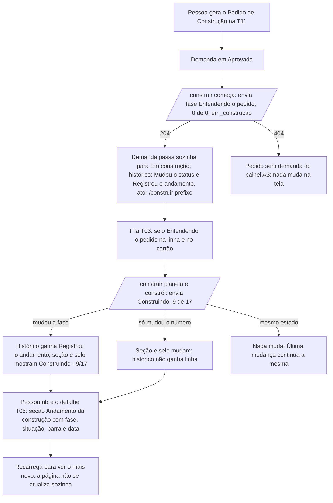
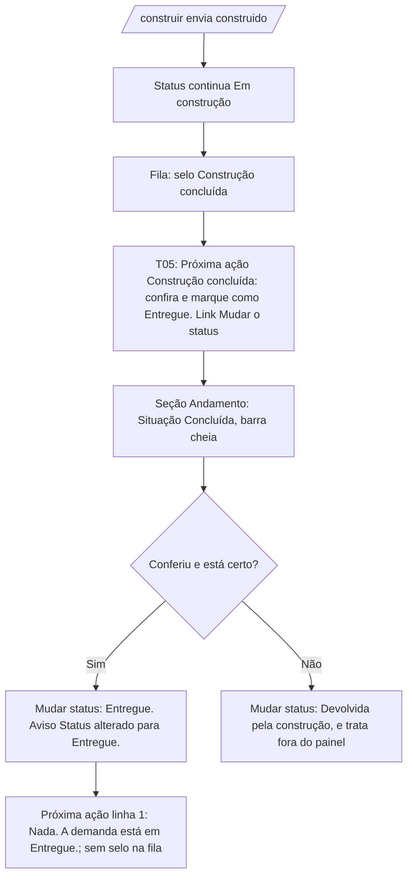
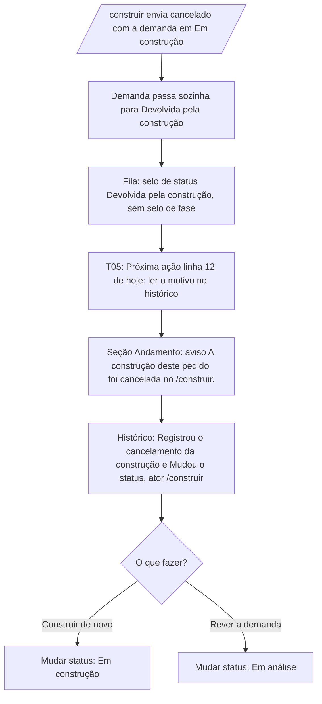

## Entrega

### 0. Escopo e regra de leitura

Interface da 0.4.0 do WS Orquestrador de Demandas: o andamento do Pedido de Construção informado pelo `/construir`
aparece no painel. A maior parte do pedido é rota, matriz, banco e limite, sem tela. O que chega ao painel:

- **T03 Fila:** o selo de fase nas demandas em construção (RF-08).
- **T05 Demanda:** a seção nova "Andamento da construção" (RF-09), a linha nova da "Próxima ação" (RF-07), o texto do
  evento `andamento_registrado` no histórico (RF-06) e o texto de apoio de "Mudar status", que deixa de dizer que tudo
  é manual.
- **Mensagens da API** que alguém lê (Fabiano, no registro do `/construir`): 409, 422 e 429 da rota nova (P-06 do 01).
- **Sem tela:** RF-01 a RF-05 (matriz, rota, gravação, transições), RF-10 e RF-11 (vistas da API), RF-12 (limite) e
  RF-13 (documentação). A vista do Awave entrega valores de enumeração; como o Awave mostra isso ao cliente é da E01,
  parte 3, fora deste pedido.

Regras que valem em todo o documento:

- RF-NN e CA-NN.n são os do `01-analista-requisitos.md` deste pedido. "0015, n.n" é a seção do `03-ux-ui-design.md` do
  pedido 0015 (0.2.0); "0016, n.n", a do pedido 0016 (0.3.0).
- Base visual: a 0.3.1 na `main`, com a casca A, os tokens do `@theme` em `globals.css`, a T01 a T12, o filtro Origem,
  a confirmação do Awave e a linha "Recebido pelo /construir em …". **Nenhum token, cor, componente do design system ou
  variação nova.** Pontos de quebra os de hoje: celular abaixo de 768 px, tablete de 768 a 1199 px, computador a partir
  de 1200 px; larguras de teste 1280 × 720 e 390 × 844; reflow em 320 px.
- Texto que **não muda** é citado pela constante do código. Texto **novo ou alterado** está por inteiro onde aparece e,
  de novo, na seção 8.
- A tela só mostra o que o servidor gravou. Quem pode registrar, quando o status muda e o que é "mesmo estado" são do
  RF-02 a RF-05 e do servidor.
- Exemplos com dados fictícios: `DEC-DEM-20991231-0001-v1`, prefixo `a1b2c3d4`, "Relatório semanal fictício".

### 1. Mapa: RF com interface → fluxo → tela

| RF | Interface | Fluxo | Tela / seção |
|---|---|---|---|
| RF-05 (efeito na tela) | status muda sozinho para Em construção ou Devolvida pela construção; histórico com o ator `/construir` | F1, F3 | 4.4, 5.7 |
| RF-06 | texto do `andamento_registrado` no histórico | F1 | 5.7 |
| RF-07 | linha nova da Próxima ação depois de `construido` | F2 | 5.6 |
| RF-08 | selo de fase na tabela e no cartão da fila | F1 | 4 |
| RF-09 | seção "Andamento da construção" no detalhe | F1, F2, F3 | 5.1 a 5.5, 5.8 |
| RF-02, RF-03, RF-05, RF-12 | sem tela no painel; mensagens 404, 409, 422, 429 e 503 lidas no registro do `/construir` | — | 7 |
| RF-01, RF-04, RF-10, RF-11, RF-13 | sem interface (matriz, banco, vistas da API, documentação) | — | — |

### 2. Design system: o que esta versão usa

Nenhum componente, variação ou token novo. Tudo sai do que já está na `main`:

| Uso nesta versão | O que já existe |
|---|---|
| Selo de fase na fila | texto de apoio na célula, no molde de "Origem: …" (0016, 4.1) e da data sob a Idade: 13 px, peso 600; texto oculto para leitor de tela, no molde das `MarcasDeEtapa` |
| Seção "Andamento da construção" | `Cartao` com `h2` focável (a função `Secao` da T05), `dl` com `dt` na `CLASSE_DA_ETIQUETA`, como os Dados |
| Barra de tarefas | elemento nativo `<progress>`, com classes de token nos pseudo-elementos (detalhe em 5.3). Não é componente novo: é um elemento HTML com classes, de uso único na T05 |
| Aviso de construção cancelada e de pacote substituído | `Alerta` tipo `atencao`, estático (sem `role="alert"`) |
| Link para o DEC | link de texto da T05 (`CLASSE_LINK`), id em Mono, 44 px de alvo abaixo de 768 px como `CLASSE_ACAO_DA_VERSAO` |
| Linha nova da Próxima ação | `CartaoProximaAcao` e `LinkNestaPagina`, sem mudança de componente |
| Histórico | `LinhaDoTempo`, sem mudança; só texto novo em `textoDoEvento` |

**Por que `<progress>` e não uma `div` com largura:** a largura em porcentagem exigiria `style=`, que a CSP recusa e o
teste estático do CV-02 reprova. O `<progress>` leva `value` e `max` como atributos, tem papel `progressbar` nativo e
não precisa de script.

Constantes novas sugeridas em `src/components/rotulos.ts` (texto na seção 8): `ROTULO_FASE` (seis fases) e
`ROTULO_SITUACAO_CONSTRUCAO` (três valores de `statusConstrucao`). Os textos da seção e do selo podem ficar num
`TEXTOS_ANDAMENTO` ao lado de `TEXTOS_DETALHE` (o nome e o arquivo são do `tech-lead`).

### 3. Fluxos

#### F1. O `/construir` informa o andamento e a pessoa acompanha (RF-05, RF-06, RF-08, RF-09)



#### F2. Construção concluída: a pessoa confere e marca Entregue (RF-05, RF-07)



#### F3. Construção cancelada no `/construir` (RF-05)



### 4. T03 Fila de demandas (RF-08; CA-08.1 a CA-08.5)

#### 4.1 O que muda

1. **Selo de fase** só na demanda com status `em_construcao` **e** andamento lido e válido. Fica dentro da célula
   **Status**, numa segunda linha abaixo do selo de status, e não numa coluna nova.
2. **Texto visível** (escondido do leitor de tela com `aria-hidden="true"`):
   - `statusConstrucao = em_construcao` e `tarefasTotal > 0`: "<Fase> · <prontas>/<total>" (ex.: "Construindo · 9/17");
   - `statusConstrucao = em_construcao` e `tarefasTotal = 0`: só "<Fase>" (ex.: "Entendendo o pedido");
   - `statusConstrucao = construido`: "Construção concluída";
   - `statusConstrucao = cancelado` (só aparece se uma pessoa voltou a demanda para Em construção depois do
     cancelamento): "Construção cancelada".
3. **Texto para leitor de tela** (`sr-only`, logo depois do visível): "Andamento: <Fase>, <prontas> de <total> tarefas
   prontas." (ex.: "Andamento: Construindo, 9 de 17 tarefas prontas."); com total 0, "Andamento: <Fase>."; concluída,
   "Andamento: construção concluída."; cancelada, "Andamento: construção cancelada.". Com total 1, singular: "Andamento:
   Planejando, 0 de 1 tarefa pronta.".
4. **Aparência:** 13 px (`text-[0.8125rem]`), peso 600; cor `marinho` em `em_construcao`, `positivo` em `construido`,
   `tinta-media` em `cancelado`. A cor só reforça: a diferença está no texto. A linha quebra entre palavras
   ("Revisando e entregando · 17/17" cabe em duas linhas na coluna Status).
5. **Cartão (abaixo de 768 px):** o mesmo pedaço, logo abaixo do selo de status, no canto direito da linha de topo (id à
   esquerda; selo e fase à direita, empilhados e alinhados à direita). Com pouco espaço (320 px), o bloco quebra para
   a linha de baixo, alinhado à esquerda, sem rolagem lateral. Sem item novo na `dl`.
6. **Um pedaço só** para tabela e cartão (como `UrgenciaDaDemanda` e `IdadeDaDemanda` em `CartoesDaFila.tsx`), para as
   duas formas mostrarem o mesmo texto.
7. **Sem filtro novo, sem contador novo, sem coluna nova** (RF-08; seção 6 do 01). Ordem, paginação e legenda de hoje.
8. **Demanda sem selo:** sem andamento, com andamento fora do esquema (CA-04.6), ou com status diferente de
   `em_construcao` (inclusive `devolvida`, `entregue` e `encerrada` com andamento gravado; CA-08.4).

#### 4.2 Wireframe, computador (1280 × 720)

```
┌───────────────┬───────────────────────────────────────────────────────────────────────────────────────────┐
│ WS            │ FILA                                                                                      │
│ Orquestrador  │ Demandas                                                            [ Nova demanda ]      │
│ de Demandas   │ [Todas 12] [Nova 2] [Em análise 1] … [Em construção 3] …   (contadores de hoje)       │
│               │ Tipo [Todos ▾]  Origem [Todas ▾]  Linha de serviço [Todas ▾]  [Filtrar] Limpar filtros    │
│ ▌Demandas     │                                                                                           │
│  Nova demanda │ Demandas, da mais nova para a mais antiga                   12 demandas encontradas.      │
│  Agentes      │ ┌──────────────┬─────────────────────┬─────────┬─────────────────────┬──────┬──────┬─────┐ │
│               │ │ Id           │ Título              │ Tipo    │ Status              │Etapas│ …    │Idade│ │
│               │ ├──────────────┼─────────────────────┼─────────┼─────────────────────┼──────┼──────┼─────┤ │
│               │ │ DEM-…-0003   │ Relatório semanal   │ Melhoria│ (Em construção)     │ESP RSK DEC  │2 dias│
│               │ │              │ fictício            │         │ Construindo · 9/17  │      │      │     │ │
│               │ │              │ Origem: Pessoa      │         │                     │      │      │     │ │
│               │ ├──────────────┼─────────────────────┼─────────┼─────────────────────┼──────┼──────┼─────┤ │
│               │ │ DEM-…-0002   │ Painel fictício     │ Bug     │ (Em construção)     │ …    │      │     │ │
│               │ │              │ Origem: Awave       │         │ Construção concluída│      │      │     │ │
│               │ ├──────────────┼─────────────────────┼─────────┼─────────────────────┼──────┼──────┼─────┤ │
│               │ │ DEM-…-0001   │ Cadastro fictício   │ Melhoria│ (Em construção)     │ …    │      │     │ │
│               │ │              │ Origem: Pessoa      │         │                     │      │      │     │ │
│ Ana (CTO)     │ └──────────────┴─────────────────────┴─────────┴─────────────────────┴──────┴──────┴─────┘ │
│ [Sair]        │   (a terceira está em construção sem andamento: sem selo de fase)                         │
└───────────────┴───────────────────────────────────────────────────────────────────────────────────────────┘
```

#### 4.3 Wireframe, celular (390 × 844)

```
┌──────────────────────────────────┐
│ [Menu]   WS Orquestrador         │
├──────────────────────────────────┤
│ FILA                             │
│ Demandas          [Nova demanda] │
│ (contadores em pílulas)          │
│ ▸ Mais filtros                   │
│ Demandas, da mais nova para a    │
│ mais antiga                      │
│ 12 demandas encontradas.         │
│ ┌──────────────────────────────┐ │
│ │ DEM-…-0003   (Em construção) │ │
│ │          Construindo · 9/17  │ │
│ │ Relatório semanal fictício   │ │
│ │ TIPO          URGÊNCIA       │ │
│ │ Melhoria      ● Alta         │ │
│ │ ORIGEM                       │ │
│ │ Pessoa                       │ │
│ │ LINHA DE SERVIÇO             │ │
│ │ Sistema sob medida           │ │
│ │ ETAPAS        IDADE          │ │
│ │ ESP RSK DEC   2 dias         │ │
│ └──────────────────────────────┘ │
│ ┌──────────────────────────────┐ │
│ │ DEM-…-0002   (Em construção) │ │
│ │        Construção concluída  │ │
│ │ Painel fictício              │ │
│ │ …                            │ │
│ └──────────────────────────────┘ │
└──────────────────────────────────┘
```

#### 4.4 Estados da T03

| Estado | O que aparece |
|---|---|
| Vazio | `TEXTOS_FILA.vazio` e `TEXTOS_FILA.vazioComFiltro`, sem mudança. Nenhum selo de fase (não há linha) |
| Carregando | `CarregandoFila` de hoje (esqueleto na tabela e em 3 cartões); o selo de fase não tem esqueleto próprio, a célula Status inteira é uma barra de esqueleto |
| Erro da lista | `TEXTOS_FILA.erro` + "Tentar de novo", sem mudança |
| Erro só da leitura do andamento | Se a 02 puser o andamento numa leitura separada da lista e ela falhar: a fila aparece **sem nenhum selo de fase** (número que falta é tolerável, número errado não; regra da 0.2.0) e, acima do título do resultado, `Alerta` `atencao` estático: "Não foi possível ler o andamento da construção. A fila aparece sem a fase das demandas em construção." Se a 02 juntar o andamento à leitura das etapas, vale o erro da lista de hoje |
| Sucesso | Linhas e cartões com o selo onde a regra do 4.1 manda; foco no título do resultado e "N demandas encontradas." na região de aviso, como hoje. Uma demanda que acabou de ir sozinha para Em construção conta no contador "Em construção" (contagem de hoje) |
| Filtro inválido | `TEXTOS_FILA.filtroInvalido`, sem mudança |

### 5. T05 Detalhe da demanda (RF-06, RF-07, RF-09; CA-06.5, CA-07.1 a CA-07.3, CA-09.1 a CA-09.5)

#### 5.1 O que muda

1. **Seção nova "Andamento da construção"** (`h2` focável, `id="andamento-da-construcao"`), só quando a demanda tem
   andamento lido e válido, em **qualquer** status (o RF-09 não restringe: em Devolvida ou Entregue o último andamento
   continua útil). Sem andamento, a seção não existe (CA-09.4).
2. **Posição:** no DOM, logo depois do cartão "Próxima ação" e antes de "Dados". A partir de 1200 px, na coluna lateral,
   embaixo da Próxima ação e em cima do Histórico. Abaixo de 1200 px, uma coluna na ordem do DOM: Próxima ação,
   Andamento, Dados… Assim a ordem visual da coluna lateral é a mesma da leitura. Sugestão para a grade de hoje
   (`GRADE` em `page.tsx`): Andamento com `xl:col-start-3 xl:row-start-2`; Histórico de `xl:row-[2/-1]` para
   `xl:row-[3/-1]` quando a seção existe (sem ela, a regra de hoje).
3. **"Nesta página"** ganha "Andamento da construção" como **primeiro** item, quando a seção existe (é a primeira seção
   do DOM depois da Próxima ação, que não está na lista).
4. **Próxima ação:** linha nova antes da linha 11 (5.6).
5. **Histórico:** texto do `andamento_registrado` (5.7). O `status_alterado` do `/construir` usa o texto, o
   "Antes/Depois" e o ator de hoje.
6. **Mudar status:** o comportamento e as opções não mudam (CA-05.11). Muda só o texto de apoio
   `TEXTOS_DETALHE.dicaAprovada` (mostrado com a demanda em Aprovada), que hoje diz "é manual nesta versão" e passaria a
   ser falso: "Quando o /construir começar o Pedido de Construção gerado no painel, a demanda passa sozinha para Em
   construção. Entregue é sempre marcado por uma pessoa."
7. **Barra de etapas, cabeçalho, Dados, Confirmação, Dúvidas, Versões, Texto recebido:** sem mudança.

#### 5.2 Conteúdo da seção "Andamento da construção"

Ordem dentro do cartão:

1. `dl` em grade de 2 colunas (os valores quebram linha; não precisa de uma coluna só no celular):
   - **"Pedido de Construção"** (linha toda): o `decId` em Mono, como link para `/pacotes-decisao/<decId>` quando casa o
     `RE_ID_DEC`; fora do formato, "Não informado", sem link (CV-19 da 0.2.0). Nome acessível do link: o próprio id.
   - **"Fase"**: `ROTULO_FASE[fase]`.
   - **"Situação"**: `ROTULO_SITUACAO_CONSTRUCAO[statusConstrucao]` ("Em andamento", "Concluída" ou "Cancelada").
   - **"Tarefas prontas"** (linha toda):
     - `tarefasTotal > 0`: "<prontas> de <total> tarefas" (com total 1, "<prontas> de 1 tarefa") e, embaixo, a barra
       `<progress>` com `value=<prontas>` e `max=<total>` (5.3);
     - `tarefasTotal = 0`: "Nenhuma tarefa contada. O plano de tarefas ainda não foi feito, ou este pedido não tem
       plano." e **sem barra** (CA-09.2).
2. Quando `statusConstrucao = cancelado`: `Alerta` `atencao`, estático, depois da `dl`: "A construção deste pedido foi
   cancelada no /construir." (CA-09.3).
3. Quando o pacote do `decId` está em `d.pacotesDecisao` com `substituido = true`: `Alerta` `atencao`, estático: "Este
   andamento é do pedido de <decId>, cujo pacote foi substituído por um aprovado mais novo. O andamento do pedido novo
   aparece aqui quando o /construir começar." (a página já lê `substituido`; como o RF-05 recusa envio novo para DEC
   substituído, sem este aviso o andamento visível ficaria parado sem explicação).
4. Linha de data: "Última mudança informada pelo /construir em <data e hora>." com a data em
   `<time dateTime="<ISO de atualizadoEm>">`, formatada por `formatarDataHora` (fuso do sistema). Texto `tinta`, 14 px.
5. Nota em `tinta-media`, 13 px: "Esta página não se atualiza sozinha. Recarregue para ver o andamento mais novo."

**Por que "Última mudança informada" e não "Atualizado em":** o envio no mesmo estado não muda `atualizadoEm` (RF-04).
Se o pedido ficar 40 minutos em "Construindo · 9/17", a data fica 40 minutos para trás mesmo com o `/construir`
enviando; "Atualizado em" levaria a pessoa a achar que o `/construir` parou. A palavra "mudança" diz o que a data é.

#### 5.3 A barra de tarefas

- Elemento: `<progress value={prontas} max={total}>`, largura 100 % do cartão, 8 px de altura, cantos em pílula.
- Nome acessível: `aria-labelledby` apontando o `dt` "Tarefas prontas"; `aria-valuetext` com "<prontas> de <total>
  tarefas" (o leitor de tela lê "Tarefas prontas, 9 de 17 tarefas" em vez de só "53 %"). Conteúdo de texto do
  `<progress>` (o que aparece em navegador sem suporte): "<prontas> de <total>".
- Cores pelos pseudo-elementos, com classes de token (sem `style=`): trilho `linha` (`#dfe4ea`, decorativo) em
  `[&::-webkit-progress-bar]` e no próprio elemento (Firefox); preenchimento `acao` (`#1a6ae0`) em
  `[&::-webkit-progress-value]` e `[&::-moz-progress-bar]`. Preenchimento contra trilho: 3,9:1 (≥ 3:1, WCAG 1.4.11);
  preenchimento contra o branco do cartão: 4,9:1. `appearance-none` e `border-0` para a aparência ficar igual entre
  navegadores.
- A barra é complemento: o número exato está no texto acima, então quem não distingue a cor não perde nada.
- Sem animação. Com `prontas = total`, barra cheia. Se o tech-lead replanejar e o total subir (CA-04.4), a barra volta:
  é o que o dado diz, sem promessa.

#### 5.4 Wireframe, computador (1280 × 720), demanda em construção

```
┌──────────────┬──────────────────────────────────────────────────────────────────────────────────────┐
│ (casca)      │ Demandas / DEM-20991231-0003                                                         │
│              │ DEM-20991231-0003 (Em construção)  ● Urgência: Alta       [Editar dados][Mudar status]│
│              │ Relatório semanal fictício                                                           │
│              │ Andamento da construção · Dados · Versões · Mudar status · Texto recebido · Histórico│
│              │ ① Demanda ─ ② Especificação ─ ③ Parecer de risco ─ ④ Decisão ─ ⑤ Pedido de Construção│
│              │ ┌──────────────────────────────────────────────┐ ┌──────────────────────────────────┐ │
│              │ │ Dados                                        │ │ PRÓXIMA AÇÃO                     │ │
│              │ │ TIPO            LINHA DE SERVIÇO PROVÁVEL    │ │ Acompanhar a construção. Quando  │ │
│              │ │ Melhoria        Sistema sob medida           │ │ terminar, mudar o status para …  │ │
│              │ │ …                                            │ │ Quem age: Uma pessoa (CTO ou …)  │ │
│              │ │                                              │ │ [ Mudar o status ]               │ │
│              │ │                                              │ └──────────────────────────────────┘ │
│              │ │                                              │ ┌──────────────────────────────────┐ │
│              │ │                                              │ │ Andamento da construção          │ │
│              │ │                                              │ │ PEDIDO DE CONSTRUÇÃO             │ │
│              │ │                                              │ │ DEC-DEM-20991231-0001-v1         │ │
│              │ │                                              │ │ FASE            SITUAÇÃO         │ │
│              │ └──────────────────────────────────────────────┘ │ Construindo     Em andamento     │ │
│              │ ┌──────────────────────────────────────────────┐ │ TAREFAS PRONTAS                  │ │
│              │ │ Versões                                      │ │ 9 de 17 tarefas                  │ │
│              │ │ …                                            │ │ ▓▓▓▓▓▓▓▓▓▓░░░░░░░░░              │ │
│              │ └──────────────────────────────────────────────┘ │ Última mudança informada pelo    │ │
│              │ ┌──────────────────────────────────────────────┐ │ /construir em 12/11/2026 às 14:32│ │
│              │ │ Mudar status                                 │ │ Esta página não se atualiza      │ │
│              │ │ Status atual: Em construção                  │ │ sozinha. Recarregue para ver o   │ │
│              │ │ ( ) Entregue  ( ) Devolvida pela construção  │ │ andamento mais novo.             │ │
│              │ │ [ Mudar status ]                             │ └──────────────────────────────────┘ │
│              │ └──────────────────────────────────────────────┘ ┌──────────────────────────────────┐ │
│              │                                                  │ Histórico                        │ │
│              │                                                  │ Do mais novo para o mais antigo. │ │
│              │                                                  │ ● Registrou o andamento de       │ │
│              │                                                  │   DEC-DEM-20991231-0001-v1:      │ │
│              │                                                  │   Construindo, 9 de 17 tarefas   │ │
│              │                                                  │   /construir (prefixo a1b2c3d4)  │ │
│              │                                                  │   · 12/11/2026 às 14:32          │ │
│              │                                                  │ ● Mudou o status                 │ │
│              │                                                  │   Antes: Aprovada. Depois: Em    │ │
│              │                                                  │   construção.                    │ │
│              │                                                  │   /construir (prefixo a1b2c3d4)  │ │
│              │                                                  └──────────────────────────────────┘ │
└──────────────┴──────────────────────────────────────────────────────────────────────────────────────┘
```

#### 5.5 Wireframe, celular (390 × 844), construção concluída

```
┌──────────────────────────────────┐
│ [Menu]   WS Orquestrador         │
├──────────────────────────────────┤
│ Demandas / DEM-20991231-0002     │
│ DEM-20991231-0002 (Em construção)│
│ Painel fictício                  │
│ [Editar dados] [Mudar status]    │
│ Andamento da construção  Dados … │
│ (barra de etapas vertical)       │
│ ┌──────────────────────────────┐ │
│ │ PRÓXIMA AÇÃO                 │ │
│ │ Construção concluída: confira│ │
│ │ e marque como Entregue.      │ │
│ │ O /construir não marca       │ │
│ │ Entregue: quem confere a     │ │
│ │ entrega é uma pessoa.        │ │
│ │ Quem age: Uma pessoa (CTO ou │ │
│ │ administradora)              │ │
│ │ [ Mudar o status ]           │ │
│ └──────────────────────────────┘ │
│ ┌──────────────────────────────┐ │
│ │ Andamento da construção      │ │
│ │ PEDIDO DE CONSTRUÇÃO         │ │
│ │ DEC-DEM-20991231-0002-v1     │ │
│ │ FASE           SITUAÇÃO      │ │
│ │ Documentando   Concluída     │ │
│ │ TAREFAS PRONTAS              │ │
│ │ 12 de 12 tarefas             │ │
│ │ ▓▓▓▓▓▓▓▓▓▓▓▓▓▓▓▓▓▓▓▓▓▓▓▓▓▓▓ │ │
│ │ Última mudança informada pelo│ │
│ │ /construir em 12/11/2026 às  │ │
│ │ 16:05.                       │ │
│ │ Esta página não se atualiza  │ │
│ │ sozinha. Recarregue …        │ │
│ └──────────────────────────────┘ │
│ (Dados, Versões, Mudar status,   │
│  Texto recebido, Histórico)      │
└──────────────────────────────────┘
```

#### 5.6 Próxima ação: linha nova (RF-07)

| # | Condição | O que falta | Detalhe | Quem age | Link |
|---|---|---|---|---|---|
| 15 | demanda em `em_construcao` e andamento do DEC **vigente** com `statusConstrucao = construido`; avaliada dentro do caso `em_construcao`, antes da linha 11 | "Construção concluída: confira e marque como Entregue." | "O /construir não marca Entregue: quem confere a entrega é uma pessoa." | "Uma pessoa (CTO ou administradora)" (`UMA_PESSOA` de hoje) | "Mudar o status" → `h2` da seção Mudar status (`LinkNestaPagina`, como a linha 11) |

- O número 15 é só identificador, como o 14 da 0.3.0: as linhas da 0.2.0 não são renumeradas.
- Andamento de DEC que não é o vigente, sem andamento, ou com `em_construcao` ou `cancelado`: linha 11 de hoje
  (CA-07.2).
- Depois de marcar Entregue: linha 1 de hoje, "Nada. A demanda está em Entregue." (CA-07.3).
- "Entregue" com maiúscula, como nome de status, igual às linhas 10 a 12 ("mudar o status para Entregue"). O 01 escreve
  "entregue" em minúscula; vale este texto, e o CA-07.1 o segue.

#### 5.7 Histórico: evento novo (RF-06; CA-06.5)

Texto de `textoDoEvento` para `andamento_registrado` (sem ponto final, como os demais eventos). O DEC sai de
`e.entidadeId` pelo `doPacote` de hoje (só com o formato de id de DEC; senão, "um pacote de decisão"):

| `depois` | Texto |
|---|---|
| `statusConstrucao = em_construcao`, total > 0 | "Registrou o andamento de <DEC>: <Fase>, <prontas> de <total> tarefas" |
| `statusConstrucao = construido`, total > 0 | "Registrou o fim da construção de <DEC>: <Fase>, <prontas> de <total> tarefas" |
| `statusConstrucao = cancelado`, total > 0 | "Registrou o cancelamento da construção de <DEC>: <Fase>, <prontas> de <total> tarefas" |
| qualquer um, total = 0 | a mesma frase sem ", <prontas> de <total> tarefas" (ex.: "Registrou o andamento de <DEC>: Entendendo o pedido") |
| total = 1 | "… <prontas> de 1 tarefa" |
| fase ou `statusConstrucao` fora da lista, ou número que não é inteiro | "Registrou o andamento de <DEC>" (nada gravado de fora chega à tela) |

- Ator: `rotuloAtor` de hoje, "/construir (prefixo a1b2c3d4)". Nunca o token nem o hash.
- **Sem linha "Antes: … Depois: …"** para este evento (`valoresDoEvento` não muda): a frase já tem o estado novo, e o
  anterior está no item de baixo da mesma lista.
- `status_alterado` gravado pelo `/construir`: "Mudou o status", "Antes: Aprovada. Depois: Em construção." (ou "Antes:
  Em construção. Depois: Devolvida pela construção.") e o ator "/construir (prefixo …)". Tudo de hoje, sem mudança.
- Na demanda que passa de Aprovada a Em construção no primeiro envio, os dois eventos têm o mesmo instante; a ordem
  entre eles é a da leitura de hoje (`listarHistorico`), sem regra nova.

#### 5.8 Estados da seção "Andamento da construção"

| Estado | O que aparece |
|---|---|
| Vazio (sem andamento) | A seção não existe, nem o item em "Nesta página" (CA-09.4). Acontece antes do primeiro envio, com o envio desligado (`andamento_ligado` falso) e no pedido escrito direto (A3). A Próxima ação continua a de hoje e diz o que fazer |
| Carregando | O da T05 de hoje: a página é renderizada no servidor e chega inteira; não há esqueleto próprio da seção |
| Erro (andamento gravado fora do esquema) | Tratado como sem andamento: a seção não aparece e a página abre sem erro (CA-04.6). Nenhuma mensagem: não há o que a pessoa possa fazer, e o próximo envio válido regrava |
| Erro (falha ao ler a demanda) | Tela de erro de hoje (`error.tsx`), sem mudança |
| Sucesso, em andamento | `dl` com Pedido, Fase, Situação "Em andamento", tarefas com barra (ou o texto de total 0), data e nota |
| Sucesso, concluída | Situação "Concluída"; Próxima ação linha 15 quando o DEC é o vigente e a demanda está Em construção |
| Sucesso, cancelada | Situação "Cancelada" e o alerta "A construção deste pedido foi cancelada no /construir." |
| Sucesso, pacote substituído | O alerta do 5.2, item 3, além do resto |

#### 5.9 Estados da T05 (tela inteira)

Os de hoje (0015, 5.7; 0016, 5.7). A seção nova não muda o vazio, o carregando nem o erro da tela. No sucesso de "Mudar
status", o aviso "Status alterado para <status>." e a nova leitura da página atualizam também a seção e a Próxima ação.

### 6. T11 Decisão e T12 Agentes

Nada muda. A linha "Recebido pelo /construir em …" (0016, 6.1) e a seção "Pedido de Construção" continuam como estão.
O andamento não aparece na T11: a T11 é a tela da decisão, e o andamento é da demanda.

### 7. Mensagens da API que alguém lê (pt-BR, por inteiro)

Corpo `{ erro, mensagem }`, sem `campos` e sem eco do valor recebido. Quem lê: Fabiano, no registro do `/construir`
(o `andamento.mjs` classifica pelo status HTTP; a mensagem é para quem investiga).

| Situação | Código | `mensagem` |
|---|---|---|
| Corpo JSON fora do formato (RF-02) | 422 `nao_processavel` | "Andamento fora do formato. Envie só fase, tarefasProntas, tarefasTotal e status, com fase e status da lista e 0 ≤ tarefasProntas ≤ tarefasTotal ≤ 999." |
| DEC inexistente, sem pedido gerado ou gerado por não pessoa (RF-03) | 404 `nao_encontrado` | `MENSAGEM_NAO_ENCONTRADO`, sem mudança |
| DEC substituído (RF-05, CA-05.8) | 409 `conflito` | "O pacote deste pedido foi substituído por um aprovado mais novo. O andamento não foi registrado: envie o do pedido novo." |
| Contradição com status final (RF-05, CA-05.4) | 409 `conflito` | "A demanda deste pedido já está em um status final e não aceita este andamento. Nada foi registrado." |
| Limite por DEC (RF-12) | 429 `limite_excedido` | "Limite de 60 registros de andamento por hora deste pedido atingido. Tente de novo mais tarde." |
| Limite total do `/construir` (RF-12) | 429 `limite_excedido` | "Limite de 600 registros de andamento por hora do /construir atingido. Tente de novo mais tarde." |
| Tempo esgotado no servidor (RNF-01) | 503 `indisponivel` | `MENSAGEM_INDISPONIVEL`, sem mudança |
| JSON malformado, `content-type`, corpo grande, Bearer com cookie, token inválido, sem permissão | 400, 415, 413, 400, 401, 403 | as de hoje, sem mudança |

- O 422 **não** leva `campos`: o caminho de uma chave a mais seria o nome da chave enviada, que é eco de entrada (CA-02.4).
- O 409 de status final não diz qual status: o `/construir` não precisa saber, e a resposta não ganha dado da demanda.
- O 409 de DEC substituído não cita o id do substituto, pela mesma razão; quem investiga abre a demanda no painel.
- Os números do 429 seguem a P-03 do 01: se Fabiano mudar o limite, o texto muda junto.

### 8. Textos novos e alterados (pt-BR, por inteiro)

| Onde | Constante sugerida | Texto |
|---|---|---|
| Fases | `ROTULO_FASE` | `entendendo_o_pedido` "Entendendo o pedido"; `planejando` "Planejando"; `construindo` "Construindo"; `testando` "Testando"; `revisando_e_entregando` "Revisando e entregando"; `documentando` "Documentando" |
| Situação da construção | `ROTULO_SITUACAO_CONSTRUCAO` | `em_construcao` "Em andamento"; `construido` "Concluída"; `cancelado` "Cancelada" |
| Selo de fase, visível | — | "<Fase> · <prontas>/<total>"; com total 0, "<Fase>"; "Construção concluída"; "Construção cancelada" |
| Selo de fase, leitor de tela | — | "Andamento: <Fase>, <prontas> de <total> tarefas prontas."; total 1: "Andamento: <Fase>, <prontas> de 1 tarefa pronta."; total 0: "Andamento: <Fase>."; "Andamento: construção concluída."; "Andamento: construção cancelada." |
| Fila, erro do andamento | — | "Não foi possível ler o andamento da construção. A fila aparece sem a fase das demandas em construção." |
| Seção e "Nesta página" | `TEXTOS_DETALHE.secoes.andamento`, `ID_SECAO.andamento = 'andamento-da-construcao'` | "Andamento da construção" |
| Termos da seção | — | "Pedido de Construção"; "Fase"; "Situação"; "Tarefas prontas" |
| Tarefas | — | "<prontas> de <total> tarefas"; total 1: "<prontas> de 1 tarefa" |
| Sem tarefas | — | "Nenhuma tarefa contada. O plano de tarefas ainda não foi feito, ou este pedido não tem plano." |
| DEC fora do formato | `TEXTOS_DETALHE.naoInformado` | "Não informado" (de hoje) |
| Cancelada | — | "A construção deste pedido foi cancelada no /construir." |
| Pacote substituído | — | "Este andamento é do pedido de <decId>, cujo pacote foi substituído por um aprovado mais novo. O andamento do pedido novo aparece aqui quando o /construir começar." |
| Data | — | "Última mudança informada pelo /construir em <data e hora>." |
| Nota | — | "Esta página não se atualiza sozinha. Recarregue para ver o andamento mais novo." |
| Barra, `aria-valuetext` | — | "<prontas> de <total> tarefas" (total 1: "<prontas> de 1 tarefa") |
| Barra, conteúdo de recurso | — | "<prontas> de <total>" |
| Próxima ação, linha 15 | `proximaAcao` | o que falta "Construção concluída: confira e marque como Entregue."; detalhe "O /construir não marca Entregue: quem confere a entrega é uma pessoa."; quem age "Uma pessoa (CTO ou administradora)"; link "Mudar o status" |
| Histórico | `textoDoEvento` | as frases da 5.7 |
| Mudar status (**alterado**) | `TEXTOS_DETALHE.dicaAprovada` | "Quando o /construir começar o Pedido de Construção gerado no painel, a demanda passa sozinha para Em construção. Entregue é sempre marcado por uma pessoa." |
| API | seção 7 | as cinco mensagens novas da seção 7 |

### 9. Acessibilidade por tela (WCAG 2.2 AA; vale também a regra da casa de 4,5:1 para todo texto)

Comum: tudo o que a 0.2.0 e a 0.3.x garantem continua (0015, seção 10; 0016, seção 10): `lang="pt-BR"`, um `h1`, foco
de 2 px com afastamento e cor da superfície, alvo de 44 px abaixo de 768 px, reflow sem rolagem lateral em 320 e 390
px, zoom de 200 % e 400 %, espaçamento de texto ajustável, nada só por cor, axe sem violação (`wcag2a`, `wcag2aa`,
`wcag21a`, `wcag21aa`, `wcag22aa`) em 1280 × 720 e 390 × 844. Contrastes abaixo calculados à mão; o teste de
contraste dos tokens continua a fonte final.

| Tela | Foco e teclado | Contraste | Rótulos e leitor de tela |
|---|---|---|---|
| T03 Fila | O selo de fase não é focável e não muda a ordem do Tab (o único alvo da linha continua o id) | "Construindo · 9/17" em `marinho` sobre `branco` 12,0:1 e sobre `superficie` 11,2:1; "Construção concluída" em `positivo` 5,4:1 e 5,0:1; "Construção cancelada" em `tinta-media` 7,4:1 e 7,0:1 | Visível com `aria-hidden="true"` e o texto `sr-only` da 4.1, para o leitor não ler "ponto" e "9 barra 17"; a célula se lê "Em construção, Andamento: Construindo, 9 de 17 tarefas prontas."; só tabela ou só lista na árvore (regra de hoje); diferença entre fases e situações pelo texto, não pela cor (1.4.1) |
| T05 seção Andamento | "Nesta página" → "Andamento da construção" leva o foco ao `h2` (`tabIndex={-1}`); o link do DEC entra no Tab logo depois do link da Próxima ação; alvo do link de 44 px abaixo de 768 px e 24 px a partir dele (como as ações das versões); nenhum outro elemento focável na seção | Texto `tinta` sobre `branco` 18,2:1; etiquetas e nota `tinta-media` 7,4:1; link `acao-escura` 7,1:1; alerta `atencao` sobre `atencao-fundo` 5,4:1; barra: preenchimento `acao` contra trilho `linha` 3,9:1 e contra `branco` 4,9:1 (1.4.11) | `section` com `aria-labelledby` do `h2` (função `Secao` de hoje); `dl`/`dt`/`dd`; `<progress>` com `aria-labelledby` do `dt` "Tarefas prontas" e `aria-valuetext` "9 de 17 tarefas" (CA-09.1); sem barra com total 0; data em `<time dateTime>`; alertas estáticos (sem `role="alert"`: não são resultado de ação da pessoa); id do DEC quebra sem reticência (`[overflow-wrap:anywhere]`) |
| T05 Próxima ação | Link "Mudar o status" leva o foco ao `h2` "Mudar status" (`LinkNestaPagina`, como a linha 11); foco `branco` dentro do marinho | O que falta `branco` sobre `marinho` 12,0:1; detalhe e "Quem age" `texto-claro` sobre `marinho` (par de hoje) | Linha 15 com o mesmo `section`/`h2` de hoje; o texto diz a ação inteira, sem depender da seção de andamento |
| T05 Histórico | sem mudança | ator `tinta-media` 13 px 7,4:1 (de hoje) | Frase do evento com DEC, fase e "x de y tarefas" escritos por inteiro (CA-06.5); prefixo lido como texto; nenhum token nem hash |
| T05 Mudar status | sem mudança | sem mudança | Só o texto da `dicaAprovada` muda; continua parágrafo de apoio, como hoje |
| T11, T12 | sem mudança | sem mudança | sem mudança |

### 10. Comportamento esperado para o `qa-funcional` e o `qa-automacao`

- **T03 (CA-08.1 a CA-08.5):** demanda Em construção com andamento `construindo 9/17` mostra "Construindo · 9/17" na
  célula Status em 1280 px e no topo do cartão em 390 px, com o texto oculto "Andamento: Construindo, 9 de 17 tarefas
  prontas."; `entendendo_o_pedido 0/0` mostra só "Entendendo o pedido"; `construido` mostra "Construção concluída";
  Em construção sem andamento e Devolvida com andamento ficam sem selo; axe sem violação nas duas larguras com selos na
  página; em 320 px, "Revisando e entregando · 17/17" quebra sem rolagem lateral.
- **T05, em andamento (CA-09.1):** seção "Andamento da construção" depois da Próxima ação; "Nesta página" com ela em
  primeiro; link do DEC para `/pacotes-decisao/<id>`; "Construindo", "Em andamento", "9 de 17 tarefas"; `<progress>`
  com `value="9"`, `max="17"`, nome "Tarefas prontas" e `aria-valuetext="9 de 17 tarefas"`; "Última mudança informada
  pelo /construir em <data>." com `<time datetime>`.
- **T05, total 0 (CA-09.2):** texto "Nenhuma tarefa contada. …" e nenhum `<progress>` na página.
- **T05, cancelada (CA-09.3):** Situação "Cancelada" e o alerta "A construção deste pedido foi cancelada no /construir.";
  status Devolvida pela construção; Próxima ação linha 12.
- **T05, sem andamento (CA-09.4) e andamento fora do esquema (CA-04.6):** nenhuma seção, nenhum item em "Nesta página",
  página sem erro.
- **T05, concluída (CA-07.1 a CA-07.3):** Próxima ação "Construção concluída: confira e marque como Entregue.", o
  detalhe, "Quem age: Uma pessoa (CTO ou administradora)" e "Mudar o status" levando o foco ao `h2` "Mudar status";
  marcar Entregue leva à linha 1. Com andamento `em_construcao`, ou de um DEC substituído, linha 11.
- **T05, pacote substituído:** com o `decId` do andamento marcado `substituido`, o alerta do 5.2, item 3.
- **Histórico (CA-06.5):** "Registrou o andamento de DEC-…: Construindo, 9 de 17 tarefas" com ator "/construir
  (prefixo …)"; as variantes de concluída, cancelada, total 0 e total 1 da 5.7; o `status_alterado` com "Antes: Aprovada.
  Depois: Em construção." e o mesmo ator.
- **Mudar status:** com a demanda em Aprovada, o texto novo da `dicaAprovada`; opções e transições iguais às de hoje
  (CA-05.11).
- **API:** as mensagens da seção 7; nenhuma resposta 422 contém a chave a mais nem o valor enviado (CA-02.4).

## Decisões tomadas

- Nenhum componente, variação, token nem cor nova: o selo de fase é texto de apoio no molde de "Origem: …", a seção é
  `Cartao` + `dl` como os Dados, os avisos são `Alerta` `atencao` (nenhuma tela inventa componente que já existe).
- Selo de fase como segunda linha da célula Status, e não coluna nova nem `Selo` colorido: a tabela já tem 8 colunas, e
  um segundo selo ao lado de "Em construção" disputaria as cores dos status ("Nova" é azul); texto sob o status se lê
  como detalhe dele.
- Texto visível com `aria-hidden` e versão `sr-only` por extenso: "·" e "9/17" lidos em voz viram "ponto" e "nove barra
  dezessete" (ou data); o padrão já existe nas marcas de etapa.
- Selo de `construido` como "Construção concluída", em `positivo`: é o estado que pede ação de pessoa (RF-07), e a
  palavra casa com a Próxima ação; a cor só reforça.
- Seção na coluna lateral, logo depois da Próxima ação e antes de Dados no DOM: quem abre uma demanda em construção quer
  saber em que pé ela está, e a ordem visual da coluna lateral fica igual à de leitura; sem andamento, nada muda.
- Seção mostrada em qualquer status com andamento (não só em Em construção): em Devolvida ou Entregue o último andamento
  explica o que aconteceu; o RF-09 não restringe, e só o selo da fila é restrito pelo RF-08.
- Situação "Em andamento", "Concluída" e "Cancelada", e não os rótulos de status da demanda: "Em construção" no campo
  Situação seria lido como o status da demanda, que é outra coisa (glossário do 01).
- "Última mudança informada pelo /construir em …" no lugar de "Atualizado em …": o envio no mesmo estado não muda a data
  (RF-04), e "atualizado" faria a pessoa achar que o `/construir` parou.
- Nota "Esta página não se atualiza sozinha…": o envio vem a cada 2 minutos e a T05 não recarrega; o mesmo aviso já
  existe no alerta de agente trabalhando.
- `<progress>` nativo: único caminho sem `style=` (CSP e CV-02), com papel `progressbar` e sem script.
- Texto de total 0 sem afirmar só que "o plano ainda não foi feito": o pedido de bug (cadeia curta) não tem plano e
  fica com 0 até o fim; a frase cobre os dois casos.
- Alerta de pacote substituído no detalhe: o RF-05 recusa envio para DEC substituído, então o andamento visível pararia
  sem explicação; a página já lê `substituido`. Não vai para a fila, que não lê isso e não deve ganhar consulta.
- "Entregue" com maiúscula na linha 15: é nome de status, como nas linhas 10 a 12 de hoje.
- `dicaAprovada` reescrita: o texto de hoje diz que mudar para Em construção e Devolvida "é manual nesta versão", o que
  deixa de ser verdade; só o texto muda, a regra de Mudar status fica.
- Linhas 10 e 11 da Próxima ação sem mudança: continuam verdadeiras (a pessoa ainda pode mudar à mão, e o pedido escrito
  direto, A3, depende disso).
- Histórico sem "Antes/Depois" no `andamento_registrado`: a frase tem o estado novo e o anterior está no item de baixo;
  repetir a fase em "Antes/Depois" encheria a coluna lateral.
- 422 sem `campos`: o caminho de uma chave a mais seria eco da entrada (CA-02.4). 409 sem status nem id do substituto:
  o `/construir` não precisa disso.

## Pendências

- Nenhuma bloqueia a etapa. Itens para as etapas seguintes:
- (`arquiteto-solucoes`, etapa 02 em paralelo) A fila precisa de `{ fase, tarefasProntas, tarefasTotal,
  statusConstrucao }` por id da página, sem mudar `DemandaResumo` nem `GET /api/demandas` (RF-11); o detalhe precisa
  dos seis campos do andamento na vista de pessoa. Se a leitura da fila for separada da lista, vale o estado de erro do
  4.4; se entrar na leitura das etapas, o erro da lista de hoje. A forma é da 02.
- (`tech-lead`, etapa 05) Os textos alterados mudam asserções de hoje: `TEXTOS_DETALHE.dicaAprovada` e o texto do
  CA-07.1 do 01 ("Entregue" com maiúscula). Mudar o texto do teste é permitido; a regra testada não muda.
- (`tech-lead`) A grade da T05 (`GRADE`, `xl:row-[2/-1]` do Histórico) precisa da linha nova da coluna lateral quando a
  seção existe (5.1, item 2). Conferir no axe e no e2e em 1280 px que nada se sobrepõe.
- (`seguranca-aplicacao`, etapa 04) Conferir as mensagens 409 e 422 da seção 7 (sem eco, sem status, sem id do
  substituto) e o link do DEC só com `RE_ID_DEC` (CV-19 da 0.2.0).
- (Fabiano, fora deste pedido, E01 parte 3) Quando o Awave for mostrar o andamento ao cliente, usar os mesmos rótulos
  de fase da seção 8, sem número de tarefas fora da fase Construindo e sem prazo (RSK do pedido).
- O texto do pedido não trouxe instrução para mudar de tarefa, ler segredo, chamar endereço de fora ou sair do
  repositório.

## Comandos executados

Nenhum.

## Critério de pronto atendido

- [x] cada RF com interface tem fluxo e tela
- [x] cada tela tem os quatro estados
- [x] os textos de interface estão escritos por inteiro, em pt-BR
- [x] os critérios de acessibilidade estão listados por tela
