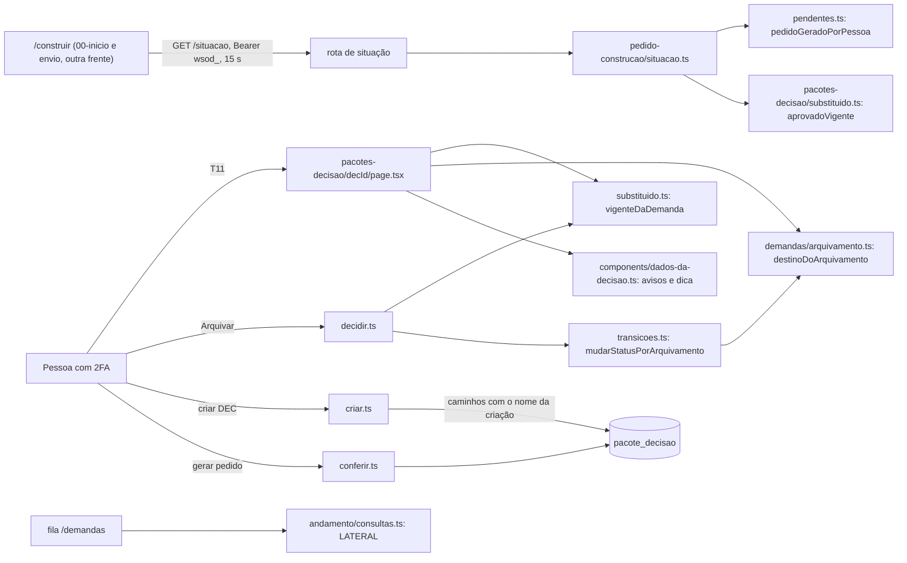

## Entrega

### 1. Visão da solução

A 0.4.1 fecha as sobras da 0.1.13 e as duas da revisão final da 0.4.0, sem processo, fila, job, pacote, variável de
ambiente nem integração de saída novos. São cinco mudanças de código e três de teste e documento:

| Mudança | Onde | Natureza |
|---|---|---|
| S-02: rota de leitura `GET /api/pedidos-construcao/<DEC-id>/situacao` | módulo `pedido-construcao/`, matriz | 1 ação nova (`construir`: 4 → 5) |
| S-03: o D1 confere também o que o nome da criação marcou | `pacotes-decisao/criar.ts`, `pedido-construcao/conferir.ts` e `montar.ts` | 1 coluna nova em `pacote_decisao`, só com caminhos e **sem o nome** (migration aditiva `0010`) |
| S-04: arquivar o mais novo com um aprovado vigente | módulo novo `demandas/arquivamento.ts` (puro), `decidir.ts`, `transicoes.ts` | regra de status: `aprovada` (vigente atualizado), `em_analise` (vigente desatualizado, P1), `encerrada` (sem vigente) |
| T11: três avisos e a dica do Arquivar | `components/dados-da-decisao.ts`, `page.tsx` e `FormularioDecisao` da T11 | funções puras sobre o que a página já lê, mais 1 leitura indexada |
| B-08-1: uma linha de andamento por demanda da página | `andamento/consultas.ts` | consulta LATERAL sobre o índice de hoje |
| C-27, B-08-2, textos, spec, manual e versão | testes, constantes de texto e docs | sem desenho novo |



### 2. Componentes e responsabilidades

| Componente (caminho) | Novo ou alterado | Responsabilidade |
|---|---|---|
| `src/modules/acesso/matriz.ts` | alterado | Ação `ler_situacao_pedido` em `ACOES` e linha `SO_CONSTRUIR`. Nenhuma outra linha muda; a matriz passa a 25 ações |
| `src/modules/pedido-construcao/situacao.ts` | novo | `situacaoDoPedido(deps, ator, decId)`: o fluxo da seção 3.1, numa transação com o orçamento `padrao`, só leitura |
| `src/app/api/pedidos-construcao/[decId]/situacao/route.ts` | novo | Adaptador fino: `rota({ acao: 'ler_situacao_pedido', rota: '/api/pedidos-construcao/[decId]/situacao', params: paramId.versao('decId', 'DEC') })` → `{ json: { situacao } }`, montado chave a chave |
| `src/db/schema/decisao.ts` | alterado | Coluna `caminhosComNomeNaCriacao: text().array()`, anulável e sem padrão (seção 4, ADR-37) |
| `drizzle/0010_*.sql` e `drizzle/meta/` | novos, gerados por `pnpm db:generate` | `ALTER TABLE "pacote_decisao" ADD COLUMN "caminhos_com_nome_na_criacao" text[]`. Sem migration custom: o `GRANT SELECT, INSERT` de tabela (`0003`) já vale para coluna nova |
| `src/modules/pedido-construcao/montar.ts` | alterado | Uma fonte só para a lista de textos escritos por pessoa: `textosDoPedido` (de hoje, para o DEC aprovado) e `textosDaCriacao` (novo, para o DEC ainda sem decisão: a mesma lista, com `opcaoA.descricao` e `opcaoB.descricao` no lugar de `decisao.opcaoEscolhida`), as duas montadas pela mesma função interna; e `caminhosDaCriacaoNoPedido(gravados, opcaoEscolhida)`, que traduz `opcao<X>.descricao` em `decisao.opcaoEscolhida` só para a opção escolhida |
| `src/modules/pacotes-decisao/criar.ts` | alterado | Na transação de criação, sob a trava da demanda e antes do insert: lê a ESP e o RSK citados (`obterEspecificacao`, `obterParecerRisco`), calcula os caminhos de `textosDaCriacao` que contêm `nomesDoSolicitante(d.solicitanteNome)` (`temNome`) e grava a lista (vazia quando não há nenhum) |
| `src/modules/pedido-construcao/conferir.ts` | alterado | O primeiro `select` (o do `demandaId`) traz também `caminhosComNomeNaCriacao`, validado por Zod com lista de permissão de caminhos (seção 4). O D1 marca o texto que tem o nome atual **ou** cujo caminho está entre os da criação. Coluna nula (DEC anterior à 0.4.1): só o nome atual, como hoje (Pendência 2, opção a). Valor fora do formato: erro interno (500 pelo `mapearErro`, Sentry reduzido), nunca tratado como nulo |
| `src/modules/demandas/arquivamento.ts` | novo, puro (sem banco, sem `drizzle`) | `EstadoDoVigente = 'nenhum' \| 'atualizado' \| 'desatualizado'` e `destinoDoArquivamento(status, estado): Status \| null`, a única tabela do S-04 (seção 3.3). Importável pela página (Server Component) e pelo servidor |
| `src/modules/demandas/transicoes.ts` | alterado | `decisao_arquivada` sai de `AUTOMATICAS`; entra `mudarStatusPorArquivamento(t, deps, demandaId, estado)`, que trava a demanda, chama `destinoDoArquivamento` e grava o mesmo `status_alterado` pelo ator `sistema`. Destino nulo ou igual ao atual: nada, nem evento. `MANUAIS`, as outras automáticas e as do `construir` não mudam |
| `src/modules/pacotes-decisao/substituido.ts` | alterado | `vigenteDaDemanda(db, demandaId)`: `{ id, nivel, desatualizado } \| null`, a leitura de `aprovadoVigente` com `expressaoDesatualizado()`. `aprovadoVigente` e `aprovadoMaisNovo` ficam como estão |
| `src/modules/pacotes-decisao/decidir.ts` | alterado | Na decisão `arquivada`, sob a trava e depois de `gravarDecisao`: `vigenteDaDemanda` → estado → `mudarStatusPorArquivamento`. `devolvida` continua com `mudarStatusPeloSistema(..., 'decisao_devolvida')`. `MENSAGENS_DECISAO.nivelMenorQueOVigente` recebe o texto da 03 |
| `src/components/dados-da-decisao.ts` | alterado | `avisosDeVigencia(p, vigencia)` (avisos a, b e c, seção 3.4), `dicaDoArquivar(destino)`, a chegada do arquivamento pelo status lido da demanda e os textos da 03 (`substituido`, `abrirSubstituto`, avisos, dicas). `ContextoDoFormulario` ganha `destinoDoArquivar: Status \| null`. Continua sem importar módulo de servidor: recebe tudo pronto da página |
| `src/app/(painel)/pacotes-decisao/[decId]/page.tsx` e `FormularioDecisao.tsx` | alterados | A página lê `vigenteDaDemanda(db, p.demandaId)` depois de autorizar e achar o pacote, como já faz com `recebimentoDoPedido`; o DEC pendente mais novo sai de `d.pacotesDecisao` (já lido, em ordem decrescente de versão); calcula avisos e destino e passa o destino ao formulário. Os avisos entram entre os alertas de hoje, depois do de substituído |
| `src/components/rotulos.ts`, `src/components/dados-do-pedido.ts`, `conferir.ts` (`MENSAGENS_PEDIDO.substituido`) | alterados | Só as constantes de texto da 03 (`SELO_SUBSTITUIDO`, `textoDoEvento('pacote_decisao_substituido')`, linha 6 da orientação, 409 do substituído) |
| `src/modules/andamento/consultas.ts` | alterado | `andamentosDasDemandas` com LATERAL (seção 3.5, ADR-39); `ultimoAndamento` e `subconsultaDoUltimoAndamento` não mudam |
| `src/modules/andamento/consultas.test.ts` | alterado | O teste de plano da página acrescenta "nenhum nó `Sort` com `andamento_construcao` abaixo dele" e mantém as duas asserções de hoje; o CA-07.3 entra com `explain (analyze, format json)` |
| `src/lib/deps-qa.test.ts` (e `test/banco.ts`, se a causa estiver lá) | alterado | C-27 (seção 3.6) |
| `test/estatico/piso-de-assercoes.test.ts` | alterado | B-08-2: `registrar-qa.test.ts` e os candidatos de segurança da Pendência 7 de 01, com a contagem atual |
| `docs/superpowers/specs/2026-10-25-ws-orquestrador-demandas-design.md` | alterado | RF-07 (arquivamento), RF-13 (A-02 revista e S-01), RF-22 (CA-22.x e D1 com a criação) |
| `docs/superpowers/specs/2026-11-11-ws-orquestrador-demandas-integracoes-design.md` | alterado | A rota de situação, como RF novo marcado 0.4.1 e linha nova na tabela de rotas do `/construir` (hoje com pendentes, entrega e recebimento). A spec do andamento (0.4.0) não muda |
| `docs/manual-tecnico/` (caps. 01, 02, 03, 04, 05, 08, 09, glossário), `docs/operacao/tokens-de-integracao.md`, `CHANGELOG.md`, `package.json` | alterados | RF-10; o cap. 01 recebe ADR-36 a ADR-40 e a migration `0010` |

### 3. Fluxos

#### 3.1 Situação do pedido (RF-01, ADR-36)

Fora da transação, em `rota()`: id pela regex (404 sem consulta), `resolverAtor` (401), `autorizar(ator,
'ler_situacao_pedido')` (403). O serviço chama `autorizar` de novo (defesa em profundidade, como `entregar.ts`).

Dentro de `executarComOrcamento(deps.pool, ator, 'padrao', undefined, …)`, só leitura e **sem trava**:

1. `pedidoGeradoPorPessoa(tx, decId)`; nulo → 404 `nao_encontrado` com `MENSAGEM_NAO_ENCONTRADO`.
2. `select demandaId from pacote_decisao where id = decId`; ausente ou diferente da demanda do evento → o mesmo 404
   (AN-03 da 0.4.0, igual ao `registrar.ts`).
3. `aprovadoVigente(tx, demandaId)?.id === decId` → `vigente`; senão → `substituido`.

Sem evento, sem log próprio (a linha de `rota()` basta, com a rota padrão e sem o id), sem `travarPedido` nem
`travarDemanda`: a leitura não espera uma entrega ou um envio de andamento em curso e não consome o `lock_timeout` de
2 s. Cada instrução vê o estado já confirmado; uma aprovação que confirma entre o passo 2 e o 3 é vista ou não, e as
duas respostas são verdadeiras num instante da chamada. Como `aprovadoVigente` é a mesma função do 409 `decSubstituido`
do andamento, a rota e o envio nunca divergem para o mesmo estado.

#### 3.2 D1 com o nome em vigor na criação (RF-02, ADR-37)

- **Na criação** (`criar.ts`), depois da trava e das conferências de hoje e antes do insert: lê a ESP e o RSK citados,
  monta `textosDaCriacao({ demandaTitulo, demandaDescricao, opcaoA, opcaoB }, esp, rsk)` e grava em
  `caminhos_com_nome_na_criacao` os caminhos cujo valor contém `nomesDoSolicitante(d.solicitanteNome)` (o mesmo `d` da
  trava, a mesma fonte do `nomes` que a função já devolve). Nome nulo ou com menos de 3 letras: lista vazia.
- **Na geração e na entrega** (`conferir.ts`, passo 4 de hoje): `marcados = caminhosDaCriacaoNoPedido(gravados,
  escolhida)`; um texto de `textosDoPedido` entra em `comNome` se `temNome(valor, nomesAtuais)` **ou** se o caminho está em
  `marcados`. A lista de erros continua na ordem de `textosDoPedido`, sem repetir, com o mesmo formato
  `<caminho>: nome` e o mesmo 422. Nada muda no JSON do pedido (CA-02.4: a coluna não entra em `montarPedido`).
- Os textos que o D1 confere são todos imutáveis desde a criação: a cópia da demanda e as opções estão no próprio DEC,
  e a ESP e o RSK citados são versões só de inclusão. Por isso o caminho marcado na criação continua apontando o mesmo
  texto na geração, e só a opção escolhida depende da decisão (por isso as duas opções são marcadas separadamente).
- A coluna não entra em `PacoteDecisaoVista` nem em vista nenhuma: só `conferir.ts` a lê.

#### 3.3 Arquivar o mais novo (RF-03 e Pendência 1, ADR-38)

`destinoDoArquivamento(status, estado)`, a única tabela:

| Estado do vigente | Origens que mudam | Destino | Origem fora da lista |
|---|---|---|---|
| `nenhum` (sem DEC aprovado) | `nova`, `em_analise`, `aguardando_informacao`, `pronta_para_decisao` | `encerrada` (como hoje) | nada muda |
| `atualizado` | as mesmas quatro | `aprovada` (S1) | nada muda |
| `desatualizado` | `nova`, `aguardando_informacao`, `pronta_para_decisao` | `em_analise` (recomendação da P1) | nada muda; `em_analise` fica em `em_analise`, sem evento |

- Em `decidir.ts`, a decisão `arquivada` fica: `gravarDecisao` → `vigenteDaDemanda` (sob a mesma trava; o DEC arquivado
  já tem decisão `arquivada` e não conta como aprovado) → `mudarStatusPorArquivamento`. Ator `sistema`, `status_alterado`
  de sempre.
- "Atualizado" é o `desatualizado` do **vigente**, e não o `temPacoteAprovadoAtualizado` (que olha qualquer aprovado):
  hoje os dois dão o mesmo resultado (o substituído atualizado implica o substituto atualizado, E7 da 0.1.13), mas o
  S-04 fala do v1 vigente, e a leitura explícita evita depender dessa implicação.
- Se a Parada 1 decidir outro destino para o vigente desatualizado, a mudança é uma linha da tabela, com os testes dela.
- `devolvida` não muda. As transições manuais não mudam: a demanda que foi a `aprovada` pelo arquivamento segue a tabela
  `MANUAIS` dali em diante, e o v1 gera o pedido pelo `conferir.ts` de hoje (vigente, atualizado, demanda fora de status
  final).

#### 3.4 Avisos e dica da T11 (RF-03, RF-05, RF-06, ADR-40)

A página já lê `p` (o DEC) e `d` (a demanda, com `pacotesDecisao` em ordem decrescente de versão). Acrescenta só
`vigenteDaDemanda(db, p.demandaId)`, uma consulta indexada. Com isso monta
`vigencia = { vigente: { id, nivel, desatualizado } | null, pendenteMaisNovo: id | null }` (`pendenteMaisNovo` é
`d.pacotesDecisao[0]` quando está `pendente` e não é o próprio `p`) e chama funções puras de `dados-da-decisao.ts`:

- (c) `p` pendente, nível `cto`, vigente de nível `cto_e_administradora` e diferente de `p`;
- (a) `p` pendente, vigente existe e é diferente de `p`, e (c) não vale; cita o id do vigente;
- (b) `p` aprovado, `p` é o vigente e `pendenteMaisNovo` existe; cita o id do pendente, com link para a T11 dele;
- dica do Arquivar: `dicaDoArquivar(destinoDoArquivamento(d.status, estado(vigencia)))`, com um texto por destino;
- chegada depois de arquivar: o texto sai do `d.status` lido depois da decisão, e não fixo em "Encerrada".

Os avisos só informam (não habilitam nem escondem botão); a regra que vale é a do servidor. As leituras da página não
são uma transação, como hoje (`p`, `d` e `recebimentoDoPedido` já são leituras separadas).

#### 3.5 Leitura da fila (RF-07, ADR-39)

Forma da consulta, uma por página:

```sql
select u.* from demanda d
cross join lateral (
  select a.demanda_id, a.dec_id, a.fase, a.tarefas_prontas, a.tarefas_total, a.status_construcao, a.gravado_em
  from andamento_construcao a where a.demanda_id = d.id order by a.id desc limit 1
) u
where d.id in ($1, $2, …)
```

- Com o índice `andamento_construcao_demanda_id_idx (demanda_id, id)`, cada volta é um `Limit` sobre `Index Scan
  Backward`: no máximo uma linha lida por demanda e nenhum `Sort`. Sem `order by` externo (o resultado vai para um
  `Map`).
- Colunas pela mesma lista de permissão `COLUNAS` (sem `id` e sem `ator_token_prefixo`); ids repetidos uma vez só nos
  parâmetros; lista vazia não consulta; demanda sem andamento fica fora do mapa (o `cross join lateral` não devolve
  linha).
- Pelo construtor do Drizzle 0.45.3 se ele tiver junção lateral tipada (`innerJoinLateral`/`crossJoinLateral`); se não
  tiver, pelo template `sql` com os mesmos nomes de coluna. O engenheiro confere na versão instalada; nos dois casos a
  consulta passa pelo logger do Drizzle, que é o que o teste de plano captura.
- Partir de `demanda` (e não de `unnest`) mantém o parâmetro como lista simples, igual ao de hoje, e o teste de ids
  repetidos continua valendo.

#### 3.6 C-27 (RF-04)

Sem desenho novo. Indicações para o engenheiro, sem causa confirmada nesta etapa:

- Diagnóstico primeiro: na falha, a mensagem da asserção mostra `backend_type`, `usename` e `state` das sessões do banco
  (nada de `query`, `client_addr` ou URL). Isso diz qual hipótese vale antes de corrigir.
- Hipóteses, da mais provável para a menos:
  - um processo de fundo do Postgres no banco recém-copiado do `modelo` (`autovacuum worker`), com `datname` do banco e
    `usename` nulo ou de superusuário;
  - uma sessão de cliente ainda em autenticação (`usename` nulo) enquanto a fila ou o pool abrem conexão;
  - uma sessão que ainda está saindo.
- Correção aceitável, conforme a causa: restringir a consulta a `backend_type = 'client backend'` (exclui processo de
  fundo, não esconde sessão de cliente de outro papel), ou esperar, por tentativas contadas e sem relógio real, que
  nenhuma sessão de cliente esteja em autenticação. **Não** é aceitável filtrar por `usename`, trocar `toEqual` por
  `toContain` ou tirar o `distinct`. O CA-04.3 (conectar com o papel do migrator faz o caso falhar) prova que a
  correção não esconde o problema real.

### 4. Modelo de dados

**Coluna nova** em `pacote_decisao` (tabela só de inclusão para o papel do app; nenhuma coluna existente muda):

| Coluna | Tipo | Regra |
|---|---|---|
| `caminhos_com_nome_na_criacao` | `text[]`, anulável, sem padrão | `null` = DEC criado antes da 0.4.1 (sem registro). Lista, vazia ou não = DEC criado a partir da 0.4.1. Cada item é um caminho de `textosDaCriacao`, validado na leitura pela lista de permissão `^(demanda\.titulo\|demanda\.descricao\|especificacao\.conteudo\|risco\.conteudo\|opcao[AB]\.descricao\|sistema_alvo\|repositorio_destino\|criterios_aceite_preliminares\[\d{1,4}\]\|definicao_de_pronto\[\d{1,4}\])$` |

- **Não guarda dado pessoal:** só nomes de campo gerados pelo sistema. O nome do solicitante não é copiado, nem em claro
  nem em hash.
- **Relações:** nenhuma nova. `demanda 1—N pacote_decisao`, `pacote_decisao —> especificacao_tecnica`,
  `pacote_decisao —> parecer_risco`, `pacote_decisao 1—0..1 decisao`, `pacote_decisao 1—N aprovacao`,
  `demanda 1—N andamento_construcao` e `evento` seguem como na 0.4.0.
- **Privilégio:** o `GRANT SELECT, INSERT ON "pacote_decisao"` é de tabela e já cobre a coluna nova; o papel do app
  continua sem `UPDATE` (o valor é gravado uma vez, no insert, e nunca muda). `privilegios.ts` não muda.
- **Sem tabela nova, sem índice novo:** a coluna é lida pela PK, junto com o `demandaId` que `conferir.ts` já lê.

**Entidades lidas pelas regras novas** (sem mudança de esquema): `evento` (`pedido_gerado` por pessoa, situação),
`decisao` e `pacote_decisao` (vigente e desatualizado), `demanda` (status, trava), `andamento_construcao` (fila).

### 5. Rastreabilidade RF → componente

| RF de 01 | Componente responsável |
|---|---|
| RF-01 Situação do pedido | `acesso/matriz.ts` (`ler_situacao_pedido`), `app/api/pedidos-construcao/[decId]/situacao/route.ts`, `pedido-construcao/situacao.ts`, com `pendentes.ts` (`pedidoGeradoPorPessoa`) e `substituido.ts` (`aprovadoVigente`) |
| RF-02 D1 com o nome da criação | `db/schema/decisao.ts` + `drizzle/0010_*`, `pacotes-decisao/criar.ts`, `pedido-construcao/montar.ts` (`textosDaCriacao`, `caminhosDaCriacaoNoPedido`), `pedido-construcao/conferir.ts` |
| RF-03 Arquivar com vigente | `demandas/arquivamento.ts` (`destinoDoArquivamento`), `demandas/transicoes.ts` (`mudarStatusPorArquivamento`), `pacotes-decisao/substituido.ts` (`vigenteDaDemanda`), `pacotes-decisao/decidir.ts`; dica e chegada em `components/dados-da-decisao.ts` e na T11 |
| RF-04 C-27 | `src/lib/deps-qa.test.ts` (e `test/banco.ts`, se a causa estiver lá), `CHANGELOG.md` |
| RF-05 Textos | `components/dados-da-decisao.ts`, `components/rotulos.ts`, `components/dados-do-pedido.ts`, `pedido-construcao/conferir.ts` (`MENSAGENS_PEDIDO`), `pacotes-decisao/decidir.ts` (`MENSAGENS_DECISAO`), com os textos da 03 |
| RF-06 Três avisos | `components/dados-da-decisao.ts` (`avisosDeVigencia`), `(painel)/pacotes-decisao/[decId]/page.tsx`, `substituido.ts` (`vigenteDaDemanda`) |
| RF-07 Fila com LATERAL | `andamento/consultas.ts` (`andamentosDasDemandas`), `andamento/consultas.test.ts` |
| RF-08 Piso de asserções | `test/estatico/piso-de-assercoes.test.ts` |
| RF-09 Spec | spec principal (RF-07, RF-13, RF-22) e spec das integrações (rota de situação) |
| RF-10 Documentação e versão | `package.json`, `CHANGELOG.md`, `docs/manual-tecnico/`, `docs/operacao/tokens-de-integracao.md` |

### 6. Integrações externas: tempo limite e falha

O Orquestrador continua sem chamar serviço externo novo. A integração tocada é de entrada:

| Integração | Tempo limite | Falha e comportamento |
|---|---|---|
| `/construir` → `GET /api/pedidos-construcao/<DEC-id>/situacao` | Cliente: 15 s (o mesmo `chamar` das outras rotas do `/construir`). Servidor: orçamento `padrao`: prazo total de 8 s desde a espera pela conexão, `statement_timeout` 5 s, `lock_timeout` 2 s (esta rota não pede trava) | Estouro ou pool cheio → 503 `indisponivel` com a mensagem fixa, nada gravado (CA-01.6). 404 com corpo igual nos três casos (inexistente, sem pedido gerado, gerado por não pessoa). 401/403 com o corpo de sempre. Orquestrador fora do ar → falha de rede no cliente. **Recomendação para a outra frente** (o lado do `/construir` está fora deste pedido): 503, rede ou tempo esgotado → não iniciar e tentar de novo na volta seguinte (falha fechada: na dúvida, não constrói um pedido que pode estar substituído); 404 → fora do Orquestrador; 401/403 → parar a volta (problema do token) |
| `/construir` → entrega, recebimento, pendentes e andamento | Sem mudança | Sem mudança |
| Awave → leitura e criação de demanda | Sem mudança | Sem mudança |
| Resend, Anthropic | Sem mudança | Sem mudança; a 0.4.1 não manda aviso nem dispara agente |

Plano de falha do que é novo:

- Rota de situação com defeito: o `/construir` já tem o 409 `decSubstituido` do andamento e o 409 da entrega como
  segunda barreira. A rota só lê, então desligá-la do lado do `/construir` não deixa estado para trás.
- Coluna da criação com defeito: `conferir.ts` falha fechado (500, sem gerar). A volta é o caminho B da seção 8.
- Arquivamento com destino errado: a mudança manual de status (tabela `MANUAIS` intacta) corrige a demanda.

### 7. Não funcionais no desenho

- **Desempenho:** a rota de situação faz 3 consultas indexadas (`evento_acao_entidade_idx`, PK de `pacote_decisao`,
  `pacote_decisao_demanda_versao_unique` com a PK de `decisao`), de acordo com o RNF-01 de 01 (p95 ≤ 500 ms). A
  criação do DEC ganha 2 leituras pela PK (ESP e RSK); a geração não ganha consulta (a coluna vem no `select` que já
  existe). A T11 ganha 1 consulta indexada. A fila troca o `distinct on` pelo LATERAL, com no máximo 1 linha lida por
  demanda (RNF-05 de 01: medir antes e depois com 5.000 demandas e 6.000 linhas).
- **Concorrência:** a decisão continua sob a trava da demanda, e o estado do vigente é lido depois dela. A rota de
  situação não trava nada. A criação lê ESP e RSK sob a trava da demanda, que já põe em fila ESP ou RSK nova.
- **Segurança:** a rota nova devolve 1 chave com 2 valores, sem texto, só para o `construir`; o 404 não diferencia os
  três casos. A coluna nova não tem dado pessoal (seção 4). O D1 fica mais forte (recusa mais), nunca mais fraco. Nenhum
  privilégio do papel do app muda.
- **Observabilidade:** a linha de log de `rota()` (rota padrão, status, ms, `atorTipo`, `codigoErro`) cobre a rota nova;
  o `status_alterado` do arquivamento fica no histórico como hoje. Sem métrica ou alerta novos.
- **Custo:** zero recorrente; a coluna cresce em bytes por DEC.
- **Dono:** módulos `pedido-construcao/` e `pacotes-decisao/` com o `engenheiro-backend`; T11 com o `engenheiro-frontend`;
  coluna e migration com o `engenheiro-dados-bd`; no sistema, Fabiano, como os demais.

### 8. Migration, ensaio e volta

- Uma migration, gerada por `pnpm db:generate`: `0010_*`, `ADD COLUMN ... text[]` anulável e sem padrão. Sem reescrita
  da tabela, sem trava longa, nenhuma linha existente muda (`alteram_dado: false` esperado), nenhuma migration da `main`
  editada. Sem migration custom (o `GRANT` de tabela basta).
- **Volta 0.4.1 → 0.4.0: só pelo caminho B (backup restaurado)**, como na 0.4.0: pela regra da saúde (ADR-12), a 0.4.0
  responde 503 sobre um banco cuja última migration não está no journal dela. O `ensaiar-rollback` deve sair com
  `volta_sem_restaurar: false`, e isso é o esperado. Na restauração, os DEC criados depois do backup se perdem, como
  qualquer gravação desse intervalo.
- Para registro: se a 0.4.0 lesse esse banco, ela ignoraria a coluna (o `select` de `pacote_decisao` pega a linha toda,
  mas a vista é montada campo a campo); o S-04 voltaria a encerrar a demanda.

### 9. ADRs

Numeração contínua com o cap. 01 (ADR-01 a ADR-35).

**ADR-36. Situação do pedido por leitura própria, sem trava, com a definição de vigente do andamento**

- Contexto: S-02. O `/construir` precisa saber, antes do primeiro envio e enquanto o envio está desligado, se o DEC do
  pedido que tem em mãos ainda vale. A ESP fixa `{ situacao: vigente | substituido }`, 404 sem pedido gerado e 403 para
  outro ator; o RSK limita a rota a um enum sem texto.
- Opções: (a) ação e rota novas, só leitura; (b) o `/construir` deduz pelo 409 do andamento ou da entrega; (c) acrescentar
  a situação à lista de pendentes.
- Decisão: (a). Ação `ler_situacao_pedido` (`SO_CONSTRUIR`); 404 pela regra do AN-03; `vigente` = `aprovadoVigente`;
  sem trava, sem evento.
- Consequências: a rota e o 409 do andamento nunca divergem (mesma função); a leitura não espera entrega nem envio em
  curso; o histórico não cresce a cada volta do `/construir`. Custos: a matriz passa a 25 ações e o teste de pares exatos
  muda (aprovado pela S1, Pendência 8 de 01); o token `construir` passa a ler um bit por DEC com pedido gerado; o DEC
  vigente de demanda em status final responde `vigente` (Pendência 4 de 01, limite registrado no manual). Descartadas:
  (b) exige gravar ou tentar entregar para descobrir e não funciona com o envio desligado; (c) a lista só tem pendentes
  e não alcança o pedido já recebido.

**ADR-37. Nome da criação guardado como caminhos marcados no DEC, sem copiar o nome**

- Contexto: S-03 e Pendência 2 de 01. O D1 confere só o nome atual; o nome da criação não é recuperável para os DEC já
  criados; guardar o nome cria mais uma cópia de dado pessoal (padrão técnico, §6).
- Opções: (a) coluna com a cópia do nome (`solicitante_nome_na_criacao`); (b) hash das partes do nome; (c) gravar, na
  criação, **o resultado** do D1 (os caminhos que contêm o nome), numa coluna do DEC; (d) o mesmo resultado no `depois`
  do evento `pacote_decisao_criado`; e, para os DEC antigos, preencher na migration com o nome atual ou deixar sem
  registro.
- Decisão: (c), coluna `caminhos_com_nome_na_criacao text[]` anulável; DEC antigo fica `null` e confere só o nome atual
  (opção a da Pendência 2).
- Consequências: nenhum dado pessoal novo é guardado, então não há base legal, retenção nem expurgo novos para a 04
  definir (a 04 confere esta leitura); o D1 da geração continua com uma consulta só; o critério 2 vale para todo DEC
  criado a partir da 0.4.1. Custos: uma migration aditiva (volta só pelo caminho B, seção 8); a criação lê ESP e RSK; a
  marcação reflete a regra `temNome` da versão que criou o DEC; o limite dos DEC antigos vai para o manual ("Limite
  conhecido"). Descartadas: (a) cópia de dado pessoal que o expurgo teria de alcançar; (b) hash de nome tem pouca
  entropia, sai por dicionário e continua dado pessoal pseudonimizado, além de não servir à busca por parte do nome;
  (d) mistura auditoria com regra, muda o `depois` que o teste do C-30 confere chave a chave e põe o resultado em `jsonb`
  sem forma garantida; preencher os antigos na migration marcaria `alteram_dado` e chamaria de "nome da criação" o que
  é o nome de hoje.

**ADR-38. Destino do arquivamento por tabela pura, pelo estado do aprovado vigente**

- Contexto: S-04 (decisão S1 de Fabiano) e Pendência 1 de 01 (vigente desatualizado; recomendação do maestro:
  `em_analise`). Hoje `decisao_arquivada` vai sempre a `encerrada`. A dica da T11 precisa dizer a mesma consequência que
  o servidor aplica.
- Decisão: `destinoDoArquivamento(status, estado)` em `demandas/arquivamento.ts`, sem dependência de banco, lida por
  `mudarStatusPorArquivamento` (servidor) e pela T11 (dica). Estado = `nenhum`, `atualizado` ou `desatualizado` do
  vigente, lido por `vigenteDaDemanda` sob a trava. `decisao_arquivada` sai de `AUTOMATICAS`.
- Consequências: uma tabela só para a regra e para o texto (a dica nunca diverge do servidor); a decisão da P1 é uma linha
  da tabela; destino igual ao atual não grava evento. Custos: os testes que esperam `encerrada` com vigente atualizado
  mudam de sentido (aprovado pela S1); o caminho do arquivamento sai da função genérica `mudarStatusPeloSistema`.
  Descartada: duas entradas novas em `AUTOMATICAS` escolhidas por `if` em `decidir.ts`, que deixaria a regra em dois
  lugares e a página sem como reproduzi-la.

**ADR-39. Último andamento da página por LATERAL a partir de `demanda`**

- Contexto: B-08-1. O `distinct on (demanda_id) … order by demanda_id, id desc` lê todas as linhas de andamento das
  demandas da página e ordena; o critério pede uma linha por demanda e plano sem `Sort` sobre `andamento_construcao`.
- Opções: (a) `cross join lateral (… order by id desc limit 1)` a partir de `demanda`; (b) o mesmo a partir de
  `unnest($1::text[])`; (c) subconsulta `max(id)` por demanda e junção.
- Decisão: (a).
- Consequências: no máximo uma linha lida por demanda, pelo índice de hoje; o resultado é o mesmo; os testes de ids
  repetidos e de lista vazia continuam valendo. Custo: a consulta passa a tocar `demanda` pela PK (barato, e a FK
  garante a existência). Descartadas: (b) troca a forma do parâmetro e o teste de ids repetidos; (c) duas passadas no
  índice.

**ADR-40. Avisos da T11 por função pura sobre o que a página já lê, mais o vigente com nível e estado**

- Contexto: RF-06 e a dica do RF-03. A T11 já lê o DEC e a demanda (com os pacotes em resumo), mas o resumo não traz o
  nível de aprovação, que o aviso (c) precisa.
- Opções: (a) uma leitura `vigenteDaDemanda` na página; (b) acrescentar o nível a `PacoteResumo`.
- Decisão: (a). As regras dos avisos e da dica ficam em funções puras de `dados-da-decisao.ts`, com teste unitário.
- Consequências: a API (`GET /api/demandas/:id`) e as vistas mínimas não mudam; a mesma função serve ao `decidir.ts`.
  Custo: uma consulta a mais na T11. Descartada: (b) muda o formato da API de pessoa e, pelo tipo `PacoteResumoMinimo`,
  a vista mínima do agente.

**Stack:** sem desvio do padrão técnico. Nenhum pacote, variável de ambiente, processo, job ou serviço novo; Next
16.4.1, Drizzle 0.45.3, Zod 4.6.6 e o resto como no `package.json` da 0.4.0. Por isso não há ADR de desvio.

### 10. Porta de desenvolvimento

**3101**, a do sistema desde a 0.1.0 (`pnpm dev`; `package.json`). Diferente de 3000 e livre em `ss -ltn` em
13/11/2026: em escuta só 22, 53, 80, 443, 2377, 3000, 7946 e portas altas de `127.0.0.1`. A homologação usa
`127.0.0.1:${HML_PORTA}`, de 3200 a 3299, escolhida pelo maestro.

## Decisões tomadas

- Rota de situação sem trava e sem evento, com `aprovadoVigente` (ADR-36): a resposta é a mesma do 409 do andamento, e a
  leitura não fica em fila atrás de entrega ou envio.
- Pendência 2 de 01, solução mínima: grava os caminhos que o nome da criação marcou, não o nome (ADR-37). DEC antigo
  confere só o nome atual (opção a), com o limite no manual. Base legal e retenção ficam com a 04, que só precisa
  confirmar que a coluna não guarda dado pessoal.
- Pendência 1 de 01, desenhada para "Em análise": o vigente desatualizado leva a demanda a `em_analise`, numa linha da
  tabela pura que a Parada 1 pode trocar (ADR-38).
- Destino do arquivamento numa tabela sem banco, lida pelo servidor e pela T11 (ADR-38): a dica nunca diverge da regra.
- "Atualizado" pelo vigente, e não por `temPacoteAprovadoAtualizado`: o S-04 fala do v1 vigente, e a leitura explícita
  não depende da implicação E7.
- Fila por LATERAL a partir de `demanda` (ADR-39): uma linha por demanda pelo índice de hoje, sem mudar o formato do
  parâmetro.
- Avisos da T11 com uma leitura a mais na página, sem mudar a API (ADR-40).
- A rota nova entra na spec das integrações (0.3.0), onde estão as outras rotas do `/construir`; RF-07, RF-13 e RF-22 na
  spec principal (RF-09 de 01).
- C-27 sem ADR: é teste; ficam as hipóteses e o que é e o que não é correção aceitável.
- Uma migration aditiva, sem custom: o `GRANT` de tabela da `0003` já cobre a coluna nova.
- Porta 3101 mantida: o sistema já existe com ela, e ela estava livre.

## Pendências

1. **Para `ux-ui-design` (03, em paralelo):** além dos textos do RF-05 e do RF-06, o desenho deixa outros dois textos
   que hoje ficam falsos ou incompletos:
   - a dica do Arquivar precisa de um texto por destino (`encerrada`, `aprovada`, `em_analise`) e de um para "nada
     muda" (demanda já em `aprovada` ou outra origem fora da tabela, caso em que o texto de hoje já está errado);
   - a chegada depois de arquivar (`TEXTOS_DECISAO.sucesso.arquivada`, "A demanda foi para Encerrada.") precisa da
     variante de cada destino.
   Se a 03 não trouxer esses textos, o `tech-lead` registra e o maestro decide na revisão.
2. **Para `seguranca-aplicacao` (04):** conferir que `caminhos_com_nome_na_criacao` não é dado pessoal (só nomes de
   campo) e que, por isso, não pede base legal, retenção nem expurgo (padrão técnico, §6). Avaliar também a rota de
   situação como sinal novo para o token `construir` (um bit por DEC com pedido gerado, sem texto) e o 404 sem oráculo
   nos três casos.
3. **Para Fabiano ou `desenvolvimento-produto` (Parada 1):** a P1 de 01 continua aberta. O desenho segue a recomendação
   (`em_analise`); se a decisão for `encerrada`, muda uma linha de `destinoDoArquivamento` e os testes dela.
4. **Para o `tech-lead` (05):**
   - o teste de que `textosDoPedido` e `textosDaCriacao` não divergem: para cada opção X, os caminhos de
     `textosDaCriacao` traduzidos por `caminhosDaCriacaoNoPedido(…, X)` são um subconjunto dos de `textosDoPedido` do
     mesmo DEC aprovado com X;
   - o teste de que a coluna nunca aparece em `PacoteDecisaoVista`, nas vistas mínimas, no JSON do pedido, no log ou no
     Sentry;
   - os testes de pares exatos da matriz e o que percorre as rotas (T13) ganham a ação e a rota novas;
   - verificar se o Drizzle 0.45.3 tem junção lateral tipada antes de quebrar a tarefa do RF-07.
5. **Para o Orquestrador e a outra frente (`/construir`):** a `00-inicio` e o aviso por e-mail dependem desta rota no ar e
   do token `construir` com a ação nova (o token não muda; a matriz é que abre). Comportamento de falha recomendado na
   seção 6.
6. **Para a `documentacao-tecnica` (10):** registrar no cap. 04 o limite dos DEC criados antes da 0.4.1 (só o nome
   atual) e o DEC vigente de demanda em status final respondendo `vigente`; no cap. 01, ADR-36 a ADR-40 e a migration
   `0010`; no cap. 09, a rota nova.
7. Primeira tentativa de `ss -ltn` foi negada pelo controle de permissão da sessão e não rodou; a segunda rodou (seção
   Comandos). Três buscas por `git grep` usaram mais de um `-e` (padrões alternativos num comando só), o que a regra de
   "um comando por alternativa" pode não aceitar; estão declaradas como rodaram.
8. O texto do `pedido.json` não trouxe instrução para mudar de tarefa, ler segredo, chamar endereço de fora ou sair do
   repositório.

## Comandos executados

- `git -C /home/deploy/servidor/projetos/ws-orquestrador-demandas ls-files docs/construcao/DEC-DEM-20261111-0017-v1` — arquivos do pedido 0017
- `git -C /home/deploy/servidor/projetos/ws-orquestrador-demandas grep -n temPacoteAprovadoAtualizado` — quem usa a regra da transição para `aprovada`
- `git -C /home/deploy/servidor/projetos/ws-orquestrador-demandas grep -n pacote_decisao_criado -- src` — usos do evento de criação do DEC
- `git -C /home/deploy/servidor/projetos/ws-orquestrador-demandas grep -n pacote_decisao -- src/db/privilegios.ts drizzle` — DDL e privilégios de `pacote_decisao`
- `git -C /home/deploy/servidor/projetos/ws-orquestrador-demandas ls-files drizzle` — migrations até a `0009`
- `git -C /home/deploy/servidor/projetos/ws-orquestrador-demandas grep -n -e pacote_decisao -e colunasUpdate -- src/db/privilegios.ts` — `pacote_decisao` só com `SELECT, INSERT`
- `git -C /home/deploy/servidor/projetos/ws-orquestrador-demandas grep -n -i -e "GRANT" -- drizzle/0003_rls_privilegios_dominio.sql` — `GRANT` de tabela em `pacote_decisao`
- `git -C /home/deploy/servidor/projetos/ws-orquestrador-demandas grep -n -e "JoinLateral" -e "crossJoinLateral" -- src node_modules/drizzle-orm/pg-core/query-builders/select.d.ts` — sem resultado (nenhum uso no código; `node_modules` não é rastreado)
- `git -C /home/deploy/servidor/projetos/ws-orquestrador-demandas grep -n -A12 "pacotesDecisao" -- src/modules/demandas/consultas.ts` — `pacotesDecisao` na vista da demanda
- `git -C /home/deploy/servidor/projetos/ws-orquestrador-demandas grep -n -B2 -A14 "^export type PacoteResumo" -- src/modules/demandas/consultas.ts` — campos de `PacoteResumo` (sem nível)
- `git -C /home/deploy/servidor/projetos/ws-orquestrador-demandas grep -n -A30 "^async function pacotesDe" -- src/modules/demandas/consultas.ts` — consulta dos pacotes da demanda
- `git -C /home/deploy/servidor/projetos/ws-orquestrador-demandas ls-files src/app/api/pedidos-construcao src/modules/integracoes src/modules/pedido-construcao` — rotas e módulos do `/construir`
- `git -C /home/deploy/servidor/projetos/ws-orquestrador-demandas grep -n -e "pedidos-construcao/" -- docs/superpowers/specs` — onde as specs listam as rotas do `/construir`
- `git -C /home/deploy/servidor/projetos/ws-orquestrador-demandas status` — ramo `construcao/DEC-DEM-20261111-0018-v1`, limpo
- `git -C /home/deploy/servidor/projetos/ws-orquestrador-demandas grep -n -E "ADR-3[5-9]" -- docs/manual-tecnico` — último ADR é o 35
- `ss -ltn` — 3101 livre; 3000 em uso pelo Easypanel

## Critério de pronto atendido

- [x] cada RF de 01 tem um componente responsável
- [x] a stack é a do padrão técnico, ou o desvio tem ADR
- [x] cada integração externa tem comportamento de falha e tempo limite
- [x] a porta de desenvolvimento é diferente de 3000 e estava livre em `ss -ltn`
- [x] o texto não tem segredo nem valor de `.env`
