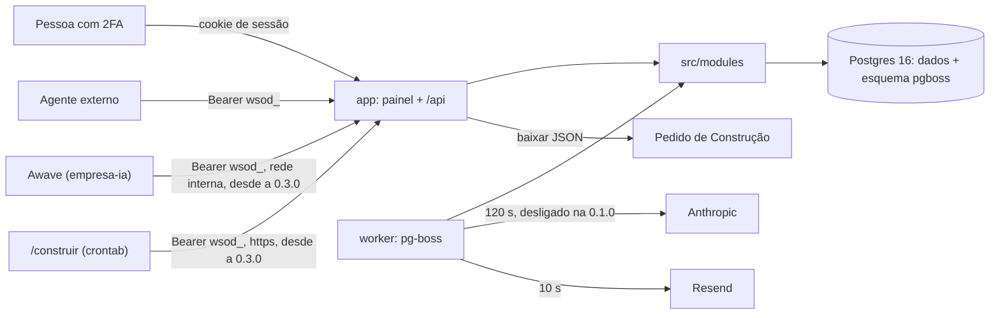

# 01. Arquitetura

| Campo | Valor |
|---|---|
| Atualizado em | 12/11/2026 (0.3.1: prazo total das integrações no módulo `integracoes/`, ADR-28); 12/11/2026 (0.3.0: as duas integrações no desenho, módulos `integracoes/` e `pedido-construcao/` ampliado, migration `0007`, ADR-20 a ADR-29); 11/11/2026 (0.2.0: leituras da fila em `demandas/`, `src/components/`, fontes Noto, ADR-13 a ADR-19); 10/11/2026 (0.1.13: substituído no módulo `pacotes-decisao/`); 31/10/2026 |
| Dono | `documentacao-tecnica` (sistema: Fabiano) |
| Cobre | RNF-01, RNF-02, RNF-05, RNF-17, ADR-01 a ADR-29 |
| Fontes no código | `package.json`, `pnpm-workspace.yaml`, `src/worker/iniciar.ts`, `src/lib/rota.ts`, `src/lib/deps.ts`, `src/app/api/saude/route.ts`, `scripts/migrate.ts`, `next.config.ts`, `src/app/fontes.ts`, `src/app/layout.tsx`, `src/modules/demandas/resumo-da-fila.ts`, `drizzle/0007_greedy_wendigo.sql` |

## Visão geral

Monólito modular em Next.js (App Router) com **dois processos da mesma imagem**, sobre um Postgres 16 que guarda os
dados e também a fila do pg-boss:

| Processo | Comando | O que faz |
|---|---|---|
| `app` | `pnpm start` (`next start`, porta `PORT`, padrão 3101) | painel em pt-BR e API REST em `src/app/api/` |
| `worker` | `pnpm worker` (`tsx src/worker/index.ts`) | jobs do pg-boss: agentes de IA, aviso por e-mail, expurgo, batimento |

A regra de negócio fica em `src/modules/<domínio>`. Rota da API, Server Action do painel e job do worker são
adaptadores finos sobre as mesmas funções, com os mesmos schemas Zod e a mesma `autorizar(ator, acao)`
(`src/modules/acesso/matriz.ts`). O worker chama os módulos direto, não a própria API (ADR-02).

Desde a 0.3.0, as duas integrações **chamam** o Orquestrador; o Orquestrador não chama ninguém de novo. Não há processo,
fila, job, pacote nem variável de ambiente novos ([cap. 02](02-acesso-e-seguranca.md#atores-de-integração-030)).

## Módulos

| Caminho | Responsabilidade |
|---|---|
| `src/app/(painel)/` | telas; cada página começa por `exigirPessoaNaPagina` |
| `src/components/` | componentes de tela e regras de exibição puras (`dados-*.ts`). Desde a 0.2.0: a casca (`casca/`), a marca (`marca/MarcaWs.tsx`), `dados-da-fila.ts` e `dados-das-etapas.ts`. Não decidem acesso nem gravam nada ([cap. 08](08-painel.md)) |
| `src/app/api/` | rotas; cada uma é `rota(...)` de `src/lib/rota.ts`, menos `/api/auth/*` e `/api/saude` |
| `src/modules/acesso/` | Better Auth (senha + TOTP), tokens de serviço (de agente e, desde a 0.3.0, de integração), `resolverAtor`, `exigirPessoa`, matriz de acesso |
| `src/modules/demandas/` | criar, ler, alterar, gerador de id, máquina de status, entrada colando o texto, entradas pendentes; desde a 0.2.0, as duas leituras da fila do painel (`resumo-da-fila.ts`, só `SELECT`, [cap. 03](03-demandas.md#rf-06-consultar-e-alterar)); desde a 0.3.0, a origem da demanda, a leitura pelo Awave e a confirmação por pessoa (`confirmar.ts`, `confirmacao.ts`, [cap. 03](03-demandas.md#demanda-aberta-pelo-awave-030)); desde a 0.3.1, a regra de visibilidade da demanda do Awave para agente e `sistema` (`exigirVisivelPara`, `condicaoVisivelAoAgente`, em `confirmacao.ts`) |
| `src/modules/integracoes/` | desde a 0.3.0: tempo limite das transações de integração e o 503 `indisponivel` (`tempo-limite.ts`, ADR-28); desde a 0.3.1, o prazo total da transação (`PRAZO_TOTAL_MS`), aplicado por `comTransacao` (`src/db/transacao.ts`) desde a espera pela conexão ([cap. 02](02-acesso-e-seguranca.md#atores-de-integração-030)) |
| `src/modules/especificacoes/`, `pareceres-risco/`, `pacotes-decisao/` | versões de ESP, RSK e DEC, desatualizado, substituído (desde a 0.1.13), decisão e dupla aprovação |
| `src/modules/versoes.ts` | trava da demanda (`SELECT … FOR UPDATE`) e próxima versão |
| `src/modules/limites.ts` | limite por ator: 30 demandas e 60 versões (ESP, RSK e DEC somados) por hora; desde a 0.3.0, 10 demandas por hora para o Awave |
| `src/modules/historico/` | eventos só de inclusão |
| `src/modules/agentes/`, `src/agents/` | interruptores, teto, preço, execução, entrada do agente, provedor; prompts |
| `src/modules/dados-pessoais/` | detectores (e-mail, telefone, CPF, CNPJ) e minimização |
| `src/modules/pedido-construcao/` | montar, serializar e validar o Pedido de Construção; desde a 0.3.0, a conferência e a montagem compartilhadas (`conferir.ts`) e a entrega ao `/construir` (`pendentes.ts`, `entregar.ts`, `receber.ts`, [cap. 05](05-pedido-de-construcao.md#entrega-ao-construir-030)) |
| `src/vendor/construir/` | cópia sem mudança do `validarPedido` do `/construir`, com SHA-256 conferido em teste (ADR-05) |
| `src/modules/avisos/`, `retencao/` | e-mail de DEC pronto; expurgo |
| `src/worker/`, `src/jobs/` | filas, agendamentos, batimento, varredura de execuções órfãs |
| `src/db/`, `drizzle/` | esquema Drizzle e 8 migrations (`0000` a `0007`, três delas custom `rls_privilegios_*`). A `0007` (0.3.0) é gerada e só aditiva: ver [Banco](#banco) |
| `src/lib/` | relógio injetável, fuso de São Paulo, log, erros, adaptador de rota, leitura do corpo, configuração |
| `scripts/` | migrate, homologação, seed fictício e scripts de operação ([cap. 10](10-configuracao-e-scripts.md)) |

## Banco

- **Dois papéis.** O migrator (`DATABASE_URL_MIGRATOR`) é dono do DDL e só aparece no `pnpm db:migrate`. O app e o
  worker usam `orquestrador_app` (`DATABASE_URL`), sem DDL. Nas tabelas imutáveis (versões, decisão, aprovação,
  histórico) o papel da aplicação só tem `SELECT` e `INSERT` (ADR-03); um teste de guarda confere os privilégios.
- **Migration** (`scripts/migrate.ts`): aplica a pasta `drizzle/` com o migrator e depois cria o esquema e as filas
  do pg-boss, também com o migrator. O app e o worker sobem com `migrate: false` (ADR-04). O papel
  `orquestrador_app` precisa existir antes: a migration de privilégios falha sem ele, de propósito.
- **Na produção a migration é passo separado** (ADR-12): backup → `pnpm db:migrate` → deploy. Só a homologação
  (`pnpm start:hml`) migra ao subir.
- Tabelas: `user`, `session`, `account`, `verification`, `two_factor` (Better Auth), `bloqueio_verificacao`,
  `token_servico`, `demanda`, `entrada_bruta`, `entrada_pendente`, `especificacao_tecnica`, `parecer_risco`,
  `pacote_decisao`, `aprovacao`, `decisao`, `evento`, `configuracao_agente`, `configuracao_ia`, `preco_modelo`,
  `execucao_agente`, `uso_ia`, `aviso_email`, `worker_batimento`, `rotina_execucao`.
- **Migration `0007` (0.3.0)**, gerada por `pnpm db:generate` e só aditiva (`drizzle/0007_greedy_wendigo.sql`):
  - `token_servico`: `agente` passa a anulável; coluna nova `integracao` (anulável); CHECK
    `token_servico_integracao_check` (`awave`, `construir`) e `token_servico_dono_check` (exatamente um dono);
  - `evento`: `evento_ator_tipo_check` aceita `integracao`; CHECK novo `evento_ator_integracao_check` (integração exige
    `ator_id` da lista e prefixo); índice novo `evento_acao_entidade_idx (acao, entidade_id)` (ADR-27);
  - `demanda`: `demanda_autor_tipo_check` aceita `integracao`; CHECK novo `demanda_autor_integracao_check` (só `awave`
    e sempre rascunho).

  Nenhuma linha muda e nenhuma coluna sai (`alteram_dado: false` no ensaio). Nenhum `GRANT` novo:
  `token_servico.integracao` fica fora das colunas que o papel da aplicação atualiza. A volta para a 0.2.0 exige
  restaurar o backup ([deploy.md, seção 6](../operacao/deploy.md)).

## Saúde

`GET /api/saude` (RNF-17) é pública. Responde 200 `{"status":"ok"}` só quando o banco responde em até 150 ms **e** a
última migration aplicada no banco é a última do journal da própria imagem (`drizzle/meta/_journal.json`). Fora disso,
503 `{"status":"indisponivel"}`. A resposta não traz versão, configuração nem motivo. Por essa regra, uma imagem
antiga não fica saudável num banco migrado por uma imagem nova: o rollback depois de migration exige restaurar o
backup ([deploy.md, seção 6](../operacao/deploy.md)).

## Cabeçalhos

`next.config.ts` põe cabeçalhos estáticos em toda resposta e, só em produção, `Strict-Transport-Security`
(`max-age=63072000; includeSubDomains`); o HTTPS termina no proxy do Easypanel. O `src/proxy.ts` monta a CSP com
nonce. Toda rota da API responde com `cache-control: no-store`, `x-content-type-options: nosniff`,
`referrer-policy: no-referrer` e sem CORS.

A 0.2.0 não mudou `next.config.ts` nem `src/proxy.ts`: a CSP continua sem domínio externo. O teste
`src/proxy.test.ts` ficou sem diff, e a fixture dos e2e reprova qualquer violação de CSP
([cap. 08](08-painel.md#acessibilidade-rnf-11)).

## Fontes (ADR-13)

Desde a 0.2.0, o painel usa Noto Sans (pesos 400, 600, 700 e 800) e Noto Sans Mono (400 e 600), servidas pelo próprio
app (`src/app/fontes.ts`):

- Os arquivos são os `woff2` do subconjunto `latin` dos pacotes `@fontsource/noto-sans` e
  `@fontsource/noto-sans-mono`, versão exata 5.3.0, em `devDependencies`. São seis arquivos, com `display: 'swap'` e
  fallback `system-ui` e `ui-monospace`. A licença (OFL 1.1) vem no pacote.
- O `next/font/local` lê os arquivos em `node_modules` no `next build` e os copia para `/_next/static/media`, com hash
  no nome. Nada é buscado na rede, nem no build nem no navegador. Não há chamada ao Google Fonts, e a CSP não ganhou
  domínio.
- `src/app/layout.tsx` usa só o `.variable` dos dois objetos (`--font-noto-sans` e `--font-noto-sans-mono`). As
  famílias entram pelo `@theme` de `src/app/globals.css`. O `.style` não é usado, e o teste
  `test/estatico/sem-recurso-externo.test.ts` reprova quem usar.
- **Consequência para o build:** o `next build` precisa das `devDependencies` instaladas. A imagem já faz o
  `pnpm install` completo. O caminho até `node_modules` depende do leiaute do pnpm.
- `test/estatico/fontes.test.ts` confere os seis arquivos (assinatura `wOF2`, até 300 KB somados), a licença OFL, a
  versão exata e o `integrity` no lockfile. `e2e/fontes.spec.ts` confere, na T01, na T03 e na T11, que a família
  carregou e veio da mesma origem.

É o único desvio do padrão técnico da 0.2.0 (pacote novo), registrado no ADR-13.

## Escala (RNF-05)

Uma réplica de `app` e uma de `worker`. O limite de login é em memória (ADR-11), e a fila dos agentes tem
concorrência 1 numa instância só, o que garante no máximo uma chamada ao provedor por vez (RNF-07). O painel avisa
quando duas instâncias de worker batem ([cap. 07](07-worker-avisos-retencao.md#batimento)).

## Versões da stack (RNF-01)

As versões abaixo são as do `package.json` do ramo. Três subiram na 08-correcao para fechar a S-01 (vulnerabilidade
alta ou crítica conhecida):

| Pacote | Versão | Observação |
|---|---|---|
| Node | 24 (`engines.node >=24`) | |
| pnpm | 12.6.0 (`packageManager`) | |
| `next` e `eslint-config-next` | **16.4.1** | eram 16.3.8; subiram juntos (S-01) |
| `react`, `react-dom` | 19.2.8 | |
| `better-auth` | **1.7.7** | era 1.7.6 (S-01) |
| `zod` | **4.6.6** | era 4.6.5 (S-01). O `pnpm-workspace.yaml` fixa `overrides: zod: 4.6.6`, para o `zod` que vem pelo `@better-auth/core` também ficar em 4.6.6 |
| `drizzle-orm`, `drizzle-kit` | 0.45.3, 0.31.11 | |
| `pg-boss` | 12.34.0 | |
| `pino`, `@sentry/node` | 10.3.1, 11.4.0 | |
| `resend` | 6.30.0 | |
| `@anthropic-ai/sdk` | 0.131.0 | |
| `vitest`, `testcontainers` | 5.0.2, 12.1.0 | |
| `@playwright/test`, `@axe-core/playwright` | 1.63.0, 4.13.0 | |
| `@fontsource/noto-sans`, `@fontsource/noto-sans-mono` | 5.3.0 (exata) | `devDependencies`, desde a 0.2.0; lidas só no `next build` ([Fontes](#fontes-adr-13)) |

Divergências conhecidas, registradas no [CHANGELOG](../../CHANGELOG.md):

- O RNF-01 da spec e do `01-analista-requisitos.md`, a linha de stack do plano e o `padrao-tecnico.md` ainda citam
  Next 16.3.8, Zod 4.6.5 e Better Auth 1.7.6. Vale o `package.json`.
- O `padrao-tecnico.md` (seção 1) diz que mudar de linha do Next (16.3 → 16.4) pede ADR. A troca foi feita como
  correção de segurança na 08, sem ADR. Desde a 0.3.0, o ADR-29 registra a troca; o `padrao-tecnico.md` ainda não foi
  atualizado.
- Comentários e nomes de teste ainda citam "Better Auth 1.7.6" (por exemplo, `src/modules/acesso/bloqueio-verificacao.ts:5`
  e `src/db/schema/acesso.ts:1`). A suíte inteira passou com o 1.7.7 (3.697 de 3.697), inclusive
  `verificacao.test.ts` e `sonda-mutacao-qa.test.ts`, que fixam o comportamento do plugin `twoFactor`.
- Quem atualizar o better-auth deve conferir se o override do `zod` ainda é preciso, rodando o
  `pnpm audit --prod --audit-level high`.

## Porta (RNF-02)

Desenvolvimento em 3101 (`pnpm dev`), nunca 3000 (painel do Easypanel). Postgres de desenvolvimento em
`127.0.0.1:5434`. Homologação local em `127.0.0.1:${HML_PORTA}`, de 3200 a 3299.

## ADRs

| ADR | Decisão |
|---|---|
| ADR-01 | Monólito modular, app e worker da mesma imagem |
| ADR-02 | Worker chama os módulos direto; token de serviço só para agente externo (desde a 0.3.0, também para as integrações, ADR-20) |
| ADR-03 | Imutabilidade por `GRANT` só de `SELECT, INSERT` ao `orquestrador_app`, com teste de guarda |
| ADR-04 | Esquema do pg-boss criado pelo migrator; app e worker sobem sem criar esquema |
| ADR-05 | `validarPedido` copiado sem mudança para `src/vendor/construir/pedido.mjs`, com SHA-256 conferido |
| ADR-06 | Job enfileirado na mesma transação do artefato, com varredura de órfãos |
| ADR-07 | Nova tentativa dos agentes calculada pela aplicação (`esperaAntesDaTentativa`) |
| ADR-08 | Provedor de IA e e-mail atrás de interface injetável; o real só existe com a chave definida |
| ADR-09 | Schema de saída do agente = schema da rota |
| ADR-10 | Acréscimos de layout: `src/agents/` e `src/vendor/construir/` |
| ADR-11 | Limite de login em memória, sessão fixa de 8 h, 2FA conferido em `exigirPessoa` |
| ADR-12 | Migrations ao subir só na homologação; na produção, passo separado; a saúde confere a última migration |
| ADR-13 | Fontes Noto por `next/font/local` a partir dos pacotes `@fontsource` em `devDependencies` (desvio do padrão: pacote novo) |
| ADR-14 | Tokens de cor, família, raio e foco no `@theme` de `globals.css`; um nome por cor desde a T16 |
| ADR-15 | Casca com menu lateral e gaveta em `<dialog>` nativo, com a volta do Tab feita à mão |
| ADR-16 | Contadores e etapas da fila por leitura nova e separada, só `SELECT`, sem mudar a API |
| ADR-17 | Barra de etapas e Próxima ação como funções puras de exibição, chamadas só por página |
| ADR-18 | T11 com um formulário, três botões de envio e arranjo do celular só por CSS |
| ADR-19 | Testes nas duas larguras sem projeto novo do Playwright; origem e CSP conferidas em todo e2e; capturas por spec |
| ADR-20 | Integração é um quarto tipo de ator (`integracao`), com lista fechada no esquema e fora de `AGENTES` |
| ADR-21 | Token de integração na mesma tabela `token_servico`: `agente` anulável, `integracao` nova, CHECK de exatamente um dono |
| ADR-22 | Matriz com a coluna das integrações (vazia por padrão) e todo ramo por tipo de ator como `switch` exaustivo |
| ADR-23 | Leitura do Awave por consulta própria, com a autoria no `WHERE` e vista de seis chaves |
| ADR-24 | Autoria da demanda travada no banco e limite por integração (Awave: 10 por hora) |
| ADR-25 | Sem disparo de agente para demanda de integração; confirmação só por pessoa, no painel; "confirmada" = o evento |
| ADR-26 | A entrega ao `/construir` reaproveita a conferência e a montagem da geração; o hash fica no evento |
| ADR-27 | Índice `evento (acao, entidade_id)` |
| ADR-28 | Tempo limite do servidor abaixo do do cliente, só para integração; estouro vira 503 |
| ADR-29 | Stack sem mudança; registra Next 16.4.1, Better Auth 1.7.7 e Zod 4.6.6 |

O texto completo dos ADR-01 a ADR-12 está em `docs/construcao/DEC-DEM-20261022-0001-v1/02-arquiteto-solucoes.md`; o
dos ADR-13 a ADR-19 (0.2.0), em `docs/construcao/DEC-DEM-20261110-0015-v1/02-arquiteto-solucoes.md`, seção 9; o dos
ADR-20 a ADR-29 (0.3.0), em `docs/construcao/DEC-DEM-20261111-0016-v1/02-arquiteto-solucoes.md`. Na
ADR-14 e na ADR-18, o plano trocou dois pontos: os nomes antigos de cor saíram de vez na T16 (D-01), e o recolhível
é o componente `Recolhivel`, e não `
` (D-02, `05-tech-lead.md`).
