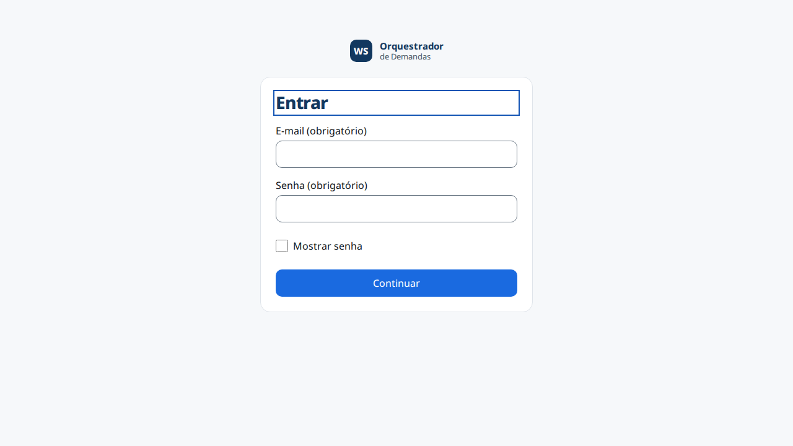
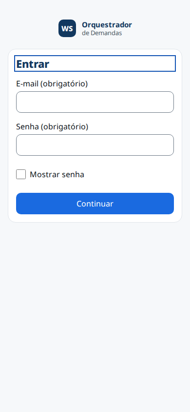
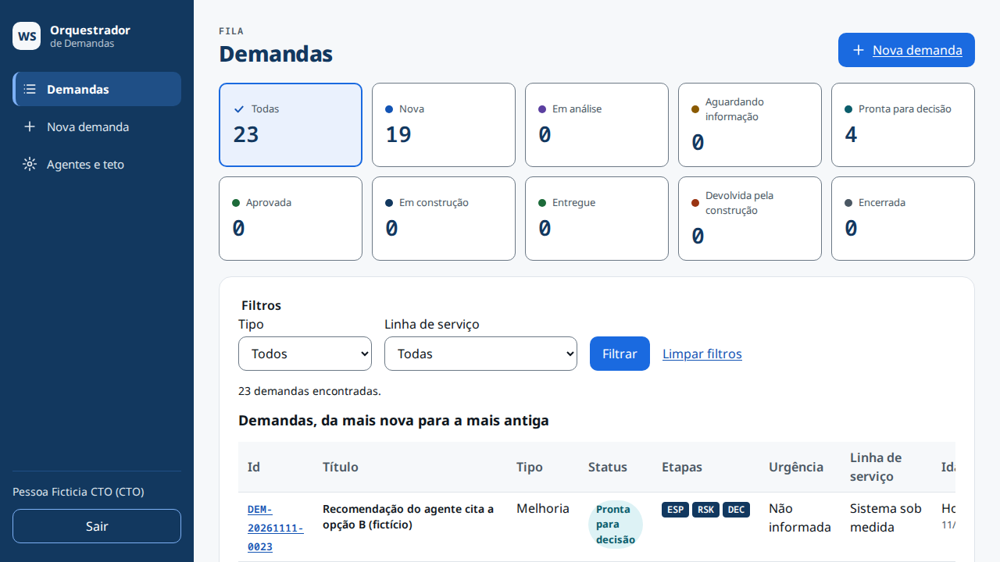
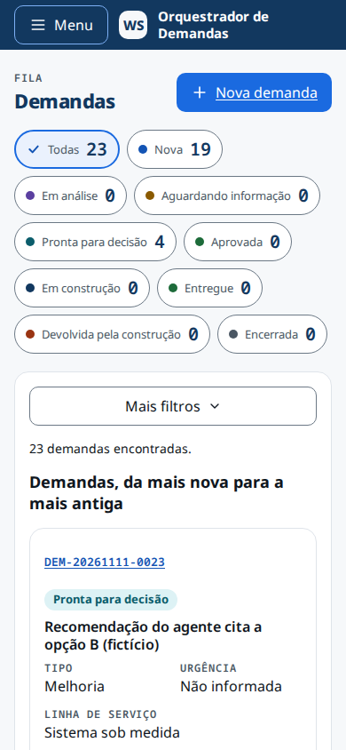
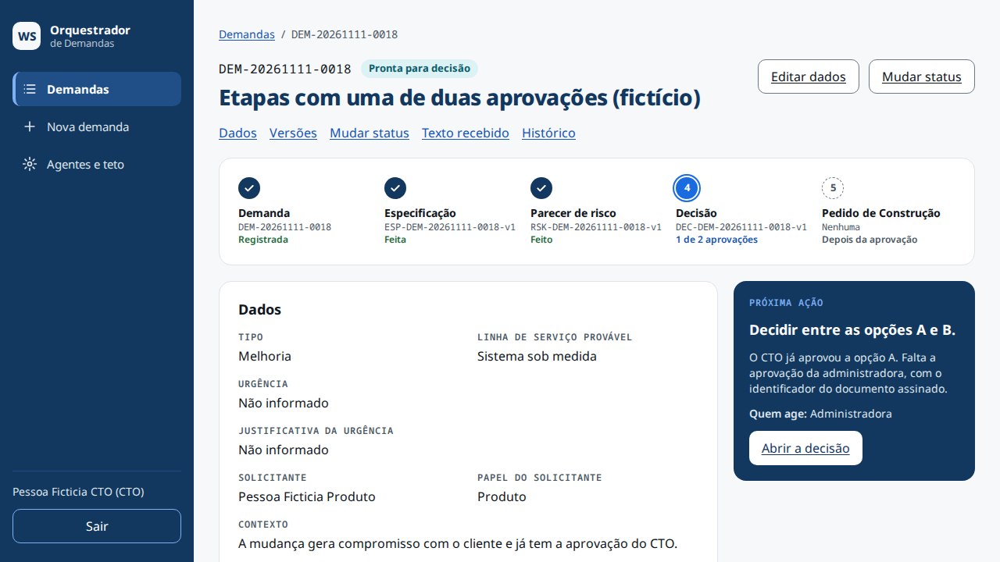
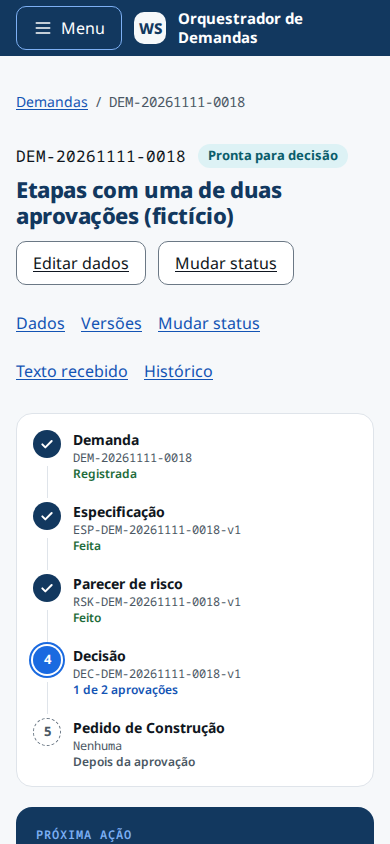
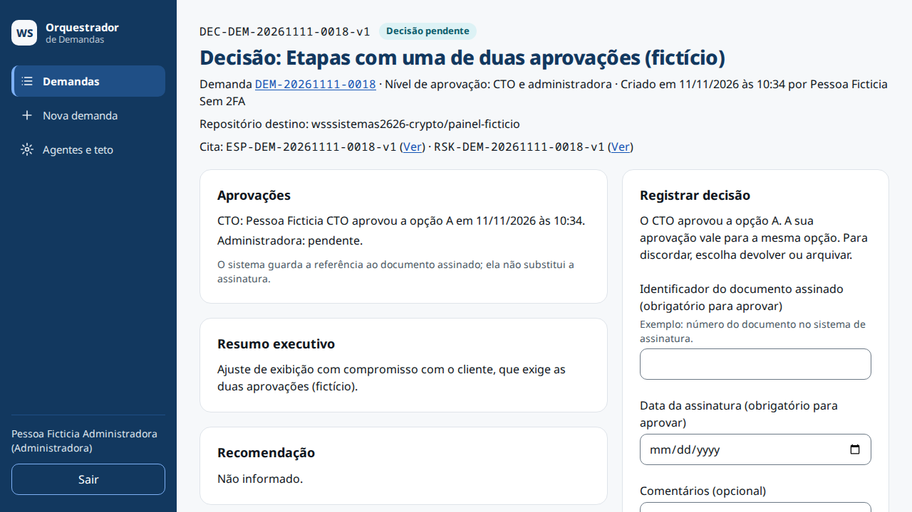
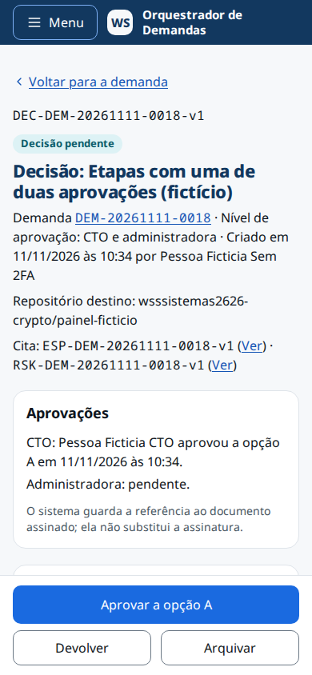
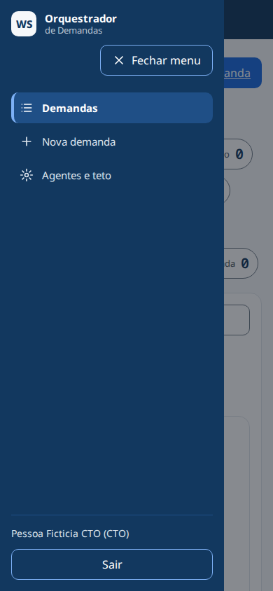

# 08. Painel

| Campo | Valor |
|---|---|
| Atualizado em | 12/11/2026 (0.3.0: origem e filtro "Origem" na T03; origem, selo "Aguardando confirmação", seção "Confirmação do Awave" e linha 14 da Próxima ação na T05; "Recebido pelo /construir em …" e texto novo da seção do pedido na T11; rótulos do histórico); 11/11/2026 (0.2.0: novo visual, com identidade, casca e gaveta, fila com contadores, T05 com barra de etapas e "Próxima ação", T11 por três botões e no celular, telas públicas, o que não mudou, testes nas duas larguras, capturas e pendências novas); 10/11/2026 (0.1.13: selo e aviso do DEC substituído na T11 e na T05, e2e da substituição e textos novos nas pendências); 04/11/2026 (0.1.12: caixa de confirmação da T11, e2e do pedido e textos novos nas pendências); 04/11/2026 (0.1.11: aviso e dica com os limites da troca do nome, nas pendências); 04/11/2026 (0.1.10: dica do nome e aviso de minimização, nas pendências); 03/11/2026 (0.1.6: textos de 409 em status final e tela de erro, nas pendências) |
| Dono | `documentacao-tecnica` (sistema: Fabiano) |
| Cobre | RF-26; RNF-11, RNF-16; RF-01 a RF-17 do pedido `DEC-DEM-20261110-0015-v1` (0.2.0); RF-06, RF-10, RF-11 e RF-15 do pedido `DEC-DEM-20261111-0016-v1` (0.3.0) |
| Fontes no código | `src/app/entrar/`, `src/app/configurar-2fa/`, `src/app/(painel)/`, `src/app/globals.css`, `src/app/fontes.ts`, `src/components/` (inclusive `casca/` e `marca/`), `src/proxy.ts`, `e2e/` |

Todas as telas são em pt-BR, com os textos de `03-ux-ui-design.md` (do pedido 0001 e, desde a 0.2.0, do pedido 0015).
Rótulos de enumeração e de selo vêm só de `src/components/rotulos.ts`. Cada página do painel começa por
`exigirPessoaNaPagina` ([cap. 02](02-acesso-e-seguranca.md#rf-01-login-com-2fa)), e cada Server Action passa pelo
mesmo módulo e pela mesma `autorizar` da API. Texto de cliente e de agente é mostrado só como texto (`react/no-danger`).
As páginas saem com `no-store` e CSP com nonce.

Na 0.2.0 (pedido `DEC-DEM-20261110-0015-v1`), o painel ganhou o visual da proposta A ("Mesa de controle") e, na
decisão no celular, o da proposta C (C2). **Só a camada visual mudou**: rotas, Server Actions, regras, banco e
permissões são os da 0.1.13 ([O que não mudou](#o-que-não-mudou-rf-15)). Os RF citados nas seções abaixo, de RF-01 a
RF-17, são os do pedido 0015, e não os do sistema.

Na 0.3.0 (pedido `DEC-DEM-20261111-0016-v1`), a base visual é a da 0.2.0, sem componente, variação ou token novo. Entram
leituras e textos para as integrações: a origem da demanda na T03 e na T05, a confirmação da demanda do Awave na T05 e
o recebimento pelo `/construir` na T11. A T12 não muda: as integrações não aparecem nela. As capturas de tela
continuam as da 0.2.0 e não mostram essas mudanças ([Capturas de tela](#capturas-de-tela)).

## Telas

| Tela | Rota | O que faz | RF |
|---|---|---|---|
| T01 Entrar | `/entrar` | senha e depois o código do aplicativo ou um código de recuperação; moldura pública desde a 0.2.0 | RF-01 |
| T02 Configurar 2FA | `/configurar-2fa` | QR, chave para digitar, confirmação do código e códigos de recuperação; única tela aberta à sessão sem 2FA, por até 15 min; moldura pública desde a 0.2.0 | RF-01 |
| T03 Fila de demandas | `/demandas` | contadores por status que filtram (desde a 0.2.0); filtros por tipo, origem (desde a 0.3.0) e linha de serviço na URL, aplicados por botão; tabela com etapas, idade e a origem embaixo do título, ou cartões no celular; total encontrado; entradas que aguardam o agente | RF-06 |
| T04 Nova demanda | `/demandas/nova` | colar o texto e preencher os campos, ou mandar ao agente orquestrador quando ligado | RF-03, RF-05, RF-20 |
| T05 Detalhe | `/demandas/[id]` | barra das cinco etapas e cartão "Próxima ação" (desde a 0.2.0); origem nos dados e, na demanda do Awave, o selo "Aguardando confirmação" e a seção "Confirmação do Awave" (desde a 0.3.0); dados, dúvidas, versões de ESP, RSK e DEC (com o selo "Substituído" no DEC aprovado substituído, desde a 0.1.13), mudança manual de status, texto recebido (com a data do expurgo), histórico completo, agente trabalhando | RF-06, RF-07, RF-12, RF-15, RF-21, RF-24 |
| T06 Editar demanda | `/demandas/[id]/editar` | editar os campos | RF-06 |
| T07 Nova ESP | `/demandas/[id]/especificacoes/nova` | começa com a mais nova; destino por conta e sistema | RF-08 |
| T08 Novo RSK | `/demandas/[id]/pareceres-risco/novo` | três níveis, comentários, listas | RF-09 |
| T09 Novo DEC | `/demandas/[id]/pacotes-decisao/novo` | resumo, opções A e B, recomendação, nível de aprovação | RF-10 |
| T10 Ver ESP ou RSK | `/especificacoes/[espId]`, `/pareceres-risco/[rskId]` | somente leitura | RF-11 |
| T11 Decisão | `/pacotes-decisao/[decId]` | revisão do destino, dos níveis e do nível de aprovação; decisão por três botões ("Aprovar a opção X", "Devolver", "Arquivar", desde a 0.2.0) com confirmação em diálogo; arranjo próprio no celular (desde a 0.2.0); aprovar indisponível e explicado quando desatualizado; gerar, baixar e copiar o pedido; "Recebido pelo /construir em …" no cabeçalho (desde a 0.3.0); aviso sobre dado pessoal no pedido; caixa de confirmação sem dado pessoal antes de gerar (desde a 0.1.12, [cap. 05](05-pedido-de-construcao.md#na-t11)); no DEC substituído, o selo, o aviso com o link para o DEC que gera e nenhuma seção do pedido (desde a 0.1.13, [cap. 04](04-versoes-e-decisao.md#substituição-do-dec-aprovado)) | RF-12, RF-13, RF-14, RF-22 |
| T12 Agentes e teto | `/configuracao/agentes` | interruptor e modelo de cada agente, teto, gasto do mês, batimento do worker, último expurgo; as duas contas leem, só a `cto` altera | RF-17, RF-18, RF-19 |
| Sem permissão | `/sem-permissao` | conta sem papel válido; moldura pública desde a 0.2.0 | RF-01 |
| Erro e 404 | `src/app/error.tsx`, 404 da raiz e do painel | "Não foi possível carregar esta página." e "Tentar de novo"; o 404 do painel fica dentro da casca, o da raiz na moldura pública | — |
| E01 E-mail | Resend | aviso de pacote pronto ([cap. 07](07-worker-avisos-retencao.md#rf-25-aviso-por-e-mail)) | RF-25 |

## Identidade visual (RF-01, RF-02)

**Tokens** (`src/app/globals.css`, `@theme`). Cor, família, raio, alturas fixas e foco estão só ali, como variáveis
CSS. O único hexadecimal fora do `globals.css` é o do QR da T02 (`#000000` sobre `#ffffff`, em
`src/app/configurar-2fa/AssistenteDoisFatores.tsx`).

| Grupo | Tokens (`--color-*`) |
|---|---|
| Marca | `marinho` `#12385f` (casca, cartão Próxima ação, `h1`, etapa feita); `marinho-luz` `#1f4f86` (item ativo do menu, só fundo); `acao` `#1a6ae0` (botão primário, contador marcado, etapa atual; nunca como texto sobre marinho); `acao-escura` `#1354b4` (link e foco no fundo claro); `azul-claro` `#7db0f5`; `nevoa` `#eaf1fd` |
| Texto e fundo | `tinta` `#0f1620`; `tinta-media` `#4a5763`; `tinta-suave` `#6b7885` (só borda de campo e marca tracejada); `linha` `#dfe4ea` (só decorativa); `superficie` `#f6f8fa`; `branco`; `texto-claro` `#dfe6ee` e `texto-claro-apoio` `#b9c5d2` (sobre marinho) |
| Estados | `positivo`, `atencao` e `erro`, cada um com o seu `-fundo` |
| Selos | `selo-violeta`, `selo-petroleo`, `selo-verde`, `selo-laranja`, cada um com `-fundo`; `selo-marinho-fundo` e `selo-cinza-fundo` |

- Os nomes de cor da 0.1.13 (`texto`, `primaria`, `borda`, `perigo`…) e a paleta do Tailwind (`bg-blue-50`,
  `text-white`…) não existem mais. `test/estatico/classes-antigas.test.ts` reprova quem os usar.
  `test/estatico/cores-so-por-token.test.ts` reprova hexadecimal fora do `globals.css` e `style={` em `src/`.
- O contraste de cada par de cor usado é conferido por `test/estatico/contraste-tokens.test.ts`: 4,5:1 para texto e
  3:1 para borda de campo, ícone, marca de etapa e foco.
- **Foco:** contorno de 2 px, afastado 2 px, nunca removido. A cor depende do fundo: `acao-escura` no claro e branco
  dentro do marinho (casca, gaveta e cartão Próxima ação, pela classe `superficie-escura`).
- **Raio:** 10 px em botão, campo, item de menu e contador (`--radius-campo`); 16 px em cartão (`--radius-cartao`);
  pílula nos selos. Cartão branco com borda `linha`, sem sombra.
- **Alvo de toque:** 44 × 44 px em todo controle. No celular, vale também para link solto.
- **Movimento:** transição de até 200 ms, como a entrada da gaveta. Com `prefers-reduced-motion`, nada anima.
- **Selos:** sempre com texto. As cores de `COR_STATUS`, `COR_DECISAO` e `COR_NIVEL` (`rotulos.ts`) viram pares de
  fundo e texto no `Selo` (`data-cor`). O selo de rascunho de agente é violeta com borda tracejada.

**Fontes:** Noto Sans no corpo e Noto Sans Mono em ids, números de contador, marcas ESP/RSK/DEC e etiquetas. As duas
saem do próprio app, sem chamada a outro domínio ([cap. 01](01-arquitetura.md#fontes-adr-13)). O corpo e os campos
têm 16 px, e nada fica abaixo de 12 px. O `h1` tem 28 px, peso 800, em `marinho` (22 px no celular).

**Marca** (`src/components/marca/MarcaWs.tsx`): o quadrado "WS" e o nome "Orquestrador de Demandas", em HTML e CSS,
sem arquivo de imagem. Nome acessível: "WS Orquestrador de Demandas". Há variante clara (moldura pública) e escura
(casca), com ou sem link para `/demandas`.

## Casca e gaveta (RF-03, RF-04)

A casca é a moldura de T03 a T12 e do 404 do painel (`src/app/(painel)/layout.tsx`, `src/components/CabecalhoPainel.tsx`
e `src/components/casca/`). A ordem é sempre esta: "Pular para o conteúdo" (primeiro elemento focável), o `header`
da casca, os avisos da moldura (agente suspenso pelo teto e capacidade de ids, com os textos de antes) e o
`main#conteudo`.

**A partir de 768 px**, o `header` é o menu lateral marinho, fixo na altura da janela, com 216 px de largura até
1199 px e 248 px a partir de 1200 px. Ele tem:

- a marca, com link para a fila;
- o `nav "Principal"` com Demandas, Nova demanda e Agentes e teto (`LINKS` e `ehPaginaAtual`, em `casca/navegacao.ts`).
  O item da tela atual tem `aria-current="page"`, fundo `marinho-luz`, barra `azul-claro` e peso 700. "Demandas" fica
  marcado também no detalhe, na edição e nas telas de ESP, RSK e DEC;
- a conta, `<Nome> (<Papel>)`, e "Sair" ("Saindo…" durante a saída).

**Abaixo de 768 px**, o mesmo `header` é uma barra de 56 px no topo, com o botão "Menu" (`aria-expanded`,
`aria-controls="gaveta-menu"`) e a marca compacta. "Menu" abre a gaveta (`casca/GavetaMenu.tsx`):

- é um `<dialog id="gaveta-menu" aria-label="Menu">` aberto com `showModal()`, que deixa a página atrás inerte. Entra
  pela esquerda, com largura `min(320px, 85%)` e véu `tinta` a 50 %;
- abre com o foco em "Fechar menu". Tab e Shift+Tab dão a volta dentro dela (`casca/foco.ts`). A ordem é a marca,
  "Fechar menu", os três itens, a conta e "Sair". Na largura de 320 px, "Fechar menu" desce para a linha de baixo da
  marca, à direita;
- fecham a gaveta: Esc, "Fechar menu", um clique no véu e o item da tela atual, e o foco volta a "Menu". O item de
  outra tela fecha a gaveta e navega, e o foco vai ao `h1` da tela nova. Se a janela passar a 768 px, a gaveta fecha e
  o foco vai ao `main`;
- enquanto está aberta, a página atrás não rola (classe `gaveta-aberta` no `html`);
- o conteúdo só existe com a gaveta aberta. Por isso, o HTML do servidor tem um só `nav "Principal"` e um só
  `aria-current`.

Em toda largura, há um só banner e um só `nav "Principal"` na árvore de acessibilidade. O foco vai ao `h1` só na troca
de tela, e não na primeira carga (`casca/FocoNaTrocaDeTela.tsx`).

**A casca não decide acesso.** Nome e papel chegam por prop do layout do servidor, e quem decide é a página (C-04).
"Sair" (`casca/BotaoSair.tsx`) é a mesma função da 0.1.13: `POST` com `Origin`, nunca link GET.

## Fila, T03 (RF-05 a RF-07)

Arquivos: `src/app/(painel)/demandas/page.tsx`, `ContadoresDaFila.tsx`, `fila.tsx`, `CartoesDaFila.tsx`,
`FiltrosFila.tsx`, `leituras-da-fila.ts` e `src/components/dados-da-fila.ts`. As leituras de banco estão no
[cap. 03](03-demandas.md#rf-06-consultar-e-alterar).

O cabeçalho tem a etiqueta "Fila", o `h1` "Demandas" e o botão "Nova demanda".

**Contadores** (`contadoresDaFila`):

- Ficam num `div role="group" aria-label="Filtrar por status"`, com "Todas" e os nove status na ordem de
  `ROTULO_STATUS`. Cada um tem um ponto com a cor do selo, o rótulo, o número em Mono e o texto oculto " demandas". O
  nome acessível fica, por exemplo, "Nova 3 demandas".
- Cada contador é um botão de envio de um `form` GET para `/demandas` (`name="status"`), com `aria-pressed`. O marcado
  tem borda de 2 px `acao`, fundo `nevoa` e um visto, para não depender só da cor.
- O total respeita os filtros de tipo e de linha da URL e ignora o de status.
- Ativar um contador (clique, Enter ou Espaço) troca o `status` da URL, mantém tipo e linha, volta à primeira página
  (sem `offset`) e põe o foco no título do resultado. Ativar o contador marcado tira o status e marca "Todas".
- O endereço de cada contador é montado no servidor, só do filtro validado e do enum de status. O valor inválido da URL
  não volta para a tela.
- O arranjo tem 5 colunas a partir de 1200 px e 3 de 768 a 1199 px. No celular, os contadores são pílulas de 44 px que
  quebram linha.
- Enquanto carrega, o grupo tem `aria-busy`, os números dão lugar a uma barra e os botões ficam desabilitados.
- Se a contagem falha, os botões ficam sem número e continuam filtrando, com o texto "Não foi possível contar as
  demandas por status. Os filtros por status continuam funcionando.".

**Filtros:** Tipo, Origem (desde a 0.3.0) e Linha de serviço, nessa ordem, com "Filtrar" e "Limpar filtros". Mudar o
seletor não aplica nada sozinho. O seletor de Status saiu, e um campo oculto mantém o status da URL. No celular, os
filtros e os botões ficam no recolhível "Mais filtros" ("Mais filtros (1 ativo)", "Mais filtros (2 ativos)"), que conta
também a origem.

**Origem** (desde a 0.3.0, RF-10 do pedido 0016): o seletor "Origem" (`name="origem"`) tem as opções Todas, Pessoa,
Agente de IA e Awave (`ROTULO_ORIGEM`, `rotulos.ts`). Na URL, `origem` vem depois de `linhaServicoProvavel`; valor fora
da lista mostra `TEXTOS_FILA.filtroInvalido`. "Limpar filtros" tira também a origem. Os contadores levam a origem
oculta, e o total de cada um respeita tipo, linha **e** origem. No título do resultado, a parte "origem <rótulo>" vem
por último (`legendaDaFila`; por exemplo, "Demandas com status Nova e origem Awave, da mais nova para a mais antiga"). A origem sai da autoria,
nunca do solicitante. A fila mostra o selo "Rascunho de agente" na demanda do Awave, mas não o "Aguardando
confirmação", que só aparece na T05.

**Resultado:** o título `h2 id="resultado-da-fila"` (com `tabindex="-1"`) e "N demandas encontradas.", também anunciado
na região de aviso. A tabela e a lista usam o mesmo título, com um id só.

**Tabela, a partir de 768 px**, com as colunas Id, Título, Tipo, Status, Etapas, Urgência, Linha de serviço e Idade:

- o Id é um link em Mono; o Título leva o selo de rascunho quando há e, desde a 0.3.0, uma segunda linha
  "Origem: <rótulo>" (13 px, `tinta-media`), em vez de uma coluna nova;
- Etapas tem três marcas, ESP, RSK e DEC. A marca feita é cheia em marinho, e a por fazer é branca com borda tracejada.
  As marcas são `aria-hidden`, e o leitor de tela lê o texto oculto "Etapas: ESP feita, RSK feita, DEC por fazer"
  (`textoDasEtapas`). Cada uma conta como feita com **qualquer** versão daquele tipo, mesmo um DEC ainda pendente;
- Urgência tem um ponto e o texto;
- Idade diz "Hoje", "1 dia" ou "N dias", em dias de calendário de São Paulo (`idadeDaDemanda`), com `<time dateTime>`
  e "criada em dd/mm/aaaa" embaixo. A coluna "Criada em" da 0.1.13 saiu;
- a tabela tem `caption` só para leitor de tela e `th scope="col"`. Fica numa região rolável com `tabindex="0"`.

**Cartões, abaixo de 768 px** (`CartoesDaFila.tsx`): uma lista `ul`/`li`, com os mesmos dados. No topo ficam o id
(link) e o selo de status; depois, o título num `h3` e uma `dl` com Tipo, Urgência, Origem (desde a 0.3.0), Linha de
serviço, Etapas e Idade. Só
o id é link, o cartão não. Em cada largura, só a tabela ou só a lista está na árvore de acessibilidade. Não há rolagem
lateral em 390 nem em 320 px.

**Estados:** vazio (`TEXTOS_FILA.vazio`), vazio com filtro (com "Limpar filtros"), carregando (esqueleto), erro da
lista (`TEXTOS_FILA.erro` e "Tentar de novo"), erro dos contadores (acima), filtro inválido (`TEXTOS_FILA.filtroInvalido`,
com "Todas" marcado) e sucesso.

## Demanda, T05 (RF-08 a RF-10)

Arquivos: `src/app/(painel)/demandas/[id]/page.tsx`, `BarraDeEtapas.tsx`, `CartaoProximaAcao.tsx`, `Historico.tsx` e
`src/components/dados-das-etapas.ts`.

**Arranjo:** a partir de 1200 px, há duas colunas. A principal (2/3) tem Dados, Confirmação do Awave (só na demanda
do Awave, desde a 0.3.0), Dúvidas, Versões, Status e Texto recebido; a lateral (1/3) tem Próxima ação e Histórico. Abaixo de 1200 px, a tela tem uma coluna só. A ordem no DOM é
a mesma em toda largura: trilha, cabeçalho, "Nesta página", alertas, barra de etapas, **Próxima ação**, Dados,
Dúvidas, Versões, Status, Texto recebido e **Histórico**.

**Cabeçalho:** a trilha (`nav "Trilha"`), o id em Mono, os selos e "Urgência: Alta" quando informada. Depois vêm o `h1`
com o título, "Editar dados" e o botão **"Mudar status"**, que leva o foco ao `h2` Status. Nada saiu da 0.1.13:
selos, dúvidas, versões, botões, "Mudar status", texto recebido e o **histórico completo**, do mais novo para o mais
antigo, sem "Ver histórico completo".

**Barra de etapas** (`etapasDaDemanda`; `ol aria-label="Etapas da demanda"`): as cinco etapas ficam em colunas a
partir de 1200 px e em lista vertical abaixo disso. Cada etapa mostra uma marca por forma, o nome, o id da versão mais
nova ou "Nenhuma", e o estado em texto. A marca é um círculo marinho com visto (feita), um círculo `acao` com o número
e um anel (atual) ou um círculo tracejado (por fazer). O estado é o primeiro da lista que valer:

| Etapa | Estados |
|---|---|
| 1 Demanda | "Registrada" (sempre feita) |
| 2 Especificação | "Por fazer" (sem ESP) · "Com dúvidas em aberto" (a ESP mais nova tem dúvidas) · "Feita" |
| 3 Parecer de risco | "Por fazer" · "Feito" |
| 4 Decisão (DEC mais novo) | "Por fazer" (sem DEC) · pendente: "Pacote desatualizado", "1 de 2 aprovações" ou "Decisão pendente" · "Aprovada, opção X" (feita) · "Devolvida" · "Arquivada" |
| 5 Pedido de Construção | "Gerado" (há `pedido_gerado` do aprovado vigente no histórico) · "Ainda não gerado" (há aprovado vigente) · "Depois da aprovação" |

A etapa atual (`aria-current="step"`) é a primeira, de 2 a 5, que não está feita. Uma demanda em `entregue` ou
`encerrada` não tem etapa atual. A Decisão só conta como feita com o DEC mais novo aprovado. Na fila, basta haver um
DEC para a marca DEC ficar cheia (R-01, nas pendências).

**Próxima ação** (`proximaAcao`; `section` marinho com o `h2` "Próxima ação"): mostra o que falta, o detalhe quando há,
"Quem age: …" e um link. Vale a primeira linha que casar:

| # | Condição | O que falta | Quem age | Link |
|---|---|---|---|---|
| 1 | status `entregue` ou `encerrada` | "Nada. A demanda está em <status>." | Ninguém | — |
| 2 | um agente pendente ou em andamento | "Esperar o <agente> terminar <artefato>." | o agente | — |
| 3 | `aguardando_informacao` | "Responder às dúvidas em aberto e voltar a demanda para Em análise." | Uma pessoa (CTO ou administradora) | "Ver as dúvidas em aberto" (ou "Mudar o status", sem a seção de dúvidas) |
| 4 | sem ESP | "Escrever a especificação técnica." | Agente de insumo técnico ou uma pessoa | "Escrever a especificação" (T07) |
| 5 | sem RSK | "Escrever o parecer de risco." | Agente de risco ou uma pessoa | "Escrever o parecer de risco" (T08) |
| 6 | sem DEC, ou o DEC mais novo devolvido | "Montar o pacote de decisão." | Agente de consolidação ou uma pessoa | "Montar o pacote de decisão" (T09) |
| 7 | DEC mais novo pendente e desatualizado | "Montar um pacote novo. O pacote atual está desatualizado." | Uma pessoa (CTO ou administradora) | "Montar um pacote novo" (T09) |
| 8 | DEC mais novo pendente | "Decidir entre as opções A e B." | CTO; CTO e administradora; ou o papel que falta, com o detalhe "O CTO já aprovou a opção A. Falta a aprovação da administradora, com o identificador do documento assinado." (ou o inverso) | "Abrir a decisão" (T11) |
| 9 | `pronta_para_decisao` com aprovado vigente | "Mudar o status para Aprovada e gerar o Pedido de Construção." | Uma pessoa (CTO ou administradora) | "Abrir a decisão aprovada" (T11 do vigente) |
| 10 | `aprovada` | "Gerar o Pedido de Construção e, quando a construção começar, mudar o status para Em construção." | idem | "Abrir a decisão aprovada" (se houver vigente) |
| 11 | `em_construcao` | "Acompanhar a construção. Quando terminar, mudar o status para Entregue ou Devolvida pela construção." | idem | "Mudar o status" |
| 12 | `devolvida` | "Ler o motivo da devolução no histórico e voltar a demanda para Em construção ou Em análise." | idem | "Mudar o status" |
| 13 | qualquer outro caso | "Acompanhar a demanda." | "Sem responsável definido" | — |
| 14 (desde a 0.3.0; avaliada depois da 2 e antes da 3) | demanda do Awave não confirmada, fora de status final | "Confirmar a demanda aberta pelo Awave.", com o detalhe "Até a confirmação, nenhum agente de IA trabalha nela." | Uma pessoa (CTO ou administradora) | "Ir para a confirmação" |

A linha 14 tem esse número só para não renumerar as linhas da 0.2.0; a ordem de avaliação é a da tabela acima, com ela
entre a 2 e a 3.

- O cartão só informa: não libera, não esconde e não decide nada. `etapasDaDemanda` e `proximaAcao` são funções puras,
  chamadas só pela página (`test/estatico/dados-das-etapas.test.ts`). De `src/modules/` elas só importam tipos.
- O detalhe da linha 8 cita só o papel de quem aprovou, sem nome, documento nem comentário.
- Link só sai com id que casa o formato de hoje. Com id fora do formato, o cartão fica sem link.
- Para a barra e o cartão, a página lê o DEC mais novo por `obterPacoteDecisao`, depois de
  `autorizar(pessoa, 'ler_pacote_decisao')`. O id vem da demanda, nunca da URL.
- Se o DEC ou a ESP lidos não forem os mais novos da demanda, as funções lançam erro, e a T05 mostra a tela de erro. O
  mesmo vale para DEC aprovado sem opção registrada (R-02, nas pendências).

**Demanda do Awave** (desde a 0.3.0, RF-06 e RF-10 do pedido 0016; regra do servidor no
[cap. 03](03-demandas.md#demanda-aberta-pelo-awave-030)):

- **Dados:** "Origem" antes de "Criada por", com o rótulo da autoria (Pessoa, Agente de IA ou Awave). "Criada por" de
  integração diz "Awave". Vale para toda demanda.
- **Selo "Aguardando confirmação"** (âmbar, sem tracejado, `SELO_AGUARDANDO_CONFIRMACAO`) no cabeçalho, só na demanda
  do Awave não confirmada e fora de status final.
- **Seção "Confirmação do Awave"** (`ConfirmarDemanda.tsx`; textos em `TEXTOS_CONFIRMACAO`,
  `src/components/dados-da-confirmacao.ts`), depois de Dados, com o `h2 id="confirmacao"` focável e o item em "Nesta
  página". Só existe na demanda do Awave. O estado sai de `estadoDaConfirmacao`, função pura sobre a origem, o status e
  o histórico que a página já lê:

  | Estado | O que aparece |
  |---|---|
  | Aguardando | "Esta demanda foi aberta pelo Awave e ainda não foi confirmada. Até uma pessoa confirmar, nenhum agente de IA trabalha nela."; "Ao confirmar, a demanda segue o fluxo de qualquer outra: se o agente de insumo técnico estiver ligado, ele recebe o título, a descrição e o contexto e começa a especificação técnica."; "Leia os dados antes. Se a demanda não deve seguir, não confirme: use Mudar status e escolha Encerrada."; e o botão "Confirmar demanda" (44 px, com a consequência ligada por `aria-describedby`) |
  | Enviando | "Confirmando…", botão desabilitado, seção com `aria-busy` |
  | Sucesso | "Demanda confirmada." na região de aviso, foco no `h2` da seção; o selo some |
  | Confirmada | "Confirmada por <pessoa> em <data e hora>." e "Desde a confirmação, a demanda segue o fluxo de qualquer outra." |
  | Status final sem confirmação | "Esta demanda foi aberta pelo Awave e não foi confirmada. Ela está em <status>, um status final: não há confirmação a fazer.", sem botão |
  | Erro (409, 403, rede) | alerta com foco, "Não foi possível concluir: " e a mensagem do servidor |

  Não há diálogo de confirmação (P-01): a consequência está escrita acima do botão. O botão chama a Server Action
  `confirmarDemandaNoPainel`; quem decide se pode é o servidor.
- **Próxima ação:** linha 14 (acima).
- A partir de 1200 px, a coluna principal passa de 5 para 6 linhas na grade. A barra de etapas não muda.

## Decisão, T11 (RF-11, RF-12)

Arquivos: `src/app/(painel)/pacotes-decisao/[decId]/page.tsx`, `FormularioDecisao.tsx`, `RevisaoDoPacote.tsx` e
`src/components/dados-da-decisao.ts`. A regra que vale é a do servidor (`registrarDecisaoNoPainel`, sem mudança), e o
diálogo e as validações são os da 0.1.13 ([cap. 04](04-versoes-e-decisao.md#rf-13-decisão)).

**Um formulário, três botões, em toda largura:**

- "Registrar decisão" é um formulário só, sem `action` nem `method`, com três botões de envio no grupo
  `role="group" aria-label="Ações da decisão"`:
  - o principal diz "Aprovar a opção X", com a opção marcada ou a fixada pela primeira aprovação. Sem opção, diz
    "Aprovar";
  - "Devolver" e "Arquivar" levam a consequência escrita e ligada por `aria-describedby`: "Devolver: a demanda volta
    para Em análise." e "Arquivar: a demanda vai para Encerrada.".
- O botão ativado (`submitter`) define a decisão uma vez só. O mesmo valor vai à validação, ao diálogo e à Server
  Action, e só pode ser `aprovada`, `devolvida` ou `arquivada`.
- Todo envio passa pela validação e pelo diálogo, inclusive o Enter num campo de texto, que aciona o principal. Em
  "Comentários", o Enter não envia. O foco vai ao botão ativado antes do diálogo e volta a ele depois. Durante o envio,
  os três ficam desabilitados, e o ativado diz "Registrando…".
- O diálogo de confirmação não mudou de texto. Ele repete a ação ("Devolver para nova análise." no caso do Devolver),
  o repositório destino e o nível de aprovação.
- **Nenhuma opção vem marcada**, nas duas larguras. Não há selo "Recomendada": a recomendação aparece em texto, antes
  das opções.
- O documento assinado aparece desde o início quando a conta é a da administradora e a aprovação o exige. Os rótulos
  dizem "Identificador do documento assinado (obrigatório para aprovar)" e "Data da assinatura (obrigatório para
  aprovar)", sem `aria-required`. O documento só é validado e enviado na aprovação: "Devolver" e "Arquivar" não o
  levam.
- A caixa "Revisei os rascunhos de agente citados neste pacote (obrigatório)", quando o pacote cita rascunho, tem
  `aria-required` e vale para as três ações.
- Nenhum campo digitado tem `name`, então nada vai para a URL.
- **Pacote desatualizado:** o principal diz "Aprovar", fica `aria-disabled` (continua focável) e mostra
  "Indisponível: pacote desatualizado.". Ativá-lo, mesmo por Enter, não valida, não abre o diálogo e não envia nada. As
  opções e o documento não aparecem, e a revisão e os comentários continuam. O servidor segue respondendo 409.

**Cabeçalho**, em toda largura: o id em Mono, os selos, o `h1` "Decisão: <título>", a linha com a demanda, o nível de
aprovação e a criação, a linha nova **"Repositório destino: <valor>"** e as citações. Depois vêm os alertas de antes
(desatualizado, substituído, rascunho).

Desde a 0.3.0 (RF-15 do pedido 0016), depois de "Repositório destino", a linha **"Recebido pelo /construir em <data e
hora>."**, com um visto decorativo e `<time>`, quando o DEC tem `pedido_recebido`. Ela aparece em toda situação do DEC
(substituído, desatualizado, demanda em status final) e não é focável. Sem recebimento, a linha não existe. O texto da
seção "Pedido de Construção" também mudou: ele cita a busca automática e a cópia manual
([cap. 05](05-pedido-de-construcao.md#na-t11)).

**A partir de 1200 px:** à esquerda (3/5) ficam Aprovações, Resumo executivo, Recomendação, Opções e "Revisão antes de
decidir"; à direita (2/5), o cartão "Registrar decisão", que não é fixo. Depois de aprovado, a seção do Pedido de
Construção ocupa a linha toda. **De 768 a 1199 px**, a tela tem uma coluna, sem rodapé fixo. A ordem do DOM é a mesma
em toda largura, com a revisão antes do formulário.

**Abaixo de 768 px (C2):**

- No topo, "‹ Voltar para a demanda" (só no celular), o id, os selos, o `h1` de 22 px, o nível, o repositório destino,
  as citações e os alertas.
- Depois vêm Aprovações, Resumo executivo, Recomendação e a parte da revisão que fica **sempre à vista**: sistema alvo e
  repositório destino da ESP, os três níveis do RSK, o nível de aprovação, os selos de rascunho e todos os alertas.
- O recolhível "Ver vantagens, desvantagens e a revisão do pacote" (`Recolhivel`, com `aria-expanded`) guarda só os
  critérios de aceite, a definição de pronto e o detalhe das opções.
- Em "Registrar decisão" ficam a frase da opção fixada, ou as opções como cartões grandes, o documento, a revisão, os
  comentários e as consequências.
- Os três botões ficam num **rodapé fixo**, branco e com borda em cima: o principal com 48 px na largura toda, e
  "Devolver" e "Arquivar" lado a lado com 44 px. O rodapé tem 124 px (150 px com a explicação de indisponível) e
  respeita a área segura. O `main` ganha folga e `scroll-padding-bottom` do mesmo tamanho, para nada focado ficar sob
  o rodapé.
- O rodapé só existe quando há formulário. Com o DEC já decidido, ou sem formulário para a conta, não há rodapé.
- No diálogo, os botões ficam empilhados na largura toda.

Ficam sem uso na T11, mas ainda em `dados-da-decisao.ts`, os textos do rádio "Decisão" (`legendaDecisao`, `aprovar`,
`devolver`) e do botão "Registrar decisão" (`registrar`). O `h2` "Registrar decisão" continua.

## Telas públicas e demais telas (RF-13, RF-14)

**Moldura pública** (`src/components/casca/MolduraPublica.tsx`): vale para T01, T02, Sem permissão, a tela de erro e
o 404 da raiz.

- Fundo `superficie`, conteúdo centralizado com até 440 px e a marca clara acima do cartão, sem menu.
- Em T01 e T02, a marca não tem link, para não criar outro caminho depois do login. Nas outras, ela leva a `/demandas`.
- Dentro do cartão, os campos, os textos e o fluxo são os da 0.1.13. Os e2e `entrar.spec.ts`, `configurar-2fa.spec.ts`
  e `autenticacao-qa.spec.ts` não mudaram.
- O QR da T02 é `#000000` sobre `#ffffff`, com margem branca de 16 px.

**Demais telas** (T04, T06 a T10 e T12): cada `fieldset` ou `section` virou um cartão, e o formulário tem até 760 px.
O interruptor da T12 tem o trilho `acao` ligado e `tinta-suave` desligado. Nenhum campo, ordem, texto de regra,
validação ou condição mudou.

## O que não mudou (RF-15)

Comparado com a 0.1.13 (`198e97d`), o `git diff` sai vazio em:

- `src/proxy.ts` e `src/proxy.test.ts`, `next.config.ts` (CSP e cabeçalhos);
- `src/app/api/`, `src/db/`, `drizzle/`, `src/modules/acesso/`, `src/worker/`, `src/jobs/`, `src/agents/`,
  `src/lib/auth*`, `src/lib/qr.ts`, `src/lib/log.ts`, `src/lib/erros.ts`, `src/instrumentation.ts` e
  `pnpm-workspace.yaml`;
- os nove arquivos `'use server'` do painel (`acoes.ts` de `configuracao/agentes`, `demandas/[id]`,
  `demandas/[id]/editar`, `especificacoes/nova`, `pacotes-decisao/novo`, `pareceres-risco/novo`, `demandas/nova` e
  `pacotes-decisao/[decId]`, e `acoes-pedido.ts`).

Há uma exceção registrada: o teste `src/app/api/saude/route-qa.test.ts`, com 5 linhas a mais e nenhuma removida
(`06-T17-tech-lead.md`, 2.1). A rota não mudou. Em `src/modules/`, só entrou `demandas/resumo-da-fila.ts` com o teste
dele, só de leitura.

## Acessibilidade (RNF-11)

Cada tela tem verificação do axe sem violação no Playwright (`wcag2a`, `wcag2aa`, `wcag21a`, `wcag21aa`, `wcag22aa`),
em mais de um estado. Foco, teclado e anúncios que o axe não pega foram conferidos pelo `qa-funcional` na etapa 07.

A verificação fica em `semViolacoes` (`e2e/apoio.ts`) e exige zero violação. Antes do axe, ela espera a página ter
`<title>` não vazio, por até 5 s. Depois de uma Server Action, o Next 16 re-renderiza a página, e o título chega por
streaming depois do corpo. Se o título não chegar, o axe roda assim mesmo e reprova pela regra `document-title`.
Nenhuma regra é desligada nem filtrada. O `e2e/sem-violacoes.spec.ts` confere os dois casos: título atrasado passa,
tela sem título reprova. Na decisão (T11), o axe roda também na tela arquivada, depois do alerta "Pacote arquivado. A
demanda foi para Encerrada." (`e2e/decisao.spec.ts`, teste "Arquivar"). O `test/estatico/decisao-e2e.test.ts`, que roda
no `pnpm test`, reprova se algum `e2e/**/*.ts` usar `disableRules`, `disableOtherRules`, `exclude`, `include`,
`withRules` ou `options` do axe, ou se outro arquivo além de `e2e/apoio.ts` montar o `AxeBuilder`.

Desde a 0.1.12, o `e2e/pedido-construcao.spec.ts` marca a caixa de confirmação antes de gerar e manda
`{ "confirmaSemDadoPessoal": true }` em todo `POST` que deve passar ou que prova outra recusa. Na seção do pedido da
T11, o axe roda antes de marcar, com o erro da caixa, com a caixa marcada, depois de gerar, no 422 de e-mail, no 422 de
e-mail e nome e na demanda de Estudo. O teste "CA-26.3" confere a caixa (nome acessível, `aria-required`, desmarcada,
botão habilitado), que o clique com ela desmarcada não faz `POST` à página, o erro e o foco na caixa, o Espaço, o
`aprovadoPor` `cto`, o 422 sem a confirmação pela API e o histórico com a confirmação, pela API e na T05.

Desde a 0.1.13, o axe roda também na T11 do DEC substituído e na T05 com um DEC substituído (`e2e/decisao.spec.ts`,
teste "substituição: …"), e, no caminho completo da substituição (`e2e/pedido-construcao.spec.ts`, teste "0.1.13,
caminho completo: …", na demanda `TITULOS_DO_E2E.substituicao` do seed), na recusa por nome, na aba velha do v1 com o
409 do substituído e na T11 do v1 substituído. As corridas da substituição (C-13) ficam nos testes de unidade e de
integração (`substituicao.test.ts`, `gerar-substituido.test.ts`), porque o e2e roda com `workers: 1`.

**Desde a 0.2.0** (RF-16 do pedido 0015):

- **Duas larguras.** `e2e/axe-todas.spec.ts` roda o axe de T01 a T12 em 1280 × 720 e em 390 × 844, no mesmo estado da
  página. Na fila, roda também com "Mais filtros" aberto e com a gaveta aberta. Não há projeto novo do Playwright: a
  largura é definida por teste.
- **Vigia de origem e de CSP em todo e2e.** A fixture automática de `e2e/apoio.ts` (`e2e/vigia.ts`) reprova o teste
  quando acontece uma destas coisas: requisição a outra origem, evento `securitypolicyviolation` ou mensagem de CSP no
  console. Ela nunca usa `bypassCSP`. O `e2e/vigia.spec.ts` prova, com `test.fail()`, que a fixture reprova.
- **Fontes da mesma origem** (`e2e/fontes.spec.ts`, `e2e/fontes-qa.spec.ts`): nas telas conferidas, a família está em
  `document.fonts` com `status` `loaded`, servida de `/_next/static/media/*.woff2` como `font/woff2`.
- **e2e novos:**
  - `casca.spec.ts` e `casca-qa.spec.ts`: menu, gaveta, foco e "Sair" pela casca e pela gaveta, com o cookie antigo
    recebendo 401;
  - `fila-contadores.spec.ts`: contadores contra os totais da API, URL e foco;
  - `detalhe-a2.spec.ts`: barra de etapas, Próxima ação e "Nesta página";
  - `decisao-botoes.spec.ts` e `decisao-botoes-qa.spec.ts`: o que se vê no diálogo é o que se grava, com a opção B,
    "Devolver" e o Enter, e o "Aprovar" indisponível sem nenhum `POST`;
  - `decisao-celular.spec.ts` e `decisao-celular-qa.spec.ts`: a aprovação em 390 px, o foco fora do rodapé e as
    exigências visíveis;
  - `moldura-publica.spec.ts`, `reflow.spec.ts` (320 e 390 px), `alvo-de-toque.spec.ts` (44 px);
  - `capturas.spec.ts`, descrito abaixo.
- **Testes de antes** mudaram só seletor, texto ou passo equivalente. O `test/estatico/piso-de-assercoes.test.ts` (e o
  `-qa`) fixa o mínimo de linhas com `expect(` por arquivo de segurança, contado na 0.1.13. O `vigia.test.ts` reprova a
  configuração que suba `retries` ou desligue a CSP.
- **Dados:** os e2e novos usam as demandas fictícias de `TITULOS_DO_E2E` (`scripts/seed-ficticio.ts`), como
  `etapasDupla` ("Etapas com uma de duas aprovações (fictício)"), `decisaoOpcaoB`, `decisaoCelularDupla` e
  `textoDeTerceiro`. O seed tem 23 demandas.

## Capturas de tela

As nove capturas ficam em `docs/manual-tecnico/capturas/`, com tela e largura no nome. Todas usam só o seed fictício,
com contas "Pessoa Ficticia …", títulos com "(fictício)" e o repositório fictício `painel-ficticio`.

Quem grava é o `e2e/capturas.spec.ts`, com as regras em `e2e/capturas.ts`:

- só grava com o servidor em `127.0.0.1` ou `localhost` e sem a variável `CI`, com qualquer valor (`podeCapturar`). No
  CI e na homologação do `/construir`, os nove testes são pulados;
- pula a captura que já existe (`deveGravar`). Para regravar uma tela, apague o PNG dela e rode `pnpm test:e2e` contra
  o servidor local. Outra forma é pôr o nome em `REGRAVAR` só durante a correção: o teste estático
  (`test/estatico/capturas.test.ts`) exige a lista vazia no commit;
- grava só a janela, do topo, depois de as fontes carregarem e sem animação;
- não visita a T02 (QR, chave e códigos de recuperação) nem usa as contas sem 2FA. Também não grava nada: a T05 e a
  T11 usam a demanda `etapasDupla` do seed, e a T11 abre na conta da administradora, que ainda não aprovou.

Captura com dado real que chegue a um commit é incidente, porque o git não tem expurgo. Nesse caso, pare e avise
Fabiano e a `seguranca-informacao`.

Duas observações valem para mais de uma captura:

- **Contorno no título "Entrar"** (T01, nas duas larguras): é o contorno de foco. A T01 abre com o foco no `h1`
  (o efeito de foco de `FormularioEntrar.tsx`), para o leitor de tela anunciar a tela. Com os tokens da 0.2.0, esse
  foco aparece como um contorno de 2 px em `acao-escura`. Não é defeito de layout.
- **"Criado em … por Pessoa Ficticia Sem 2FA"** (T11): o seed grava a ESP, o RSK e o DEC da `etapasDupla` com a conta
  fictícia `sem2fa` (papel `cto`). Só a aprovação do CTO é da conta `cto`. É só o seed: no painel, uma conta sem 2FA
  não grava nada.

| Captura | Tela, largura e estado |
|---|---|
| `t01-entrar-1280.png` | T01 em 1280 × 720, vazia, com o foco no `h1` |
| `t01-entrar-390.png` | T01 em 390 × 844, vazia, com o foco no `h1` |
| `t03-fila-1280.png` | T03 em 1280 × 720, conta `cto`, sem filtro: menu lateral, contadores com "Todas" marcado, tabela |
| `t03-fila-390.png` | T03 em 390 × 844, conta `cto`: barra com "Menu", contadores em pílulas, "Mais filtros", cartões |
| `t05-demanda-1280.png` | T05 da `etapasDupla` em 1280 × 720, conta `cto`: barra com a Decisão em "1 de 2 aprovações" e Próxima ação com "Quem age: Administradora" |
| `t05-demanda-390.png` | T05 da `etapasDupla` em 390 × 844, conta `cto`: barra vertical e "Nesta página" |
| `t11-decisao-1280.png` | T11 do DEC v1 da `etapasDupla` em 1280 × 720, conta `administradora`: repositório destino no cabeçalho, frase da opção fixada e documento "(obrigatório para aprovar)" |
| `t11-decisao-390.png` | A mesma T11 em 390 × 844: "Voltar para a demanda" e o rodapé fixo com "Aprovar a opção A", "Devolver" e "Arquivar" |
| `gaveta-aberta-390.png` | Gaveta aberta sobre a T03 em 390 × 844, conta `cto` |

*T01 em 1280 px. O contorno azul em volta de "Entrar" é o foco com que a tela abre, e não erro de layout.*

*T01 em 390 px. Vale a mesma observação do contorno de foco no título.*

*T03 em 1280 px. A coluna "Idade" aparece cortada na borda direita e só aparece rolando a tabela (QF-0015-01), e o
total fica acima do título do resultado (QF-0015-02). Os dois estão nas pendências.*

*T03 em 390 px, com a lista de cartões.*

*T05 em 1280 px. A etapa 4 é a atual ("1 de 2 aprovações"), e a Próxima ação diz que falta a aprovação da
administradora.*

*T05 em 390 px, com a barra de etapas em lista vertical.*

*T11 em 1280 px, na conta da administradora. O campo "Data da assinatura" mostra "mm/dd/yyyy" porque o Chromium dos
testes exibe o formato americano no campo nativo de data (QF-0015-03). No Chrome em pt-BR, o mesmo campo mostra
"dd/mm/aaaa". O campo é o da 0.1.13 e o valor enviado é o mesmo; digite a data no formato que o seu navegador mostrar.*

*T11 em 390 px (C2), com o rodapé fixo das ações.*

*Gaveta aberta em 390 px. "Fechar menu" fica na linha de baixo da marca, à direita.*

## Pendências de interface conhecidas

Da 0.2.0 (pedido 0015):

- **QF-0015-01:** em 1280 px, a coluna "Idade" da fila fica cortada e só aparece rolando a tabela. O id e o selo
  "Pronta para decisão" quebram em três linhas (`fila.tsx`, `Tabela.tsx`). Vai para a `ux-ui-design` decidir o ajuste
  e para Fabiano decidir se publica assim. Nenhum teste confere a tabela sem rolagem em 1280 px.
- **QF-0015-02:** "N demandas encontradas." aparece acima do `h2` do resultado, e não ao lado. Vai para a
  `ux-ui-design`.
- **QF-0015-03:** a captura da T11 mostra a data em "mm/dd/yyyy". O `playwright.config.ts` já usa `locale: 'pt-BR'` e
  `timezoneId: 'America/Sao_Paulo'`, e mesmo assim o campo nativo de data do Chromium dos testes fica no formato
  americano. Para regravar a captura em "dd/mm/aaaa", a `qa-automacao` precisa de outro ajuste no navegador dos
  testes.
- **R-01 da revisão:** "DEC feita" na fila (qualquer versão) e "Decisão" feita na T05 (só aprovada) têm sentidos
  diferentes. Segue o RF-06 aprovado. A proposta é trocar o texto ou a regra, por decisão de Fabiano.
- **R-02 da revisão:** dado inconsistente (DEC aprovado sem opção) derruba a T05 inteira, e não só a barra e a Próxima
  ação (`dados-das-etapas.ts:62`).
- **R-03 da revisão:** com o gesto de voltar do celular, a gaveta fica aberta e a página não rola
  (`GavetaMenu.tsx:112`).
- **Sem JavaScript:** os contadores não filtram (EX-06 da `07-qa-funcional.md`), e o formulário deles perde o `limit`
  (R-06, `ContadoresDaFila.tsx:93`). A decisão está com o `tech-lead`.
- **R-05:** o Enter num campo da T11 envia pelo "Aprovar", passando pela validação e pelo diálogo, que abre com o foco
  no cabeçalho. É o desenho da 03. Reavaliar se o principal deve ser o botão padrão.
- **P-01, para Fabiano:** opção recomendada marcada ou com selo "Recomendada" na T11. Hoje nenhuma vem marcada. Mudar
  pede campo novo no DEC.
- **Safari do iOS:** o teclado virtual sobre o rodapé fixo, a área segura, o `<dialog>` e o `:has()` só se conferem na
  UAT, porque os e2e rodam só no Chromium (`07-qa-funcional.md`, seção 7).
- **Marca:** o bloco "WS" ainda precisa ser conferido pelo `marketing-comunicacao` contra o manual de marca. Se for
  vetado, a troca é só no `MarcaWs`.

De antes da 0.2.0, sem mudança:

- Textos para a `ux-ui-design`: QF-01 a QF-04 e D-01 a D-06 do `07-qa-funcional.md` (por exemplo, o bloqueio de
  15 minutos anunciado como "Aguarde um minuto"), e as mensagens de 409 da decisão e do pedido desatualizado.
- Desde a 0.1.6 (B-4): os dois textos de 409 de demanda em status final, que a T11 mostra depois de "Não foi possível
  concluir: " ([cap. 04](04-versoes-e-decisao.md#rf-13-decisão) e [cap. 05](05-pedido-de-construcao.md#rf-22-gerar-o-pedido)),
  foram escritos na triagem e esperam a revisão da `ux-ui-design`. A T11 não esconde as ações de decisão nem a seção do
  pedido quando a demanda está em status final; esconder é decisão da `ux-ui-design`.
- Desde a 0.1.10 (M-1 da revisão do 0009), a dica do campo "Nome do solicitante" (T04 e T06) e o aviso de minimização
  do modo agente (T04) têm texto novo (`dicaNome` e `avisoMinimizacao` em `src/components/dados-da-demanda.ts`;
  [cap. 06](06-agentes-de-ia.md#rf-20-minimização)). Desde a 0.1.11 (B-4 da revisão do 0011), o aviso diz "cada
  parte com 3 letras ou mais, fora partículas como dos, das e Júnior, quando escrita com inicial maiúscula", e a dica
  diz que o sistema não troca "a parte do nome escrita toda em minúscula". Os textos foram escritos na triagem, e o
  exemplo de partícula foi ajustado na revisão de segurança ("da" tem 2 letras e já fica de fora pelo mínimo). Esperam
  a revisão da `ux-ui-design`. Nenhum e2e fixa essas frases; elas são conferidas em `dados-da-demanda.test.ts` e
  `formularios.test.ts`.
- Desde a 0.1.12 (D1 e D3 do 0013), a T11 tem textos novos na seção do pedido: o aviso de C-28, o rótulo da caixa de
  confirmação, o erro da caixa ("Marque a confirmação para gerar o pedido.") e as linhas da orientação do 422
  (`TEXTOS_PEDIDO` e `orientacaoDoPedido` em `src/components/dados-do-pedido.ts`;
  [cap. 05](05-pedido-de-construcao.md#corrigir-uma-recusa)). Foram escritos na triagem e esperam a revisão da
  `ux-ui-design`. A linha "Título e descrição …: corrija na demanda, em "Editar dados"." não diz que a edição só vale
  para um DEC novo; desde a 0.1.13, a linha 6 diz que o pacote novo, aprovado, substitui este.
- Desde a 0.1.13 (pedido 0014), textos novos escritos na triagem e na correção, que esperam a revisão da
  `ux-ui-design`: o selo "Substituído" (`SELO_SUBSTITUIDO`, `rotulos.ts`), o aviso e o link da T11 do DEC substituído
  (`TEXTOS_DECISAO.substituido` e `abrirSubstituto`, `dados-da-decisao.ts`), a linha 6 da orientação
  (`dados-do-pedido.ts`), a mensagem do 409 do substituído no gerar (`MENSAGENS_PEDIDO.substituido`), a frase do
  histórico e o 409 do S-01 (`MENSAGENS_DECISAO.nivelMenorQueOVigente`). Ficam em aberto três avisos que a T11 não
  mostra: na T11 de um DEC pendente, que aprová-lo substitui o aprovado vigente; na T11 do vigente, que há um DEC mais
  novo pendente; e, na T11 de um DEC `cto` com o vigente de dupla aprovação, que a aprovação será recusada (hoje a
  recusa só aparece depois do envio).
- Falha ao carregar uma tela mostra "Não foi possível carregar esta página." e "Tentar de novo" (`src/app/error.tsx`),
  sem mensagem, pilha nem `digest`. O registro do erro é o `erro_requisicao` do servidor
  ([cap. 02](02-acesso-e-seguranca.md#log-e-sentry-rnf-10-c-20-c-21)).
- Leitura do QR da T02 com o Google Authenticator e o Microsoft Authenticator (cenário U-01 do UAT) ainda não foi feita
  com aparelho real. O QR é gerado por `src/lib/qr.ts`.
